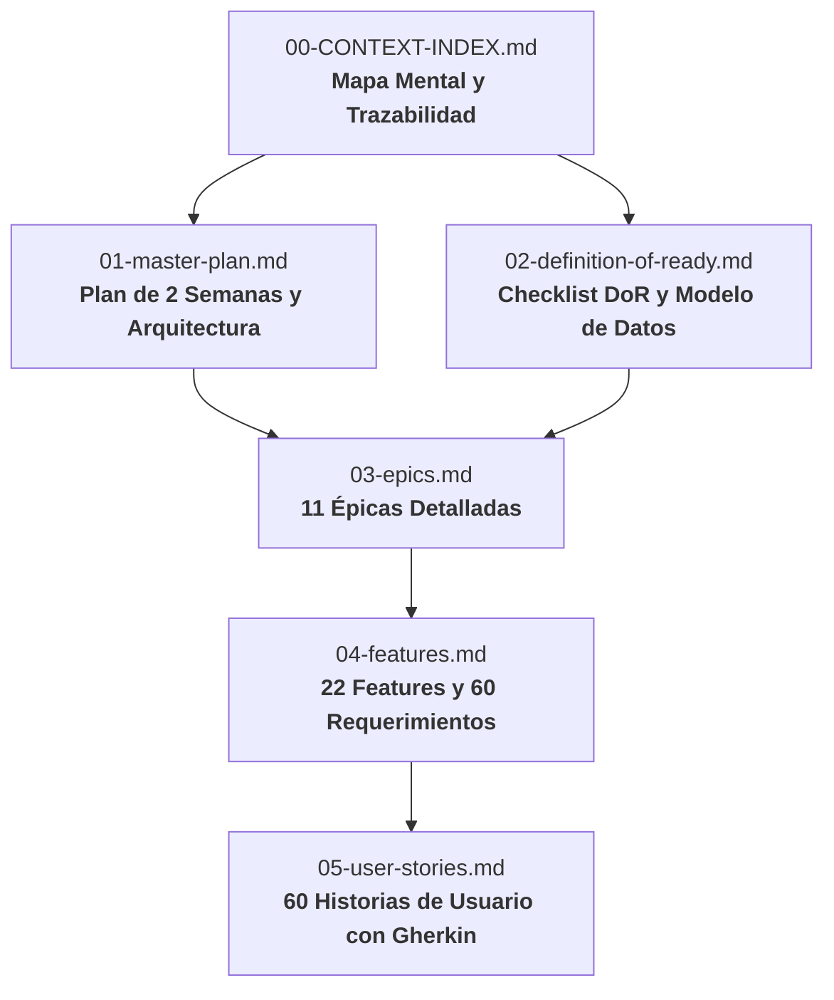
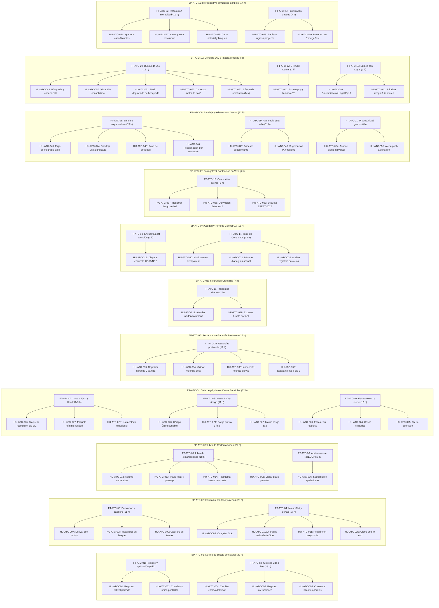

# 00 · MAPA DE NAVEGACIÓN Y CONTEXTO MAESTRO SCRUM
## Plataforma de Atención al Cliente «Aybar Atiende» · AYBARCORP SAC

---

## 1. RESUMEN EJECUTIVO DEL PROYECTO (1 PÁRRAFO)

La plataforma **«Aybar Atiende»** es la solución omnicanal y transversal de Atención al Cliente de **AYBARCORP SAC** diseñada para centralizar, tipificar y gestionar en una sola fuente de verdad todas las solicitudes, reclamos de garantía, trámites del Libro de Reclamaciones (Ley 29571) y controversias de 11 razones sociales inmobiliarias provenientes de canales telefónicos (CTI/Call Center), WhatsApp y correo electrónico, eliminando registros paralelos en hojas de cálculo y garantizando trazabilidad absoluta mediante números correlativos únicos por RUC, control paramétrico de Acuerdos de Nivel de Servicio (SLA) con alertas no redundantes, contención de riesgos legales e indemnizaciones en la Mesa de Casos Sensibles (Gate Legal Eje 3), gestión de resoluciones por morosidad y soporte en vivo para eventos masivos (EntregaFest); todo soportado sobre una arquitectura de monolito modular en Node.js 20/NestJS con TypeScript, frontend en React, almacenamiento inmutable con Object Lock en AWS S3, base de datos transaccional PostgreSQL Multi-AZ con bitácoras selladas criptográficamente vía HMAC-SHA256, y cumplimiento riguroso de la Ley 29733 de Protección de Datos Personales.

---

## 2. GUÍA DE OPERACIÓN PARA AGENTES DE CODIFICACIÓN IA

Como agente de codificación de IA (Claude Code, GPT Codex, OpenCode, etc.), debes operar bajo las siguientes reglas mandatorias antes de generar, refactorizar o evaluar cualquier componente de código:

### Protocolo 1: Verificación DoR Previa al Código (Pre-Code Gate)
1. **Nunca inicies la implementación de una Historia de Usuario (`[US-XX]`)** sin consultar antes `02-definition-of-ready.md`.
2. Verifica que los contratos de interfaz de las dependencias (`DEP-XX`) asociadas a la historia estén definidos o simulados mediante adaptadores Mock (`contract-first`).
3. Si una funcionalidad figura como `NO LISTO` (ej. `[FEAT-11]` UrbeMind), no generes código de producción hasta que se levante la condición de bloqueo.

### Protocolo 2: Trazabilidad Bidireccional Estricta
- Cada commit, archivo de código fuente, suite de pruebas automatizadas y documentación debe referenciar explícitamente la tríada de identificadores:
  `[EPIC-XX]` -> `[FEAT-XX]` -> `[US-XX]` (ejemplo: `EP-ATC-01` -> `FT-ATC-01` -> `HU-ATC-001` / `RF-SVC-001`).

### Protocolo 3: Terminología de Negocio Obligatoria (RNF-USA-003)
- Queda terminantemente prohibido utilizar el término «agente» o «operador» para referirse al usuario del sistema en interfaces, variables o comentarios de código. Debe usarse siempre **`Gestor de tickets`** (o `TicketManager` en código).

### Protocolo 4: Privacidad y Cumplimiento Normativo (Ley 29733)
- **Cero PII en logs y notas internas:** Nunca persistas DNI, nombres de clientes ni datos sensibles en campos de notas libres (`Notes_*`) o bitácoras de auditoría (`RNF-SEC-008`).
- **Anonimización en prompts de IA:** Cualquier llamada al proveedor de IA debe pasar por el servicio de sanitización y anonimización de datos (`RNF-SEC-009`).
- **Asistencia, no decisión:** Los modelos de IA únicamente sugieren soluciones o respuestas; la decisión y el cierre formal son potestad exclusiva del gestor humano (`RN-SVC-032`).

### Protocolo 5: Definición de Terminado (DoD)
- Código generado por IA requiere:
  1. Pruebas unitarias y de integración que cubran el 100 % de los criterios de aceptación Gherkin (`Dado / Cuando / Entonces`).
  2. Inmutabilidad y cálculo de hash `IntegrityHash` (HMAC-SHA256) en bitácoras (`STATUS_LOG`, `ASSIGNMENT_LOG`).
  3. Revisión de pares y análisis SAST sin vulnerabilidades antes de integrar en `develop`.

---

## 3. MAPA DE ESTRUCTURA DOCUMENTAL

---

## 4. ÁRBOL MAESTRO DE TRAZABILIDAD (EPIC -> FEAT -> US)

El proyecto consta de **11 Épicas**, **22 Funcionalidades** y **60 Historias de Usuario** cubriendo **60 Requerimientos Funcionales (RF)**, **25 Requerimientos No Funcionales (RNF)** y **42 Reglas de Negocio (RN)** distribuidas en 4 desarrolladores en un horizonte de 10 días hábiles (227 horas estimadas con IA).

---

## 5. MATRIZ DE ASIGNACIÓN, HORAS Y CALENDARIO

| Desarrollador | Épicas Asignadas | Funcionalidades | Horas Asignadas | Capacidad | Carga | Holgura |
| :--- | :--- | :--- | :---: | :---: | :---: | :---: |
| **Dev 1** | `[EPIC-01]`, `[EPIC-03]`, `[EPIC-05]` | `FT-01`, `FT-02`, `FT-05`, `FT-06`, `FT-10` | 55 h | 60 h | 92 % | 5 h |
| **Dev 2** | `[EPIC-02]`, `[EPIC-04]` | `FT-03`, `FT-04`, `FT-07`, `FT-08`, `FT-09` | 60 h | 60 h | 100 % | 0 h |
| **Dev 3** | `[EPIC-09]`, `[EPIC-07]`, `[EPIC-08]` | `FT-18`, `FT-19`, `FT-21`, `FT-13`, `FT-14`, `FT-15` | 54 h | 60 h | 90 % | 6 h |
| **Dev 4** | `[EPIC-10]`, `[EPIC-11]`, `[EPIC-06]` | `FT-20`, `FT-17`, `FT-16`, `FT-22`, `FT-23`, `FT-11` | 58 h | 60 h | 97 % | 2 h |
| **TOTAL** | **11 Épicas** | **22 Funcionalidades** | **227 h** | **240 h** | **95 %** | **13 h** |

---

## 6. HITOS CLAVE DEL HORIZONTE DE 10 DÍAS

- **Kick-off y Base Técnica:** Lunes 19-oct-2026 (Modelado de datos en base, contratos de interfaz y simuladores).
- **Demo Iteración 1:** Viernes 23-oct-2026 (Presentación de `EP-01`, `EP-02`, `EP-09`, `EP-10`).
- **Control de Alcance:** Martes 27-oct-2026 (Decisión de descarte de flexible: `HU-ATC-053`, `HU-ATC-011`, `HU-ATC-037..039` si hay retraso).
- **Code Freeze:** Jueves 29-oct-2026 18:00 (Congelamiento estricto de ramas `feature/*`).
- **UAT, Demo Final y Go/No-Go:** Viernes 30-oct-2026 (Pruebas con usuarios clave, verificación de integridad y decisión de pase a producción v1.0).
