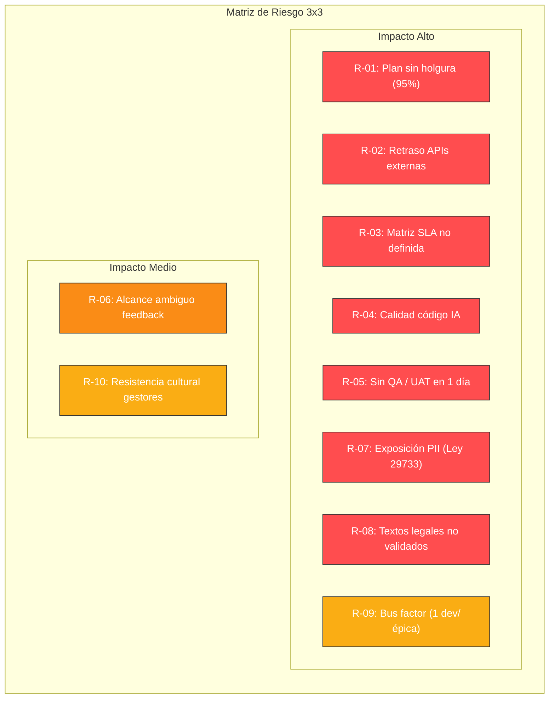

# 01 · PLAN MAESTRO DE TRABAJO
## Plataforma de Atención al Cliente «Aybar Atiende» · AYBARCORP SAC

---

## 1. METADATOS Y VISIÓN DEL PRODUCTO

| Atributo | Detalle |
| :--- | :--- |
| **Producto** | Aybar Atiende · Plataforma de Atención al Cliente (DOM-SVC-001) |
| **Dueño de Producto (PO)** | Eddie Huamaní |
| **Versión / Fecha** | v1.2 · 14-oct-2026 |
| **Horizonte Temporal** | 2 semanas: Lunes 19-oct → Viernes 30-oct-2026 (10 días hábiles) |
| **Estado** | En revisión · Comité DoR del viernes 16-oct-2026 |
| **Capacidad del Equipo** | 4 desarrolladores asistidos por herramientas de IA (240 horas totales) |
| **Carga Comprometida** | 227 horas en 60 historias de usuario (95 % de capacidad ocupada) |
| **Visión del Producto** | *«Toda solicitud del cliente se registra una sola vez, se atiende con un plazo trazable y se cierra con evidencia, sin exposición ante INDECOPI.»* |

---

## 2. PLAN MAESTRO DÍA A DÍA (HORIZONTE 2 SEMANAS)

El desarrollo se ejecuta en dos iteraciones de 5 días hábiles cada una. Cada épica es asignada a un único desarrollador para maximizar foco y minimizar cambios de contexto. Las fechas se calculan hora a hora considerando jornadas de 7 horas útiles (excepto día 1 con 4 horas por setup técnico y día 10 dedicado exclusivamente a UAT y pase).

```mermaid
gantt
    title Cronograma de Ejecución Aybar Atiende (19-oct al 30-oct-2026)
    dateFormat  YYYY-MM-DD
    axisFormat  %d-%b

    section Dev 1 (Núcleo / Libro / Garantías)
    EP-01 Núcleo de tickets omnicanal (22h)       :active, d1_ep01, 2026-10-19, 2026-10-22
    EP-03 Libro Reclamaciones y Apelaciones (21h) :d1_ep03, 2026-10-22, 2026-10-27
    EP-05 Reclamos de Garantía Postventa (12h)    :d1_ep05, 2026-10-27, 2026-10-29

    section Dev 2 (Enrutamiento / SLA / Casos Sensibles)
    EP-02 Enrutamiento, SLA y alertas (28h)       :active, d2_ep02, 2026-10-19, 2026-10-23
    EP-04 Gate Legal Eje 3 y Mesa Sensibles (32h) :d2_ep04, 2026-10-23, 2026-10-29

    section Dev 3 (Bandeja / CX / EntregaFest)
    EP-09 Bandeja Orquestadora e IA (32h)         :active, d3_ep09, 2026-10-19, 2026-10-23
    EP-07 Calidad CX y Torre de Control (16h)     :d3_ep07, 2026-10-26, 2026-10-28
    EP-08 EntregaFest: Contención en vivo (6h)    :d3_ep08, 2026-10-28, 2026-10-29

    section Dev 4 (Consulta 360 / Morosidad / UrbeMind)
    EP-10 Consulta 360 e Integraciones (34h)      :active, d4_ep10, 2026-10-19, 2026-10-26
    EP-11 Resolución Morosidad y Form. Simples (17h):d4_ep11, 2026-10-26, 2026-10-28
    EP-06 Integración UrbeMind (7h)               :d4_ep06, 2026-10-28, 2026-10-29

    section Hitos Críticos
    Kick-off y Base Técnica                       :milestone, m1, 2026-10-19, 0d
    Demo Iteración 1                              :milestone, m2, 2026-10-23, 0d
    Control de Alcance Flexible                   :milestone, m3, 2026-10-27, 0d
    Code Freeze (18:00)                           :milestone, m4, 2026-10-29, 0d
    UAT / Demo Final / Go-NoGo                    :milestone, m5, 2026-10-30, 0d
```

### Detalle de Distribución por Desarrollador y Jornada

| Dev | Semana 1 · Iteración 1 (19–23 oct) | Semana 2 · Iteración 2 (26–30 oct) | Horas Comprometidas | Horas Capacidad | Holgura |
| :--- | :--- | :--- | :---: | :---: | :---: |
| **DEV 1** | **EP-01** Núcleo de tickets omnicanal (`FT-01`, `FT-02` · 22 h: lun 19 → jue 22)<br/>**EP-03** Libro de Reclamaciones (`FT-05` · inicia jue 22) | **EP-03** Libro de Reclamaciones (`FT-05`, `FT-06` · 21 h: hasta mar 27)<br/>**EP-05** Postventa: garantías (`FT-10` · 12 h: mar 27 → jue 29) | 55 h | 60 h | 5 h |
| **DEV 2** | **EP-02** Enrutamiento, SLA y alertas (`FT-03`, `FT-04` · 28 h: lun 19 → vie 23)<br/>**EP-04** Gate legal Eje 3 (`FT-07` · inicia vie 23) | **EP-04** Gate legal y Mesa SGD (`FT-07`, `FT-08`, `FT-09` · 32 h: hasta jue 29) | 60 h | 60 h | 0 h |
| **DEV 3** | **EP-09** Bandeja orquestadora y asistencia (`FT-18`, `FT-19`, `FT-21` · 32 h: lun 19 → vie 23) | **EP-07** Calidad CX y Torre de Control (`FT-13`, `FT-14` · 16 h: lun 26 → mié 28)<br/>**EP-08** EntregaFest contención (`FT-15` · 6 h: mié 28 → jue 29) | 54 h | 60 h | 6 h |
| **DEV 4** | **EP-10** Consulta 360 e integraciones (`FT-20`, `FT-17`, `FT-16` · 34 h: lun 19 → lun 26) | **EP-10** (finaliza lun 26)<br/>**EP-11** Morosidad y formularios (`FT-22`, `FT-23` · 17 h: lun 26 → mié 28)<br/>**EP-06** UrbeMind (`FT-11` · 7 h: mié 28 → jue 29) | 58 h | 60 h | 2 h |
| **TOTAL** | **Día 1: Setup 4 h · Días 2 al 5: 7 h/día** | **Días 6 al 9: 7 h/día · Día 10: UAT (0 h dev)** | **227 h** | **240 h** | **13 h** |

---

## 3. CATÁLOGO MAESTRO DE ÉPICAS

| ID Épica | Nombre de la Épica | Tipo | Prioridad MoSCoW | Funcionalidades | Dev Asignado | Ventana de Fechas | Horas | Iteración | Patrocinador Sugerido |
| :--- | :--- | :--- | :---: | :--- | :---: | :---: | :---: | :---: | :--- |
| `[EPIC-01]`<br/>`EP-ATC-01` | Núcleo de tickets omnicanal | Habilitadora | **Debe** | `FT-01`, `FT-02` | Dev 1 | 19-oct → 22-oct | 22 h | 1 | Gerencia de Experiencia del Cliente |
| `[EPIC-02]`<br/>`EP-ATC-02` | Enrutamiento, SLA y alertas | Habilitadora | **Debe** | `FT-03`, `FT-04` | Dev 2 | 19-oct → 23-oct | 28 h | 1 | Gerencia de Experiencia del Cliente |
| `[EPIC-03]`<br/>`EP-ATC-03` | Libro de Reclamaciones y apelaciones | Valor negocio | **Debe** | `FT-05`, `FT-06` | Dev 1 | 22-oct → 27-oct | 21 h | 1 y 2 | Gerencia Legal |
| `[EPIC-04]`<br/>`EP-ATC-04` | Gate legal Eje 3 y Mesa de Casos sensibles | Valor negocio | **Debe** | `FT-07`, `FT-08`, `FT-09` | Dev 2 | 23-oct → 29-oct | 32 h | 1 y 2 | Gerencia Legal / Dirección UX |
| `[EPIC-05]`<br/>`EP-ATC-05` | Postventa: reclamos de garantía | Valor negocio | **Debería** | `FT-10` | Dev 1 | 27-oct → 29-oct | 12 h | 2 | Gerencia de Postventa |
| `[EPIC-06]`<br/>`EP-ATC-06` | Integración UrbeMind | Habilitadora | **Debería** | `FT-11` | Dev 4 | 28-oct → 29-oct | 7 h | 2 | Gerencia de TI · Producto UrbeMind |
| `[EPIC-07]`<br/>`EP-ATC-07` | Calidad de atención y Torre de Control CX | Valor negocio | **Debería** | `FT-13`, `FT-14` | Dev 3 | 26-oct → 28-oct | 16 h | 2 | Dirección UX |
| `[EPIC-08]`<br/>`EP-ATC-08` | EntregaFest: contención y derivación en vivo | Valor negocio | **Podría** | `FT-15` | Dev 3 | 28-oct → 29-oct | 6 h | 2 | Dirección UX |
| `[EPIC-09]`<br/>`EP-ATC-09` | Bandeja orquestadora y asistencia al gestor | Habilitadora | **Debe** | `FT-18`, `FT-19`, `FT-21` | Dev 3 | 19-oct → 23-oct | 32 h | 1 | Gerencia de Experiencia del Cliente |
| `[EPIC-10]`<br/>`EP-ATC-10` | Consulta 360 e integraciones operativas | Habilitadora | **Debe** | `FT-20`, `FT-17`, `FT-16` | Dev 4 | 19-oct → 26-oct | 34 h | 1 y 2 | Gerencia de TI · Gerencia Legal |
| `[EPIC-11]`<br/>`EP-ATC-11` | Resolución por morosidad y formularios simples | Valor negocio | **Debe** | `FT-22`, `FT-23` | Dev 4 | 26-oct → 28-oct | 17 h | 2 | Gerencia de Cobranza · Comercial |

---

## 4. GESTIÓN DE CAPACIDAD, CARGA Y CADENCIA

### Distribución de Esfuerzo
- **Capacidad Total:** 240 horas-hombre disponibles (4 desarrolladores x 10 días).
- **Carga Comprometida:** 227 horas (94.6 % de utilización).
- **Holgura Estratégica:** 13 horas reservadas en Dev 1 (5 h) y Dev 3 (6 h) para dar soporte de integración a Dev 2 (con 100 % de carga) y estabilizar la suite E2E.
- **Día 10 (30-oct-2026):** Cero horas de nuevo desarrollo; 100 % dedicado a UAT con usuarios clave, corrección de bugs bloqueantes y reunión de decisión Go / No-Go.

### Cadencia de Ceremonias y Acuerdos de Trabajo
- **Daily Scrum:** 09:00 a 09:15 (15 minutos estrictos) para sincronizar avances, dependencias activas del día y bloqueos.
- **Aceptación Continua del PO:** 17:00 todos los días laborables. El PO inspecciona y acepta las historias terminadas en el ambiente DEV/QA para no acumular revisiones en el último día.
- **Control de Alcance (27-oct):** Punto de decisión formal. Si existen retrasos acumulados > 7 h, se extrae del plan el alcance catalogado como «Flexible» (`HU-ATC-053` búsqueda semántica, `HU-ATC-011` reapertura con SLA, `HU-ATC-037..039` EntregaFest verbal) sin comprometer la versión v1.0.
- **Congelamiento de Código (29-oct 18:00):** Se prohíbe cualquier nuevo commit en `develop`; solo se permiten hotfixes validados para incidencias críticas de UAT.

### Modelo de Desarrollo Asistido por IA (Pair AI Programming)
Cada desarrollador trabaja con asistentes de IA siguiendo un flujo disciplinado:
1. Contextualización con ficha técnica `PLT-04` (Gherkin, reglas de negocio, modelo ER).
2. Generación iterativa de código y pruebas automatizadas (unitarias e integración).
3. Revisión obligatoria del desarrollador (lectura línea por línea, ejecución de tests locales y análisis SAST).
4. Code Review cruzado (revisión de pares entre desarrolladores) previo al merge a `develop`.

---

## 5. CATÁLOGO COMPLETO DE DEPENDENCIAS (DEP-01 A DEP-15)

Todas las integraciones con sistemas externos se desacoplan mediante **adaptadores y simuladores (mocks) contract-first** a partir del día 19-oct. El pase a producción de cada integración real queda condicionado a la disponibilidad de la API productiva del área responsable.

| ID | Dependencia Técnica / Negocio | Tipo | Bloquea a | Responsable | Fecha Requerida | Estado DoR | Mitigación / Estrategia |
| :--- | :--- | :--- | :--- | :--- | :---: | :---: | :--- |
| **DEP-01** | API de SIGDA/TAXON: consulta de clientes y KYC (fuente única) | Interna | `EP-01`, `EP-04`, `EP-10` | CDO / Equipo Datos | 19-oct-2026 | Pendiente (Urgente) | Mock de cliente y KYC según contrato JSON definido el día 1 |
| **DEP-02** | NEXUS (tercero): identidad de colaboradores, SSO (OIDC) y roles | Externa | `EP-01`, `EP-02`, `EP-09` | TI / Proveedor NEXUS | 19-oct-2026 | Pendiente (Urgente) | Servidor mock OIDC local con tokens JWT preconfigurados |
| **DEP-03** | Matriz SLA por tipo/prioridad y plazos de Mesa SGD (RNF-REN-003) | Interna | `EP-02`, `EP-04` | Gerencia ATC · Mesa SGD | 21-oct-2026 | Pendiente (Urgente) | Carga de matriz provisional parametrizable en PostgreSQL |
| **DEP-04** | Calendario `MAE_TIME` y feriados `MAE_HOLIDAY` por geografía | Técnica | `EP-02`, `EP-03` | Equipo Datos | 21-oct-2026 | En curso | Seeder con calendario laboral nacional oficial 2026-2027 |
| **DEP-05** | Validación legal: formato de asiento, textos y plazos del Libro | Legal | `EP-03`, `EP-11` | Gerencia Legal | 23-oct-2026 | Pendiente | Plantillas HTML/PDF configurables validadas en acta legal |
| **DEP-06** | Repositorio documental S3 con Object Lock y GLI | Técnica | `EP-01`, `EP-03`, `EP-04`, `EP-10` | Arquitectura / Legal | 21-oct-2026 | En curso | Bucket S3 configurado con retención WORM (Object Lock) |
| **DEP-07** | Contratos y Activos: API de contrato, unidad y Acta de Entrega | Interna | `EP-05` | Equipo Contratos | 27-oct-2026 | Pendiente | Simulador de contrato con fechas de acta y vigencia garantía |
| **DEP-08** | Cobranza: estado de cuenta y cuotas vencidas (desfase ≤ 24 h) | Interna | `EP-04`, `EP-10`, `EP-11` | Cobranza | 20-oct-2026 | Pendiente (Urgente) | Mock de saldos y cuotas morosas con esquema OpenAPI |
| **DEP-09** | UrbeMind: contrato de API / eventos y decisión de alcance | Externa | `EP-06` | Patrocinador / UrbeMind | 28-oct-2026 | Bloqueada (Alcance) | Si no se aprueba el 27-oct, sus 7 h se reasignan a holgura |
| **DEP-10** | KPI Engine y encuestas post-atención `SVY_SURVEY_RESPONSE` | Interna | `EP-07` | Equipo Datos / BI | 26-oct-2026 | Pendiente | Emisor de eventos asíncronos y tabla local de encuestas |
| **DEP-11** | Call Center: API/CTI para screen pop, grabación y click-to-call | Externa | `EP-10` | TI / Proveedor Call Center | 19-oct-2026 | Por evaluar | Emulador Webhook de eventos CTI (`call_received`, `call_end`) |
| **DEP-12** | Herramienta Legal (Rosario): API/sincronización de casos Eje 3 | Interna | `EP-10` | Gerencia Legal · TI | 23-oct-2026 | Por evaluar | Cola de sincronización bidireccional asíncrona |
| **DEP-13** | Motor de consultas de José: contrato de API y mantenimiento | Interna | `EP-10` | José · TI | 21-oct-2026 | Por evaluar | Adaptador REST con fallback a consulta estándar SIGDA |
| **DEP-14** | Proveedor de IA aprobado por TI y Seguridad (política PII) | Técnica | `EP-09`, `EP-10` | TI · Seguridad | 21-oct-2026 | Por evaluar | Servicio proxy con anonimizador DLP previo al LLM |
| **DEP-15** | Maestro de responsables de proyecto y supervisores (fuente única)| Interna | `EP-11` | Gerencia Comercial · Datos | 27-oct-2026 | Pendiente | Catálogo cargado en tabla estática `MAE_PROJECT_SUPERVISOR` |

---

## 6. MATRIZ Y REGISTRO DE RIESGOS DEL PROYECTO



### Tabla de Mitigación y Contingencia de Riesgos

| ID | Riesgo Identificado | Prob. | Impacto | Nivel | Mitigación / Plan de Contingencia | Dueño Responsable |
| :--- | :--- | :---: | :---: | :---: | :--- | :--- |
| **R-01** | **Plan sin holgura:** 227 h de 240 h comprometidas (95 %) y Dev 2 al 100 %. | Alta | Alto | **ALTO** | Alcance flexible (`HU-053`, `HU-011`, `HU-037..039`) tipificado para corte el 27-oct; Dev 1 y Dev 3 apoyan a Dev 2 en pruebas e integración. | PO (Eddie Huamaní) |
| **R-02** | **APIs externas no disponibles en 2 semanas:** (SIGDA, NEXUS, Call Center, Cobranza, etc.). | Alta | Alto | **ALTO** | Definir especificaciones OpenAPI y mocks locales el día 1; pase a producción de cada conector condicionado a la entrega formal del API real. | Líder Técnico |
| **R-03** | **Matriz SLA y plazos SGD sin definición:** al arrancar el motor SLA (21-oct). | Alta | Alto | **ALTO** | Aprobación de matriz provisional parametrizable firmada por Gerencia ATC antes del 20-oct. | Gerencia ATC |
| **R-04** | **Calidad y seguridad de código generado por IA:** (bugs sutiles, leaks de seguridad). | Media | Alto | **ALTO** | Revisión de pares obligatoria en PR, pruebas unitarias automatizadas con cobertura de casos borde y análisis SAST integrado en CI. | Líder Técnico |
| **R-05** | **Ausencia de QA dedicado y UAT concentrada:** en una única jornada (30-oct). | Media | Alto | **ALTO** | Aceptación diaria por el PO a las 17:00, tests E2E automatizados desde el día 3 y citación formal de usuarios clave con antelación. | PO · Jefe Ops UX |
| **R-06** | **Ambigüedad en requerimientos del feedback:** (interés 8 %, rayo de criticidad, buses). | Alta | Medio | **ALTO** | Refinamiento de preguntas abiertas el 16-oct en comité DoR; lo no resuelto se implementa como parámetro configurable. | PO |
| **R-07** | **Exposición de datos personales (PII):** en bitácoras o prompts de IA (Ley 29733). | Media | Alto | **ALTO** | Regla DLP estricta (`RNF-SEC-008`), anonimizador obligatorio previo a IA (`RNF-SEC-009`) y permisos por rol en búsqueda (`RNF-SEC-010`). | Seguridad de TI |
| **R-08** | **Textos legales no validados:** (Libro, alerta de cancelación, carta de morosidad). | Media | Alto | **ALTO** | Uso de plantillas dinámicas auditadas; aprobación formal de Legal antes del 23-oct (Libro) y 27-oct (Cobranza). | Gerencia Legal |
| **R-09** | **Ausencia de un desarrollador:** (Bus factor = 1 por épica). | Baja | Alto | **MEDIO** | Documentación viva de arquitectura, estandarización de prompts, ramas de integración diaria en `develop` y repositorios compartidos. | Líder Técnico |
| **R-10** | **Resistencia cultural y persistencia del término «agente»:** sobre herramientas paralelas. | Media | Medio | **MEDIO** | Capacitación formal el 30-oct, etiqueta «Gestor de tickets» hardcoded en UI (`RNF-USA-003`) y decomiso de Excel/chats. | Jefe Operaciones UX |

---

## 7. ARQUITECTURA TÉCNICA DE DESARROLLO Y STACK

```mermaid
graph TD
    subgraph Capa de Presentación
        UI_ATC["Consola ATC Gestor<br/>(React 18 + TypeScript + Tailwind)"]
        UI_PORTAL["Mi Portal Cliente<br/>(React SPA)"]
        UI_PWA["Formularios Simples & EntregaFest<br/>(PWA Mobile-First)"]
    end

    subgraph Capa de API y Seguridad
        APIGW["API Gateway / Reverse Proxy"]
        AUTH["NEXUS SSO (OpenID Connect / JWT)"]
        WAF["WAF & Rate Limiting"]
        BUS["Internal Event Bus (EventEmitter / Redis)"]
    end

    subgraph Capa de Servicios de Negocio (Monolito Modular NestJS 20)
        MOD_TICKETS["Módulo Core Tickets & Ciclo de Vida"]
        MOD_SLA["Módulo Motor SLA & Alertas"]
        MOD_LEGAL["Módulo Libro Reclamaciones & Casos Eje 3"]
        MOD_POSTVENTA["Módulo Postventa & Garantías"]
        MOD_CX["Módulo Torre de Control CX & Encuestas"]
        MOD_ORCH["Módulo Bandeja & Orquestador Gestor"]
        MOD_INTEG["Módulo Adaptadores & Consulta 360"]
        MOD_MOROSIDAD["Módulo Resolución Morosidad & Eventos"]
        MOD_AI["Módulo Asistente IA (DLP & Prompt Bridge)"]
    end

    subgraph Capa de Persistencia y Almacenamiento
        PG[("PostgreSQL 16 Multi-AZ<br/>Transaccional + Bitácoras HMAC")]
        S3[("AWS S3 + Object Lock<br/>Documentos & Cartas Formales")]
        SEARCH_IDX[("Índice de Búsqueda Full-Text<br/>Permisos por Rol")]
    end

    UI_ATC --> APIGW
    UI_PORTAL --> APIGW
    UI_PWA --> APIGW
    APIGW --> AUTH
    APIGW --> WAF
    WAF --> MOD_TICKETS
    WAF --> MOD_SLA
    WAF --> MOD_LEGAL
    WAF --> MOD_POSTVENTA
    WAF --> MOD_CX
    WAF --> MOD_ORCH
    WAF --> MOD_INTEG
    WAF --> MOD_MOROSIDAD
    WAF --> MOD_AI

    MOD_TICKETS --> BUS
    MOD_SLA --> BUS
    MOD_LEGAL --> BUS

    MOD_TICKETS --> PG
    MOD_SLA --> PG
    MOD_LEGAL --> PG
    MOD_POSTVENTA --> PG
    MOD_LEGAL --> S3
    MOD_INTEG --> SEARCH_IDX
```

### Pipeline de Entrega Continua (CI/CD) y Ambientes
1. **Flujo Git:** `feature/[ID-HU]` -> Pull Request -> `develop` -> `main`.
2. **Quality Gates en CI:**
   - Compilación TypeScript estricta (cero `any`).
   - Cobertura de pruebas automatizadas sobre criterios Gherkin.
   - Análisis estático SAST y escaneo de vulnerabilidades de dependencias.
3. **Ambientes:**
   - **DEV:** Despliegue automático con mocks activos para pruebas individuales.
   - **QA:** Integración global, pruebas E2E automatizadas desde el día 3 con datos sintéticos anonimizados.
   - **PRE:** Entorno idéntico a producción para el UAT del 30-oct.
   - **PROD:** Despliegue Multi-AZ condicionado a aprobación de Go/No-Go.

---

## 8. REGISTRO DE DECISIONES DE ARQUITECTURA (ADR)

- **ADR-01: Monolito Modular en Node.js 20 / NestJS:**
  *Decisión:* Implementar una arquitectura de monolito modular con separación estricta por módulos de dominio en lugar de microservicios distribuidos, optimizando la velocidad de desarrollo en 2 semanas y minimizando la sobrecarga de despliegue.
- **ADR-02: Bitácoras Inmutables con Sellado Criptográfico:**
  *Decisión:* Todas las transiciones de estado (`STATUS_LOG`) y asignaciones (`ASSIGNMENT_LOG`) son append-only y calculan un `IntegrityHash` mediante HMAC-SHA256 para garantizar valor probatorio legal ante INDECOPI.
- **ADR-03: Consulta en Tiempo Real sin Duplicidad de Clientes:**
  *Decisión:* No se creará una tabla de clientes local; los datos de contacto y KYC se consultan dinámicamente vía API a SIGDA/TAXON para asegurar cero registros paralelos (`RNF-INT-007`).
- **ADR-04: Integración Desacoplada de UrbeMind:**
  *Decisión:* La comunicación con UrbeMind se realizará exclusivamente mediante contratos API REST y eventos asíncronos (`CITY_INCIDENT`), protegiendo el núcleo transaccional.
- **ADR-05: Jobs Batch Idempotentes para SLA y Plazos Legales:**
  *Decisión:* Los cron jobs de evaluación de SLA y vencimiento del Libro de Reclamaciones se ejecutan de manera periódica e idempotente basándose en el calendario oficial de feriados (`MAE_TIME`).
- **ADR-06: Repositorio Documental con Almacenamiento WORM:**
  *Decisión:* Las cartas de respuesta formal del Libro y notificaciones de morosidad se generan en PDF y se almacenan en AWS S3 con Object Lock para evitar alteraciones posteriores.
- **ADR-07: Adaptadores Contract-First para Sistemas Externos:**
  *Decisión:* Todos los módulos que dependen de sistemas externos (Call Center, Cobranza, Legal) se programan contra contratos de interfaz abstractos respaldados por simuladores locales (`mocks`).
- **ADR-08: Gateway de IA con Anonimización Obligatoria:**
  *Decisión:* Las peticiones de asistencia cognitiva pasan por una capa de Data Loss Prevention (DLP) que enmascara PII antes de comunicarse con proveedores externos de LLM (`RNF-SEC-009`).

---

## 9. CONTROL DE VERSIONES DEL DOCUMENTO

| Versión | Fecha | Autor | Descripción del Cambio | Estado / Aprobación |
| :--- | :---: | :--- | :--- | :--- |
| **v1.0** | 29-sep-2026 | Eddie Huamaní (PO) | Versión inicial con horizonte de 12 meses: 8 épicas, 15 funcionalidades, 11 dependencias y 8 riesgos. | Reemplazada |
| **v1.1** | 02-oct-2026 | Eddie Huamaní (PO) | Adaptación a plantillas v1.1: calendario en días hábiles, ruta crítica, estimación por horas y adición de riesgos R-09 y R-10. | Reemplazada |
| **v1.2** | 14-oct-2026 | Eddie Huamaní (PO) | Incorporación de feedback de 2.ª reunión usuaria (21 RF nuevos, 3 épicas, 8 features); replanificación a 10 días hábiles (19 al 30-oct) con 4 desarrolladores asistidos por IA; término estricto «Gestor de tickets»; 15 dependencias y 10 riesgos. | **Vigente (Comité DoR 16-oct)** |
