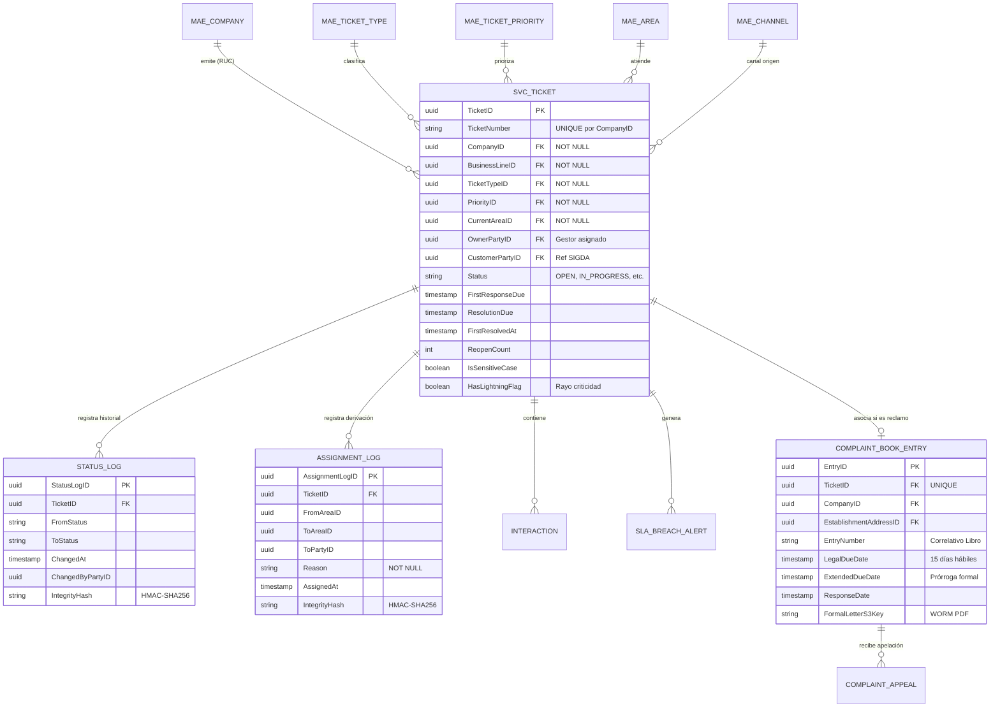
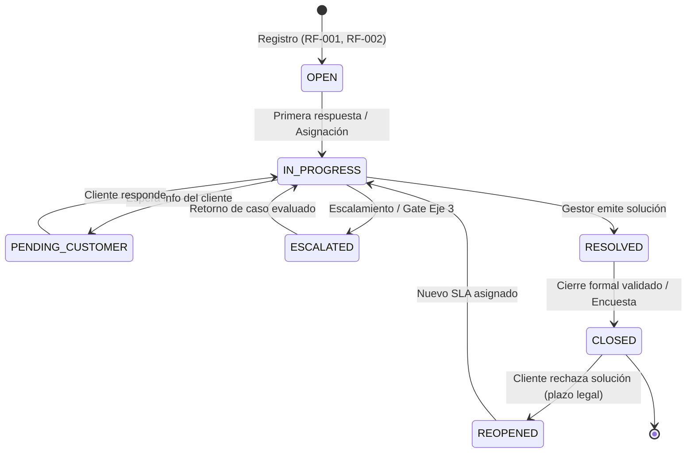

# 02 · DEFINICIÓN DE LISTO (DoR)
## Plataforma de Atención al Cliente «Aybar Atiende» · AYBARCORP SAC

---

## 1. PROPÓSITO Y MODELO DE EJECUCIÓN PARA AGENTES DE IA

La **Definición de Listo (Definition of Ready - DoR)** establece las condiciones técnicas, funcionales y de seguridad mínimas y no negociables que un ítem del backlog debe cumplir antes de que un desarrollador o agente de IA pueda escribir una sola línea de código de producción.

> **REGLA DE ORO PARA EL AGENTE DE CODIFICACIÓN:**
> Si una funcionalidad o historia de usuario no cumple con los criterios de validación pre-código aquí definidos, o si sus dependencias (`DEP-XX`) no cuentan al menos con una especificación OpenAPI y un simulador local (`mock`), **el agente debe detener la generación de código y reportar la condición bloqueante**.

---

## 2. CHECKLIST DE VALIDACIÓN PRE-CÓDIGO (PRE-CODE GATES)

| Dimensión | Criterio de Preparación DoR | Estado Actual | Regla de Validación para el Agente |
| :--- | :--- | :---: | :--- |
| **Negocio** | **Objetivo y KPIs definidos:** Indicadores de éxito por épica documentados en `03-epics.md`. | Cumplido | Verificar que la HU apunte a una épica con métricas de éxito cuantificables. |
| **Negocio** | **Alcance acordado (IN/OUT):** 21 RF de feedback incluidos; ítems ambiguos tratados. | Parcial | No implementar funcionalidades fuera de alcance (ej. apps móviles nativas o chat en vivo en web). |
| **Negocio** | **Prioridad y fechas confirmadas:** Asignación en el plan de 2 semanas hora a hora. | Parcial | Respetar la ventana de ejecución y prioridad MoSCoW (`Debe` > `Debería` > `Podría`). |
| **Funcional** | **Historias con criterios Gherkin:** 60 HU con 3-4 criterios en formato `Dado / Cuando / Entonces`. | Cumplido | El agente debe traducir cada escenario Gherkin en una prueba automatizada (`describe`/`it`). |
| **Funcional** | **Reglas de negocio validadas:** 42 reglas tipificadas (`RN-SVC-001..042`). | Parcial | Validar invariantes en entidades de dominio (ej. `CompanyID` NOT NULL, correlativo por RUC). |
| **Funcional** | **Estimación en horas (≤ 1 día):** Estimación entre 2 h y 6 h por historia asistida con IA. | Parcial | Si una HU requiere > 6 h de esfuerzo, debe modularizarse antes de codificar. |
| **Diseño / UX** | **Prototipos y maquetas aprobados:** Vistas clave definidas en el prototipo v0.2. | Parcial | Construir componentes visuales con Tailwind/React alineados con el Design System AYBAR. |
| **Diseño / UX** | **Textos y validaciones legales:** Textos de constancia y cargos aprobados por Legal. | Parcial | Usar plantillas parametrizables para textos legales del Libro y morosidad. |
| **Técnico** | **Diagramas de arquitectura y datos:** Modelo ER, secuencia y estados revisados. | Parcial | Validar esquemas DDL de PostgreSQL contra las entidades descritas en la Sección 4. |
| **Técnico** | **APIs y mocks disponibles:** Contratos de interfaz definidos para dependencias externas. | Parcial | Operar con adaptadores Mock si la API externa no está disponible en ambiente DEV. |
| **Técnico** | **Requerimientos No Funcionales (RNF):** 25 RNF (seguridad, concurrencia, disponibilidad). | Parcial | Verificar que toda consulta a BD cumpla con índices y tiempos de respuesta (p95 ≤ 2 s). |
| **Trabajo IA** | **Guía de prompts y política PII:** Prohibido enviar datos personales a modelos LLM. | Parcial | Ejecutar sanitización de datos (DLP) antes de enviar prompts al proveedor de IA. |
| **Trabajo IA** | **Contexto estructurado por historia:** Cada HU contiene reglas, tablas y diagramas. | Cumplido | Consumir la historia en formato Markdown íntegro antes de proponer cambios. |
| **Calidad** | **Estrategia de pruebas automatizadas:** Tests unitarios, integración y E2E definidos. | No cumplido | El agente debe generar tests unitarios con cobertura de ramas y edge cases para cada HU. |
| **Calidad** | **Riesgos y mitigaciones conocidos:** 10 riesgos del proyecto con dueño asignado. | Cumplido | Considerar los riesgos R-01 a R-10 en la toma de decisiones técnicas. |

---

## 3. RED DE DEPENDENCIAS Y BLOQUEANTES CRÍTICOS

Las dependencias que se requieren durante los primeros 3 días de desarrollo (≤ 21-oct) son de carácter urgente. Si no cuentan con contrato OpenAPI y mock al día de su inicio, la historia no puede iniciar:

```mermaid
graph TD
    subgraph Dependencias Urgentes (Requeridas ≤ 21-oct)
        DEP01["DEP-01 (19-oct): API SIGDA/TAXON<br/>Consulta cliente y KYC"]
        DEP02["DEP-02 (19-oct): NEXUS SSO<br/>Identidad y roles gestor"]
        DEP11["DEP-11 (19-oct): Call Center CTI<br/>Screen pop y llamadas"]
        DEP08["DEP-08 (20-oct): Cobranza<br/>Estado de cuenta y cuotas"]
        DEP03["DEP-03 (21-oct): Matriz SLA<br/>Plazos por tipo y prioridad"]
        DEP13["DEP-13 (21-oct): Motor de José<br/>Contrato API consultas"]
        DEP14["DEP-14 (21-oct): Proveedor IA<br/>Aprobación TI / Seguridad"]
        DEP06["DEP-06 (21-oct): Repositorio S3<br/>Bucket WORM Object Lock"]
    end

    subgraph Épicas Desbloqueadas
        EP01["EP-ATC-01: Núcleo tickets (Dev 1)"]
        EP02["EP-ATC-02: Enrutamiento SLA (Dev 2)"]
        EP09["EP-ATC-09: Bandeja gestor (Dev 3)"]
        EP10["EP-ATC-10: Consulta 360 (Dev 4)"]
    end

    DEP01 --> EP01
    DEP02 --> EP01
    DEP02 --> EP02
    DEP03 --> EP02
    DEP02 --> EP09
    DEP14 --> EP09
    DEP01 --> EP10
    DEP11 --> EP10
    DEP08 --> EP10
    DEP13 --> EP10
    DEP06 --> EP01
```

---

## 4. MODELADO DE DATOS Y MÁQUINA DE ESTADOS

### 4.1 Entidades del Núcleo Transaccional (Core Domain)



### 4.2 Máquina de Estados del Ticket (RF-SVC-004)



### 4.3 Nuevas Entidades del Feedback (Extensiones del Modelo)

Todas estas entidades se integran directamente con `SVC_TICKET`:

| ID Entidad | Nombre Técnico | Descripción Funcional | Historias de Usuario Asociadas |
| :--- | :--- | :--- | :--- |
| **ENT-SVC-014** | `SVC_WORKFLOW_DEFINITION` | Definición de pasos y transiciones permitidas por área y tipo de ticket. | `HU-ATC-043`, `HU-ATC-044` |
| **ENT-SVC-015** | `SVC_KNOWLEDGE_ARTICLE` | Artículos de conocimiento y guías de resolución sugeridas por tipo de caso. | `HU-ATC-047` |
| **ENT-SVC-016** | `SVC_AI_SUGGESTION_LOG` | Registro de sugerencias generadas por la IA y confirmación/edición por el gestor. | `HU-ATC-048` |
| **ENT-SVC-017** | `SVC_SEARCH_INDEX` | Índice de búsqueda semántica y full-text filtrado por permisos de rol. | `HU-ATC-049`, `HU-ATC-052`, `HU-ATC-053` |
| **ENT-SVC-018** | `SVC_CONTRACT_DEFAULT_ALERT`| Alertas y constancias de intimación por morosidad (3 cuotas vencidas). | `HU-ATC-056`, `HU-ATC-057`, `HU-ATC-058` |
| **ENT-SVC-019** | `SVC_SIMPLE_FORM_DEFINITION`| Esquemas de formularios rápidos (≤ 6 campos) para captura externa. | `HU-ATC-059`, `HU-ATC-060` |
| **ENT-SVC-020** | `SVC_EVENT_BUS_BOOKING` | Reservas y aforo de buses de traslado para el evento EntregaFest. | `HU-ATC-060` |

---

## 5. DIRECTIVAS DE SEGURIDAD Y PRIVACIDAD (LEY 29733)

El agente de codificación debe validar en cada endpoint y consulta las siguientes directivas:
1. **Regla de Cero PII en Bitácoras (`RNF-SEC-008`):** Queda prohibido concatenar datos personales (nombres, DNI, teléfono, correos) dentro de descripciones libres de bitácoras de auditoría (`STATUS_LOG.Reason`, `ASSIGNMENT_LOG.Reason`).
2. **Sanitización Pre-LLM (`RNF-SEC-009`):** El módulo `MOD_AI` debe anonimizar cualquier dato de contacto o identidad antes de interactuar con la API del LLM, sustituyéndolos por tokens opacos (`[CLIENTE_ANON_1]`, `[RUC_ANON_1]`).
3. **Filtro de Búsqueda por Perfil (`RNF-SEC-010`):** La búsqueda 360 (`FT-ATC-20`) debe respetar los permisos de la fuente de origen; un gestor de Eje 1 no puede ver datos judiciales ni montos de indemnización confidenciales de Eje 3.

---

## 6. LOS 7 ACUERDOS PREVIOS PARA EL KICK-OFF (LUNES 19-OCT)

| # | Condición Previa / Acuerdo | Responsable | Fecha Límite | Criterio de Aceptación |
| :-: | :--- | :--- | :---: | :--- |
| **1** | Refinamiento formal con los 4 desarrolladores: confirmar horas de las 60 historias y orden de trabajo. | Equipo Dev · PO | 16-oct-2026 | Acta de consenso del equipo firmada en DoR. |
| **2** | Cierre de ambigüedades del feedback: tasa 8 %, rayo de criticidad, «llamar la cuenta», buses EntregaFest. | PO · Áreas usuarias | 16-oct-2026 | Parámetros de negocio definidos en `04-features.md`. |
| **3** | Estrategia de pruebas automatizadas, fixtures de datos y guía de uso de IA para el equipo. | Líder Técnico | 16-oct-2026 | Template de prompt y pipeline CI con Jest configurado. |
| **4** | Contratos de interfaz OpenAPI y mocks para SIGDA, NEXUS, Call Center y Cobranza (`DEP-01, 02, 08, 11`). | Líder Técnico · TI | 19-oct-2026 | Mocks locales operativos en el repo para DEV. |
| **5** | Matriz provisional de SLA aprobada y proveedor de IA formalizado (`DEP-03, DEP-14`). | Gerencia ATC · TI | 20-oct-2026 | Tabla `MAE_SLA_POLICY` con seeders aprobados. |
| **6** | Validación legal de formatos: Libro de Reclamaciones (23-oct) y cartas de morosidad (27-oct). | Gerencia Legal | 23 / 27-oct | Plantillas HTML con visto bueno formal de Legal. |
| **7** | Citación formal de usuarios clave para UAT del 30-oct y plan de corte de casos en Excel/WhatsApp. | PO · Ops UX | 23-oct-2026 | Convocatoria de agenda confirmada con 10 usuarios. |

---

## 7. MATRIZ DE ESTADO DoR POR FUNCIONALIDAD (22 FUNCIONALIDADES)

| ID Funcionalidad | Nombre de la Funcionalidad | Dev Asignado | Inicio Previsto | Estado DoR | Condición Bloqueante Principal |
| :--- | :--- | :---: | :---: | :---: | :--- |
| **FT-ATC-01** | Registro multicanal y tipificación | Dev 1 | lun 19-oct | **Listo con condiciones** | Contrato OpenAPI y mock de SIGDA/TAXON (`DEP-01`). |
| **FT-ATC-02** | Ciclo de vida, interacciones e hitos | Dev 1 | mar 20-oct | **Listo con condiciones** | Catálogo de roles NEXUS y tabla de estados (`DEP-02`). |
| **FT-ATC-03** | Derivación, reasignación y casillero | Dev 2 | lun 19-oct | **Listo con condiciones** | Esquema de casillero por área (`DEP-02`). |
| **FT-ATC-04** | Motor SLA y alertas | Dev 2 | mié 21-oct | **Listo con condiciones** | Matriz provisional de SLA firmada al 20-oct (`DEP-03`). |
| **FT-ATC-05** | Libro de Reclamaciones | Dev 1 | jue 22-oct | **Listo con condiciones** | Formato legal de asiento y carta validado al 23-oct (`DEP-05`). |
| **FT-ATC-06** | Apelaciones internas e INDECOPI | Dev 1 | mar 27-oct | **Listo con condiciones** | Bucket S3 configurado con Object Lock (`DEP-06`). |
| **FT-ATC-07** | Gate de derivación a Eje 3 y handoff | Dev 2 | vie 23-oct | **Listo con condiciones** | Mock de clientes y saldos morosos (`DEP-01`, `DEP-08`). |
| **FT-ATC-08** | Mesa SGD: recepción, activación y riesgo | Dev 2 | lun 26-oct | **Listo con condiciones** | Plazos de línea de la Mesa SGD aprobados (`DEP-03`). |
| **FT-ATC-09** | Escalamiento, vinculación y cierre tipificado | Dev 2 | mié 28-oct | **Listo con condiciones** | Matriz de umbrales de escalamiento confirmada. |
| **FT-ATC-10** | Reclamos de garantía postventa | Dev 1 | mar 27-oct | **Listo con condiciones** | Simulador de contrato con Acta de Entrega (`DEP-07`). |
| **FT-ATC-11** | Integración UrbeMind (CITY_INCIDENT) | Dev 4 | mié 28-oct | **NO LISTO** | Alcance de UrbeMind no definido (`R-06`, `DEP-09`). |
| **FT-ATC-13** | Encuesta post-atención | Dev 3 | lun 26-oct | **Listo con condiciones** | Definición de webhook para KPI Engine (`DEP-10`). |
| **FT-ATC-14** | Torre de Control CX | Dev 3 | lun 26-oct | **Listo con condiciones** | Estructura de eventos consolidados de analítica. |
| **FT-ATC-15** | EntregaFest: contención en vivo | Dev 3 | mié 28-oct | **Listo con condiciones** | Modelo entidad del evento creado en día 1 (`ENT-SVC-020`). |
| **FT-ATC-16** | Integración con Legal y prevención | Dev 4 | vie 23-oct | **Listo con condiciones** | Contrato de sincronización con sistema de Legal (`DEP-12`). |
| **FT-ATC-17** | Integración con plataforma Call Center | Dev 4 | jue 22-oct | **Listo con condiciones** | Emulador de eventos CTI (`DEP-11`). |
| **FT-ATC-18** | Bandeja orquestadora y flujos por área | Dev 3 | lun 19-oct | **Listo con condiciones** | Regla de autoasignación (push vs. pull) confirmada. |
| **FT-ATC-19** | Asistencia al gestor: guía e IA | Dev 3 | mié 21-oct | **Listo con condiciones** | Proveedor de IA autorizado y proxy DLP (`DEP-14`). |
| **FT-ATC-20** | Búsqueda y consulta 360 del cliente | Dev 4 | lun 19-oct | **Listo con condiciones** | Mock SIGDA y conector Motor de José (`DEP-01`, `DEP-13`). |
| **FT-ATC-21** | Productividad y notificaciones del gestor | Dev 3 | vie 23-oct | **Listo con condiciones** | Jerarquía de supervisión en catálogo de usuarios. |
| **FT-ATC-22** | Resolución de contrato por morosidad | Dev 4 | lun 26-oct | **Listo con condiciones** | Mock Cobranza (`DEP-08`) y causal legal validada. |
| **FT-ATC-23** | Formularios simples: ingreso y buses | Dev 4 | mar 27-oct | **Listo con condiciones** | Aprobación de campos (≤ 6) y alcance de buses. |
