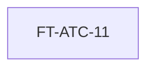
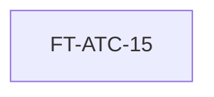
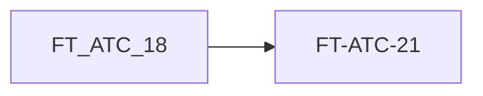
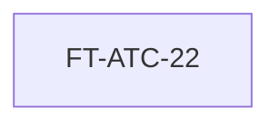

# 03 · CATÁLOGO MAESTRO DE ÉPICAS
## Plataforma de Atención al Cliente «Aybar Atiende» · AYBARCORP SAC

---

## ÍNDICE GENERAL DE ÉPICAS

| ID Épica | Nombre de la Épica | Tipo | Prioridad | Dev Asignado | Fechas | Horas | Funcionalidades |
| :--- | :--- | :---: | :---: | :---: | :---: | :---: | :--- |
| `[EPIC-01]` `EP-ATC-01` | Núcleo de tickets omnicanal | Valor negocio | **Debe** | Dev 1 | lun 19-oct → jue 22-oct 2026 | 22 h | Ver detalle |
| `[EPIC-02]` `EP-ATC-02` | Enrutamiento, SLA y alertas | Valor negocio | **Debe** | Dev 2 | lun 19-oct → vie 23-oct 2026 | 28 h | Ver detalle |
| `[EPIC-03]` `EP-ATC-03` | Libro de Reclamaciones y apelaciones | Valor negocio | **Debe** | Dev 1 | jue 22-oct → mar 27-oct 2026 | 21 h | Ver detalle |
| `[EPIC-04]` `EP-ATC-04` | Gate legal Eje 3 y Mesa de Casos | Valor negocio | **Debe** | Dev 2 | vie 23-oct → jue 29-oct 2026 | 32 h | Ver detalle |
| `[EPIC-05]` `EP-ATC-05` | Postventa: reclamos de garantía | Valor negocio | **Debería** | Dev 1 | mar 27-oct → jue 29-oct 2026 | 12 h | Ver detalle |
| `[EPIC-06]` `EP-ATC-06` | Integración UrbeMind | Valor negocio | **Debería** | Dev 4 | mié 28-oct → jue 29-oct 2026 | 7 h | Ver detalle |
| `[EPIC-07]` `EP-ATC-07` | Calidad de atención y Torre de | Valor negocio | **Debería** | Dev 3 | lun 26-oct → mié 28-oct 2026 | 16 h | Ver detalle |
| `[EPIC-08]` `EP-ATC-08` | EntregaFest: contención y derivación | Valor negocio | **Podría** | Dev 3 | mié 28-oct → jue 29-oct 2026 | 6 h | Ver detalle |
| `[EPIC-09]` `EP-ATC-09` | Bandeja orquestadora y asistencia al | Valor negocio | **Debe** | Dev 3 | lun 19-oct → vie 23-oct 2026 | 32 h | Ver detalle |
| `[EPIC-10]` `EP-ATC-10` | Consulta 360 e integraciones | Valor negocio | **Debe** | Dev 4 | lun 19-oct → lun 26-oct 2026 | 34 h | Ver detalle |
| `[EPIC-11]` `EP-ATC-11` | Resolución por morosidad y | Valor negocio | **Debe** | Dev 4 | lun 26-oct → mié 28-oct 2026 | 17 h | Ver detalle |

---

## [EPIC-01] EP-ATC-01: Núcleo de tickets omnicanal

### Metadatos de la Épica
- **ID Épica:** `[EPIC-01]` (`EP-ATC-01`)
- **Nombre:** Núcleo de tickets omnicanal
- **Producto:** Plataforma ATC (DOM-SVC-001)
- **Dueño de Producto (PO):** Eddie Huamaní
- **Patrocinador:** Gerencia de Experiencia del Cliente (por confirmar)
- **Prioridad:** Alta (MoSCoW: Debe)
- **Horizonte de Ejecución:** lun 19-oct → jue 22-oct 2026 · Dev 1 · 22 h
- **Estado:** Refinamiento
- **Procesos Cubiertos:** PROC-SVC-001 · 002 · Tipo: Épica habilitadora

### 1. Contexto de Negocio
**Problema u oportunidad:**
Hoy las solicitudes se anotan en Excel, chats personales o correo, sin número ni
tipificación; el cliente no puede dar seguimiento y la empresa no sabe cuántas solicitudes
tiene ni de qué tipo.

**Usuarios / segmentos beneficiarios:**
gestores de tickets (Eje 1) y colaboradores de área que atienden solicitudes de las 11
razones sociales; clientes que llaman, escriben por WhatsApp o correo.

**Evidencia y antecedentes:**
NEC-SVC-001 «registrar el pedido una sola vez, tipificado y con número»; OBJ-SVC-001 y
OBJ-SVC-003; dolores 1, 2 y 5 del AS-IS (registros paralelos, sin bitácora, cierres
informales). Volumen y tiempos actuales: por medir en Iteración 0.

**Alineamiento estratégico:**
Atender toda solicitud con compromiso de tiempo trazable y auditable (OBJ-SVC-001) y
operar ATC como servicio transversal de las 11 razones sociales (OBJ-SVC-003).

### 2. Objetivos
- **Objetivo de Negocio:** Registrar el 100 % de las solicitudes de los canales telefónicos, WhatsApp y correo en la
plataforma, con número por RUC, dentro de los 3 meses siguientes al pase a producción.
- **Objetivo del Usuario:** El cliente recibe un número de ticket desde el primer contacto y puede preguntar por su
caso sin repetir la historia.

### 3. Alcance (Scope)
#### En Alcance (IN):
- Registro de tickets tipificados por teléfono, WhatsApp y
- correo (registro asistido por el gestor de tickets)
- Número correlativo único por razón social (11 RUC)
- Ciclo de vida con 7 estados e historial inmutable
- Interacciones visibles al cliente vs. notas internas, con
- evidencia multimedia
- Hitos probatorios: 1.ª respuesta, 1.ª resolución, última
- resolución y cierre

#### Fuera de Alcance (OUT):
- Conectores automáticos de WhatsApp y correo
- (pendientes de producto, fuera del plan de 2 semanas); la
- llamada se integra en FT-ATC-17
- Maestro de clientes propio (se consulta SIGDA/TAXON)
- Chat en vivo en web
- App móvil nativa

### 4. Funcionalidades Asociadas
| ID Funcionalidad | Nombre | Prioridad | Duración / Fechas | Predecesora | Estado DoR |
| :--- | :--- | :---: | :--- | :---: | :---: |
| `[FEAT-01]` `FT-ATC-01` | Registro multicanal y tipificación | **Debe** | 9 h · lun 19-oct → mar 20-oct | — | Refinamiento |
| `[FEAT-02]` `FT-ATC-02` | Ciclo de vida, interacciones e hitos | **Debe** | 13 h · mar 20-oct → jue 22-oct | FT-ATC-01 | Refinamiento |

### 5. Ruta Crítica de la Épica
- **Secuencia Crítica:** `FT-ATC-01  >  FT-ATC-02`
- **Duración Lógica:** `22 h`

### 6. Supuestos y Restricciones
**Supuestos:**
SIGDA/TAXON expone una API de consulta de cliente y KYC; la instancia PostgreSQL
Multi-AZ de la arquitectura vigente está disponible.

**Restricciones:**
Ley 29733 (Protección de Datos Personales): sin PII en bitácoras (RN-SVC-012). Empresa y
línea de negocio obligatorias y no derivables (RN-SVC-005).

### 7. Dependencias y Riesgos
DEP-01 SIGDA/TAXON · DEP-02 NEXUS (SSO/roles) · R-04 adopción interna · R-05 terceros
· R-07 datos personales

### 8. Criterios de Éxito e Indicadores
**Criterios de salida:**
100 % de solicitudes con N.º durante 2 meses seguidos, 0 registros paralelos en 2
auditorías quincenales seguidas y 100 % de cierres formales.

**Indicadores Clave:**
% de solicitudes registradas con N.º de ticket: 100 %; Registros paralelos del
dato de cliente (RNF-INT-007): 0; % de tickets cerrados con cierre formal en Mi Portal: 100
%.

---

## [EPIC-02] EP-ATC-02: Enrutamiento, SLA y alertas

### Metadatos de la Épica
- **ID Épica:** `[EPIC-02]` (`EP-ATC-02`)
- **Nombre:** Enrutamiento, SLA y alertas
- **Producto:** Plataforma ATC (DOM-SVC-001)
- **Dueño de Producto (PO):** Eddie Huamaní
- **Patrocinador:** Gerencia de Experiencia del Cliente (por confirmar)
- **Prioridad:** Alta (MoSCoW: Debe)
- **Horizonte de Ejecución:** lun 19-oct → vie 23-oct 2026 · Dev 2 · 28 h
- **Estado:** Refinamiento
- **Procesos Cubiertos:** PROC-SVC-003 · 004 · Tipo: Épica habilitadora

### 1. Contexto de Negocio
**Problema u oportunidad:**
Los tickets se derivan por correo o de palabra y se pierden cuando un colaborador rota o
cesa. No hay compromiso de tiempo por tipo y prioridad, y nadie se entera de un
incumplimiento hasta que el cliente reclama.

**Usuarios / segmentos beneficiarios:**
gestores de tickets, colaboradores de Cobranza, Legal, Postventa, TI y Administración,
supervisores ATC y el job batch de la plataforma.

**Evidencia y antecedentes:**
NEC-SVC-002 «comprometer tiempos sin que un feriado nazca incumplido» y
NEC-SVC-003 «derivar sin perder el rastro»; reglas RN-SVC-001…008; RNF-REN-003 y
RNF-REN-005.

**Alineamiento estratégico:**
Compromiso de tiempo trazable y auditable (OBJ-SVC-001) y cierre end-to-end en 72
horas hábiles (RN-SVC-025).

### 2. Objetivos
- **Objetivo de Negocio:** Llegar al 90 % de cumplimiento de SLA de resolución por tipo y prioridad en los 3 meses
siguientes al puesta en marcha, y cerrar sin escalamiento en ≤ 72 horas hábiles.
- **Objetivo del Usuario:** El colaborador ve su bandeja con lo que vence primero; el supervisor recibe una sola
alerta por incumplimiento y puede reasignar sin perder historial.

### 3. Alcance (Scope)
#### En Alcance (IN):
- Derivación entre 6 áreas con bitácora append-only y
- motivo tipificado
- Derivación a área sin persona asignada
- Reasignación masiva por cese, rotación o renuncia
- Casillero de tareas por área y responsable
- Motor SLA: precedencia de política, congelamiento al
- abrir, horas/días hábiles con feriados por geografía
- Alertas únicas por tipo y ciclo; reapertura con nuevo
- compromiso
- Medición de cierre E2E (72 h hábiles)

#### Fuera de Alcance (OUT):
- Asignación por habilidades avanzadas (la reasignación
- por menor carga está en FT-ATC-18)
- Definición de los tiempos de la matriz SLA (decisión de
- negocio, DEP-03)
- Escalamiento de casos sensibles a Comité/Directorio
- (EP-ATC-04)

### 4. Funcionalidades Asociadas
| ID Funcionalidad | Nombre | Prioridad | Duración / Fechas | Predecesora | Estado DoR |
| :--- | :--- | :---: | :--- | :---: | :---: |
| `[FEAT-03]` `FT-ATC-03` | Derivación, reasignación y casillero | **Debe** | 11 h · lun 19-oct → mar 20-oct | — | Refinamiento |
| `[FEAT-04]` `FT-ATC-04` | Motor SLA y alertas | **Debe** | 17 h · mié 21-oct → vie 23-oct | — | Refinamiento (req. DEP-03) |

### 5. Ruta Crítica de la Épica
- **Secuencia Crítica:** `FT-ATC-04`
- **Duración Lógica:** `17 h`

### 6. Supuestos y Restricciones
**Supuestos:**
Negocio entrega la matriz de minutos por tipo y prioridad (o una provisional firmada)
antes del 21-oct, día en que inicia el motor SLA; MAE_TIME y MAE_HOLIDAY son la fuente
única de días hábiles.

**Restricciones:**
Compromisos congelados: nunca se recalculan si la política cambia (RN-SVC-002).
Bitácoras append-only firmadas HMAC-SHA256 (RNF-AUD-004).

### 7. Dependencias y Riesgos
DEP-02 NEXUS · DEP-03 matriz SLA · DEP-04 calendario · R-01 matriz sin definir · R-05
terceros

### 8. Criterios de Éxito e Indicadores
**Criterios de salida:**
≥ 90 % de cumplimiento de SLA durante 2 meses seguidos, 0 alertas duplicadas y 0
tickets huérfanos tras un cese.

**Indicadores Clave:**
% de tickets resueltos dentro del SLA: ≥ 90 %; Tiempo de cierre E2E sin
escalamiento: ≤ 72 h hábiles; Tickets sin responsable > 1 día hábil: 0.

---

## [EPIC-03] EP-ATC-03: Libro de Reclamaciones y apelaciones

### Metadatos de la Épica
- **ID Épica:** `[EPIC-03]` (`EP-ATC-03`)
- **Nombre:** Libro de Reclamaciones y apelaciones
- **Producto:** Plataforma ATC (DOM-SVC-001)
- **Dueño de Producto (PO):** Eddie Huamaní
- **Patrocinador:** Gerencia Legal (por confirmar) PRIORIDAD
- **Prioridad:** Alta (MoSCoW: Debe)
- **Horizonte de Ejecución:** jue 22-oct → mar 27-oct 2026 · Dev 1 · 21 h
- **Estado:** Refinamiento
- **Procesos Cubiertos:** PROC-SVC-005 · 006 · Tipo: Épica de valor de negocio

### 1. Contexto de Negocio
**Problema u oportunidad:**
El Libro de Reclamaciones se lleva aparte y el plazo de 15 días hábiles se controla a mano.
Hay respuestas sin número de reclamo ni cargo, lo que expone a la empresa a sanciones
de INDECOPI.

**Usuarios / segmentos beneficiarios:**
Responsable legal de reclamos, gestores de tickets que detectan quejas y reclamos, y
consumidores de las 11 razones sociales.

**Evidencia y antecedentes:**
NEC-SVC-004 «probar ante INDECOPI cuándo se registró, prorrogó y respondió» y
NEC-SVC-005 «detectar reclamos sin asiento»; RNF-CUM-006; Ley 29571 art. 24, Ley 31435
y D.S. 101-2022-PCM.

**Alineamiento estratégico:**
Cumplir el Libro de Reclamaciones sin exposición ante INDECOPI (OBJ-SVC-002).

### 2. Objetivos
- **Objetivo de Negocio:** Cero respuestas fuera del plazo legal (o prorrogado) y cero reclamos sin asiento desde el
pase a producción.
- **Objetivo del Usuario:** El consumidor recibe una respuesta formal con número y cargo dentro del plazo y sabe
que puede acudir a INDECOPI.

### 3. Alcance (Scope)
#### En Alcance (IN):
- Asiento QUEJA/RECLAMO como extensión 1:1 del ticket,
- con correlativo por empresa y establecimiento
- Cálculo del plazo de 15 días hábiles y prórroga única, con
- justificación y cargo
- Respuesta formal con carta PDF, cargo y constancia del
- derecho a acudir a INDECOPI
- Job de vigilancia del plazo legal y detección diaria de
- huérfanos
- Apelaciones internas y ante INDECOPI con historial

#### Fuera de Alcance (OUT):
- Portal público del Libro de Reclamaciones virtual (se
- integra el existente; se define en refinamiento)
- Interoperabilidad electrónica con sistemas de INDECOPI
- (se registra manualmente)
- Gestión de procedimientos sancionadores

### 4. Funcionalidades Asociadas
| ID Funcionalidad | Nombre | Prioridad | Duración / Fechas | Predecesora | Estado DoR |
| :--- | :--- | :---: | :--- | :---: | :---: |
| `[FEAT-05]` `FT-ATC-05` | Libro de Reclamaciones | **Debe** | 18 h · jue 22-oct → mar 27-oct | — | Refinamiento |
| `[FEAT-06]` `FT-ATC-06` | Apelaciones internas e INDECOPI | **Debe** | 3 h · mar 27-oct → mar 27-oct | FT-ATC-05 | Refinamiento |

### 5. Ruta Crítica de la Épica
- **Secuencia Crítica:** `FT-ATC-05  >  FT-ATC-06`
- **Duración Lógica:** `21 h`

### 6. Supuestos y Restricciones
**Supuestos:**
El ticket y su tipo existen (EP-ATC-01, listo el 22-oct); Legal valida el formato del asiento y
los textos de la respuesta antes del 23-oct.

**Restricciones:**
Plazo legal 15 + 15 días hábiles, prórroga comunicada antes del vencimiento
(RN-SVC-009); la empresa del asiento es inmutable (RN-SVC-013).

### 7. Dependencias y Riesgos
DEP-04 calendario · DEP-05 validación legal · DEP-06 repositorio S3/GLI · R-03 plazo legal
en transición

### 8. Criterios de Éxito e Indicadores
**Criterios de salida:**
0 respuestas fuera de plazo y 0 huérfanos durante 3 meses seguidos, y una auditoría legal
interna sin observaciones.

**Indicadores Clave:**
Reclamos respondidos fuera de plazo (RNF-CUM-006): 0; Tickets
QUEJA/RECLAMO sin asiento (huérfanos): 0; Documentos probatorios sin checksum
(RNF-CUM-007): 0.

---

## [EPIC-04] EP-ATC-04: Gate legal Eje 3 y Mesa de Casos

### Metadatos de la Épica
- **ID Épica:** `[EPIC-04]` (`EP-ATC-04`)
- **Nombre:** Gate legal Eje 3 y Mesa de Casos
- **Producto:** Plataforma ATC (DOM-SVC-001)
- **Dueño de Producto (PO):** Eddie Huamaní
- **Patrocinador:** Gerencia Legal / Dirección UX (por confirmar)
- **Prioridad:** Alta (MoSCoW: Debe)
- **Horizonte de Ejecución:** vie 23-oct → jue 29-oct 2026 · Dev 2 · 32 h
- **Estado:** Refinamiento
- **Procesos Cubiertos:** PROC-SVC-009 · 010 · 011 · Tipo: Épica de valor de negocio

### 1. Contexto de Negocio
**Problema u oportunidad:**
Casos con carta notarial, INDECOPI, abogado o prensa se atienden en Eje 1 o Eje 2 sin
Legal. Los casos sensibles llegan por 5 líneas distintas, sin código único, sin matriz de
riesgo y sin escalamiento formal.

**Usuarios / segmentos beneficiarios:**
Mesa de Casos (SGD), Especialista Legal Senior, gestores de tickets telefónicos y gestores
de postventa, Comité de Asistentes y Directorio.

**Evidencia y antecedentes:**
Reglas RN-SVC-014…024 (gates no compensables); RNF-CUM-015 (IGDC); dolor 7 del AS-IS
(conflictos resueltos sin Legal).

**Alineamiento estratégico:**
Reducir la exposición legal y reputacional y medir la gestión de casos con el IGDC.

### 2. Objetivos
- **Objetivo de Negocio:** El 100 % de los tickets con señal de conflicto llega a Eje 3 con el paquete mínimo
completo, y ningún caso sensible vence su SLA de línea sin escalar, desde el pase a
producción.
- **Objetivo del Usuario:** Legal recibe casos completos y confirmados; el cliente en conflicto es atendido por la
instancia correcta sin repetir su historia.

### 3. Alcance (Scope)
#### En Alcance (IN):
- Gate que bloquea resolver en Eje 1/2 un ticket con señal
- de conflicto
- Paquete mínimo de handoff con confirmación de
- recepción
- Nota de estado emocional sin juicios de valor
- Registro multilínea con Código Único de Caso
- Cargo previo vs. cargo de activación (inicio del SLA de
- línea)
- Matriz objetiva de riesgo y recalibración
- Escalamiento en cadena, validación de casos vinculados
- y cierre tipificado en 8 estados

#### Fuera de Alcance (OUT):
- Gestión del expediente judicial o arbitral
- Vocería y comunicación con prensa (solo aviso al Director
- UX)
- Custodia de originales: vive en el Repositorio Legal GLI,
- no en la plataforma

### 4. Funcionalidades Asociadas
| ID Funcionalidad | Nombre | Prioridad | Duración / Fechas | Predecesora | Estado DoR |
| :--- | :--- | :---: | :--- | :---: | :---: |
| `[FEAT-07]` `FT-ATC-07` | Gate de derivación a Eje 3 y handoff | **Debe** | 9 h · vie 23-oct → lun 26-oct | — | Refinamiento |
| `[FEAT-08]` `FT-ATC-08` | Mesa SGD: recepción, activación y riesgo | **Debe** | 11 h · lun 26-oct → mié 28-oct | FT-ATC-07 | Refinamiento |
| `[FEAT-09]` `FT-ATC-09` | Escalamiento, vinculación y cierre tipificado | **Debe** | 12 h · mié 28-oct → jue 29-oct | FT-ATC-08 | Refinamiento |

### 5. Ruta Crítica de la Épica
- **Secuencia Crítica:** `FT-ATC-07  >  FT-ATC-08  >  FT-ATC-09`
- **Duración Lógica:** `32 h`

### 6. Supuestos y Restricciones
**Supuestos:**
La Mesa SGD entrega los plazos del SLA de cada línea y las ponderaciones de la matriz de
riesgo (provisionales y parametrizables) antes del 26-oct.

**Restricciones:**
Gates no compensables (RN-SVC-021, 022, 024). Custodia legal separada de la plataforma
operativa (RN-SVC-020).

### 7. Dependencias y Riesgos
DEP-01 SIGDA/TAXON · DEP-06 GLI · DEP-08 Cobranza · R-06 modelo de datos
incompleto · R-08 ponderaciones provisionales

### 8. Criterios de Éxito e Indicadores
**Criterios de salida:**
100 % de handoffs completos y 0 casos vencidos sin escalar durante 2 meses; IGDC ≥ 85
en el primer trimestre de operación.

**Indicadores Clave:**
% de derivaciones a Eje 3 con paquete mínimo 6/6: 100 %; Casos sensibles
vencidos sin escalamiento: 0; IGDC = CASOS·0,60 + CUSTODIA·0,40 (RNF-CUM-015): ≥ 85.

---

## [EPIC-05] EP-ATC-05: Postventa: reclamos de garantía

### Metadatos de la Épica
- **ID Épica:** `[EPIC-05]` (`EP-ATC-05`)
- **Nombre:** Postventa: reclamos de garantía
- **Producto:** Plataforma ATC (DOM-SVC-001)
- **Dueño de Producto (PO):** Eddie Huamaní
- **Patrocinador:** Gerencia de Postventa (por confirmar)
- **Prioridad:** Media (MoSCoW: Debería)
- **Horizonte de Ejecución:** mar 27-oct → jue 29-oct 2026 · Dev 1 · 12 h
- **Estado:** Refinamiento
- **Procesos Cubiertos:** PROC-SVC-013 · Tipo: Épica de valor de negocio

### 1. Contexto de Negocio
**Problema u oportunidad:**
Los reclamos por defectos después de la entrega no se vinculan con el Acta de Entrega ni
con el periodo de cobertura, y se resuelven sin inspección técnica documentada.

**Usuarios / segmentos beneficiarios:**
Gestor de Postventa (Eje 2), clientes con Acta de Entrega formalizada y el área técnica
que inspecciona.

**Evidencia y antecedentes:**
PROC-SVC-013 y RN-SVC-027 «la garantía siempre cuelga de una entrega y está vigente
por cobertura».

**Alineamiento estratégico:**
Mejorar la experiencia postventa, componente POS del NPS-C (35 %).

### 2. Objetivos
- **Objetivo de Negocio:** Resolver el 100 % de los reclamos de garantía con inspección documentada y rechazar
automáticamente los que están fuera de cobertura, desde el pase a producción.
- **Objetivo del Usuario:** El propietario sabe si su reclamo procede, cuándo lo inspeccionan y cómo se resolvió.

### 3. Alcance (Scope)
#### En Alcance (IN):
- Registro del reclamo tipificado (estructural,
- impermeabilización, acabados, instalaciones) vinculado al
- Acta de Entrega
- Validación de vigencia contra el periodo de cobertura
- Inspección técnica con evidencia y resolución (aprobado
- / rechazado / resuelto)
- Escalamiento a Eje 3 y reincorporación contractual por
- adenda

#### Fuera de Alcance (OUT):
- Gestión de contratistas y órdenes de trabajo de obra
- Compras y almacén de materiales
- Cálculo de costos de reparación

### 4. Funcionalidades Asociadas
| ID Funcionalidad | Nombre | Prioridad | Duración / Fechas | Predecesora | Estado DoR |
| :--- | :--- | :---: | :--- | :---: | :---: |
| `[FEAT-10]` `FT-ATC-10` | Reclamos de garantía postventa | **Debería** | 12 h · mar 27-oct → jue 29-oct | — | Refinamiento |

### 5. Ruta Crítica de la Épica
- **Secuencia Crítica:** `FT-ATC-10`
- **Duración Lógica:** `12 h`

### 6. Supuestos y Restricciones
**Supuestos:**
El dominio de Contratos expone CONTRACT_UNIT_HANDOVER y
MAE_WARRANTY_COVERAGE_PERIOD por API.

**Restricciones:**
Sin Acta de Entrega no hay reclamo de garantía (RN-SVC-027).

### 7. Dependencias y Riesgos
DEP-07 Contratos y Activos · R-05 terceros

### 8. Criterios de Éxito e Indicadores
**Criterios de salida:**
100 % de reclamos con inspección y 0 reclamos fuera de cobertura admitidos durante 2
meses.

**Indicadores Clave:**
% de reclamos de garantía con inspección documentada: 100 %; Tiempo
medio de resolución de garantía: Por definir con Postventa; Componente POS del NPS-C:
+10 pts vs. LB.

---

## [EPIC-06] EP-ATC-06: Integración UrbeMind

### Metadatos de la Épica
- **ID Épica:** `[EPIC-06]` (`EP-ATC-06`)
- **Nombre:** Integración UrbeMind
- **Producto:** Plataforma ATC (DOM-SVC-001)
- **Dueño de Producto (PO):** Eddie Huamaní
- **Patrocinador:** Gerencia de TI · Producto UrbeMind (por confirmar)
- **Prioridad:** Media (MoSCoW: Debería)
- **Horizonte de Ejecución:** mié 28-oct → jue 29-oct 2026 · Dev 4 · 7 h
- **Estado:** Refinamiento · alcance por confirmar
- **Procesos Cubiertos:** PROC-SVC-007 · Tipo: Épica habilitadora

### 1. Contexto de Negocio
**Problema u oportunidad:**
Las incidencias de ciudad de UrbeMind no entran como tickets y no se pueden cobrar ni
medir.

**Usuarios / segmentos beneficiarios:**
Residentes que reportan en UrbeMind y gestores de tickets.

**Evidencia y antecedentes:**
RF-SVC-017/018, RNF-INT-003. Ojo: la hoja 00_Leyenda lista UrbeMind en «No alcance»
(contradicción, R-02).

**Alineamiento estratégico:**
ATC como servicio transversal de las 11 razones sociales y de UrbeMind (OBJ-SVC-003).

### 2. Objetivos
- **Objetivo de Negocio:** Crear automáticamente el 100 % de las incidencias de ciudad de UrbeMind como tickets
desde que el patrocinador confirme el alcance.
- **Objetivo del Usuario:** El residente reporta en UrbeMind y su incidencia se atiende con número y plazo como
cualquier ticket.

### 3. Alcance (Scope)
#### En Alcance (IN):
- Tipo de ticket CITY_INCIDENT con vínculo opcional a
- contrato/unidad (cobro CITY_SERVICE_FEE)
- API/eventos de creación y consulta para UrbeMind

#### Fuera de Alcance (OUT):
- Bot conversacional con IA (fase posterior)
- Desarrollo de funcionalidades dentro de UrbeMind
- Facturación del CITY_SERVICE_FEE (dominio Cobranza)
- Conectores automáticos de WhatsApp y correo
- (RF-P-01…03, propuesta del PO en v1.1): pasan al
- pendientes de producto; RF-P-04 queda cubierto por
- RF-SVC-042

### 4. Funcionalidades Asociadas
| ID Funcionalidad | Nombre | Prioridad | Duración / Fechas | Predecesora | Estado DoR |
| :--- | :--- | :---: | :--- | :---: | :---: |
| `[FEAT-11]` `FT-ATC-11` | Integración UrbeMind (CITY_INCIDENT) | **Debería** | 7 h · mié 28-oct → jue 29-oct | — | Refinamiento |

### 5. Ruta Crítica de la Épica
- **Secuencia Crítica:** `FT-ATC-11`
- **Duración Lógica:** `7 h`

### 6. Supuestos y Restricciones
**Supuestos:**
El patrocinador confirma que UrbeMind entra al alcance; los proveedores de canal tienen
API disponible.

**Restricciones:**
Sin JOIN físico con UrbeMind: solo API/evento (RNF-INT-003).

### 7. Dependencias y Riesgos
DEP-09 UrbeMind · R-06 alcance ambiguo

### 8. Criterios de Éxito e Indicadores
**Criterios de salida:**
100 % de incidencias de ciudad con ticket y 0 accesos fuera de API durante 2 meses.

**Indicadores Clave:**
Accesos de UrbeMind fuera de API/evento (RNF-INT-003): 0; Incidencias de
ciudad con ticket: 100 %.

---

## [EPIC-07] EP-ATC-07: Calidad de atención y Torre de

### Metadatos de la Épica
- **ID Épica:** `[EPIC-07]` (`EP-ATC-07`)
- **Nombre:** Calidad de atención y Torre de
- **Producto:** Plataforma ATC (DOM-SVC-001)
- **Dueño de Producto (PO):** Eddie Huamaní
- **Patrocinador:** Dirección UX (por confirmar) PRIORIDAD
- **Prioridad:** Media (MoSCoW: Debería)
- **Horizonte de Ejecución:** lun 26-oct → mié 28-oct 2026 · Dev 3 · 16 h
- **Estado:** Refinamiento
- **Procesos Cubiertos:** PROC-SVC-008 · 012 · Tipo: Épica de valor de negocio

### 1. Contexto de Negocio
**Problema u oportunidad:**
No se mide la satisfacción al cerrar un caso y la jefatura no tiene visibilidad en tiempo real
de SLA, NPS ni casos en riesgo: se entera cuando el problema ya escaló.

**Usuarios / segmentos beneficiarios:**
Coordinador CX (Torre de Control), supervisores ATC, jefaturas, Comité de Asistentes y
CDO.

**Evidencia y antecedentes:**
NEC-SVC-006 «medir CSAT/CES por tipo, área y gestor de tickets»; RNF-INT-004,
RNF-USA-001 (NPS-C), RNF-INT-007; dolor 8 del AS-IS.

**Alineamiento estratégico:**
NPS-C como North Star corporativo de experiencia (RNF-USA-001).

### 2. Objetivos
- **Objetivo de Negocio:** Disparar la encuesta en el 100 % de los tickets cerrados y emitir el informe diario de la
Torre de Control desde el pase a producción.
- **Objetivo del Usuario:** El coordinador detecta un caso en riesgo antes de que venza y redistribuye la carga.

### 3. Alcance (Scope)
#### En Alcance (IN):
- Encuesta POST_TRANSACTION al cierre, con CSAT/CES
- por tipo, área y gestor de tickets
- Tablero en tiempo real: tickets activos, SLA, NPS,
- derivaciones y casos en riesgo
- Informe diario operativo e informe quincenal analítico
- Auditoría quincenal de registros paralelos del dato de
- cliente

#### Fuera de Alcance (OUT):
- Diseño de las preguntas de la encuesta (se reutiliza el
- fragmento 19 del KPI Engine)
- BI corporativo fuera del dominio ATC

### 4. Funcionalidades Asociadas
| ID Funcionalidad | Nombre | Prioridad | Duración / Fechas | Predecesora | Estado DoR |
| :--- | :--- | :---: | :--- | :---: | :---: |
| `[FEAT-13]` `FT-ATC-13` | Encuesta post-atención | **Debe** | 3 h · lun 26-oct → lun 26-oct | — | Refinamiento |
| `[FEAT-14]` `FT-ATC-14` | Torre de Control CX | **Debería** | 13 h · lun 26-oct → mié 28-oct | FT-ATC-13 | Refinamiento |

### 5. Ruta Crítica de la Épica
- **Secuencia Crítica:** `FT-ATC-13  >  FT-ATC-14`
- **Duración Lógica:** `16 h`

### 6. Supuestos y Restricciones
**Supuestos:**
El KPI Engine y SVY_SURVEY_RESPONSE están disponibles; las ponderaciones del NPS-C
se calibran en el primer trimestre.

**Restricciones:**
Puntero polimórfico, sin FK desde ATC hacia encuestas (RNF-INT-004).

### 7. Dependencias y Riesgos
DEP-10 KPI Engine · R-08 ponderaciones provisionales · R-04 adopción

### 8. Criterios de Éxito e Indicadores
**Criterios de salida:**
100 % de encuestas disparadas, informe diario emitido 20 días hábiles seguidos y NPS-C
calibrado.

**Indicadores Clave:**
% de tickets CLOSED con encuesta disparada (RNF-INT-004): 100 %; NPS-C
(RNF-USA-001): Meta tras calibrar el 1.er trimestre; Casos corregidos antes del
incumplimiento: ≥ 70 % de los marcados en riesgo.

---

## [EPIC-08] EP-ATC-08: EntregaFest: contención y derivación

### Metadatos de la Épica
- **ID Épica:** `[EPIC-08]` (`EP-ATC-08`)
- **Nombre:** EntregaFest: contención y derivación
- **Producto:** Plataforma ATC (DOM-SVC-001)
- **Dueño de Producto (PO):** Eddie Huamaní
- **Patrocinador:** Dirección UX (por confirmar) PRIORIDAD
- **Prioridad:** Baja (MoSCoW: Podría)
- **Horizonte de Ejecución:** mié 28-oct → jue 29-oct 2026 · Dev 3 · 6 h
- **Estado:** Refinamiento
- **Procesos Cubiertos:** PROC-SVC-014 · Tipo: Épica de valor de negocio

### 1. Contexto de Negocio
**Problema u oportunidad:**
En los eventos de entrega (EntregaFest) hay imputaciones públicas —estafa, fraude,
abuso, delito— que se debaten en sala y no quedan registradas ni derivadas a Legal.

**Usuarios / segmentos beneficiarios:**
Moderadores de evento, Coordinador CX, Especialista Legal Senior de la Estación 4 y
propietarios asistentes.

**Evidencia y antecedentes:**
RN-SVC-028…030 y RNF-REN-006 (post-mortem en ≤ 3 días hábiles).

**Alineamiento estratégico:**
Componente EVT del NPS-C (20 %) y reducción del riesgo reputacional.

### 2. Objetivos
- **Objetivo de Negocio:** Registrar y derivar a la Estación 4 el 100 % de los casos sensibles de cada EntregaFest, con
post-mortem en ≤ 3 días hábiles.
- **Objetivo del Usuario:** El moderador tiene un guion y un registro rápido para cerrar el tema en sala sin debatirlo.

### 3. Alcance (Scope)
#### En Alcance (IN):
- Registro de la clasificación de riesgo verbal y de la
- secuencia de Frases Ancla 4-5-6
- Detección de palabras de riesgo muy alto y derivación
- inmediata a la Estación 4
- Registro con la etiqueta estándar «Atención especial —
- derivación a Legal»

#### Fuera de Alcance (OUT):
- Logística y agenda del evento
- Guion completo del moderador (lo mantiene Dirección
- UX)
- Grabación o transcripción automática de audio

### 4. Funcionalidades Asociadas
| ID Funcionalidad | Nombre | Prioridad | Duración / Fechas | Predecesora | Estado DoR |
| :--- | :--- | :---: | :--- | :---: | :---: |
| `[FEAT-15]` `FT-ATC-15` | EntregaFest: contención en vivo | **Podría** | 6 h · mié 28-oct → jue 29-oct | — | Refinamiento |

### 5. Ruta Crítica de la Épica
- **Secuencia Crítica:** `FT-ATC-15`
- **Duración Lógica:** `6 h`

### 6. Supuestos y Restricciones
**Supuestos:**
Los eventos cuentan con tablet y conectividad; la Estación 4 opera con un especialista
legal.

**Restricciones:**
Los casos sensibles no se debaten en sala (RN-SVC-028).

### 7. Dependencias y Riesgos
EP-ATC-04 (gate legal) · R-04 adopción

### 8. Criterios de Éxito e Indicadores
**Criterios de salida:**
100 % de derivaciones y post-mortems a tiempo en 3 eventos seguidos.

**Indicadores Clave:**
% de casos sensibles derivados a la Estación 4: 100 %; % de eventos con
post-mortem a tiempo (RNF-REN-006): 100 %.

---

## [EPIC-09] EP-ATC-09: Bandeja orquestadora y asistencia al

### Metadatos de la Épica
- **ID Épica:** `[EPIC-09]` (`EP-ATC-09`)
- **Nombre:** Bandeja orquestadora y asistencia al
- **Producto:** Plataforma ATC (DOM-SVC-001)
- **Dueño de Producto (PO):** Eddie Huamaní
- **Patrocinador:** Gerencia de Experiencia del Cliente (por confirmar)
- **Prioridad:** Alta (MoSCoW: Debe)
- **Horizonte de Ejecución:** lun 19-oct → vie 23-oct 2026 · Dev 3 · 32 h
- **Estado:** Refinamiento
- **Procesos Cubiertos:** PROC-SVC-017 · 018 · 020 · Tipo: Épica habilitadora

### 1. Contexto de Negocio
**Problema u oportunidad:**
Cada gestor de tickets trabaja con su propia lista y decide el orden a criterio; no hay flujos
por área, los urgentes no se distinguen y la carga se reparte de forma desigual. El gestor
nuevo no tiene una guía de cómo resolver cada tipo de ticket.

**Usuarios / segmentos beneficiarios:**
Gestores de tickets (antes «agentes» u «operadores ATC»), supervisores y líderes de área, y
el administrador funcional que configura los flujos.

**Evidencia y antecedentes:**
Feedback de la presentación (oct-2026), ítems 6, 7, 8, 10, 11, 13, 15 y 18; NEC-SVC-009
«repartir la carga y priorizar lo urgente sin perder el SLA»; reglas RN-SVC-031…035.

**Alineamiento estratégico:**
Atender toda solicitud con compromiso de tiempo trazable (OBJ-SVC-001) con un equipo
balanceado y medido a diario.

### 2. Objetivos
- **Objetivo de Negocio:** Reducir a 0 los tickets sin responsable por más de 1 día hábil y mantener la diferencia de
carga entre gestores del mismo área por debajo del 20 % durante el piloto.
- **Objetivo del Usuario:** El gestor de tickets ve en una sola bandeja qué atender primero, cómo resolverlo y su
avance del día; su líder se entera de cada asignación.

### 3. Alcance (Scope)
#### En Alcance (IN):
- Flujos de trabajo configurables por área y tipo, sin
- desarrollo
- Bandeja única que ordena por rayo, SLA y prioridad, y
- asigna según el flujo
- Marca de prioridad «rayo» controlada por el líder
- Reasignación automática al gestor con menos carga
- Guía de solución por tipo de ticket y retroalimentación de
- IA al cerrar
- Tablero de avance diario y correo de asignación con copia
- al líder

#### Fuera de Alcance (OUT):
- Gestión de turnos y vacaciones (se consume el estado de
- disponibilidad)
- IA que responde sola al cliente (la IA solo sugiere,
- RN-SVC-032)
- Evaluación de desempeño o bonos

### 4. Funcionalidades Asociadas
| ID Funcionalidad | Nombre | Prioridad | Duración / Fechas | Predecesora | Estado DoR |
| :--- | :--- | :---: | :--- | :---: | :---: |
| `[FEAT-18]` `FT-ATC-18` | Bandeja orquestadora y flujos por área | **Debe** | 15 h · lun 19-oct → mié 21-oct | — | Refinamiento |
| `[FEAT-19]` `FT-ATC-19` | Asistencia al gestor: guía e IA | **Debe** | 11 h · mié 21-oct → jue 22-oct | FT-ATC-18 | Refinamiento |
| `[FEAT-21]` `FT-ATC-21` | Productividad y notificaciones del gestor | **Debe** | 6 h · vie 23-oct → vie 23-oct | FT-ATC-18 | Refinamiento |

### 5. Ruta Crítica de la Épica
- **Secuencia Crítica:** `FT-ATC-18  >  FT-ATC-21`
- **Duración Lógica:** `23 h`

### 6. Supuestos y Restricciones
**Supuestos:**
El modelo SVC_TICKET y la bitácora de asignación de EP-ATC-02 están disponibles; TI
aprueba un proveedor de IA antes del 21-oct (DEP-14), día en que inicia la asistencia con
IA.

**Restricciones:**
IA asesora: ninguna respuesta al cliente sin acción del gestor y sin datos personales hacia
modelos externos (RN-SVC-032, RNF-SEC-009). Rayo ≤ 10 % de la bandeja del área
(RN-SVC-031).

### 7. Dependencias y Riesgos
DEP-02 NEXUS (líder de cada gestor) · DEP-14 proveedor de IA · R-01 capacidad · R-04
código generado con IA

### 8. Criterios de Éxito e Indicadores
**Criterios de salida:**
0 tickets huérfanos y carga balanceada durante el piloto; 100 % de asignaciones
notificadas al gestor y a su líder.

**Indicadores Clave:**
Tickets sin responsable > 1 día hábil: 0; Diferencia de carga entre gestores del
mismo área: ≤ 20 %; % de cierres que siguieron la guía de solución: ≥ 80 %.

---

## [EPIC-10] EP-ATC-10: Consulta 360 e integraciones

### Metadatos de la Épica
- **ID Épica:** `[EPIC-10]` (`EP-ATC-10`)
- **Nombre:** Consulta 360 e integraciones
- **Producto:** Plataforma ATC (DOM-SVC-001)
- **Dueño de Producto (PO):** Eddie Huamaní
- **Patrocinador:** Gerencia de TI · Gerencia Legal (por confirmar)
- **Prioridad:** Alta (MoSCoW: Debe)
- **Horizonte de Ejecución:** lun 19-oct → lun 26-oct 2026 · Dev 4 · 34 h
- **Estado:** Refinamiento
- **Procesos Cubiertos:** PROC-SVC-015 · 016 · 019 · Tipo: Épica habilitadora

### 1. Contexto de Negocio
**Problema u oportunidad:**
Para atender, el gestor de tickets consulta 3 o 4 sistemas (SIGDA/TAXON, Cobranza,
correo, carpetas) y la plataforma telefónica no está conectada al ticket. Los casos de Legal
se siguen fuera del sistema y un reclamo puede escalar a denuncia sin que nadie mida su
costo.

**Usuarios / segmentos beneficiarios:**
Gestores de tickets y operadores del call center, el equipo de Legal (responsable: Rosario)
y el Coordinador CX.

**Evidencia y antecedentes:**
Feedback de la presentación, ítems 2, 5, 9, 12, 14, 16, 17 y 19; NEC-SVC-007 «resolver en el
primer contacto» y NEC-SVC-008 «evitar que un reclamo escale a denuncia».

**Alineamiento estratégico:**
Cumplir el Libro de Reclamaciones sin exposición ante INDECOPI (OBJ-SVC-002) y
atender en el primer contacto (OBJ-SVC-001).

### 2. Objetivos
- **Objetivo de Negocio:** Ningún reclamo del piloto llega a denuncia y el 70 % de las consultas se resuelve en el
primer contacto, en los 3 meses siguientes al pase a producción.
- **Objetivo del Usuario:** El gestor encuentra al cliente en segundos, ve sus lotes, cuotas, correos y documentos sin
salir del ticket y lo llama con un clic.

### 3. Alcance (Scope)
#### En Alcance (IN):
- Sincronización con la herramienta de Legal y exposición
- económica por riesgo de denuncia
- Integración con la plataforma del call center (screen pop,
- registro de llamada, click-to-call)
- Motor de búsqueda del cliente y consulta 360 (lotes,
- cuotas, correos, documentos)
- Excepciones de consulta (cliente no encontrado, sistema
- caído)
- Reutilización del motor de consultas de José y búsqueda
- semántica en documentos

#### Fuera de Alcance (OUT):
- Copia del maestro de clientes (se consulta, RN-SVC-026)
- Gestión del expediente judicial
- Reemplazo de la plataforma de call center

### 4. Funcionalidades Asociadas
| ID Funcionalidad | Nombre | Prioridad | Duración / Fechas | Predecesora | Estado DoR |
| :--- | :--- | :---: | :--- | :---: | :---: |
| `[FEAT-20]` `FT-ATC-20` | Búsqueda y consulta 360 del cliente | **Debe** | 18 h · lun 19-oct → mié 21-oct | — | Refinamiento |
| `[FEAT-17]` `FT-ATC-17` | Integración con la plataforma del call center | **Debe** | 7 h · jue 22-oct → vie 23-oct | FT-ATC-20 | Refinamiento |
| `[FEAT-16]` `FT-ATC-16` | Integración con Legal y prevención de denuncias | **Debe** | 9 h · vie 23-oct → lun 26-oct | FT-ATC-20 | Refinamiento |

### 5. Ruta Crítica de la Épica
- **Secuencia Crítica:** `FT-ATC-20  >  FT-ATC-17`
- **Duración Lógica:** `25 h`

### 6. Supuestos y Restricciones
**Supuestos:**
Las integraciones se construyen contra contratos de interfaz y simuladores; la conexión
real se activa cuando cada sistema externo entregue su API (DEP-01, 12, 13, 15).

**Restricciones:**
Ley 29733: la búsqueda respeta los permisos del sistema de origen (RN-SVC-036). La tasa
del 8 % es referencial hasta que Legal la valide (RN-SVC-034).

### 7. Dependencias y Riesgos
DEP-01 SIGDA/TAXON · DEP-11 call center · DEP-12 herramienta de Legal · DEP-13 motor
de José · R-02 terceros

### 8. Criterios de Éxito e Indicadores
**Criterios de salida:**
Integraciones funcionando con simuladores al 29-oct y en real dentro del mes siguiente;
0 accesos indebidos en la búsqueda.

**Indicadores Clave:**
Reclamos que escalan a denuncia o INDECOPI: 0; Resolución en el primer
contacto: ≥ 70 %; Tiempo de búsqueda del cliente (RNF-REN-007): p95 ≤ 2 s.

---

## [EPIC-11] EP-ATC-11: Resolución por morosidad y

### Metadatos de la Épica
- **ID Épica:** `[EPIC-11]` (`EP-ATC-11`)
- **Nombre:** Resolución por morosidad y
- **Producto:** Plataforma ATC (DOM-SVC-001)
- **Dueño de Producto (PO):** Eddie Huamaní
- **Patrocinador:** Gerencia de Cobranza · Gerencia Comercial (por confirmar)
- **Prioridad:** Alta (MoSCoW: Debe)
- **Horizonte de Ejecución:** lun 26-oct → mié 28-oct 2026 · Dev 4 · 17 h
- **Estado:** Refinamiento
- **Procesos Cubiertos:** PROC-SVC-021 · 022 · Tipo: Épica de valor de negocio

### 1. Contexto de Negocio
**Problema u oportunidad:**
La resolución de contratos con 3 meses impagos depende de seguimiento manual, sin
aviso uniforme al cliente ni al responsable del proyecto. Los ingresos de personas al
proyecto y las reservas de bus del Entrega Fest se anotan en papel o listas.

**Usuarios / segmentos beneficiarios:**
Cobranza, Legal, responsables de proyecto y sus supervisores, personal de control de
acceso, clientes convocados al Entrega Fest.

**Evidencia y antecedentes:**
2.ª reunión con el área usuaria (oct-2026), ítems 1, 2, 3, 5 y 6; NEC-SVC-010 y NEC-SVC-011;
reglas RN-SVC-037…042.

**Alineamiento estratégico:**
Atender toda solicitud con trazabilidad (OBJ-SVC-001) y reducir la cartera morosa con
aviso oportuno.

### 2. Objetivos
- **Objetivo de Negocio:** El 100 % de los contratos con 3 meses impagos tiene caso, alerta al cliente y carta al
proyecto en 24 h, y el 100 % de ingresos al proyecto queda registrado, desde el piloto.
- **Objetivo del Usuario:** El cliente moroso recibe aviso antes de la resolución; el responsable del proyecto se
entera a tiempo; el personal de campo registra con un formulario de 1 minuto.

### 3. Alcance (Scope)
#### En Alcance (IN):
- Caso de resolución automático por 3 meses impagos,
- derivado a Cobranza y Legal
- Alerta de cancelación del servicio al cliente, en paralelo y
- con constancia
- Carta de alerta al responsable del proyecto con copia al
- supervisor
- Formulario simple de ingreso al proyecto que crea ticket
- Reserva de cupos de bus del Entrega Fest con aforo y
- lista de espera

#### Fuera de Alcance (OUT):
- Redacción legal de la resolución contractual y carta
- notarial (Legal)
- Cobro o refinanciamiento de la deuda (Cobranza)
- Contratación del proveedor de buses

### 4. Funcionalidades Asociadas
| ID Funcionalidad | Nombre | Prioridad | Duración / Fechas | Predecesora | Estado DoR |
| :--- | :--- | :---: | :--- | :---: | :---: |
| `[FEAT-22]` `FT-ATC-22` | Resolución de contrato por morosidad | **Debe** | 10 h · lun 26-oct → mar 27-oct | — | Refinamiento |
| `[FEAT-23]` `FT-ATC-23` | Formularios simples: ingreso al proyecto y Entrega Fest | **Debe** | 7 h · mar 27-oct → mié 28-oct | — | Refinamiento |

### 5. Ruta Crítica de la Épica
- **Secuencia Crítica:** `FT-ATC-22`
- **Duración Lógica:** `10 h`

### 6. Supuestos y Restricciones
**Supuestos:**
Cobranza entrega el estado de cuotas vencidas por contrato con desfase ≤ 24 h (DEP-08);
existe un maestro de responsables de proyecto y supervisores (DEP-15).

**Restricciones:**
La causal y los textos se validan con Legal antes del pase a producción (RN-SVC-037); si
hay un reclamo abierto, la resolución se suspende hasta responderlo (propuesta del PO, a
validar).

### 7. Dependencias y Riesgos
DEP-08 Cobranza · DEP-15 maestro de responsables de proyecto · DEP-05 validación
legal · R-06 alcance ambiguo

### 8. Criterios de Éxito e Indicadores
**Criterios de salida:**
100 % de casos con alerta y carta en 24 h durante el piloto y 0 resoluciones sin aviso
previo.

**Indicadores Clave:**
Casos de resolución con alerta y carta en ≤ 24 h: 100 %; Contratos
regularizados tras la alerta: Línea base en el piloto; Ingresos al proyecto con ticket: 100 %.

---
