# 04 · CATÁLOGO MAESTRO DE FUNCIONALIDADES (FEATURES)
## Plataforma de Atención al Cliente «Aybar Atiende» · AYBARCORP SAC

---

## ÍNDICE DE LAS 22 FUNCIONALIDADES

| ID Funcionalidad | Nombre de la Funcionalidad | Épica Padre | Prioridad | Dev Asignado | Fechas | Horas | Talla |
| :--- | :--- | :--- | :---: | :---: | :---: | :---: | :---: |
| `[FEAT-01]`<br/>`FT-ATC-01` | Registro multicanal y tipificación | `EP-ATC-01 Núcleo de tickets omnicanal` | **Debe** | Dev | lun 19-oct 2026 → mar 20-oct 2026 | 9 h de desarrollo | M |
| `[FEAT-02]`<br/>`FT-ATC-02` | Ciclo de vida, interacciones e hitos | `EP-ATC-01 Núcleo de tickets omnicanal` | **Debe** | Dev | mar 20-oct 2026 → jue 22-oct 2026 | 13 h de desarrollo | L |
| `[FEAT-03]`<br/>`FT-ATC-03` | Derivación, reasignación y casillero | `EP-ATC-02 Enrutamiento, SLA y alertas` | **Debe** | Dev 2 1 | lun 19-oct 2026 → mar 20-oct 2026 | 11 h de desarrollo | M |
| `[FEAT-04]`<br/>`FT-ATC-04` | Motor SLA y alertas | `EP-ATC-02 Enrutamiento, SLA y alertas` | **Debe** | Dev 2 1 | mié 21-oct 2026 → vie 23-oct 2026 | 17 h de desarrollo | L |
| `[FEAT-05]`<br/>`FT-ATC-05` | Libro de Reclamaciones | `EP-ATC-03 Libro de Reclamaciones y apelaciones` | **Debe** | Dev | jue 22-oct 2026 → mar 27-oct 2026 | 18 h de desarrollo | L |
| `[FEAT-06]`<br/>`FT-ATC-06` | Apelaciones internas e INDECOPI | `EP-ATC-03 Libro de Reclamaciones y apelaciones` | **Debe** | Dev | mar 27-oct 2026 → mar 27-oct 2026 | 3 h de desarrollo | S |
| `[FEAT-07]`<br/>`FT-ATC-07` | Gate de derivación a Eje 3 y handoff | `EP-ATC-04 Gate legal Eje 3 y Mesa de Casos sensibles` | **Debe** | Dev 2 1 | vie 23-oct 2026 → lun 26-oct 2026 | 9 h de desarrollo | M |
| `[FEAT-08]`<br/>`FT-ATC-08` | Mesa SGD: recepción, activación y riesgo | `EP-ATC-04 Gate legal Eje 3 y Mesa de Casos sensibles` | **Debe** | Dev 2 1 | lun 26-oct 2026 → mié 28-oct 2026 | 11 h de desarrollo | M |
| `[FEAT-09]`<br/>`FT-ATC-09` | Escalamiento, vinculación y cierre tipificado | `EP-ATC-04 Gate legal Eje 3 y Mesa de Casos sensibles` | **Debe** | Dev 2 1 | mié 28-oct 2026 → jue 29-oct 2026 | 12 h de desarrollo | L |
| `[FEAT-10]`<br/>`FT-ATC-10` | Reclamos de garantía postventa | `EP-ATC-05 Postventa: reclamos de garantía` | **Debería** | Dev | mar 27-oct 2026 → jue 29-oct 2026 | 12 h de desarrollo | L |
| `[FEAT-11]`<br/>`FT-ATC-11` | Integración UrbeMind (CITY_INCIDENT) | `EP-ATC-06 Integración UrbeMind` | **Debería** | Dev 4 1 | mié 28-oct 2026 → jue 29-oct 2026 | 7 h de desarrollo | M |
| `[FEAT-13]`<br/>`FT-ATC-13` | Encuesta post-atención | `EP-ATC-07 Calidad de atención y Torre de Control CX` | **Debe** | Dev 3 1 | lun 26-oct 2026 → lun 26-oct 2026 | 3 h de desarrollo | S |
| `[FEAT-14]`<br/>`FT-ATC-14` | Torre de Control CX | `EP-ATC-07 Calidad de atención y Torre de Control CX` | **Debería** | Dev 3 1 | lun 26-oct 2026 → mié 28-oct 2026 | 13 h de desarrollo | L |
| `[FEAT-15]`<br/>`FT-ATC-15` | EntregaFest: contención en vivo | `EP-ATC-08 EntregaFest: contención y derivación en vivo` | **Podría** | Dev 3 1 | mié 28-oct 2026 → jue 29-oct 2026 | 6 h de desarrollo | S |
| `[FEAT-16]`<br/>`FT-ATC-16` | Integración con Legal y prevención de denuncias | `EP-ATC-10 Consulta 360 e integraciones operativas` | **Debe** | Dev 4 1 | vie 23-oct 2026 → lun 26-oct 2026 | 9 h de desarrollo | M |
| `[FEAT-17]`<br/>`FT-ATC-17` | Integración con la plataforma del call center | `EP-ATC-10 Consulta 360 e integraciones operativas` | **Debe** | Dev 4 1 | jue 22-oct 2026 → jue 22-oct 2026 | 5 h de desarrollo | S |
| `[FEAT-18]`<br/>`FT-ATC-18` | Bandeja orquestadora y flujos por área | `EP-ATC-09 Bandeja orquestadora y asistencia al gestor` | **Debe** | Dev 3 1 | lun 19-oct 2026 → mié 21-oct 2026 | 17 h de desarrollo | L |
| `[FEAT-19]`<br/>`FT-ATC-19` | Asistencia al gestor: guía e IA | `EP-ATC-09 Bandeja orquestadora y asistencia al gestor` | **Debería** | Dev 3 1 | mié 21-oct 2026 → vie 23-oct 2026 | 9 h de desarrollo | M |
| `[FEAT-20]`<br/>`FT-ATC-20` | Búsqueda y consulta 360 del cliente | `EP-ATC-10 Consulta 360 e integraciones operativas` | **Debe** | Dev 4 1 | lun 19-oct 2026 → jue 22-oct 2026 | 20 h de desarrollo | L |
| `[FEAT-21]`<br/>`FT-ATC-21` | Productividad y notificaciones del gestor | `EP-ATC-09 Bandeja orquestadora y asistencia al gestor` | **Debería** | Dev 3 1 | vie 23-oct 2026 → vie 23-oct 2026 | 6 h de desarrollo | S |
| `[FEAT-22]`<br/>`FT-ATC-22` | Resolución de contrato por morosidad | `EP-ATC-11 Resolución por morosidad y formularios simples` | **Debe** | Dev 4 1 | lun 26-oct 2026 → mar 27-oct 2026 | 10 h de desarrollo | M |
| `[FEAT-23]`<br/>`FT-ATC-23` | Formularios simples: ingreso al proyecto y Entrega Fest | `EP-ATC-11 Resolución por morosidad y formularios simples` | **Debería** | Dev 4 1 | mar 27-oct 2026 → mié 28-oct 2026 | 7 h de desarrollo | S |

---

## [FEAT-01] FT-ATC-01: Registro multicanal y tipificación

### Metadatos de la Funcionalidad
- **ID Funcionalidad:** `[FEAT-01]` (`FT-ATC-01`)
- **Nombre:** Registro multicanal y tipificación
- **Épica Padre:** `EP-ATC-01 Núcleo de tickets omnicanal`
- **Dueño de Producto (PO):** Eddie Huamaní
- **Prioridad:** Debe
- **Estado DoR:** Refinamiento
- **Estimación (Talla):** M · 9 h
- **Ventana de Ejecución:** lun 19-oct 2026 → mar 20-oct 2026
- **Duración Total:** 9 h de desarrollo · Dev

### 1. Descripción y Valor
**Descripción:**
Permite al gestor de tickets registrar cada solicitud que llega por teléfono, WhatsApp o correo en un ticket tipificado, con número correlativo por razón social, que se entrega al cliente desde el primer contacto.

**Beneficio esperado:**
Una sola fuente de verdad de solicitudes: elimina los registros paralelos y permite dar seguimiento con un número.

**Usuarios / roles:**
Gestor de tickets · Supervisor ATC · Cliente (recibe el N.º)

### 2. Catálogo de Requerimientos Funcionales (RF)
| ID Requerimiento | Requerimiento Funcional | Prioridad | Origen | Criterio de Verificación | Horas IA | Predec. | Estado DoR |
| :--- | :--- | :---: | :--- | :--- | :---: | :---: | :---: |
| `RF-SVC-001` | El sistema debe registrar tickets de teléfono, WhatsApp y correo con canal, cliente, empresa (RUC), línea de negocio, tipo, prioridad, resumen y descripción. | Debe | PROC-SVC-001 · Gestor de | tickets Ticket guardado solo con los campos obligatorios completos | 6 h | — | Pend. DoR |
| `RF-SVC-002` | El sistema debe generar un número correlativo único por razón social y entregarlo al cliente. | Debe | PROC-SVC-001 · Gestor de | tickets UNIQUE (CompanyID, TicketNumber) | 3 h | RF-001 | Pend. DoR |

### Ruta Crítica de la Funcionalidad
- **Secuencia Crítica:** `RF-SVC-001  >  RF-SVC-002`
- **Duración Total de Ruta Lógica:** `9 h`

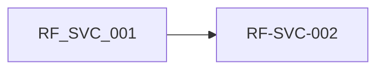

### 3. Requerimientos No Funcionales (RNF)
| ID RNF | Categoría | Requerimiento No Funcional | Métrica / Umbral | Prioridad |
| :--- | :--- | :--- | :--- | :---: |
| `RNF-DIS-003` | Disponibilidad | Plataforma ATC en Multi-AZ | `zonas_de_disponibilidad: 2` | Debe |
| `RNF-INT-007` | Interoperabilid | ad cliente | `Cero registros paralelos del dato de registros_paralelos_dato_cliente: 0` | Debe |
| `RNF-P (P)` | Rendimiento |  | `Búsqueda de cliente en SIGDA/TAXON al registrar p95 ≤ 2 s` | Debería |

### 4. Reglas de Negocio (RN)
| ID Regla | Detalle de la Regla de Negocio |
| :--- | :--- |
| `RN-SVC-004` | Correlativo por RUC. TicketNumber UNIQUE por CompanyID; el libro corre ademas por establecimiento (UNIQUE Company+Address+Número) Ley 29571 (libro) · Negocio |
| `RN-SVC-005` | Empresa y línea obligatorias. CompanyID y BusinessLineID son NOT NULL y no derivables (ContractID es nullable) Negocio · Excel 05_Catalogos |
| `RN-SVC-026` | Cero registros paralelos del dato de cliente. No pueden existir registros paralelos del dato de cliente fuera de SIGDA/TAXON; la auditoría quincenal debe arrojar cero casos y crear uno es gate no compensable Negocio · Excel 05_Catalogos |

### 5. Trazabilidad y Planificación
| Requerimiento | Historias de Usuario Asociadas | Dependencia Bloqueante | Riesgo Asociado |
| :--- | :--- | :--- | :--- |
| `RF-SVC-001` | `HU-ATC-001 · Iteración 1 ·` | DEP-01 SIGDA/TAXON | R-04, R-05 |
| `RF-SVC-002` | `HU-ATC-002 · Iteración 1 ·` | DEP-01 SIGDA/TAXON | R-04, R-05 |

**Fuera de alcance:**
Conectores automáticos de WhatsApp y correo (pendientes de producto); alta de clientes nuevos en SIGDA (proceso del dominio de datos).

**Preguntas abiertas:**
¿La numeración reinicia por año? ¿Cuál es el formato del N.º visible al cliente (prefijo por RUC)? ¿Quién registra a un interesado sin rol contractual (ACT-003)?

---

## [FEAT-02] FT-ATC-02: Ciclo de vida, interacciones e hitos

### Metadatos de la Funcionalidad
- **ID Funcionalidad:** `[FEAT-02]` (`FT-ATC-02`)
- **Nombre:** Ciclo de vida, interacciones e hitos
- **Épica Padre:** `EP-ATC-01 Núcleo de tickets omnicanal`
- **Dueño de Producto (PO):** Eddie Huamaní
- **Prioridad:** Debe
- **Estado DoR:** Refinamiento
- **Estimación (Talla):** L · 13 h
- **Ventana de Ejecución:** mar 20-oct 2026 → jue 22-oct 2026
- **Duración Total:** 13 h de desarrollo · Dev

### 1. Descripción y Valor
**Descripción:**
Gestiona los estados del ticket con historial inmutable, registra cada interacción marcando si es visible al cliente o nota interna (con adjuntos) y conserva los hitos temporales que prueban el cumplimiento.

**Beneficio esperado:**
Trazabilidad completa del caso y evidencia para medir el SLA incluso tras una reapertura.

**Usuarios / roles:**
Colaborador de área · Gestor de tickets · Supervisor ATC

### 2. Catálogo de Requerimientos Funcionales (RF)
| ID Requerimiento | Requerimiento Funcional | Prioridad | Origen | Criterio de Verificación | Horas IA | Predec. | Estado DoR |
| :--- | :--- | :---: | :--- | :--- | :---: | :---: | :---: |
| `RF-SVC-004` | El sistema debe gestionar 7 estados y registrar cada transición con fecha y autor en un historial append-only. | Debe | PROC-SVC-002 · | Colaborador de área Cada cambio agrega una fila; ninguna se sobrescribe | 5 h | — | Pend. DoR |
| `RF-SVC-005` | El sistema debe registrar cada interacción con canal, gestor de tickets, visibilidad al cliente y evidencia multimedia adjunta. | Debe | PROC-SVC-002 · | Colaborador de área Nota interna nunca visible al cliente | 5 h | RF-004 | Pend. DoR |
| `RF-SVC-006` | El sistema debe registrar 1.ª respuesta, 1.ª resolución (inmutable), última resolución y cierre. | Debe | PROC-SVC-002 · Supervisor ATC | FirstResolvedDa teTime no cambia tras reabrir | 3 h | RF-004 | Pend. DoR |

### Ruta Crítica de la Funcionalidad
- **Secuencia Crítica:** `RF-SVC-004  >  RF-SVC-005`
- **Duración Total de Ruta Lógica:** `10 h`


### 3. Requerimientos No Funcionales (RNF)
| ID RNF | Categoría | Requerimiento No Funcional | Métrica / Umbral | Prioridad |
| :--- | :--- | :--- | :--- | :---: |
| `RNF-AUD-004` | Auditoría |  | `Cinco bitácoras append-only firmadas hash_mismatch: 0 en el job de auditoría` | Debe |
| `RNF-SEC-008` | Seguridad | atención/legal | `DLP en bitácoras y narrativa por rol acceso_narrativa_por_rol: columnas de narrativa solo para roles de` | Debe |
| `RNF-CUM-016` | Cumplimiento | NPS-C) | `Cierre formal 100% en Mi Portal pct_tickets_cierre_formal_mi_portal: 100% (gate no compensable, Capa 1 del` | Debe |

### 4. Reglas de Negocio (RN)
| ID Regla | Detalle de la Regla de Negocio |
| :--- | :--- |
| `RN-SVC-002` | Compromisos congelados. FirstResponseDueDateTime y ResolutionDueDateTime se calculan al abrir y NO se recalculan si la política cambia después Negocio · Excel 05_Catalogos |
| `RN-SVC-006` | Asignación append-only. Cada movimiento de área/responsable es fila nueva con motivo tipificado; los punteros actuales son denormalizados Negocio · Excel 05_Catalogos |
| `RN-SVC-007` | Reapertura con nuevo compromiso. REOPENED incrementa ReopenCount y calcula ReopenedResolutionDueDateTime con la política vigente al reabrir; el compromiso original no se reescribe Negocio · Excel 05_Catalogos |
| `RN-SVC-012` | DLP en bitácoras. Prohibido registrar PII en los campos Notes_*: solo el motivo operativo del movimiento Ley 29733 · Seguridad TI |
| `RN-SVC-023` | Gate: cierre fuera de Mi Portal. Un ticket cerrado fuera de Mi Portal, sin cierre formal en el sistema, es un gate no compensable Negocio · Excel 05_Catalogos |

### 5. Trazabilidad y Planificación
| Requerimiento | Historias de Usuario Asociadas | Dependencia Bloqueante | Riesgo Asociado |
| :--- | :--- | :--- | :--- |
| `RF-SVC-004` | `HU-ATC-004 · Iteración 1 ·` | DEP-02 NEXUS | R-07 |
| `RF-SVC-005` | `HU-ATC-005 · Iteración 1 ·` | DEP-02 NEXUS | R-07 |
| `RF-SVC-006` | `HU-ATC-006 · Iteración 1 ·` | DEP-02 NEXUS | R-07 |

**Fuera de alcance:**
Edición o borrado de interacciones ya registradas; chat en tiempo real con el cliente.

**Preguntas abiertas:**
¿Qué tipos de archivo y tamaño máximo se aceptan como evidencia? ¿Cuánto tiempo después de RESOLVED pasa a CLOSED si el cliente no responde?

---

## [FEAT-03] FT-ATC-03: Derivación, reasignación y casillero

### Metadatos de la Funcionalidad
- **ID Funcionalidad:** `[FEAT-03]` (`FT-ATC-03`)
- **Nombre:** Derivación, reasignación y casillero
- **Épica Padre:** `EP-ATC-02 Enrutamiento, SLA y alertas`
- **Dueño de Producto (PO):** Eddie Huamaní
- **Prioridad:** Debe
- **Estado DoR:** Refinamiento
- **Estimación (Talla):** M · 11 h
- **Ventana de Ejecución:** lun 19-oct 2026 → mar 20-oct 2026
- **Duración Total:** 11 h de desarrollo · Dev 2 1

### 1. Descripción y Valor
**Descripción:**
Permite derivar tickets entre las 6 áreas del flujo (con o sin persona), reasignar en bloque cuando un colaborador cesa y ver la bandeja de pendientes por área y responsable.

**Beneficio esperado:**
Ningún ticket se pierde al cambiar de manos y cada colaborador ve su carga real.

**Usuarios / roles:**
Gestor de tickets · Colaborador de área · Supervisor ATC

### 2. Catálogo de Requerimientos Funcionales (RF)
| ID Requerimiento | Requerimiento Funcional | Prioridad | Origen | Criterio de Verificación | Horas IA | Predec. | Estado DoR |
| :--- | :--- | :---: | :--- | :--- | :---: | :---: | :---: |
| `RF-SVC-007` | El sistema debe derivar tickets entre las 6 áreas y colaboradores registrando cada movimiento con motivo en bitácora append-only. | Debe | PROC-SVC-003 · Gestor de | tickets Cada movimiento es una fila nueva con motivo | 4 h | — | Pend. DoR |
| `RF-SVC-008` | El sistema debe reasignar los tickets pendientes de un colaborador que rota o cesa, sin borrar el rastro anterior. | Debe | PROC-SVC-003 · Supervisor ATC | Fila nueva REAS SIGNMENT_* por ticket | 4 h | RF-007 | Pend. DoR |
| `RF-SVC-009` | El sistema debe ofrecer el casillero por área y responsable como consulta sobre los tickets, sin tabla adicional. | Debe | PROC-SVC-003 · | Colaborador de área Resultado = área actual + responsable + estado | 3 h | RF-007 | Pend. DoR |

### Ruta Crítica de la Funcionalidad
- **Secuencia Crítica:** `RF-SVC-007  >  RF-SVC-008`
- **Duración Total de Ruta Lógica:** `8 h`


### 3. Requerimientos No Funcionales (RNF)
| ID RNF | Categoría | Requerimiento No Funcional | Métrica / Umbral | Prioridad |
| :--- | :--- | :--- | :--- | :---: |
| `RNF-AUD-004` | Auditoría | Debe ID Categoría Requerimiento Métrica / umbral Prioridad | `Cinco bitácoras append-only firmadas hash_mismatch: 0 en el job de auditoría` | Debe |
| `RNF-SEC-008` | Seguridad | atención/legal | `DLP en bitácoras y narrativa por rol acceso_narrativa_por_rol: columnas de narrativa solo para roles de` | Debe |

### 4. Reglas de Negocio (RN)
| ID Regla | Detalle de la Regla de Negocio |
| :--- | :--- |
| `RN-SVC-006` | Asignación append-only. Cada movimiento de área/responsable es fila nueva con motivo tipificado; los punteros actuales son denormalizados Negocio · Excel 05_Catalogos |
| `RN-SVC-012` | DLP en bitácoras. Prohibido registrar PII en los campos Notes_*: solo el motivo operativo del movimiento Ley 29733 · Seguridad TI |

### 5. Trazabilidad y Planificación
| Requerimiento | Historias de Usuario Asociadas | Dependencia Bloqueante | Riesgo Asociado |
| :--- | :--- | :--- | :--- |
| `RF-SVC-007` | `HU-ATC-007 · Iteración 1 ·` | DEP-02 NEXUS | R-05 |
| `RF-SVC-008` | `HU-ATC-008 · Iteración 1 ·` | DEP-02 NEXUS | R-05 |
| `RF-SVC-009` | `HU-ATC-009 · Iteración 1 ·` | DEP-02 NEXUS | R-05 |

**Fuera de alcance:**
Asignación por habilidades avanzadas (la reasignación por carga está en FT-ATC-18); integración con RR. HH. para detectar ceses (manual en v1.0).

**Preguntas abiertas:**
¿Quién puede reasignar en bloque: solo el supervisor o también el jefe de área? ¿Hay un catálogo cerrado de motivos de derivación?

---

## [FEAT-04] FT-ATC-04: Motor SLA y alertas

### Metadatos de la Funcionalidad
- **ID Funcionalidad:** `[FEAT-04]` (`FT-ATC-04`)
- **Nombre:** Motor SLA y alertas
- **Épica Padre:** `EP-ATC-02 Enrutamiento, SLA y alertas`
- **Dueño de Producto (PO):** Eddie Huamaní
- **Prioridad:** Debe
- **Estado DoR:** Refinamiento · requiere DEP-03 al
- **Estimación (Talla):** L · 17 h
- **Ventana de Ejecución:** mié 21-oct 2026 → vie 23-oct 2026
- **Duración Total:** 17 h de desarrollo · Dev 2 1

### 1. Descripción y Valor
**Descripción:**
Selecciona la política SLA vigente al abrir el ticket, congela los vencimientos en horas o días hábiles con feriados por geografía, alerta una sola vez por tipo y ciclo, recalcula solo en reaperturas y mide el cierre end-to-end.

**Beneficio esperado:**
Compromisos de tiempo estables y auditables, y alertas oportunas sin ruido.

**Usuarios / roles:**
Job batch de ATC · Supervisor ATC · Coordinador CX

### 2. Catálogo de Requerimientos Funcionales (RF)
| ID Requerimiento | Requerimiento Funcional | Prioridad | Origen | Criterio de Verificación | Horas IA | Predec. | Estado DoR |
| :--- | :--- | :---: | :--- | :--- | :---: | :---: | :---: |
| `RF-SVC-003` | El sistema debe elegir la política SLA vigente por precedencia y congelar los vencimientos de 1.ª respuesta y resolución al abrir el ticket. | Debe | PROC-SVC-001 · | Job batch de ATC Vencimientos no cambian al editar la política | 6 h | — | Pend. DoR |
| `RF-SVC-010` | El sistema debe detectar por job FIRST_RESPONSE_OVERDUE y RESOLUTION_OVERDUE y alertar una sola vez por tipo y ciclo. | Debe | PROC-SVC-004 · Supervisor ATC | UNIQUE (Ticket, Tipo, Ciclo) | 5 h | RF-003 | Pend. DoR |
| `RF-SVC-011` | El sistema debe soportar la reapertura con ReopenCount y un nuevo vencimiento calculado con la política vigente, conservando el original. | Debe | PROC-SVC-004 · Supervisor ATC | ResolutionDue DateTime original intacto | 3 h | RF-010 | Pend. DoR |
| `RF-SVC-029` | El sistema debe medir el cierre end-to-end y alertar al acercarse a 72 horas hábiles sin escalamiento o al plazo del eje si hay escalamiento. | Debe | PROC-SVC-011 · Gestor de | tickets Riesgo marcado a las 72 h hábiles | 3 h | RF-003 | Pend. DoR |

### Ruta Crítica de la Funcionalidad
- **Secuencia Crítica:** `RF-SVC-003  >  RF-SVC-010  >  RF-SVC-011`
- **Duración Total de Ruta Lógica:** `14 h`

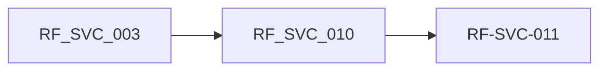

### 3. Requerimientos No Funcionales (RNF)
| ID RNF | Categoría | Requerimiento No Funcional | Métrica / Umbral | Prioridad |
| :--- | :--- | :--- | :--- | :---: |
| `RNF-REN-003` | Rendimiento | Matriz objetivo de SLA por tipo y prioridad | `cumplimiento_sla: por definir (DEP-03)` | Debería |
| `RNF-REN-005` | Rendimiento |  | `Cierre end-to-end de la experiencia sin escalamiento tiempo_cierre_ticket_sin_escalamiento: menor o igual a 72 horas hábiles sin escalamiento; con escalamiento, el plazo del eje correspondiente` | Debería |
| `RNF-AUD-004` | Auditoría |  | `Cinco bitácoras append-only firmadas hash_mismatch: 0 en el job de auditoría` | Debe |

### 4. Reglas de Negocio (RN)
| ID Regla | Detalle de la Regla de Negocio |
| :--- | :--- |
| `RN-SVC-001` | Precedencia SLA. Fila especifica (tipo+prioridad) precede a la generica (PriorityID NULL); máximo una generica activa por tipo (UNIQUEs parciales) Negocio · Excel 05_Catalogos |
| `RN-SVC-002` | Compromisos congelados. FirstResponseDueDateTime y ResolutionDueDateTime se calculan al abrir y NO se recalculan si la política cambia después Negocio · Excel 05_Catalogos |
| `RN-SVC-003` | Días hábiles unicos. BUSINESS_HOURS/BUSINESS_DAYS se resuelven contra MAE_TIME.IsWeekend + MAE_HOLIDAY por geografia del establecimiento, nunca con formula propia del job Negocio · Excel 05_Catalogos |
| `RN-SVC-007` | Reapertura con nuevo compromiso. REOPENED incrementa ReopenCount y calcula ReopenedResolutionDueDateTime con la política vigente al reabrir; el compromiso original no se reescribe Negocio · Excel 05_Catalogos |
| `RN-SVC-008` | Alerta única por ciclo. UNIQUE (TicketID, BreachTypeID, ReopenCycleNumber): cada ciclo alerta una sola vez por tipo de incumplimiento Negocio · Excel 05_Catalogos |
| `RN-SVC-025` | Cierre end-to-end en 72 horas hábiles. El cierre end-to-end del ticket sin escalamiento debe completarse en 72 horas hábiles; si hay escalamiento, aplica el plazo propio del eje correspondiente Negocio · Excel 05_Catalogos |

### 5. Trazabilidad y Planificación
| Requerimiento | Historias de Usuario Asociadas | Dependencia Bloqueante | Riesgo Asociado |
| :--- | :--- | :--- | :--- |
| `RF-SVC-003` | `HU-ATC-003 · Iteración 1 ·` | DEP-03 matriz SLA · DEP-04 calendario | R-01 |
| `RF-SVC-010` | `HU-ATC-010 · Iteración 1 ·` | DEP-03 matriz SLA · DEP-04 calendario | R-01 |
| `RF-SVC-011` | `HU-ATC-011 · Iteración 1 ·` | DEP-03 matriz SLA · DEP-04 calendario | R-01 |
| `RF-SVC-029` | `HU-ATC-029 · Iteración 1 ·` | DEP-03 matriz SLA · DEP-04 calendario | R-01 |

**Fuera de alcance:**
Definir los tiempos de la matriz (decisión de negocio); SLA de línea de casos sensibles (FT-ATC-09).

**Preguntas abiertas:**
¿Se pausa el SLA en PENDING_CUSTOMER? ¿Cuál es el horario hábil por sede? ¿Por qué canal llegan las alertas (correo, notificación en consola)?

---

## [FEAT-05] FT-ATC-05: Libro de Reclamaciones

### Metadatos de la Funcionalidad
- **ID Funcionalidad:** `[FEAT-05]` (`FT-ATC-05`)
- **Nombre:** Libro de Reclamaciones
- **Épica Padre:** `EP-ATC-03 Libro de Reclamaciones y apelaciones`
- **Dueño de Producto (PO):** Eddie Huamaní
- **Prioridad:** Debe
- **Estado DoR:** Refinamiento
- **Estimación (Talla):** L · 18 h
- **Ventana de Ejecución:** jue 22-oct 2026 → mar 27-oct 2026
- **Duración Total:** 18 h de desarrollo · Dev

### 1. Descripción y Valor
**Descripción:**
Crea el asiento QUEJA/RECLAMO como extensión del ticket, calcula el plazo legal y la prórroga única, registra la respuesta formal con cargo y vigila el plazo, detectando reclamos sin asiento.

**Beneficio esperado:**
Cumplimiento de la Ley 29571 art. 24 con evidencia probatoria ante INDECOPI.

**Usuarios / roles:**
Responsable legal de reclamos · Gestor de tickets · Job batch de ATC

### 2. Catálogo de Requerimientos Funcionales (RF)
| ID Requerimiento | Requerimiento Funcional | Prioridad | Origen | Criterio de Verificación | Horas IA | Predec. | Estado DoR |
| :--- | :--- | :---: | :--- | :--- | :---: | :---: | :---: |
| `RF-SVC-012` | El sistema debe crear el asiento QUEJA/RECLAMO como extensión 1:1 del ticket, con correlativo por empresa y establecimiento. | Debe | PROC-SVC-005 · | Responsable legal de reclamos UNIQUE (Company, Address, Número) | 4 h | — | Pend. DoR |
| `RF-SVC-013` | El sistema debe calcular 15 días hábiles desde el registro y gestionar una prórroga única de 15 días con justificación, cargo y canal, bloqueando una segunda. | Debe | PROC-SVC-005 · dDate ≤ LegalR | Responsable legal de reclamos CHECK Extensio nCommunicate esponseDueDat e | 6 h | RF-012 | Pend. DoR |
| `RF-SVC-014` | El sistema debe registrar la respuesta formal (fecha, resumen, carta PDF con cargo y firmante) y la constancia del derecho a acudir a INDECOPI. | Debe | PROC-SVC-005 · | Responsable legal de reclamos Carta PDF en S3 incluida en el IntegrityHash | 4 h | RF-012 | Pend. DoR |
| `RF-SVC-015` | El sistema debe vigilar por job el plazo legal (alertas LEGAL_RESPONSE_OVERDUE y L EGAL_Extensión_WINDOW_CLOS ING) y detectar a diario tickets sin asiento. | Debe | PROC-SVC-005 · | Job batch de ATC GOV_INTEGRITY _EXCEPTION O RPHAN_REFER ENCE | 4 h | RF-013 | Pend. DoR |

### Ruta Crítica de la Funcionalidad
- **Secuencia Crítica:** `RF-SVC-012  >  RF-SVC-013  >  RF-SVC-015`
- **Duración Total de Ruta Lógica:** `14 h`

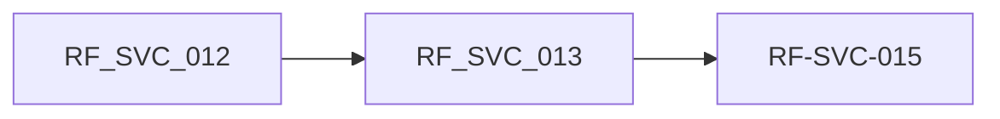

### 3. Requerimientos No Funcionales (RNF)
| ID RNF | Categoría | Requerimiento No Funcional | Métrica / Umbral | Prioridad |
| :--- | :--- | :--- | :--- | :---: |
| `RNF-CUM-006` | Cumplimiento | fuera del plazo legal (o prorrogado) | `Libro de Reclamaciones conforme a ley reclamos_fuera_de_plazo: 0 respuestas` | Debe |
| `RNF-CUM-007` | Cumplimiento | Evidencia probatoria inmutable | `documentos_probatorios_sin_checksu m: 0` | Debe |
| `RNF-AUD-004` | Auditoría |  | `Cinco bitácoras append-only firmadas hash_mismatch: 0 en el job de auditoría` | Debe |
| `RNF-SEC-008` | Seguridad | atención/legal | `DLP en bitácoras y narrativa por rol acceso_narrativa_por_rol: columnas de narrativa solo para roles de` | Debe |

### 4. Reglas de Negocio (RN)
| ID Regla | Detalle de la Regla de Negocio |
| :--- | :--- |
| `RN-SVC-004` | Correlativo por RUC. TicketNumber UNIQUE por CompanyID; el libro corre ademas por establecimiento (UNIQUE Company+Address+Número) Ley 29571 (libro) · Negocio |
| `RN-SVC-009` | Plazo legal 15+15. 15 días hábiles desde el registro, prorrogable UNA vez por 15 más si se justifica y comunica ANTES del vencimiento original; prohibido reescribir el vencimiento prorrogado Ley 29571 art. 24 · D.S. 101-2022-PCM |
| `RN-SVC-010` | Respuesta valida con cargo. Respuesta generica sin número de reclamo ni cargo al consumidor no cuenta ante INDECOPI; la carta PDF con cargo entra al IntegrityHash Ley 29571 · INDECOPI |
| `RN-SVC-011` | Flag indicativo, fila decisiva. RequiresComplaintBook tipifica; la calificación legal la da la existencia de la fila en SVC_COMPLAINT_BOOK_ENTRY (control detectivo diario) Negocio · Excel 05_Catalogos |
| `RN-SVC-013` | Empresa inmutable en el libro. FK compuesta (TicketID, CompanyID) con RESTRICT: el asiento no puede cambiar de razon social Ley 29571 · Legal |
| `RN-SVC-003` | Días hábiles unicos. BUSINESS_HOURS/BUSINESS_DAYS se resuelven contra MAE_TIME.IsWeekend + MAE_HOLIDAY por geografia del establecimiento, nunca con formula propia del job Negocio · Excel 05_Catalogos |

### 5. Trazabilidad y Planificación
| Requerimiento | Historias de Usuario Asociadas | Dependencia Bloqueante | Riesgo Asociado |
| :--- | :--- | :--- | :--- |
| `RF-SVC-012` | `HU-ATC-012 · Iteración 1 ·` | DEP-05 Legal · DEP-06 S3/GLI | R-03 |
| `RF-SVC-013` | `HU-ATC-013 · Iteración 1 ·` | DEP-05 Legal · DEP-06 S3/GLI | R-03 |
| `RF-SVC-014` | `HU-ATC-014 · Iteración 2 ·` | DEP-05 Legal · DEP-06 S3/GLI | R-03 |
| `RF-SVC-015` | `HU-ATC-015 · Iteración 2 ·` | DEP-05 Legal · DEP-06 S3/GLI | R-03 |

**Fuera de alcance:**
Hoja de reclamación pública (web); envío electrónico a INDECOPI.

**Preguntas abiertas:**
¿El libro virtual actual de la web se integra o se reemplaza? ¿Quién firma la carta de respuesta por cada razón social?

---

## [FEAT-06] FT-ATC-06: Apelaciones internas e INDECOPI

### Metadatos de la Funcionalidad
- **ID Funcionalidad:** `[FEAT-06]` (`FT-ATC-06`)
- **Nombre:** Apelaciones internas e INDECOPI
- **Épica Padre:** `EP-ATC-03 Libro de Reclamaciones y apelaciones`
- **Dueño de Producto (PO):** Eddie Huamaní
- **Prioridad:** Debe
- **Estado DoR:** Refinamiento
- **Estimación (Talla):** S · 3 h
- **Ventana de Ejecución:** mar 27-oct 2026 → mar 27-oct 2026
- **Duración Total:** 3 h de desarrollo · Dev

### 1. Descripción y Valor
**Descripción:**
Registra la apelación del consumidor en segunda instancia interna o ante INDECOPI, con número de caso, estados e historial hasta la resolución final.

**Beneficio esperado:**
Seguimiento completo del reclamo hasta su cierre definitivo.

**Usuarios / roles:**
Responsable legal de reclamos

### 2. Catálogo de Requerimientos Funcionales (RF)
| ID Requerimiento | Requerimiento Funcional | Prioridad | Origen | Criterio de Verificación | Horas IA | Predec. | Estado DoR |
| :--- | :--- | :---: | :--- | :--- | :---: | :---: | :---: |
| `RF-SVC-016` | El sistema debe gestionar apelaciones con estados PENDING … WITHDRAWN, número de caso y resolución de INDECOPI, con historial. | Debe | PROC-SVC-006 | · Responsable legal de reclamos Historial de estados completo | 3 h | — | Pend. DoR |

### Ruta Crítica de la Funcionalidad
- **Secuencia Crítica:** `RF-SVC-016`
- **Duración Total de Ruta Lógica:** `3 h`


### 3. Requerimientos No Funcionales (RNF)
| ID RNF | Categoría | Requerimiento No Funcional | Métrica / Umbral | Prioridad |
| :--- | :--- | :--- | :--- | :---: |
| `RNF-CUM-007` | Cumplimiento | Evidencia probatoria inmutable | `documentos_probatorios_sin_checksu m: 0` | Debe |
| `RNF-AUD-004` | Auditoría |  | `Cinco bitácoras append-only firmadas hash_mismatch: 0 en el job de auditoría` | Debe |

### 4. Reglas de Negocio (RN)
| ID Regla | Detalle de la Regla de Negocio |
| :--- | :--- |
| `RN-SVC-010` | Respuesta valida con cargo. Respuesta generica sin número de reclamo ni cargo al consumidor no cuenta ante INDECOPI; la carta PDF con cargo entra al IntegrityHash Ley 29571 · INDECOPI |

### 5. Trazabilidad y Planificación
| Requerimiento | Historias de Usuario Asociadas | Dependencia Bloqueante | Riesgo Asociado |
| :--- | :--- | :--- | :--- |
| `RF-SVC-016` | `HU-ATC-016 · Iteración 2 ·` | DEP-06 S3/GLI | R-03 |

**Fuera de alcance:**
Gestión del procedimiento administrativo sancionador y de los escritos legales.

**Preguntas abiertas:**
¿Cuál es el plazo interno para resolver la segunda instancia?

---

## [FEAT-07] FT-ATC-07: Gate de derivación a Eje 3 y handoff

### Metadatos de la Funcionalidad
- **ID Funcionalidad:** `[FEAT-07]` (`FT-ATC-07`)
- **Nombre:** Gate de derivación a Eje 3 y handoff
- **Épica Padre:** `EP-ATC-04 Gate legal Eje 3 y Mesa de Casos sensibles`
- **Dueño de Producto (PO):** Eddie Huamaní
- **Prioridad:** Debe
- **Estado DoR:** Refinamiento
- **Estimación (Talla):** M · 9 h
- **Ventana de Ejecución:** vie 23-oct 2026 → lun 26-oct 2026
- **Duración Total:** 9 h de desarrollo · Dev 2 1

### 1. Descripción y Valor
**Descripción:**
Impide que un ticket con señal de conflicto se resuelva en Eje 1/2, exige el paquete mínimo de handoff con confirmación de recepción de Legal y registra el estado emocional del cliente sin juicios de valor.

**Beneficio esperado:**
Los conflictos llegan a Legal completos y a tiempo; baja la exposición legal y reputacional.

**Usuarios / roles:**
Gestor de tickets · Gestor de Postventa · Especialista Legal Senior · Director UX

### 2. Catálogo de Requerimientos Funcionales (RF)
| ID Requerimiento | Requerimiento Funcional | Prioridad | Origen | Criterio de Verificación | Horas IA | Predec. | Estado DoR |
| :--- | :--- | :---: | :--- | :--- | :---: | :---: | :---: |
| `RF-SVC-026` | El sistema debe impedir que un ticket con señal de conflicto permanezca o se resuelva en Eje 1 o Eje 2 y exigir su derivación a Eje 3. | Debe | PROC-SVC-011 · Gestor de | tickets Cierre rechazado en Eje 1/2 | 3 h | — | Pend. DoR |
| `RF-SVC-027` | El sistema debe armar el paquete mínimo de handoff (6 elementos) en toda derivación entre ejes y permitir al eje destino confirmar la recepción. | Debe | PROC-SVC-011 · Gestor de | tickets 6/6 elementos antes de enviar | 4 h | RF-026 | Pend. DoR |
| `RF-SVC-028` | El sistema debe registrar una nota del estado emocional del cliente ante frustración o conflicto, sin juicios de valor. | Debe | PROC-SVC-011 · Gestor de | tickets Nota sin adjetivos de juicio | 2 h | RF-026 | Pend. DoR |

### Ruta Crítica de la Funcionalidad
- **Secuencia Crítica:** `RF-SVC-026  >  RF-SVC-027`
- **Duración Total de Ruta Lógica:** `7 h`


### 3. Requerimientos No Funcionales (RNF)
| ID RNF | Categoría | Requerimiento No Funcional | Métrica / Umbral | Prioridad |
| :--- | :--- | :--- | :--- | :---: |
| `RNF-SEC-008` | Seguridad | atención/legal | `DLP en bitácoras y narrativa por rol acceso_narrativa_por_rol: columnas de narrativa solo para roles de` | Debe |
| `RNF-AUD-004` | Auditoría |  | `Cinco bitácoras append-only firmadas hash_mismatch: 0 en el job de auditoría` | Debe |

### 4. Reglas de Negocio (RN)
| ID Regla | Detalle de la Regla de Negocio |
| :--- | :--- |
| `RN-SVC-021` | Gate: un caso de conflicto no se resuelve en Eje 1/2. Un caso de conflicto (carta notarial, INDECOPI, abogado, prensa) no se resuelve en Eje 1/2: se deriva de inmediato al Eje 3 (Legal); es un gate no compensable Negocio · Excel 05_Catalogos |
| `RN-SVC-022` | Gate: derivación sin paquete mínimo. Una derivación entre ejes sin criterio objetivo, sin paquete mínimo completo o sin trazabilidad es un gate no compensable Negocio · Excel 05_Catalogos |
| `RN-SVC-024` | Gate: estado emocional con juicios de valor. El estado emocional del cliente en frustración o conflicto registrado con juicios de valor, o no registrado, es un gate no compensable Negocio · Excel 05_Catalogos |

### 5. Trazabilidad y Planificación
| Requerimiento | Historias de Usuario Asociadas | Dependencia Bloqueante | Riesgo Asociado |
| :--- | :--- | :--- | :--- |
| `RF-SVC-026` | `HU-ATC-026 · Iteración 1 ·` | DEP-01 SIGDA/TAXON · DEP-08 Cobranza | R-05 |
| `RF-SVC-027` | `HU-ATC-027 · Iteración 2 ·` | DEP-01 SIGDA/TAXON · DEP-08 Cobranza | R-05 |
| `RF-SVC-028` | `HU-ATC-028 · Iteración 2 ·` | DEP-01 SIGDA/TAXON · DEP-08 Cobranza | R-05 |

**Fuera de alcance:**
Respuesta pública o vocería (solo aviso al Director UX y coordinación con SCIMCPI).

**Preguntas abiertas:**
¿Qué rol puede retirar una señal de conflicto marcada por error? ¿El historial de pagos se adjunta o solo se enlaza?

---

## [FEAT-08] FT-ATC-08: Mesa SGD: recepción, activación y riesgo

### Metadatos de la Funcionalidad
- **ID Funcionalidad:** `[FEAT-08]` (`FT-ATC-08`)
- **Nombre:** Mesa SGD: recepción, activación y riesgo
- **Épica Padre:** `EP-ATC-04 Gate legal Eje 3 y Mesa de Casos sensibles`
- **Dueño de Producto (PO):** Eddie Huamaní
- **Prioridad:** Debe
- **Estado DoR:** Refinamiento
- **Estimación (Talla):** M · 11 h
- **Ventana de Ejecución:** lun 26-oct 2026 → mié 28-oct 2026
- **Duración Total:** 11 h de desarrollo · Dev 2 1

### 1. Descripción y Valor
**Descripción:**
Registra los casos sensibles de las 5 líneas de ingreso con Código Único, separa el cargo previo del cargo de activación (que inicia el SLA de línea) y calcula el riesgo con una matriz objetiva recalibrable.

**Beneficio esperado:**
Trazabilidad única de casos sensibles y priorización objetiva.

**Usuarios / roles:**
Mesa de Casos (SGD) · Gestor de reclamos

### 2. Catálogo de Requerimientos Funcionales (RF)
| ID Requerimiento | Requerimiento Funcional | Prioridad | Origen | Criterio de Verificación | Horas IA | Predec. | Estado DoR |
| :--- | :--- | :---: | :--- | :--- | :---: | :---: | :---: |
| `RF-SVC-020` | El sistema debe registrar todo caso sensible por su línea de origen (5 líneas) con un Código Único Estandarizado. | Debe | PROC-SVC-009 | · Mesa de Casos (SGD) Código nunca reutilizado | 4 h | — | Pend. DoR |
| `RF-SVC-021` | El sistema debe emitir el cargo previo de asignación y un cargo de activación separado; el SLA de línea inicia solo con la activación. | Debe | PROC-SVC-009 | · Mesa de Casos (SGD) SLA inicia en la fecha de activación | 3 h | RF-020 | Pend. DoR |
| `RF-SVC-022` | El sistema debe calcular el nivel de riesgo con una matriz objetiva de criterios ponderados y permitir recalibrarlo con registro. | Debe | PROC-SVC-009 | · Mesa de Casos (SGD) Nivel resultante de la matriz, no de opinión | 4 h | RF-020 | Pend. DoR |

### Ruta Crítica de la Funcionalidad
- **Secuencia Crítica:** `RF-SVC-020  >  RF-SVC-022`
- **Duración Total de Ruta Lógica:** `8 h`

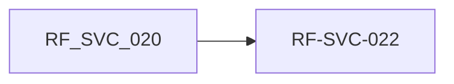

### 3. Requerimientos No Funcionales (RNF)
| ID RNF | Categoría | Requerimiento No Funcional | Métrica / Umbral | Prioridad |
| :--- | :--- | :--- | :--- | :---: |
| `RNF-CUM-015` | Cumplimiento | independiente | `IGDC: Índice de Gestión Documentaria y de Casos igdc_score: IGDC = (CASOS x 0,60) + (CUSTODIA x 0,40); se multiplica por cero si hay incumplimiento de un plazo legal externo o acceso indebido a un caso sensible, cada uno de forma` | Debe |
| `RNF-SEC-008` | Seguridad | atención/legal | `DLP en bitácoras y narrativa por rol acceso_narrativa_por_rol: columnas de narrativa solo para roles de` | Debe |

### 4. Reglas de Negocio (RN)
| ID Regla | Detalle de la Regla de Negocio |
| :--- | :--- |
| `RN-SVC-014` | Cinco lineas de ingreso de casos sensibles. Los casos sensibles ingresan por 5 lineas: Indecopi (procedimientos administrativos directos), Libro de Reclamaciones (canales regulados), Cartas Notariales (valor probatorio), Legal Atiende (preventivo, antes de escalar a reclamo formal) y Backlog Historico (casos previos sin cierre formal) Negocio · Excel 05_Catalogos |
| `RN-SVC-015` | Cargo previo distinto del cargo de activación. El SLA de un caso no arranca con el cargo previo de asignación sino con el cargo de activación formal; un cargo previo sin activación deja el caso en el limbo Negocio · Excel 05_Catalogos |
| `RN-SVC-016` | Clasificación de riesgo objetiva y recalibrable. El nivel de riesgo de un caso se calcula con una matriz objetiva (nunca por percepción) y se recalibra si el caso evoluciona con nuevos elementos o vinculación con otros casos Negocio · Excel 05_Catalogos |

### 5. Trazabilidad y Planificación
| Requerimiento | Historias de Usuario Asociadas | Dependencia Bloqueante | Riesgo Asociado |
| :--- | :--- | :--- | :--- |
| `RF-SVC-020` | `HU-ATC-020 · Iteración 2 ·` | — | R-06, R-08 |
| `RF-SVC-021` | `HU-ATC-021 · Iteración 2 ·` | — | R-06, R-08 |
| `RF-SVC-022` | `HU-ATC-022 · Iteración 2 ·` | — | R-06, R-08 |

**Fuera de alcance:**
Digitalización del pendientes de producto histórico en papel (proyecto aparte).

**Preguntas abiertas:**
¿Cuál es el plazo de SLA de cada línea? ¿Qué criterios y ponderaciones tiene la matriz de riesgo? ¿Formato del Código Único?

---

## [FEAT-09] FT-ATC-09: Escalamiento, vinculación y cierre tipificado

### Metadatos de la Funcionalidad
- **ID Funcionalidad:** `[FEAT-09]` (`FT-ATC-09`)
- **Nombre:** Escalamiento, vinculación y cierre tipificado
- **Épica Padre:** `EP-ATC-04 Gate legal Eje 3 y Mesa de Casos sensibles`
- **Dueño de Producto (PO):** Eddie Huamaní
- **Prioridad:** Debe
- **Estado DoR:** Refinamiento
- **Estimación (Talla):** L · 12 h
- **Ventana de Ejecución:** mié 28-oct 2026 → jue 29-oct 2026
- **Duración Total:** 12 h de desarrollo · Dev 2 1

### 1. Descripción y Valor
**Descripción:**
Escala en cadena los casos que incumplen su SLA de línea, valida si un caso nuevo está vinculado a uno existente y cierra cada caso en uno de los 8 estados homologados, con evidencia y custodia en el GLI.

**Beneficio esperado:**
Ningún caso se estanca sin que una instancia superior lo sepa; cierres comparables y auditables.

**Usuarios / roles:**
Mesa de Casos (SGD) · Jefaturas · Comité de Asistentes · Directorio

### 2. Catálogo de Requerimientos Funcionales (RF)
| ID Requerimiento | Requerimiento Funcional | Prioridad | Origen | Criterio de Verificación | Horas IA | Predec. | Estado DoR |
| :--- | :--- | :---: | :--- | :--- | :---: | :---: | :---: |
| `RF-SVC-023` | El sistema debe escalar automáticamente, sin saltar niveles: alerta temprana, memorándum a jefatura, Comité y Directorio. | Debe | PROC-SVC-010 · | Mesa de Casos (SGD) Secuencia de niveles sin saltos | 5 h | — | Pend. DoR |
| `RF-SVC-024` | El sistema debe validar si un caso nuevo está vinculado a uno existente antes de registrarlo como independiente. | Debe | PROC-SVC-010 · | Mesa de Casos (SGD) Casos vinculados comparten un hilo de evidencia | 4 h | — | Pend. DoR |
| `RF-SVC-025` | El sistema debe cerrar cada caso en uno de los 8 estados homologados, con evidencia, y referenciar la custodia en el GLI. | Debe | PROC-SVC-010 · | Mesa de Casos (SGD) Sin evidencia no hay cierre | 3 h | RF-023, | RF-024 Pend. DoR |

### Ruta Crítica de la Funcionalidad
- **Secuencia Crítica:** `RF-SVC-023  >  RF-SVC-025`
- **Duración Total de Ruta Lógica:** `8 h`


### 3. Requerimientos No Funcionales (RNF)
| ID RNF | Categoría | Requerimiento No Funcional | Métrica / Umbral | Prioridad |
| :--- | :--- | :--- | :--- | :---: |
| `RNF-CUM-007` | Cumplimiento | Evidencia probatoria inmutable | `documentos_probatorios_sin_checksu m: 0` | Debe |
| `RNF-CUM-015` | Cumplimiento | independiente | `IGDC: Índice de Gestión Documentaria y de Casos igdc_score: IGDC = (CASOS x 0,60) + (CUSTODIA x 0,40); se multiplica por cero si hay incumplimiento de un plazo legal externo o acceso indebido a un caso sensible, cada uno de forma` | Debe |

### 4. Reglas de Negocio (RN)
| ID Regla | Detalle de la Regla de Negocio |
| :--- | :--- |
| `RN-SVC-017` | Escalamiento en cadena sin saltos. El incumplimiento de SLA de un caso sensible escala en cadena: alerta preventiva, alerta de vencimiento, memorandum a la jefatura, escalado a Comite y escalado a Directorio, sin saltar niveles Negocio · Excel 05_Catalogos |
| `RN-SVC-018` | Caso vinculado no se duplica. Un caso cruzado o vinculado con otro no se registra como caso independiente; se gestiona con un solo hilo de evidencia Negocio · Excel 05_Catalogos |
| `RN-SVC-019` | Cierre tipificado por ocho estados homologados. Todo cierre de caso se tipifica en uno de ocho estados homologados (conforme, con observación, con riesgo mitigado, con contingencia, por desistimiento, por derivación legal, por regularización documentaria, por acuerdo con cliente) o se reabre; un cierre sin evidencia no es cierre Negocio · Excel 05_Catalogos |
| `RN-SVC-020` | Custodia legal separada de la plataforma operativa. Los originales probatorios críticos se custodian en el Repositorio Legal Controlado (GLI); la plataforma de trazabilidad operativa nunca reemplaza esa custodia Negocio · Excel 05_Catalogos |

### 5. Trazabilidad y Planificación
| Requerimiento | Historias de Usuario Asociadas | Dependencia Bloqueante | Riesgo Asociado |
| :--- | :--- | :--- | :--- |
| `RF-SVC-023` | `HU-ATC-023 · Iteración 2 ·` | DEP-06 GLI | R-06 |
| `RF-SVC-024` | `HU-ATC-024 · Iteración 2 ·` | DEP-06 GLI | R-06 |
| `RF-SVC-025` | `HU-ATC-025 · Iteración 2 ·` | DEP-06 GLI | R-06 |

**Fuera de alcance:**
Gestión de agendas del Comité y del Directorio.

**Preguntas abiertas:**
¿Umbrales de tiempo entre cada nivel de escalamiento? ¿Qué criterio define que dos casos «coinciden en hechos»?

---

## [FEAT-10] FT-ATC-10: Reclamos de garantía postventa

### Metadatos de la Funcionalidad
- **ID Funcionalidad:** `[FEAT-10]` (`FT-ATC-10`)
- **Nombre:** Reclamos de garantía postventa
- **Épica Padre:** `EP-ATC-05 Postventa: reclamos de garantía`
- **Dueño de Producto (PO):** Eddie Huamaní
- **Prioridad:** Debería
- **Estado DoR:** Refinamiento
- **Estimación (Talla):** L · 12 h
- **Ventana de Ejecución:** mar 27-oct 2026 → jue 29-oct 2026
- **Duración Total:** 12 h de desarrollo · Dev

### 1. Descripción y Valor
**Descripción:**
Registra reclamos de garantía vinculados al Acta de Entrega, valida la vigencia contra el periodo de cobertura, documenta la inspección técnica antes de resolver y escala a Legal si hay conflicto.

**Beneficio esperado:**
Postventa ordenada y defendible; rechazo automático de reclamos fuera de cobertura.

**Usuarios / roles:**
Gestor de Postventa · Inspector técnico · Cliente propietario

### 2. Catálogo de Requerimientos Funcionales (RF)
| ID Requerimiento | Requerimiento Funcional | Prioridad | Origen | Criterio de Verificación | Horas IA | Predec. | Estado DoR |
| :--- | :--- | :---: | :--- | :--- | :---: | :---: | :---: |
| `RF-SVC-033` | El sistema debe registrar el reclamo de garantía tipificado y vinculado obligatoriamente a un Acta de Entrega existente. | Debería | PROC-SVC-013 · Gestor de Postventa | Sin Acta no hay reclamo | 4 h | — | Pend. DoR |
| `RF-SVC-034` | El sistema debe validar la vigencia contra el periodo de cobertura y la fecha real de entrega, y rechazar automáticamente lo que está fuera de cobertura. | Debería | PROC-SVC-013 · Gestor de Postventa | Fuera de cobertura = no procedente | 2 h | RF-033 | Pend. DoR |
| `RF-SVC-035` | El sistema debe registrar la inspección técnica con su evidencia antes de resolver el reclamo. | Debería | PROC-SVC-013 · Gestor de Postventa | Sin inspección no hay resolución | 3 h | RF-033 | Pend. DoR |
| `RF-SVC-036` | El sistema debe escalar a Eje 3 un reclamo de garantía que derive en conflicto legal y permitir gestionar la reincorporación contractual por adenda. | Debería | PROC-SVC-013 · Gestor de Postventa | Derivación sin intento de resolución en Eje 2 | 3 h | RF-035 | Pend. DoR |

### Ruta Crítica de la Funcionalidad
- **Secuencia Crítica:** `RF-SVC-033  >  RF-SVC-035  >  RF-SVC-036`
- **Duración Total de Ruta Lógica:** `10 h`


### 3. Requerimientos No Funcionales (RNF)
| ID RNF | Categoría | Requerimiento No Funcional | Métrica / Umbral | Prioridad |
| :--- | :--- | :--- | :--- | :---: |
| `RNF-AUD-004` | Auditoría |  | `Cinco bitácoras append-only firmadas hash_mismatch: 0 en el job de auditoría` | Debe |
| `RNF-P (P)` | Usabilidad | obra | `Registro de inspección desde móvil en Responsive, fotos ≤ 10 MB` | Debería |

### 4. Reglas de Negocio (RN)
| ID Regla | Detalle de la Regla de Negocio |
| :--- | :--- |
| `RN-SVC-027` | Garantía siempre cuelga de una entrega y vigente por cobertura. Un reclamo de garantía siempre cuelga de una entrega previa (CONTRACT_UNIT_HANDOVER) y solo es procedente dentro del periodo de cobertura validado contra la fecha real de entrega Negocio · Excel 05_Catalogos |
| `RN-SVC-021` | Gate: un caso de conflicto no se resuelve en Eje 1/2. Un caso de conflicto (carta notarial, INDECOPI, abogado, prensa) no se resuelve en Eje 1/2: se deriva de inmediato al Eje 3 (Legal); es un gate no compensable Negocio · Excel 05_Catalogos |

### 5. Trazabilidad y Planificación
| Requerimiento | Historias de Usuario Asociadas | Dependencia Bloqueante | Riesgo Asociado |
| :--- | :--- | :--- | :--- |
| `RF-SVC-033` | `HU-ATC-033 · Iteración 2 ·` | DEP-07 Contratos y Activos | R-05 |
| `RF-SVC-034` | `HU-ATC-034 · Iteración 2 ·` | DEP-07 Contratos y Activos | R-05 |
| `RF-SVC-035` | `HU-ATC-035 · Iteración 2 ·` | DEP-07 Contratos y Activos | R-05 |
| `RF-SVC-036` | `HU-ATC-036 · Iteración 2 ·` | DEP-07 Contratos y Activos | R-05 |

**Fuera de alcance:**
Órdenes de trabajo a contratistas, costos de reparación, almacén.

**Preguntas abiertas:**
¿Periodos de cobertura por tipo de defecto? ¿La inspección la registra Postventa o un tercero?

---

## [FEAT-11] FT-ATC-11: Integración UrbeMind (CITY_INCIDENT)

### Metadatos de la Funcionalidad
- **ID Funcionalidad:** `[FEAT-11]` (`FT-ATC-11`)
- **Nombre:** Integración UrbeMind (CITY_INCIDENT)
- **Épica Padre:** `EP-ATC-06 Integración UrbeMind`
- **Dueño de Producto (PO):** Eddie Huamaní
- **Prioridad:** Debería
- **Estado DoR:** Refinamiento · alcance por confirmar
- **Estimación (Talla):** M · 7 h
- **Ventana de Ejecución:** mié 28-oct 2026 → jue 29-oct 2026
- **Duración Total:** 7 h de desarrollo · Dev 4 1

### 1. Descripción y Valor
**Descripción:**
Expone creación y consulta de tickets por API/evento para que UrbeMind reporte incidencias de ciudad, con vínculo opcional a contrato o unidad cuando deriven en cobro.

**Beneficio esperado:**
Incidencias urbanas atendidas con la misma infraestructura, medibles y cobrables.

**Usuarios / roles:**
UrbeMind (sistema) · Gestor de tickets · Residentes

### 2. Catálogo de Requerimientos Funcionales (RF)
| ID Requerimiento | Requerimiento Funcional | Prioridad | Origen | Criterio de Verificación | Horas IA | Predec. | Estado DoR |
| :--- | :--- | :---: | :--- | :--- | :---: | :---: | :---: |
| `RF-SVC-017` | El sistema debe vincular opcionalmente el ticket CITY_INCIDENT a un contrato y/o unidad; si deriva en cobro, a un contrato CITY_SERVICE_FEE. | Debería | PROC-SVC-007 · | UrbeMind ContractID apunta a CITY_S ERVICE_FEE | 2 h | — | Pend. DoR |
| `RF-SVC-018` | El sistema debe exponer creación y consulta de tickets vía API/evento a UrbeMind, sin JOIN físico. | Debería | PROC-SVC-007 · | UrbeMind 0 accesos fuera de API/evento | 5 h | RF-017 | Pend. DoR |

### Ruta Crítica de la Funcionalidad
- **Secuencia Crítica:** `RF-SVC-017  >  RF-SVC-018`
- **Duración Total de Ruta Lógica:** `7 h`

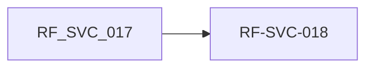

### 3. Requerimientos No Funcionales (RNF)
| ID RNF | Categoría | Requerimiento No Funcional | Métrica / Umbral | Prioridad |
| :--- | :--- | :--- | :--- | :---: |
| `RNF-INT-003` | Interoperabilid | ad Frontera API/evento con UrbeMind UrbeMind fuera de API/evento | `accesos_directos_a_bd: 0 accesos de` | Debe |

### 4. Reglas de Negocio (RN)
| ID Regla | Detalle de la Regla de Negocio |
| :--- | :--- |
| `RN-SVC-005` | Empresa y línea obligatorias. CompanyID y BusinessLineID son NOT NULL y no derivables (ContractID es nullable) Negocio · Excel 05_Catalogos |

### 5. Trazabilidad y Planificación
| Requerimiento | Historias de Usuario Asociadas | Dependencia Bloqueante | Riesgo Asociado |
| :--- | :--- | :--- | :--- |
| `RF-SVC-017` | `HU-ATC-017 · Iteración 2 ·` | DEP-09 UrbeMind | R-02 |
| `RF-SVC-018` | `HU-ATC-018 · Iteración 2 ·` | DEP-09 UrbeMind | R-02 |

**Fuera de alcance:**
Funcionalidades dentro de UrbeMind; facturación del CITY_SERVICE_FEE.

**Preguntas abiertas:**
¿Confirma el patrocinador que UrbeMind entra al alcance, pese a figurar en «No alcance»?

---

## [FEAT-13] FT-ATC-13: Encuesta post-atención

### Metadatos de la Funcionalidad
- **ID Funcionalidad:** `[FEAT-13]` (`FT-ATC-13`)
- **Nombre:** Encuesta post-atención
- **Épica Padre:** `EP-ATC-07 Calidad de atención y Torre de Control CX`
- **Dueño de Producto (PO):** Eddie Huamaní
- **Prioridad:** Debe
- **Estado DoR:** Refinamiento
- **Estimación (Talla):** S · 3 h
- **Ventana de Ejecución:** lun 26-oct 2026 → lun 26-oct 2026
- **Duración Total:** 3 h de desarrollo · Dev 3 1

### 1. Descripción y Valor
**Descripción:**
Dispara la encuesta POST_TRANSACTION al cerrar el ticket y permite medir CSAT/CES por tipo de ticket, área y gestor de tickets.

**Beneficio esperado:**
Medición sistemática de la calidad de atención desde el día 1.

**Usuarios / roles:**
Cliente · Supervisor ATC · Coordinador CX

### 2. Catálogo de Requerimientos Funcionales (RF)
| ID Requerimiento | Requerimiento Funcional | Prioridad | Origen | Criterio de Verificación | Horas IA | Predec. | Estado DoR |
| :--- | :--- | :---: | :--- | :--- | :---: | :---: | :---: |
| `RF-SVC-019` | El sistema debe disparar la encuesta POST_TRANSACTION al cerrar el ticket y permitir medir CSAT/CES por tipo, área y gestor de tickets. | Debe | PROC-SVC-008 · Supervisor ATC | 100 % de CLOSED con encuesta | 3 h | — | Pend. DoR |

### Ruta Crítica de la Funcionalidad
- **Secuencia Crítica:** `RF-SVC-019`
- **Duración Total de Ruta Lógica:** `3 h`

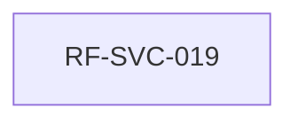

### 3. Requerimientos No Funcionales (RNF)
| ID RNF | Categoría | Requerimiento No Funcional | Métrica / Umbral | Prioridad |
| :--- | :--- | :--- | :--- | :---: |
| `RNF-INT-004` | Interoperabilid | ad Medición de calidad hacia el KPI Engine POST_TRANSACTION | `tickets_cerrados_con_encuesta_dispara da: 100% de CLOSED dispara` | Debe |

### 4. Reglas de Negocio (RN)
| ID Regla | Detalle de la Regla de Negocio |
| :--- | :--- |
| `RN-SVC-007` | Reapertura con nuevo compromiso. REOPENED incrementa ReopenCount y calcula ReopenedResolutionDueDateTime con la política vigente al reabrir; el compromiso original no se reescribe Negocio · Excel 05_Catalogos |

### 5. Trazabilidad y Planificación
| Requerimiento | Historias de Usuario Asociadas | Dependencia Bloqueante | Riesgo Asociado |
| :--- | :--- | :--- | :--- |
| `RF-SVC-019` | `HU-ATC-019 · Iteración 2 ·` | DEP-10 KPI Engine | R-08 |

**Fuera de alcance:**
Diseño de preguntas (se reutiliza el fragmento 19); encuestas relacionales o de marca.

**Preguntas abiertas:**
¿Canal de envío de la encuesta (WhatsApp, correo, SMS)? ¿Qué pasa si el ticket se reabre después de responder la encuesta?

---

## [FEAT-14] FT-ATC-14: Torre de Control CX

### Metadatos de la Funcionalidad
- **ID Funcionalidad:** `[FEAT-14]` (`FT-ATC-14`)
- **Nombre:** Torre de Control CX
- **Épica Padre:** `EP-ATC-07 Calidad de atención y Torre de Control CX`
- **Dueño de Producto (PO):** Eddie Huamaní
- **Prioridad:** Debería
- **Estado DoR:** Refinamiento
- **Estimación (Talla):** L · 13 h
- **Ventana de Ejecución:** lun 26-oct 2026 → mié 28-oct 2026
- **Duración Total:** 13 h de desarrollo · Dev 3 1

### 1. Descripción y Valor
**Descripción:**
Tablero en tiempo real de tickets activos, SLA, NPS, derivaciones y casos en riesgo; informes diario y quincenal; auditoría quincenal de registros paralelos del dato de cliente.

**Beneficio esperado:**
Corrección preventiva antes del incumplimiento y decisiones con datos consolidados.

**Usuarios / roles:**
Coordinador CX · Jefaturas · Comité de Asistentes · CDO

### 2. Catálogo de Requerimientos Funcionales (RF)
| ID Requerimiento | Requerimiento Funcional | Prioridad | Origen | Criterio de Verificación | Horas IA | Predec. | Estado DoR |
| :--- | :--- | :---: | :--- | :--- | :---: | :---: | :---: |
| `RF-SVC-030` | El sistema debe mostrar en tiempo real tickets activos, NPS, tiempos, SLA y derivaciones en curso. | Debería | PROC-SVC-012 · | Coordinador CX Casos en riesgo marcados antes de vencer | 6 h | — | Pend. DoR |
| `RF-SVC-031` | El sistema debe generar el informe diario operativo y el informe quincenal analítico. | Debería | PROC-SVC-012 · | Coordinador CX Informe con las secciones definidas | 4 h | RF-030 | Pend. DoR |
| `RF-SVC-032` | El sistema debe auditar quincenalmente la existencia de registros paralelos del dato de cliente fuera de SIGDA/TAXON. | Debería | PROC-SVC-012 · | Coordinador CX Resultado esperado = 0 | 3 h | — | Pend. DoR |

### Ruta Crítica de la Funcionalidad
- **Secuencia Crítica:** `RF-SVC-030  >  RF-SVC-031`
- **Duración Total de Ruta Lógica:** `10 h`


### 3. Requerimientos No Funcionales (RNF)
| ID RNF | Categoría | Requerimiento No Funcional | Métrica / Umbral | Prioridad |
| :--- | :--- | :--- | :--- | :---: |
| `RNF-USA-001` | Usabilidad | experiencia | `NPS-C: North Star corporativo de nps_c_score: NPS-C = (JOU x 0,45) + (POS x 0,35) + (EVT x 0,20); escala -100 a +100; ponderación provisional hasta calibración del primer trimestre` | Debería |
| `RNF-INT-007` | Interoperabilid | ad cliente | `Cero registros paralelos del dato de registros_paralelos_dato_cliente: 0` | Debe |
| `RNF-CUM-015` | Cumplimiento | independiente | `IGDC: Índice de Gestión Documentaria y de Casos igdc_score: IGDC = (CASOS x 0,60) + (CUSTODIA x 0,40); se multiplica por cero si hay incumplimiento de un plazo legal externo o acceso indebido a un caso sensible, cada uno de forma` | Debe |

### 4. Reglas de Negocio (RN)
| ID Regla | Detalle de la Regla de Negocio |
| :--- | :--- |
| `RN-SVC-026` | Cero registros paralelos del dato de cliente. No pueden existir registros paralelos del dato de cliente fuera de SIGDA/TAXON; la auditoría quincenal debe arrojar cero casos y crear uno es gate no compensable Negocio · Excel 05_Catalogos |

### 5. Trazabilidad y Planificación
| Requerimiento | Historias de Usuario Asociadas | Dependencia Bloqueante | Riesgo Asociado |
| :--- | :--- | :--- | :--- |
| `RF-SVC-030` | `HU-ATC-030 · Iteración 2 ·` | DEP-10 KPI Engine | R-08 |
| `RF-SVC-031` | `HU-ATC-031 · Iteración 2 ·` | DEP-10 KPI Engine | R-08 |
| `RF-SVC-032` | `HU-ATC-032 · Iteración 2 ·` | DEP-10 KPI Engine | R-08 |

**Fuera de alcance:**
BI corporativo de otros dominios; modelos predictivos.

**Preguntas abiertas:**
¿Quiénes reciben el informe diario? ¿Qué frecuencia de actualización se considera «tiempo real» (≤ 1 min)?

---

## [FEAT-15] FT-ATC-15: EntregaFest: contención en vivo

### Metadatos de la Funcionalidad
- **ID Funcionalidad:** `[FEAT-15]` (`FT-ATC-15`)
- **Nombre:** EntregaFest: contención en vivo
- **Épica Padre:** `EP-ATC-08 EntregaFest: contención y derivación en vivo`
- **Dueño de Producto (PO):** Eddie Huamaní
- **Prioridad:** Podría
- **Estado DoR:** Refinamiento
- **Estimación (Talla):** S · 6 h
- **Ventana de Ejecución:** mié 28-oct 2026 → jue 29-oct 2026
- **Duración Total:** 6 h de desarrollo · Dev 3 1

### 1. Descripción y Valor
**Descripción:**
Registra la clasificación de riesgo verbal y la secuencia de Frases Ancla, detecta palabras de riesgo muy alto y deriva el caso a la Estación 4 con la etiqueta estándar.

**Beneficio esperado:**
Contención ordenada en eventos y cero casos sensibles sin registro.

**Usuarios / roles:**
Moderador de evento · Coordinador CX · Especialista Legal Senior

### 2. Catálogo de Requerimientos Funcionales (RF)
| ID Requerimiento | Requerimiento Funcional | Prioridad | Origen | Criterio de Verificación | Horas IA | Predec. | Estado DoR |
| :--- | :--- | :---: | :--- | :--- | :---: | :---: | :---: |
| `RF-SVC-037` | flexible El sistema debe registrar la clasificación de riesgo de la intervención en vivo y la secuencia de Frases Ancla (4, 5, 6) aplicada. | Podría | PROC-SVC-014 · | Moderador de evento Frase 6 exige registrar el caso | 2 h | — | Pend. DoR |
| `RF-SVC-038` | flexible El sistema debe registrar la derivación inmediata a la Estación 4 de todo caso sensible o imputación penal en vivo. | Podría | PROC-SVC-014 · | Moderador de evento Derivación exigida ante palabra gatillo | 2 h | RF-037 | Pend. DoR |
| `RF-SVC-039` | flexible El sistema debe registrar todo caso sensible del evento con la etiqueta «Atención especial — derivación a Legal». | Podría | PROC-SVC-014 · | Moderador de evento Etiqueta literal | 2 h | RF-038 | Pend. DoR |

### Ruta Crítica de la Funcionalidad
- **Secuencia Crítica:** `RF-SVC-037  >  RF-SVC-038  >  RF-SVC-039`
- **Duración Total de Ruta Lógica:** `6 h`

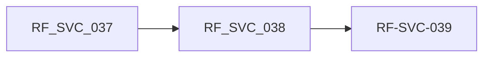

### 3. Requerimientos No Funcionales (RNF)
| ID RNF | Categoría | Requerimiento No Funcional | Métrica / Umbral | Prioridad |
| :--- | :--- | :--- | :--- | :---: |
| `RNF-REN-006` | Rendimiento | Debería ID Categoría Requerimiento Métrica / umbral Prioridad | `Post-mortem de EntregaFest dentro de 3 días hábiles pct_eventos_con_postmortem_a_tiemp o: 100% dentro de 3 días hábiles (gate no compensable, Capa 1 del NPS post-evento)` | Debe |
| `RNF-P (P)` | Usabilidad | evento | `Registro rápido desde tablet durante el ≤ 3 toques para derivar` | Debería |

### 4. Reglas de Negocio (RN)
| ID Regla | Detalle de la Regla de Negocio |
| :--- | :--- |
| `RN-SVC-028` | Gate: casos sensibles no se debaten en sala. Un caso sensible o una imputación penal en vivo durante un EntregaFest no se debate en sala: se deriva de inmediato a la Estación 4 (Legal) y se registra como 'Atención especial — derivación a Legal' Negocio · Excel 05_Catalogos |
| `RN-SVC-029` | Palabras de riesgo muy alto obligan canalización formal. Las palabras 'estafa', 'fraude', 'abuso' o 'delito' se clasifican como riesgo muy alto (imputación penal) y obligan a canalizar por vias formales; el moderador nunca niega, discute o se muestra incomodo ante ellas Negocio · Excel 05_Catalogos |
| `RN-SVC-030` | Secuencia de contención verbal 4-5-6. Ante insistencia de un propietario se aplica la secuencia Frase 4 (concreción), Frase 5 (invocación de reglas), Frase 6 (compromiso formal y registro del caso), en ese orden, antes de derivar Negocio · Excel 05_Catalogos |

### 5. Trazabilidad y Planificación
| Requerimiento | Historias de Usuario Asociadas | Dependencia Bloqueante | Riesgo Asociado |
| :--- | :--- | :--- | :--- |
| `RF-SVC-037` | `HU-ATC-037 · Iteración 2 ·` | — | R-04 |
| `RF-SVC-038` | `HU-ATC-038 · Iteración 2 ·` | — | R-04 |
| `RF-SVC-039` | `HU-ATC-039 · Iteración 2 ·` | — | R-04 |

**Fuera de alcance:**
Transcripción automática de audio; logística del evento.

**Preguntas abiertas:**
¿El registro lo hace el moderador o el personal de apoyo? ¿Funciona sin conexión en el recinto?

---

## [FEAT-16] FT-ATC-16: Integración con Legal y prevención de denuncias

### Metadatos de la Funcionalidad
- **ID Funcionalidad:** `[FEAT-16]` (`FT-ATC-16`)
- **Nombre:** Integración con Legal y prevención de denuncias
- **Épica Padre:** `EP-ATC-10 Consulta 360 e integraciones operativas`
- **Dueño de Producto (PO):** Eddie Huamaní
- **Prioridad:** Debe
- **Estado DoR:** Refinamiento
- **Estimación (Talla):** M · 9 h
- **Ventana de Ejecución:** vie 23-oct 2026 → lun 26-oct 2026
- **Duración Total:** 9 h de desarrollo · Dev 4 1

### 1. Descripción y Valor
**Descripción:**
Sincroniza los tickets del Eje 3 con la herramienta del equipo de Legal y calcula la exposición económica (monto + interés legal referencial) de los reclamos con riesgo de denuncia para priorizarlos.

**Beneficio esperado:**
Un solo registro de cada caso legal y foco en los que pueden terminar en denuncia.

**Usuarios / roles:**
Responsable legal de reclamos · Coordinador CX · Gestor de tickets

### 2. Catálogo de Requerimientos Funcionales (RF)
| ID Requerimiento | Requerimiento Funcional | Prioridad | Origen | Criterio de Verificación | Horas IA | Predec. | Estado DoR |
| :--- | :--- | :---: | :--- | :--- | :---: | :---: | :---: |
| `RF-SVC-040` | El sistema debe sincronizar los tickets derivados a Eje 3 con la herramienta que usa el equipo de Legal (responsable: Rosario), enviando el paquete mínimo y recibiendo estado y resolución. | Debe | PROC-SVC-015 · Feedback de Legal con el | Responsable legal de reclamos presentación · ítem 2 Caso visible en la herramienta N.º de ticket | 5 h | — | Pend. DoR |
| `RF-SVC-041` | El sistema debe identificar los tickets con riesgo de escalar a denuncia o INDECOPI y calcular su exposición económica (monto reclamado + interés legal referencial del 8 %) para priorizarlos y alertar a Legal. | Debe | PROC-SVC-015 · Feedback | Coordinador CX presentación · ítem 16 Exposición = monto + interés legal al día | 4 h | — | Pend. DoR |

### Ruta Crítica de la Funcionalidad
- **Secuencia Crítica:** `RF-SVC-040`
- **Duración Total de Ruta Lógica:** `5 h`

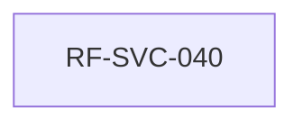

### 3. Requerimientos No Funcionales (RNF)
| ID RNF | Categoría | Requerimiento No Funcional | Métrica / Umbral | Prioridad |
| :--- | :--- | :--- | :--- | :---: |
| `RNF-INT-009` | Interoperabilid | ad | `Integración con Legal sin doble registro minutos_sincronizacion_legal: ≤ 15 min; 0 casos con doble registro` | Debe |
| `RNF-AUD-004` | Auditoría |  | `Cinco bitácoras append-only firmadas hash_mismatch: 0 en el job de auditoría` | Debe |

### 4. Reglas de Negocio (RN)
| ID Regla | Detalle de la Regla de Negocio |
| :--- | :--- |
| `RN-SVC-021` | Gate: un caso de conflicto no se resuelve en Eje 1/2. Un caso de conflicto (carta notarial, INDECOPI, abogado, prensa) no se resuelve en Eje 1/2: se deriva de inmediato al Eje 3 (Legal); es un gate no compensable Negocio · Excel 05_Catalogos |
| `RN-SVC-022` | Gate: derivación sin paquete mínimo. Una derivación entre ejes sin criterio objetivo, sin paquete mínimo completo o sin trazabilidad es un gate no compensable Negocio · Excel 05_Catalogos |
| `RN-SVC-034` | Exposición económica por denuncia. Exposición = monto reclamado + interés legal (tasa referencial 8 % anual, a validar con Legal) desde la fecha del reclamo; los casos con mayor exposición se priorizan Negocio · Excel 05_Catalogos |
| `RN-SVC-016` | Clasificación de riesgo objetiva y recalibrable. El nivel de riesgo de un caso se calcula con una matriz objetiva (nunca por percepción) y se recalibra si el caso evoluciona con nuevos elementos o vinculación con otros casos Negocio · Excel 05_Catalogos |

### 5. Trazabilidad y Planificación
| Requerimiento | Historias de Usuario Asociadas | Dependencia Bloqueante | Riesgo Asociado |
| :--- | :--- | :--- | :--- |
| `RF-SVC-040` | `HU-ATC-040 · Iteración 1 ·` | DEP-12 herramienta de Legal | R-02, R-06 |
| `RF-SVC-041` | `HU-ATC-041 · Iteración 2 ·` | DEP-12 herramienta de Legal | R-02, R-06 |

**Fuera de alcance:**
Gestión del expediente judicial; cálculo de costas.

**Preguntas abiertas:**
¿Qué herramienta usa hoy Legal? ¿La tasa del 8 % es la que Legal quiere usar? ¿Qué señales definen riesgo de denuncia?

---

## [FEAT-17] FT-ATC-17: Integración con la plataforma del call center

### Metadatos de la Funcionalidad
- **ID Funcionalidad:** `[FEAT-17]` (`FT-ATC-17`)
- **Nombre:** Integración con la plataforma del call center
- **Épica Padre:** `EP-ATC-10 Consulta 360 e integraciones operativas`
- **Dueño de Producto (PO):** Eddie Huamaní
- **Prioridad:** Debe
- **Estado DoR:** Refinamiento
- **Estimación (Talla):** S · 5 h
- **Ventana de Ejecución:** jue 22-oct 2026 → jue 22-oct 2026
- **Duración Total:** 5 h de desarrollo · Dev 4 1

### 1. Descripción y Valor
**Descripción:**
Conecta la plataforma telefónica del call center con el ticket: muestra la ficha del cliente al contestar, abre o ubica su ticket y registra la llamada con su grabación.

**Beneficio esperado:**
El operador atiende sin cambiar de sistema ni registrar dos veces.

**Usuarios / roles:**
Gestor de tickets (call center) · Supervisor ATC

### 2. Catálogo de Requerimientos Funcionales (RF)
| ID Requerimiento | Requerimiento Funcional | Prioridad | Origen | Criterio de Verificación | Horas IA | Predec. | Estado DoR |
| :--- | :--- | :---: | :--- | :--- | :---: | :---: | :---: |
| `RF-SVC-042` | El sistema debe integrarse con la plataforma que usa el equipo de call center para mostrar los datos del cliente al recibir la llamada (screen pop), abrir o ubicar su ticket y registrar la llamada como interacción con su grabación. | Debe | PROC-SVC-016 · Gestor de Feedback | tickets presentación · ítem 5 Ficha visible en ≤ 2 s al contestar | 5 h | — | Pend. DoR |

### Ruta Crítica de la Funcionalidad
- **Secuencia Crítica:** `RF-SVC-042`
- **Duración Total de Ruta Lógica:** `5 h`

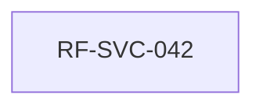

### 3. Requerimientos No Funcionales (RNF)
| ID RNF | Categoría | Requerimiento No Funcional | Métrica / Umbral | Prioridad |
| :--- | :--- | :--- | :--- | :---: |
| `RNF-INT-008` | Interoperabilid | ad Integración en línea con el call center | `tiempo_screen_pop: p95 ≤ 2 s` | Debe |

### 4. Reglas de Negocio (RN)
| ID Regla | Detalle de la Regla de Negocio |
| :--- | :--- |
| `RN-SVC-005` | Empresa y línea obligatorias. CompanyID y BusinessLineID son NOT NULL y no derivables (ContractID es nullable) Negocio · Excel 05_Catalogos |

### 5. Trazabilidad y Planificación
| Requerimiento | Historias de Usuario Asociadas | Dependencia Bloqueante | Riesgo Asociado |
| :--- | :--- | :--- | :--- |
| `RF-SVC-042` | `HU-ATC-042 · Iteración 1 ·` | DEP-11 plataforma de call center | R-02 |

**Fuera de alcance:**
Reemplazo de la central telefónica; marcador predictivo.

**Preguntas abiertas:**
¿Qué proveedor y versión de call center se usa? ¿Expone API o CTI para screen pop y grabaciones?

---

## [FEAT-18] FT-ATC-18: Bandeja orquestadora y flujos por área

### Metadatos de la Funcionalidad
- **ID Funcionalidad:** `[FEAT-18]` (`FT-ATC-18`)
- **Nombre:** Bandeja orquestadora y flujos por área
- **Épica Padre:** `EP-ATC-09 Bandeja orquestadora y asistencia al gestor`
- **Dueño de Producto (PO):** Eddie Huamaní
- **Prioridad:** Debe
- **Estado DoR:** Refinamiento
- **Estimación (Talla):** L · 17 h
- **Ventana de Ejecución:** lun 19-oct 2026 → mié 21-oct 2026
- **Duración Total:** 17 h de desarrollo · Dev 3 1

### 1. Descripción y Valor
**Descripción:**
Permite configurar flujos de trabajo por área sin desarrollo y reúne en una bandeja única los tickets de todos los canales, ordenados por rayo, SLA y prioridad, con reasignación automática por menor carga.

**Beneficio esperado:**
Cada gestor sabe qué atender primero y la carga se reparte de forma pareja.

**Usuarios / roles:**
Administrador funcional ATC · Supervisor ATC · Gestor de tickets

### 2. Catálogo de Requerimientos Funcionales (RF)
| ID Requerimiento | Requerimiento Funcional | Prioridad | Origen | Criterio de Verificación | Horas IA | Predec. | Estado DoR |
| :--- | :--- | :---: | :--- | :--- | :---: | :---: | :---: |
| `RF-SVC-043` | El sistema debe permitir configurar, sin desarrollo, el flujo de trabajo (workflow) de cada tipo de ticket por área: pasos, estados, responsables, aprobaciones y SLA de cada paso. | Debe | PROC-SVC-017 · Feedback | Administrador funcional ATC presentación · ítem 6 Tickets nuevos siguen el flujo publicado | 6 h | — | Pend. DoR |
| `RF-SVC-044` | El sistema debe ofrecer una bandeja orquestadora que reúne los tickets de todos los canales y los ordena y asigna según flujo, prioridad, marca de rayo y vencimiento de SLA. | Debe | PROC-SVC-017 · Supervisor ATC Feedback | presentación · ítem 11 Orden: rayo > SLA más próximo > prioridad | 5 h | RF-043 | Pend. DoR |
| `RF-SVC-045` | El sistema debe permitir marcar un ticket con un icono de rayo que lo sube al tope de la bandeja, registrando quien lo marco y por que. | Debería | PROC-SVC-017 · Supervisor ATC Feedback | presentación · ítem 10 Rayo solo por líder, con motivo y en bitácora | 2 h | RF-044 | Pend. DoR |
| `RF-SVC-046` | El sistema debe reasignar un ticket al gestor de tickets disponible del mismo área y habilidad con menor carga de trabajo cuando el responsable no esta disponible o su carga supera el límite. | Debería | PROC-SVC-017 · Feedback | Job batch de ATC presentación · ítem 18 Motivo REASSIG NMENT_CARGA en la bitácora | 4 h | RF-044 | Pend. DoR |

### Ruta Crítica de la Funcionalidad
- **Secuencia Crítica:** `RF-SVC-043  >  RF-SVC-044  >  RF-SVC-046`
- **Duración Total de Ruta Lógica:** `15 h`

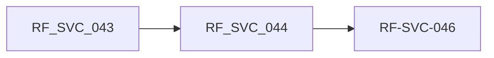

### 3. Requerimientos No Funcionales (RNF)
| ID RNF | Categoría | Requerimiento No Funcional | Métrica / Umbral | Prioridad |
| :--- | :--- | :--- | :--- | :---: |
| `RNF-USA-002` | Usabilidad | flujo | `Flujos configurables sin desarrollo dias_configurar_flujo: ≤ 1 día hábil por` | Debería |
| `RNF-USA-003` | Usabilidad | plataforma | `Término «Gestor de tickets» en toda la textos_con_termino_anterior: 0 textos visibles con «agente» u «operador»` | Debería |
| `RNF-AUD-004` | Auditoría |  | `Cinco bitácoras append-only firmadas hash_mismatch: 0 en el job de auditoría` | Debe |

### 4. Reglas de Negocio (RN)
| ID Regla | Detalle de la Regla de Negocio |
| :--- | :--- |
| `RN-SVC-031` | Prioridad rayo controlada. Solo el supervisor o líder puede marcar un ticket con rayo; queda en bitácora con motivo y no puede superar el 10 % de la bandeja del área (umbral a validar) Negocio · Excel 05_Catalogos |
| `RN-SVC-033` | Reasignación por menor carga. La reasignación automática elige al gestor de tickets disponible del mismo área y habilidad con menos tickets activos ponderados por prioridad; no mueve tickets con rayo, en Eje 3 o con interacción en curso Negocio · Excel 05_Catalogos |
| `RN-SVC-006` | Asignación append-only. Cada movimiento de área/responsable es fila nueva con motivo tipificado; los punteros actuales son denormalizados Negocio · Excel 05_Catalogos |
| `RN-SVC-040` | Término oficial: Gestor de tickets. El rol que atiende tickets (ACT-022 Operador ATC, llamado «agente» en este documento) se denomina «Gestor de tickets» en pantallas, reportes, correos y documentación Negocio · Excel 05_Catalogos |

### 5. Trazabilidad y Planificación
| Requerimiento | Historias de Usuario Asociadas | Dependencia Bloqueante | Riesgo Asociado |
| :--- | :--- | :--- | :--- |
| `RF-SVC-043` | `HU-ATC-043 · Iteración 1 ·` | DEP-02 NEXUS (roles y disponibilidad) | R-01, R-04 |
| `RF-SVC-044` | `HU-ATC-044 · Iteración 1 ·` | DEP-02 NEXUS (roles y disponibilidad) | R-01, R-04 |
| `RF-SVC-045` | `HU-ATC-045 · Iteración 1 ·` | DEP-02 NEXUS (roles y disponibilidad) | R-01, R-04 |
| `RF-SVC-046` | `HU-ATC-046 · Iteración 1 ·` | DEP-02 NEXUS (roles y disponibilidad) | R-01, R-04 |

**Fuera de alcance:**
Gestión de turnos; asignación por habilidades avanzadas (fase posterior).

**Preguntas abiertas:**
¿Asignación automática (push) o el gestor toma el siguiente (pull)? ¿Quiénes pueden marcar el rayo? ¿Cómo se mide la carga?

---

## [FEAT-19] FT-ATC-19: Asistencia al gestor: guía e IA

### Metadatos de la Funcionalidad
- **ID Funcionalidad:** `[FEAT-19]` (`FT-ATC-19`)
- **Nombre:** Asistencia al gestor: guía e IA
- **Épica Padre:** `EP-ATC-09 Bandeja orquestadora y asistencia al gestor`
- **Dueño de Producto (PO):** Eddie Huamaní
- **Prioridad:** Debería
- **Estado DoR:** Refinamiento
- **Estimación (Talla):** M · 9 h
- **Ventana de Ejecución:** mié 21-oct 2026 → vie 23-oct 2026
- **Duración Total:** 9 h de desarrollo · Dev 3 1

### 1. Descripción y Valor
**Descripción:**
Muestra la guía de solución de cada tipo de ticket y usa IA para sugerir respuestas y verificar los criterios de cierre mientras el gestor atiende; el gestor siempre decide.

**Beneficio esperado:**
Respuestas más uniformes y de mejor calidad, y menos tiempo de capacitación.

**Usuarios / roles:**
Gestor de tickets · Administrador funcional ATC · Asistente IA

### 2. Catálogo de Requerimientos Funcionales (RF)
| ID Requerimiento | Requerimiento Funcional | Prioridad | Origen | Criterio de Verificación | Horas IA | Predec. | Estado DoR |
| :--- | :--- | :---: | :--- | :--- | :---: | :---: | :---: |
| `RF-SVC-047` | El sistema debe mostrar al gestor de tickets una guía de como solucionar cada tipo de ticket (pasos, plantillas de respuesta, documentos requeridos y criterios de cierre) mantenida por el administrador funcional. | Debería | PROC-SVC-018 · Gestor de Feedback | tickets presentación · ítem 7 Guía versionada por tipo | 4 h | — | Pend. DoR |
| `RF-SVC-048` | flexible El sistema debe usar IA para retroalimentar al gestor de tickets mientras atiende y al cerrar: sugerir respuesta, verificar que se cumplan los criterios de cierre de la guía y señalar tono o datos faltantes. | Podría | PROC-SVC-018 · Feedback | Asistente IA de atención presentación · ítem 8 Toda sugerencia queda registrada con su decisión | 5 h | RF-047 | Pend. DoR |

### Ruta Crítica de la Funcionalidad
- **Secuencia Crítica:** `RF-SVC-047  >  RF-SVC-048`
- **Duración Total de Ruta Lógica:** `9 h`

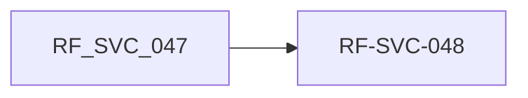

### 3. Requerimientos No Funcionales (RNF)
| ID RNF | Categoría | Requerimiento No Funcional | Métrica / Umbral | Prioridad |
| :--- | :--- | :--- | :--- | :---: |
| `RNF-SEC-009` | Seguridad |  | `Uso seguro de IA sugerencias_ia_con_datos_personales: 0; 100 % de sugerencias registradas` | Debe |

### 4. Reglas de Negocio (RN)
| ID Regla | Detalle de la Regla de Negocio |
| :--- | :--- |
| `RN-SVC-032` | IA asesora, el gestor de tickets decide. La IA solo sugiere: el gestor de tickets acepta, edita o descarta; ninguna respuesta se envía al cliente sin acción del gestor de tickets y no se envían datos personales sin anonimizar a modelos externos Negocio · Excel 05_Catalogos |
| `RN-SVC-012` | DLP en bitácoras. Prohibido registrar PII en los campos Notes_*: solo el motivo operativo del movimiento Ley 29733 · Seguridad TI |
| `RN-SVC-023` | Gate: cierre fuera de Mi Portal. Un ticket cerrado fuera de Mi Portal, sin cierre formal en el sistema, es un gate no compensable Negocio · Excel 05_Catalogos |

### 5. Trazabilidad y Planificación
| Requerimiento | Historias de Usuario Asociadas | Dependencia Bloqueante | Riesgo Asociado |
| :--- | :--- | :--- | :--- |
| `RF-SVC-047` | `HU-ATC-047 · Iteración 1 ·` | DEP-14 proveedor de IA aprobado | R-07 |
| `RF-SVC-048` | `HU-ATC-048 · Iteración 1 ·` | DEP-14 proveedor de IA aprobado | R-07 |

**Fuera de alcance:**
Respuesta automática de la IA al cliente; entrenamiento de modelos propios.

**Preguntas abiertas:**
¿Qué proveedor de IA aprueban TI y Seguridad? ¿Quién redacta y aprueba las guías por área?

---

## [FEAT-20] FT-ATC-20: Búsqueda y consulta 360 del cliente

### Metadatos de la Funcionalidad
- **ID Funcionalidad:** `[FEAT-20]` (`FT-ATC-20`)
- **Nombre:** Búsqueda y consulta 360 del cliente
- **Épica Padre:** `EP-ATC-10 Consulta 360 e integraciones operativas`
- **Dueño de Producto (PO):** Eddie Huamaní
- **Prioridad:** Debe
- **Estado DoR:** Refinamiento
- **Estimación (Talla):** L · 20 h
- **Ventana de Ejecución:** lun 19-oct 2026 → jue 22-oct 2026
- **Duración Total:** 20 h de desarrollo · Dev 4 1

### 1. Descripción y Valor
**Descripción:**
Motor de búsqueda del cliente por DNI, nombre, código, lote, teléfono o N.º de ticket, con consulta 360 en el ticket (lotes, cuotas, correos, documentos), manejo de excepciones, reutilización del motor de José y búsqueda semántica.

**Beneficio esperado:**
Atención en el primer contacto sin consultar otros sistemas.

**Usuarios / roles:**
Gestor de tickets · Supervisor ATC

### 2. Catálogo de Requerimientos Funcionales (RF)
| ID Requerimiento | Requerimiento Funcional | Prioridad | Origen | Criterio de Verificación | Horas IA | Predec. | Estado DoR |
| :--- | :--- | :---: | :--- | :--- | :---: | :---: | :---: |
| `RF-SVC-049` | El sistema debe ofrecer un motor de búsqueda de clientes por DNI, nombre, código de cliente, lote, teléfono o N.º de ticket, con opción de llamar a la cuenta desde la ficha. | Debe | PROC-SVC-019 · Gestor de Feedback | tickets presentación · ítem 9 Resultado en ≤ 2 s; llamada registrada | 4 h | — | Pend. DoR |
| `RF-SVC-050` | El sistema debe mostrar en el ticket un submódulo de consulta del cliente con su detalle: lotes, cuotas y estado de cuenta, correos y mensajes, tickets e interacciones previas y documentos. | Debe | PROC-SVC-019 · Gestor de Feedback | tickets presentación · ítem 12 Datos consultados en línea, sin copia | 5 h | RF-049 | Pend. DoR |
| `RF-SVC-051` | El sistema debe manejar las excepciones de la consulta del cliente: cliente no encontrado, interesado sin contrato, datos incompletos o sistema fuente no disponible, permitiendo continuar el registro con un flujo controlado. | Debe | PROC-SVC-019 · Gestor de Feedback | tickets presentación · ítem 14 Ticket creado con datos mínimos y vinculación pendiente | 3 h | RF-049 | Pend. DoR |
| `RF-SVC-052` | El sistema debe consumir el motor de consultas que ya construyó José para obtener datos especificos del cliente, integrándolo por API en lugar de desarrollar uno nuevo. | Debería | PROC-SVC-019 · Gestor de Feedback | tickets presentación · ítem 17 Respuesta proviene del motor vía API | 3 h | RF-050 | Pend. DoR |
| `RF-SVC-053` | flexible El sistema debe indexar con un modelo de red neuronal (búsqueda semántica) los archivos y documentos de los clientes para que el motor de búsqueda encuentre información por significado y no solo por palabras exactas. | Podría | PROC-SVC-019 · Gestor de Feedback | tickets presentación · ítem 19 Resultados relevantes con fragmento y permisos aplicados | 5 h | RF-049 | Pend. DoR |

### Ruta Crítica de la Funcionalidad
- **Secuencia Crítica:** `RF-SVC-049  >  RF-SVC-050  >  RF-SVC-052`
- **Duración Total de Ruta Lógica:** `12 h`

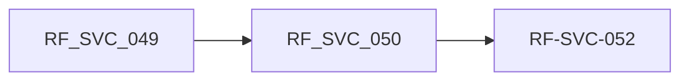

### 3. Requerimientos No Funcionales (RNF)
| ID RNF | Categoría | Requerimiento No Funcional | Métrica / Umbral | Prioridad |
| :--- | :--- | :--- | :--- | :---: |
| `RNF-REN-007` | Rendimiento |  | `Respuesta del motor de búsqueda tiempo_respuesta_busqueda: p95 ≤ 2 s (DNI/código); ≤ 3 s (semántica)` | Debería |
| `RNF-SEC-010` | Seguridad |  | `Permisos en búsqueda y consulta 360 accesos_indebidos_busqueda: 0.0` | Debe |
| `RNF-INT-007` | Interoperabilid | ad cliente | `Cero registros paralelos del dato de registros_paralelos_dato_cliente: 0` | Debe |

### 4. Reglas de Negocio (RN)
| ID Regla | Detalle de la Regla de Negocio |
| :--- | :--- |
| `RN-SVC-036` | Búsqueda respeta permisos. La búsqueda y la consulta 360 solo muestran documentos y datos que el rol del usuario puede ver en el sistema de origen Negocio · Excel 05_Catalogos |
| `RN-SVC-026` | Cero registros paralelos del dato de cliente. No pueden existir registros paralelos del dato de cliente fuera de SIGDA/TAXON; la auditoría quincenal debe arrojar cero casos y crear uno es gate no compensable Negocio · Excel 05_Catalogos |
| `RN-SVC-012` | DLP en bitácoras. Prohibido registrar PII en los campos Notes_*: solo el motivo operativo del movimiento Ley 29733 · Seguridad TI |

### 5. Trazabilidad y Planificación
| Requerimiento | Historias de Usuario Asociadas | Dependencia Bloqueante | Riesgo Asociado |
| :--- | :--- | :--- | :--- |
| `RF-SVC-049` | `HU-ATC-049 · Iteración 1 ·` | DEP-01 SIGDA/TAXON · DEP-13 motor de José | R-02, R-07 |
| `RF-SVC-050` | `HU-ATC-050 · Iteración 1 ·` | DEP-01 SIGDA/TAXON · DEP-13 motor de José | R-02, R-07 |
| `RF-SVC-051` | `HU-ATC-051 · Iteración 1 ·` | DEP-01 SIGDA/TAXON · DEP-13 motor de José | R-02, R-07 |
| `RF-SVC-052` | `HU-ATC-052 · Iteración 1 ·` | DEP-01 SIGDA/TAXON · DEP-13 motor de José | R-02, R-07 |
| `RF-SVC-053` | `HU-ATC-053 · Iteración 1 ·` | DEP-01 SIGDA/TAXON · DEP-13 motor de José | R-02, R-07 |

**Fuera de alcance:**
Copia local del maestro de clientes; edición de datos del cliente desde ATC.

**Preguntas abiertas:**
¿Qué significa «llamar la cuenta»? ¿Qué sistemas alimentan cada sección? ¿Qué repositorios de documentos se indexan?

---

## [FEAT-21] FT-ATC-21: Productividad y notificaciones del gestor

### Metadatos de la Funcionalidad
- **ID Funcionalidad:** `[FEAT-21]` (`FT-ATC-21`)
- **Nombre:** Productividad y notificaciones del gestor
- **Épica Padre:** `EP-ATC-09 Bandeja orquestadora y asistencia al gestor`
- **Dueño de Producto (PO):** Eddie Huamaní
- **Prioridad:** Debería
- **Estado DoR:** Refinamiento
- **Estimación (Talla):** S · 6 h
- **Ventana de Ejecución:** vie 23-oct 2026 → vie 23-oct 2026
- **Duración Total:** 6 h de desarrollo · Dev 3 1

### 1. Descripción y Valor
**Descripción:**
Tablero de avance diario para cada gestor y su líder, y correo de asignación con copia al líder en cada asignación o reasignación.

**Beneficio esperado:**
Nadie ignora una asignación y el líder corrige a tiempo.

**Usuarios / roles:**
Gestor de tickets · Líder / Supervisor ATC

### 2. Catálogo de Requerimientos Funcionales (RF)
| ID Requerimiento | Requerimiento Funcional | Prioridad | Origen | Criterio de Verificación | Horas IA | Predec. | Estado DoR |
| :--- | :--- | :---: | :--- | :--- | :---: | :---: | :---: |
| `RF-SVC-054` | El sistema debe mostrar a cada gestor de tickets y a su líder un tablero de avance diario: tickets atendidos, pendientes, cumplimiento de SLA, tiempo medio y CSAT. | Debería | PROC-SVC-020 · Supervisor ATC Feedback | presentación · ítem 13 Indicadores del día actualizados | 4 h | — | Pend. DoR |
| `RF-SVC-055` | El sistema debe enviar una alerta por correo al gestor de tickets cada vez que se le asigna o reasigna un ticket, con copia a su líder, indicando N.º, tipo, prioridad y vencimiento de SLA. | Debe | PROC-SVC-020 · Feedback | Job batch de ATC presentación · ítem 15 Correo en ≤ 1 min con copia al líder | 2 h | — | Pend. DoR |

### Ruta Crítica de la Funcionalidad
- **Secuencia Crítica:** `RF-SVC-054`
- **Duración Total de Ruta Lógica:** `4 h`


### 3. Requerimientos No Funcionales (RNF)
| ID RNF | Categoría | Requerimiento No Funcional | Métrica / Umbral | Prioridad |
| :--- | :--- | :--- | :--- | :---: |
| `RNF-REN-008` | Rendimiento |  | `Oportunidad del correo de asignación minutos_envio_correo_asignacion: ≤ 1 min en el 99 % de los casos` | Debería |

### 4. Reglas de Negocio (RN)
| ID Regla | Detalle de la Regla de Negocio |
| :--- | :--- |
| `RN-SVC-035` | Aviso de asignación con copia al líder. Toda asignación o reasignación envía un correo al responsable con copia a su líder, una sola vez por movimiento Negocio · Excel 05_Catalogos |
| `RN-SVC-025` | Cierre end-to-end en 72 horas hábiles. El cierre end-to-end del ticket sin escalamiento debe completarse en 72 horas hábiles; si hay escalamiento, aplica el plazo propio del eje correspondiente Negocio · Excel 05_Catalogos |

### 5. Trazabilidad y Planificación
| Requerimiento | Historias de Usuario Asociadas | Dependencia Bloqueante | Riesgo Asociado |
| :--- | :--- | :--- | :--- |
| `RF-SVC-054` | `HU-ATC-054 · Iteración 1 ·` | DEP-02 NEXUS (líder de cada gestor) | R-01 |
| `RF-SVC-055` | `HU-ATC-055 · Iteración 1 ·` | DEP-02 NEXUS (líder de cada gestor) | R-01 |

**Fuera de alcance:**
Evaluación de desempeño; ranking público entre gestores.

**Preguntas abiertas:**
¿Qué metas diarias tiene cada gestor? ¿El correo incluye datos del cliente o solo el enlace?

---

## [FEAT-22] FT-ATC-22: Resolución de contrato por morosidad

### Metadatos de la Funcionalidad
- **ID Funcionalidad:** `[FEAT-22]` (`FT-ATC-22`)
- **Nombre:** Resolución de contrato por morosidad
- **Épica Padre:** `EP-ATC-11 Resolución por morosidad y formularios simples`
- **Dueño de Producto (PO):** Eddie Huamaní
- **Prioridad:** Debe
- **Estado DoR:** Refinamiento
- **Estimación (Talla):** M · 10 h
- **Ventana de Ejecución:** lun 26-oct 2026 → mar 27-oct 2026
- **Duración Total:** 10 h de desarrollo · Dev 4 1

### 1. Descripción y Valor
**Descripción:**
Crea el caso de resolución cuando un contrato acumula 3 meses impagos, envía en paralelo la alerta de cancelación al cliente y la carta de alerta al responsable del proyecto con copia al supervisor, con constancia de cada envío.

**Beneficio esperado:**
Resoluciones oportunas, con aviso previo y evidencia.

**Usuarios / roles:**
Cobranza · Legal · Responsable de proyecto · Supervisor · Cliente

### 2. Catálogo de Requerimientos Funcionales (RF)
| ID Requerimiento | Requerimiento Funcional | Prioridad | Origen | Criterio de Verificación | Horas IA | Predec. | Estado DoR |
| :--- | :--- | :---: | :--- | :--- | :---: | :---: | :---: |
| `RF-SVC-056` | El sistema debe generar automáticamente un ticket de resolución de contrato cuando un cliente acumula 3 meses (cuotas) sin pagar, o cuando se registra un reclamo con 3 meses de no pago, y derivarlo al flujo de resolución con Cobranza y Legal. | Debe | PROC-SVC-021 · Feedback 2.ª Cobranza y Legal | Job batch de ATC reunión · ítem 1 Caso creado y derivado a | 4 h | — | Pend. DoR |
| `RF-SVC-057` | El sistema debe enviar al cliente, en paralelo al proceso de resolución, una alerta de cancelación del servicio (deuda, plazo para regularizar y consecuencias) por correo, WhatsApp y Mi Portal, dejando constancia de envío. | Debe | PROC-SVC-021 · Feedback 2.ª | Job batch de ATC reunión · ítem 2 Alerta enviada al crearse el caso, con constancia | 3 h | RF-056 | Pend. DoR |
| `RF-SVC-058` | El sistema debe generar y enviar una carta de alerta al responsable del proyecto del lote, con copia a su supervisor, indicando cliente, deuda, estado del caso y fecha prevista de resolución. | Debe | PROC-SVC-021 · Feedback 2.ª | Responsable de proyecto reunión · ítem 3 Carta con copia al supervisor y escalamiento por plazo | 3 h | RF-056 | Pend. DoR |

### Ruta Crítica de la Funcionalidad
- **Secuencia Crítica:** `RF-SVC-056  >  RF-SVC-057`
- **Duración Total de Ruta Lógica:** `7 h`

```mermaid
graph LR
    RF_SVC_056 --> RF_SVC_057
    RF_SVC_057["RF-SVC-057"]
```

### 3. Requerimientos No Funcionales (RNF)
| ID RNF | Categoría | Requerimiento No Funcional | Métrica / Umbral | Prioridad |
| :--- | :--- | :--- | :--- | :---: |
| `RNF-INT-010` | Interoperabilid | ad | `Morosidad actualizada desde Cobranza horas_desfase_morosidad: ≤ 24 h` | Debe |
| `RNF-AUD-005` | Auditoría |  | `Constancia de alertas y cartas de resolución alertas_con_constancia: 100 %` | Debe |

### 4. Reglas de Negocio (RN)
| ID Regla | Detalle de la Regla de Negocio |
| :--- | :--- |
| `RN-SVC-037` | Causal de resolución por 3 meses impagos. Se inicia la resolución cuando el contrato acumula 3 meses (cuotas) vencidos e impagos o cuando un reclamo evidencia 3 meses de no pago; el umbral es parametrizable y la causal se valida con Legal según la cláusula resolutoria del contrato Negocio · Excel 05_Catalogos |
| `RN-SVC-038` | Alerta de cancelación en paralelo. La alerta de cancelación del servicio se envía al cliente al crearse el caso, en paralelo y sin esperar el flujo de resolución; una sola vez por caso y con constancia de envío Negocio · Excel 05_Catalogos |
| `RN-SVC-039` | Carta de alerta al responsable del proyecto. Todo caso de resolución genera una carta de alerta al responsable del proyecto del lote con copia a su supervisor; sin acción en el plazo definido, se escala según la matriz de escalamiento Negocio · Excel 05_Catalogos |

### 5. Trazabilidad y Planificación
| Requerimiento | Historias de Usuario Asociadas | Dependencia Bloqueante | Riesgo Asociado |
| :--- | :--- | :--- | :--- |
| `RF-SVC-056` | `HU-ATC-056 · Iteración 2 ·` | DEP-08 Cobranza · DEP-15 responsables de proyecto | R-06 |
| `RF-SVC-057` | `HU-ATC-057 · Iteración 2 ·` | DEP-08 Cobranza · DEP-15 responsables de proyecto | R-06 |
| `RF-SVC-058` | `HU-ATC-058 · Iteración 2 ·` | DEP-08 Cobranza · DEP-15 responsables de proyecto | R-06 |

**Fuera de alcance:**
Redacción legal de la resolución; cobro o refinanciamiento.

**Preguntas abiertas:**
¿3 cuotas consecutivas o acumuladas? ¿Se suspende la resolución con un reclamo abierto? ¿Qué plazo se da para regularizar?

---

## [FEAT-23] FT-ATC-23: Formularios simples: ingreso al proyecto y Entrega Fest

### Metadatos de la Funcionalidad
- **ID Funcionalidad:** `[FEAT-23]` (`FT-ATC-23`)
- **Nombre:** Formularios simples: ingreso al proyecto y Entrega Fest
- **Épica Padre:** `EP-ATC-11 Resolución por morosidad y formularios simples`
- **Dueño de Producto (PO):** Eddie Huamaní
- **Prioridad:** Debería
- **Estado DoR:** Refinamiento
- **Estimación (Talla):** S · 7 h
- **Ventana de Ejecución:** mar 27-oct 2026 → mié 28-oct 2026
- **Duración Total:** 7 h de desarrollo · Dev 4 1

### 1. Descripción y Valor
**Descripción:**
Formularios de máximo 6 campos, desde celular, que crean un ticket: registro de ingreso de personas al proyecto y reserva de cupo en los buses del Entrega Fest con control de aforo.

**Beneficio esperado:**
Registro trazable en campo sin papel ni listas manuales.

**Usuarios / roles:**
Personal de control de acceso · Responsable de proyecto · Cliente · Organizador del evento

### 2. Catálogo de Requerimientos Funcionales (RF)
| ID Requerimiento | Requerimiento Funcional | Prioridad | Origen | Criterio de Verificación | Horas IA | Predec. | Estado DoR |
| :--- | :--- | :---: | :--- | :--- | :---: | :---: | :---: |
| `RF-SVC-059` | El sistema debe permitir registrar el ingreso de una persona al proyecto con un formulario simple (nombre, DNI, teléfono, motivo, lote o área a visitar y fecha y hora) que genera automáticamente un ticket asignado al responsable del proyecto. | Debería | PROC-SVC-022 · Feedback 2.ª | Personal de control de acceso del proyecto reunión · ítem 5 Ticket «Ingreso a proyecto» en ≤ 1 min | 4 h | — | Pend. DoR |
| `RF-SVC-060` | El sistema debe permitir que el cliente solicite cupo en los buses del Entrega Fest con un formulario simple que genera un ticket, controla el aforo por bus y horario y envía la confirmación con punto y hora de embarque. | Debería | PROC-SVC-022 · Feedback 2.ª | Interesado (Party) reunión · ítem 6 Cupo confirmado solo con aforo disponible | 3 h | — | Pend. DoR |

### Ruta Crítica de la Funcionalidad
- **Secuencia Crítica:** `RF-SVC-059`
- **Duración Total de Ruta Lógica:** `4 h`

```mermaid
graph LR
    RF_SVC_059["RF-SVC-059"]
```

### 3. Requerimientos No Funcionales (RNF)
| ID RNF | Categoría | Requerimiento No Funcional | Métrica / Umbral | Prioridad |
| :--- | :--- | :--- | :--- | :---: |
| `RNF-USA-004` | Usabilidad |  | `Formulario simple y móvil tiempo_completar_formulario: ≤ 1 min; máximo 6 campos obligatorios` | Debería |

### 4. Reglas de Negocio (RN)
| ID Regla | Detalle de la Regla de Negocio |
| :--- | :--- |
| `RN-SVC-041` | Formulario simple genera ticket. Cada envío de un formulario simple crea un ticket tipificado con número, canal «Formulario» y responsable según el flujo; máximo 6 campos obligatorios Negocio · Excel 05_Catalogos |
| `RN-SVC-042` | Aforo de buses del Entrega Fest. No se confirma un cupo si el bus y horario no tienen capacidad; una cancelación libera el cupo y lo asigna a la lista de espera en orden de solicitud Negocio · Excel 05_Catalogos |

### 5. Trazabilidad y Planificación
| Requerimiento | Historias de Usuario Asociadas | Dependencia Bloqueante | Riesgo Asociado |
| :--- | :--- | :--- | :--- |
| `RF-SVC-059` | `HU-ATC-059 · Iteración 2 ·` | — | R-06 |
| `RF-SVC-060` | `HU-ATC-060 · Iteración 2 ·` | — | R-06 |

**Fuera de alcance:**
Control de salida y torniquetes; contratación de buses.

**Preguntas abiertas:**
¿Todo ingreso es un ticket? ¿«Buses entrega fest» es reserva del cliente o logística con el proveedor?

---
