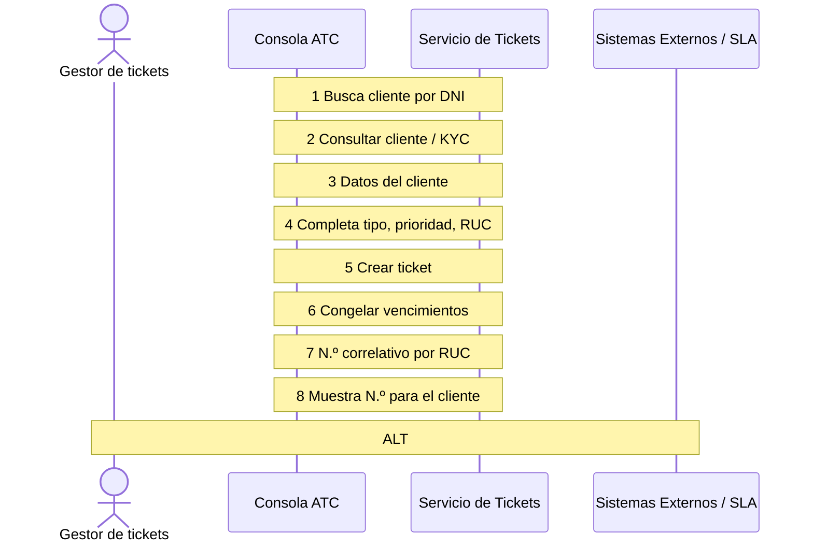
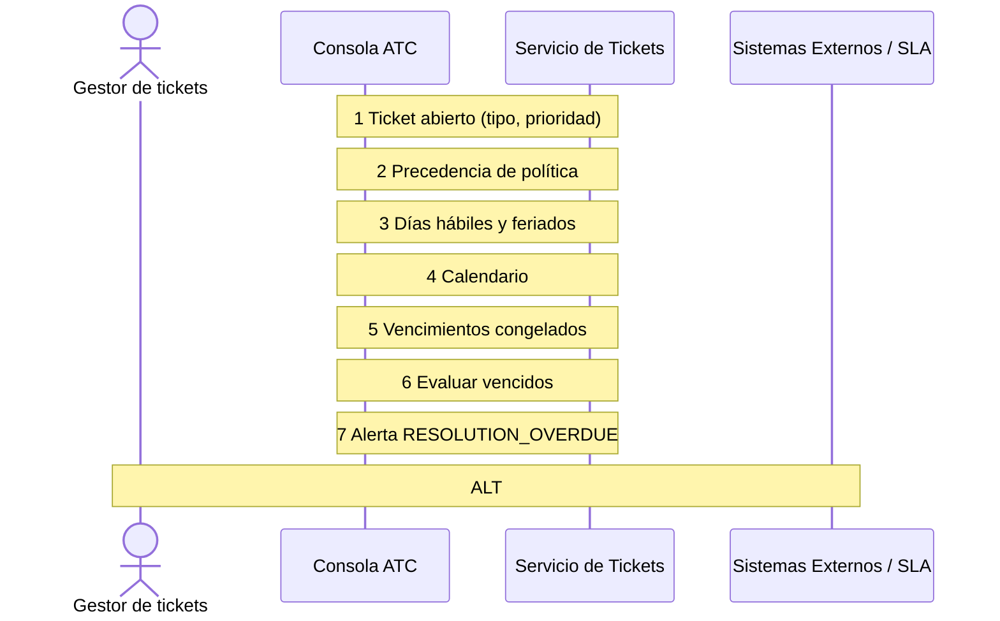
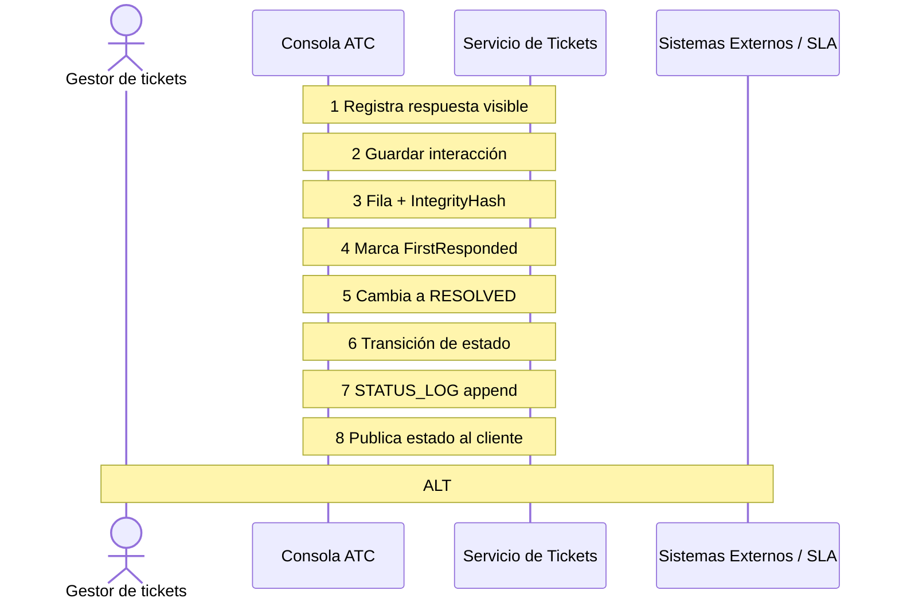
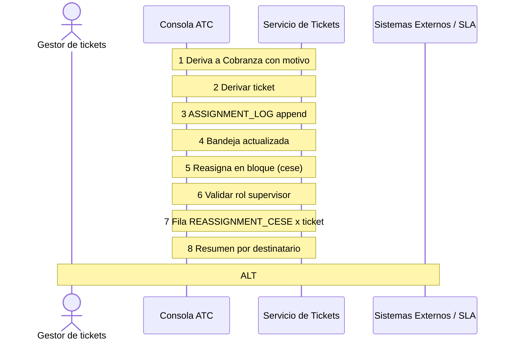
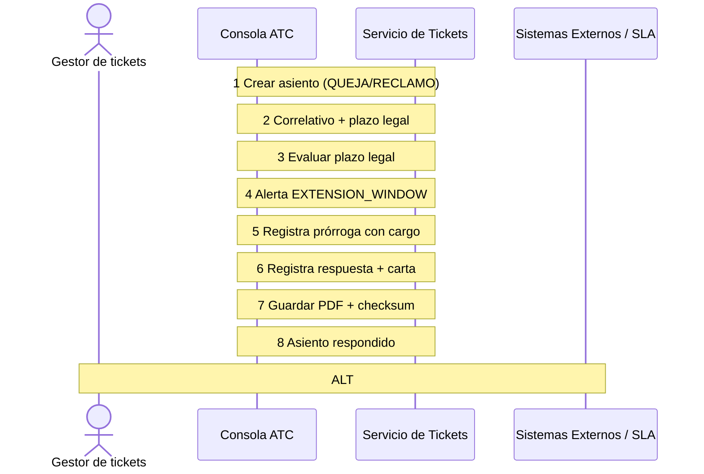
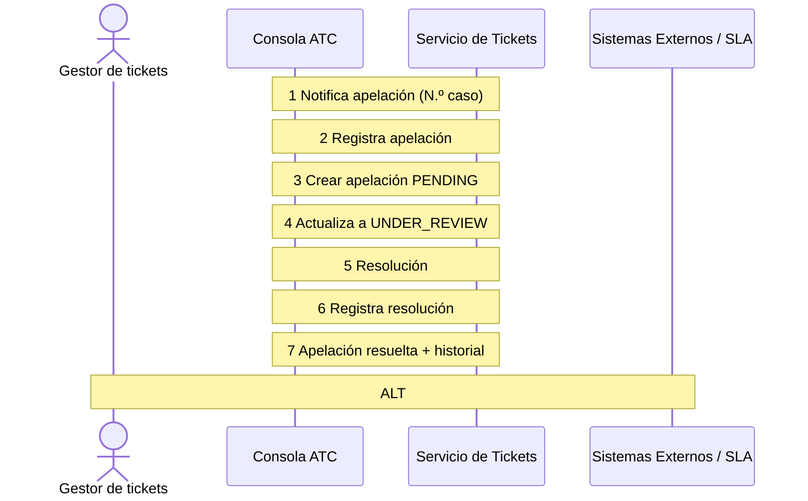
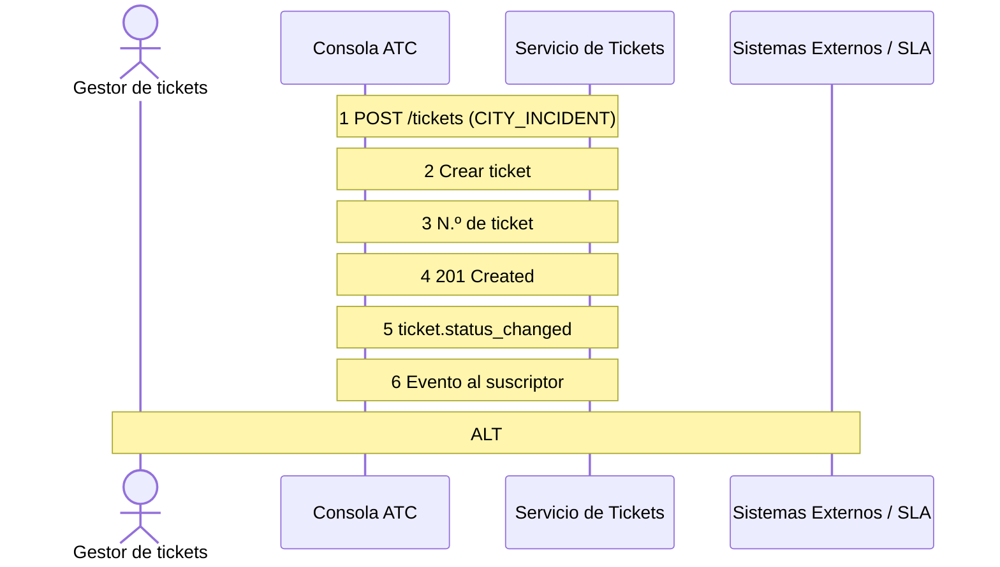
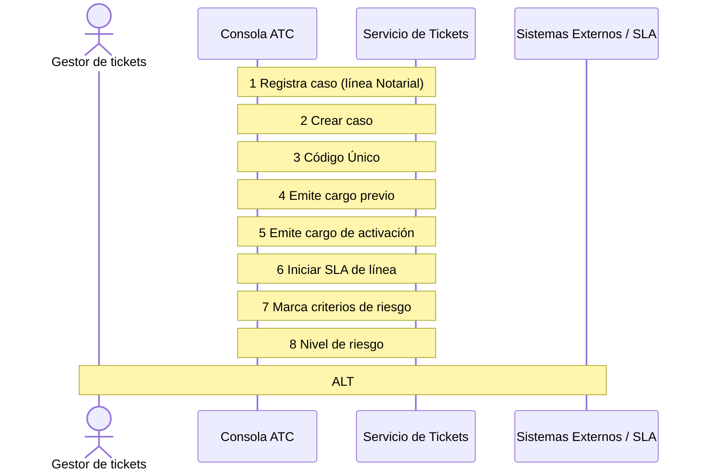

```mermaid
sequenceDiagram
    autonumber
    actor Gestor as Gestor de tickets
    participant UI as Consola ATC
    participant Core as Servicio de Tickets
    participant Ext as Sistemas Externos / SLA
    Note over UI,Core: 1 Crear asiento (QUEJA/RECLAMO)
    Note over UI,Core: 2 Correlativo + plazo legal
    Note over UI,Core: 3 Evaluar plazo legal
    Note over UI,Core: 4 Alerta EXTENSION_WINDOW
    Note over UI,Core: 5 Registra prórroga con cargo
    Note over UI,Core: 6 Registra respuesta + carta
    Note over UI,Core: 7 Guardar PDF + checksum
    Note over UI,Core: 8 Asiento respondido
    Note over Gestor,Ext: ALT
```

# 05 · HISTORIAS DE USUARIO DETALLADAS (60 HISTORIAS)
## Plataforma de Atención al Cliente «Aybar Atiende» · AYBARCORP SAC

---

## [US-001] HU-ATC-001: Registrar un ticket tipificado desde cualquier canal

### Metadatos de la Historia de Usuario
- **ID Historia:** `[US-001]` (`HU-ATC-001`)
- **Requerimiento Funcional de Origen:** `RF-SVC-001`
- **Funcionalidad Padre:** `[FEAT-01]` (`FT-ATC-01`)
- **Épica Padre:** `[EPIC-01]` (`EP-ATC-01`)
- **Prioridad:** Debe
- **Estimación con IA:** 6 h con IA
- **Asignación / Fechas:** Iteración 1 · Dev 1 · lun 19-oct → mar 20-oct
- **Estado DoR:** Pendiente DoR
- **Requerimiento Textual:** RF-SVC-001 · El sistema debe registrar tickets de teléfono, WhatsApp y correo con canal, cliente, empresa (RUC), línea de negocio, tipo, prioridad, resumen y descripción.

### Narrativa de Usuario
> **COMO** gestor de tickets
> **QUIERO** registrar la solicitud del cliente en un ticket con canal, cliente, empresa, línea de negocio, tipo, prioridad y resumen
> **PARA** tipificar cada solicitud desde el primer contacto y no volver a pedir datos

### Criterios de Aceptación (Escenarios Gherkin)
#### CA-01 · Campos obligatorios
```gherkin
DADO que registro un ticket nuevo
CUANDO intento guardarlo sin empresa (RUC) o sin línea de negocio
ENTONCES el sistema no lo guarda y señala los campos faltantes; empresa y línea no se derivan de otro dato.
```

#### CA-02 · Canal remoto sin local
```gherkin
DADO que la solicitud llega por WhatsApp
CUANDO registro el ticket sin establecimiento
ENTONCES el ticket se guarda con el establecimiento vacío.
```

#### CA-03 · Cliente desde SIGDA/TAXON (agregado por PO)
```gherkin
DADO que busco al cliente por DNI o nombre
CUANDO lo selecciono
ENTONCES los datos se traen del maestro único y no se crea un registro paralelo del cliente.
```

#### CA-04 · Permiso (agregado por PO)
```gherkin
DADO que mi rol no es de atención
CUANDO intento registrar un ticket
ENTONCES el sistema me lo impide y registra el intento.
```

### Reglas de Negocio Asociadas
- **RN-SVC-005 empresa y línea obligatorias**
- **RN-SVC-026 cero registros paralelos**

**Fuera de alcance:**
Creación automática por conectores de WhatsApp y correo (pendientes de producto).

### Especificaciones Técnicas y Dependencias
- **Diseño / UX:** `Prototipo Aybar Atiende › Nuevo ticket`
- **Entidades y Dependencias:** `ENT-SVC-001 SVC_TICKET, MAE_CHANNEL, MAE_TICKET_TYPE, MAE_TICKET_PRIORITY · DEP-01 SIGDA/TAXON`
- **Evento de Analítica / Telemetría:** `Evento ticket_creado {canal, tipo, prioridad, empresa}`

### Definición de Terminado (DoD) para la Historia
- [ ] Criterios de aceptación cubiertos por pruebas automatizadas (generadas con IA y revisadas por el dev).
- [ ] Revisión de pares obligatoria en Pull Request y análisis SAST sin vulnerabilidades en verde.
- [ ] Accesibilidad y diseño responsivo verificados (escritorio y móvil).
- [ ] Emisión del evento de telemetría `Evento ticket_creado {canal, tipo, prioridad, empresa}` validada.
- [ ] Bitácoras con hash verificado HMAC-SHA256 y cero PII expuesto (RNF-AUD-004 · RNF-SEC-008).
- [ ] Documentación técnica de la funcionalidad actualizada.
- [ ] Aceptado formalmente por el Dueño de Producto (PO) a las 17:00.

### Diagrama de Secuencia


---

## [US-002] HU-ATC-002: Entregar al cliente un número de ticket por razón social

### Metadatos de la Historia de Usuario
- **ID Historia:** `[US-002]` (`HU-ATC-002`)
- **Requerimiento Funcional de Origen:** `RF-SVC-002`
- **Funcionalidad Padre:** `[FEAT-01]` (`FT-ATC-01`)
- **Épica Padre:** `[EPIC-01]` (`EP-ATC-01`)
- **Prioridad:** Debe
- **Estimación con IA:** 3 h con IA
- **Asignación / Fechas:** Iteración 1 · Dev 1 · mar 20-oct ESTADO
- **Estado DoR:** Pendiente DoR
- **Requerimiento Textual:** RF-SVC-002 · El sistema debe generar un número correlativo único por razón social y entregarlo al cliente.

### Narrativa de Usuario
> **COMO** gestor de tickets
> **QUIERO** que el sistema genere un número correlativo propio de cada razón social al guardar el ticket
> **PARA** entregarle al cliente un número con el que pueda dar seguimiento

### Criterios de Aceptación (Escenarios Gherkin)
#### CA-01 · Correlativo por empresa
```gherkin
DADO dos tickets de empresas distintas registrados el mismo día
CUANDO se numeran
ENTONCES cada empresa sigue su propio correlativo, sin saltos ni duplicados.
```

#### CA-02 · Número visible
```gherkin
DADO que guardo el ticket
CUANDO termina el registro
ENTONCES veo el número en pantalla para dictarlo o enviarlo al cliente.
```

#### CA-03 · Concurrencia (agregado por PO)
```gherkin
DADO que dos gestores de tickets guardan tickets de la misma empresa al mismo tiempo
CUANDO se numeran
ENTONCES cada ticket recibe un número distinto.
```

### Reglas de Negocio Asociadas
- **RN-SVC-004 correlativo por RUC**

**Fuera de alcance:**
Envío automático del número por el canal de origen (pendientes de producto). Diseño / UX Prototipo › Detalle de ticket (cabecera) Notas técnicas y dependencias Secuencia por CompanyID; formato visible por definir (pregunta abierta de FT-01)

### Especificaciones Técnicas y Dependencias
- **Diseño / UX:** ``
- **Entidades y Dependencias:** ``
- **Evento de Analítica / Telemetría:** `Sin evento específico; datos de prueba: 2 razones sociales, 3 tipos de ticket y 1 feriado.`

### Definición de Terminado (DoD) para la Historia
- [ ] Criterios de aceptación cubiertos por pruebas automatizadas (generadas con IA y revisadas por el dev).
- [ ] Revisión de pares obligatoria en Pull Request y análisis SAST sin vulnerabilidades en verde.
- [ ] Accesibilidad y diseño responsivo verificados (escritorio y móvil).
- [ ] Emisión del evento de telemetría `Sin evento específico; datos de prueba: 2 razones sociales, 3 tipos de ticket y 1 feriado.` validada.
- [ ] Bitácoras con hash verificado HMAC-SHA256 y cero PII expuesto (RNF-AUD-004 · RNF-SEC-008).
- [ ] Documentación técnica de la funcionalidad actualizada.
- [ ] Aceptado formalmente por el Dueño de Producto (PO) a las 17:00.

### Diagrama de Secuencia


---

## [US-003] HU-ATC-003: Congelar el SLA del ticket al abrirlo

### Metadatos de la Historia de Usuario
- **ID Historia:** `[US-003]` (`HU-ATC-003`)
- **Requerimiento Funcional de Origen:** `RF-SVC-003`
- **Funcionalidad Padre:** `[FEAT-04]` (`FT-ATC-04`)
- **Épica Padre:** `[EPIC-02]` (`EP-ATC-02`)
- **Prioridad:** Debe
- **Estimación con IA:** 6 h con IA
- **Asignación / Fechas:** Iteración 1 · Dev 2 · mié 21-oct ESTADO
- **Estado DoR:** Pendiente DoR
- **Requerimiento Textual:** RF-SVC-003 · El sistema debe elegir la política SLA vigente por precedencia y congelar los vencimientos de 1.ª respuesta y resolución al abrir el ticket.

### Narrativa de Usuario
> **COMO** supervisor ATC
> **QUIERO** que al abrir un ticket se elija la política SLA correcta y se congelen sus vencimientos en tiempo hábil
> **PARA** tener un compromiso estable que no cambie si la política se actualiza después

### Criterios de Aceptación (Escenarios Gherkin)
#### CA-01 · Precedencia
```gherkin
DADO un tipo con política específica (tipo+prioridad) y otra genérica activas
CUANDO se abre un ticket de esa prioridad
ENTONCES se aplica la específica; si no existe, la genérica.
```

#### CA-02 · Feriado
```gherkin
DADO un ticket abierto el viernes a las 18:00 antes de un feriado, con base BUSINESS_HOURS
CUANDO se congela el SLA
ENTONCES el vencimiento cae en horas hábiles posteriores y el ticket no nace incumplido.
```

#### CA-03 · Cambio de política (agregado por PO)
```gherkin
DADO un ticket abierto con su SLA congelado
CUANDO se modifica la política
ENTONCES los vencimientos del ticket no cambian.
```

#### CA-04 · Sin política (agregado por PO)
```gherkin
DADO un tipo sin política activa
CUANDO se abre un ticket
ENTONCES el sistema aplica la genérica global y registra una alerta de configuración.
```

### Reglas de Negocio Asociadas
- **RN-SVC-001 precedencia**
- **RN-SVC-002 compromisos congelados**
- **RN-SVC-003 días hábiles únicos**

**Fuera de alcance:**
Definición de los tiempos de la matriz (DEP-03). Diseño / UX Prototipo › Nuevo ticket (panel «SLA que se congelará»)

### Especificaciones Técnicas y Dependencias
- **Diseño / UX:** ``
- **Entidades y Dependencias:** `MAE_SLA_POLICY, MAE_TIME, MAE_HOLIDAY · DEP-03, DEP-04`
- **Evento de Analítica / Telemetría:** `Evento sla_congelado {política, fr_due, res_due}`

### Definición de Terminado (DoD) para la Historia
- [ ] Criterios de aceptación cubiertos por pruebas automatizadas (generadas con IA y revisadas por el dev).
- [ ] Revisión de pares obligatoria en Pull Request y análisis SAST sin vulnerabilidades en verde.
- [ ] Accesibilidad y diseño responsivo verificados (escritorio y móvil).
- [ ] Emisión del evento de telemetría `Evento sla_congelado {política, fr_due, res_due}` validada.
- [ ] Bitácoras con hash verificado HMAC-SHA256 y cero PII expuesto (RNF-AUD-004 · RNF-SEC-008).
- [ ] Documentación técnica de la funcionalidad actualizada.
- [ ] Aceptado formalmente por el Dueño de Producto (PO) a las 17:00.

### Diagrama de Secuencia


---

## [US-004] HU-ATC-004: Cambiar el estado del ticket con historial inmutable

### Metadatos de la Historia de Usuario
- **ID Historia:** `[US-004]` (`HU-ATC-004`)
- **Requerimiento Funcional de Origen:** `RF-SVC-004`
- **Funcionalidad Padre:** `[FEAT-02]` (`FT-ATC-02`)
- **Épica Padre:** `[EPIC-01]` (`EP-ATC-01`)
- **Prioridad:** Debe
- **Estimación con IA:** 5 h con IA
- **Asignación / Fechas:** Iteración 1 · Dev 1 · mar 20-oct → mié 21-oct
- **Estado DoR:** Pendiente DoR
- **Requerimiento Textual:** RF-SVC-004 · El sistema debe gestionar 7 estados y registrar cada transición con fecha y autor en un historial append-only.

### Narrativa de Usuario
> **COMO** colaborador de área
> **QUIERO** cambiar el estado del ticket (abierto, en atención, espera cliente, escalado, resuelto, cerrado, reabierto)
> **PARA** que todos conozcan el estado real y su historial completo

### Criterios de Aceptación (Escenarios Gherkin)
#### CA-01 · Historial
```gherkin
DADO un ticket en atención
CUANDO cambio su estado
ENTONCES se agrega una fila al STATUS_LOG con fecha y autor y el puntero del ticket se actualiza.
```

#### CA-02 · Inmutabilidad
```gherkin
DADO un historial con transiciones
CUANDO alguien intenta editar o borrar una fila
ENTONCES la operación se rechaza.
```

#### CA-03 · Cambio automático (agregado por PO)
```gherkin
DADO un cambio realizado por el sistema
CUANDO se registra
ENTONCES la fila queda con marca automática en lugar de autor.
```

#### CA-04 · Transición inválida (agregado por PO)
```gherkin
DADO un ticket CLOSED
CUANDO intento pasarlo a IN_PROGRESS sin reabrirlo
ENTONCES el sistema lo impide e indica que primero debo reabrirlo.
```

### Reglas de Negocio Asociadas
- **RN-SVC-006 append-only**
- **RN-SVC-023 cierre formal en Mi Portal**

**Fuera de alcance:**
Estados personalizados por área.

### Especificaciones Técnicas y Dependencias
- **Diseño / UX:** `Prototipo › Detalle de ticket (stepper y «Cambiar estado»)`
- **Entidades y Dependencias:** `ENT-SVC-002 SVC_TICKET_STATUS_LOG · RNF-AUD-004 hash`
- **Evento de Analítica / Telemetría:** `Evento ticket_estado {de, a, autor}`

### Definición de Terminado (DoD) para la Historia
- [ ] Criterios de aceptación cubiertos por pruebas automatizadas (generadas con IA y revisadas por el dev).
- [ ] Revisión de pares obligatoria en Pull Request y análisis SAST sin vulnerabilidades en verde.
- [ ] Accesibilidad y diseño responsivo verificados (escritorio y móvil).
- [ ] Emisión del evento de telemetría `Evento ticket_estado {de, a, autor}` validada.
- [ ] Bitácoras con hash verificado HMAC-SHA256 y cero PII expuesto (RNF-AUD-004 · RNF-SEC-008).
- [ ] Documentación técnica de la funcionalidad actualizada.
- [ ] Aceptado formalmente por el Dueño de Producto (PO) a las 17:00.

### Diagrama de Secuencia


---

## [US-005] HU-ATC-005: Registrar interacciones visibles o internas con evidencia

### Metadatos de la Historia de Usuario
- **ID Historia:** `[US-005]` (`HU-ATC-005`)
- **Requerimiento Funcional de Origen:** `RF-SVC-005`
- **Funcionalidad Padre:** `[FEAT-02]` (`FT-ATC-02`)
- **Épica Padre:** `[EPIC-01]` (`EP-ATC-01`)
- **Prioridad:** Debe
- **Estimación con IA:** 5 h con IA
- **Asignación / Fechas:** Iteración 1 · Dev 1 · mié 21-oct → jue 22-oct
- **Estado DoR:** Pendiente DoR
- **Requerimiento Textual:** RF-SVC-005 · El sistema debe registrar cada interacción con canal, gestor de tickets, visibilidad al cliente y evidencia multimedia adjunta.

### Narrativa de Usuario
> **COMO** colaborador de área
> **QUIERO** registrar mensajes al cliente y notas internas, con fotos o documentos adjuntos
> **PARA** separar lo que ve el cliente de lo interno y conservar la evidencia del caso

### Criterios de Aceptación (Escenarios Gherkin)
#### CA-01 · Primera respuesta
```gherkin
DADO un ticket sin respuestas
CUANDO registro la primera respuesta visible al cliente
ENTONCES se completa el hito FirstRespondedDateTime.
```

#### CA-02 · Evidencia
```gherkin
DADO una incidencia con foto o video
CUANDO la adjunto
ENTONCES queda dentro de la interacción, sin tabla de adjuntos aparte.
```

#### CA-03 · Nota interna (agregado por PO)
```gherkin
DADO que marco una interacción como interna
CUANDO el cliente consulta su caso en Mi Portal
ENTONCES la nota no se muestra.
```

#### CA-04 · DLP (agregado por PO)
```gherkin
DADO que escribo un DNI o una tarjeta en una nota de bitácora
CUANDO intento guardarla
ENTONCES el sistema advierte que no se permite PII en ese campo.
```

### Reglas de Negocio Asociadas
- **RN-SVC-012 DLP en bitácoras**

**Fuera de alcance:**
Chat en vivo; edición de interacciones enviadas.

### Especificaciones Técnicas y Dependencias
- **Diseño / UX:** `Prototipo › Detalle de ticket (Interacciones)`
- **Entidades y Dependencias:** `ENT-SVC-004 SVC_TICKET_INTERACTION · RNF-SEC-008`
- **Evento de Analítica / Telemetría:** `Evento interacción_registrada {tipo, visible, adjuntos}`

### Definición de Terminado (DoD) para la Historia
- [ ] Criterios de aceptación cubiertos por pruebas automatizadas (generadas con IA y revisadas por el dev).
- [ ] Revisión de pares obligatoria en Pull Request y análisis SAST sin vulnerabilidades en verde.
- [ ] Accesibilidad y diseño responsivo verificados (escritorio y móvil).
- [ ] Emisión del evento de telemetría `Evento interacción_registrada {tipo, visible, adjuntos}` validada.
- [ ] Bitácoras con hash verificado HMAC-SHA256 y cero PII expuesto (RNF-AUD-004 · RNF-SEC-008).
- [ ] Documentación técnica de la funcionalidad actualizada.
- [ ] Aceptado formalmente por el Dueño de Producto (PO) a las 17:00.

### Diagrama de Secuencia


---

## [US-006] HU-ATC-006: Conservar los hitos temporales probatorios

### Metadatos de la Historia de Usuario
- **ID Historia:** `[US-006]` (`HU-ATC-006`)
- **Requerimiento Funcional de Origen:** `RF-SVC-006`
- **Funcionalidad Padre:** `[FEAT-02]` (`FT-ATC-02`)
- **Épica Padre:** `[EPIC-01]` (`EP-ATC-01`)
- **Prioridad:** Debe
- **Estimación con IA:** 3 h con IA
- **Asignación / Fechas:** Iteración 1 · Dev 1 · jue 22-oct ESTADO
- **Estado DoR:** Pendiente DoR
- **Requerimiento Textual:** RF-SVC-006 · El sistema debe registrar 1.ª respuesta, 1.ª resolución (inmutable), última resolución y cierre.

### Narrativa de Usuario
> **COMO** supervisor ATC
> **QUIERO** que el ticket guarde la primera respuesta, la primera resolución, la última resolución y el cierre
> **PARA** medir el cumplimiento del SLA incluso si el ticket se reabre

### Criterios de Aceptación (Escenarios Gherkin)
#### CA-01 · Reapertura
```gherkin
DADO un ticket resuelto que se reabre
CUANDO se resuelve de nuevo
ENTONCES FirstResolvedDateTime conserva la primera fecha y ResolvedDateTime refleja el último ciclo.
```

#### CA-02 · Cierre
```gherkin
DADO un ticket resuelto
CUANDO pasa a CLOSED
ENTONCES se registra ClosedDateTime y ya no se modifica salvo que se reabra.
```

### Reglas de Negocio Asociadas
- **RN-SVC-002 compromisos congelados**
- **RN-SVC-007 reapertura**

**Fuera de alcance:**
— Diseño / UX Prototipo › Detalle de ticket (Compromisos SLA) Notas técnicas y dependencias Campos de SVC_TICKET Datos de prueba / analítica Sin evento específico; datos de prueba: 2 razones sociales, 3 tipos de ticket y 1 feriado.

### Especificaciones Técnicas y Dependencias
- **Diseño / UX:** ``
- **Entidades y Dependencias:** ``
- **Evento de Analítica / Telemetría:** ``

### Definición de Terminado (DoD) para la Historia
- [ ] Criterios de aceptación cubiertos por pruebas automatizadas (generadas con IA y revisadas por el dev).
- [ ] Revisión de pares obligatoria en Pull Request y análisis SAST sin vulnerabilidades en verde.
- [ ] Accesibilidad y diseño responsivo verificados (escritorio y móvil).
- [ ] Emisión del evento de telemetría `` validada.
- [ ] Bitácoras con hash verificado HMAC-SHA256 y cero PII expuesto (RNF-AUD-004 · RNF-SEC-008).
- [ ] Documentación técnica de la funcionalidad actualizada.
- [ ] Aceptado formalmente por el Dueño de Producto (PO) a las 17:00.

### Diagrama de Secuencia


---

## [US-007] HU-ATC-007: Derivar un ticket a otra área con motivo tipificado

### Metadatos de la Historia de Usuario
- **ID Historia:** `[US-007]` (`HU-ATC-007`)
- **Requerimiento Funcional de Origen:** `RF-SVC-007`
- **Funcionalidad Padre:** `[FEAT-03]` (`FT-ATC-03`)
- **Épica Padre:** `[EPIC-02]` (`EP-ATC-02`)
- **Prioridad:** Debe
- **Estimación con IA:** 4 h con IA
- **Asignación / Fechas:** Iteración 1 · Dev 2 · lun 19-oct ESTADO
- **Estado DoR:** Pendiente DoR
- **Requerimiento Textual:** RF-SVC-007 · El sistema debe derivar tickets entre las 6 áreas y colaboradores registrando cada movimiento con motivo en bitácora append-only.

### Narrativa de Usuario
> **COMO** gestor de tickets
> **QUIERO** derivar el ticket a otra área o colaborador indicando el motivo
> **PARA** conservar el rastro completo de quién tuvo el ticket en cada momento

### Criterios de Aceptación (Escenarios Gherkin)
#### CA-01 · Área sin persona
```gherkin
DADO que derivo al área de Cobranza sin elegir persona
CUANDO confirmo
ENTONCES AssignedToPartyID queda vacío y CurrentAreaID se actualiza.
```

#### CA-02 · Rastro
```gherkin
DADO un ticket con varias derivaciones
CUANDO consulto su historial
ENTONCES cada fila muestra quién lo tenía antes, a quién pasó y por qué.
```

#### CA-03 · Motivo obligatorio (agregado por PO)
```gherkin
DADO que intento derivar sin motivo
CUANDO confirmo
ENTONCES el sistema pide elegir un motivo del catálogo.
```

### Reglas de Negocio Asociadas
- **RN-SVC-006 asignación append-only**
- **RN-SVC-012 DLP**

**Fuera de alcance:**
Asignación por habilidades (la reasignación por carga es RF-SVC-046). Diseño / UX Prototipo › Detalle › «Derivar / reasignar» Notas técnicas y dependencias ENT-SVC-003 SVC_TICKET_ASSIGNMENT_LOG, MAE_Área

### Especificaciones Técnicas y Dependencias
- **Diseño / UX:** ``
- **Entidades y Dependencias:** ``
- **Evento de Analítica / Telemetría:** `Evento ticket_derivado {de_área, a_área, motivo}`

### Definición de Terminado (DoD) para la Historia
- [ ] Criterios de aceptación cubiertos por pruebas automatizadas (generadas con IA y revisadas por el dev).
- [ ] Revisión de pares obligatoria en Pull Request y análisis SAST sin vulnerabilidades en verde.
- [ ] Accesibilidad y diseño responsivo verificados (escritorio y móvil).
- [ ] Emisión del evento de telemetría `Evento ticket_derivado {de_área, a_área, motivo}` validada.
- [ ] Bitácoras con hash verificado HMAC-SHA256 y cero PII expuesto (RNF-AUD-004 · RNF-SEC-008).
- [ ] Documentación técnica de la funcionalidad actualizada.
- [ ] Aceptado formalmente por el Dueño de Producto (PO) a las 17:00.

### Diagrama de Secuencia


---

## [US-008] HU-ATC-008: Reasignar en bloque los tickets de un colaborador que cesa

### Metadatos de la Historia de Usuario
- **ID Historia:** `[US-008]` (`HU-ATC-008`)
- **Requerimiento Funcional de Origen:** `RF-SVC-008`
- **Funcionalidad Padre:** `[FEAT-03]` (`FT-ATC-03`)
- **Épica Padre:** `[EPIC-02]` (`EP-ATC-02`)
- **Prioridad:** Debe
- **Estimación con IA:** 4 h con IA
- **Asignación / Fechas:** Iteración 1 · Dev 2 · mar 20-oct ESTADO
- **Estado DoR:** Pendiente DoR
- **Requerimiento Textual:** RF-SVC-008 · El sistema debe reasignar los tickets pendientes de un colaborador que rota o cesa, sin borrar el rastro anterior.

### Narrativa de Usuario
> **COMO** supervisor ATC
> **QUIERO** reasignar todos los tickets pendientes de un colaborador que rota, renuncia o cesa
> **PARA** continuar la atención sin perder la trazabilidad

### Criterios de Aceptación (Escenarios Gherkin)
#### CA-01 · Cese
```gherkin
DADO un colaborador con 12 tickets pendientes que cesa
CUANDO reasigno sus tickets a otro responsable
ENTONCES cada ticket recibe una fila nueva con motivo REASSIGNMENT_CESE y el nuevo responsable.
```

#### CA-02 · Reparto
```gherkin
DADO que elijo varios destinatarios
CUANDO confirmo
ENTONCES los tickets se reparten y el resumen muestra cuántos recibió cada uno.
```

#### CA-03 · Permiso (agregado por PO)
```gherkin
DADO que no soy supervisor
CUANDO intento reasignar en bloque
ENTONCES la acción no está disponible.
```

### Reglas de Negocio Asociadas
- **RN-SVC-006 asignación append-only**

**Fuera de alcance:**
Detección automática de ceses desde RR. HH. (propuesta futura). Diseño / UX Por diseñar: Bandeja › Acciones masivas Notas técnicas y dependencias SVC_TICKET_ASSIGNMENT_LOG

### Especificaciones Técnicas y Dependencias
- **Diseño / UX:** ``
- **Entidades y Dependencias:** ``
- **Evento de Analítica / Telemetría:** `Evento reasignación_masiva {n_tickets, motivo}`

### Definición de Terminado (DoD) para la Historia
- [ ] Criterios de aceptación cubiertos por pruebas automatizadas (generadas con IA y revisadas por el dev).
- [ ] Revisión de pares obligatoria en Pull Request y análisis SAST sin vulnerabilidades en verde.
- [ ] Accesibilidad y diseño responsivo verificados (escritorio y móvil).
- [ ] Emisión del evento de telemetría `Evento reasignación_masiva {n_tickets, motivo}` validada.
- [ ] Bitácoras con hash verificado HMAC-SHA256 y cero PII expuesto (RNF-AUD-004 · RNF-SEC-008).
- [ ] Documentación técnica de la funcionalidad actualizada.
- [ ] Aceptado formalmente por el Dueño de Producto (PO) a las 17:00.

### Diagrama de Secuencia


---

## [US-009] HU-ATC-009: Ver mi casillero de tareas por área y responsable

### Metadatos de la Historia de Usuario
- **ID Historia:** `[US-009]` (`HU-ATC-009`)
- **Requerimiento Funcional de Origen:** `RF-SVC-009`
- **Funcionalidad Padre:** `[FEAT-03]` (`FT-ATC-03`)
- **Épica Padre:** `[EPIC-02]` (`EP-ATC-02`)
- **Prioridad:** Debe
- **Estimación con IA:** 3 h con IA
- **Asignación / Fechas:** Iteración 1 · Dev 2 · mar 20-oct ESTADO
- **Estado DoR:** Pendiente DoR
- **Requerimiento Textual:** RF-SVC-009 · El sistema debe ofrecer el casillero por área y responsable como consulta sobre los tickets, sin tabla adicional.

### Narrativa de Usuario
> **COMO** colaborador de área
> **QUIERO** ver en una bandeja los tickets de mi área y los míos, ordenados por vencimiento
> **PARA** conocer mi carga pendiente sin duplicar el estado del ticket

### Criterios de Aceptación (Escenarios Gherkin)
#### CA-01 · Bandeja
```gherkin
DADO que abro mi casillero
CUANDO se carga
ENTONCES veo los tickets de CurrentAreaID + CurrentOwnerPartyID + estado activo.
```

#### CA-02 · Filtros
```gherkin
DADO que filtro por «en riesgo o vencidos»
CUANDO aplico el filtro
ENTONCES solo veo los tickets con SLA en riesgo o vencido, resaltados.
```

#### CA-03 · Sin asignar (agregado por PO)
```gherkin
DADO tickets derivados a mi área sin persona
CUANDO abro la bandeja del área
ENTONCES aparecen como «sin asignar» para que alguien los tome.
```

### Reglas de Negocio Asociadas
- **RN-SVC-006**

**Fuera de alcance:**
Tablero Kanban configurable. Diseño / UX Prototipo › Bandeja de tickets Notas técnicas y dependencias Vista/consulta sobre SVC_TICKET + ASSIGNMENT_LOG

### Especificaciones Técnicas y Dependencias
- **Diseño / UX:** ``
- **Entidades y Dependencias:** ``
- **Evento de Analítica / Telemetría:** `Sin evento específico; datos de prueba: 2 razones sociales, 3 tipos de ticket y 1 feriado.`

### Definición de Terminado (DoD) para la Historia
- [ ] Criterios de aceptación cubiertos por pruebas automatizadas (generadas con IA y revisadas por el dev).
- [ ] Revisión de pares obligatoria en Pull Request y análisis SAST sin vulnerabilidades en verde.
- [ ] Accesibilidad y diseño responsivo verificados (escritorio y móvil).
- [ ] Emisión del evento de telemetría `Sin evento específico; datos de prueba: 2 razones sociales, 3 tipos de ticket y 1 feriado.` validada.
- [ ] Bitácoras con hash verificado HMAC-SHA256 y cero PII expuesto (RNF-AUD-004 · RNF-SEC-008).
- [ ] Documentación técnica de la funcionalidad actualizada.
- [ ] Aceptado formalmente por el Dueño de Producto (PO) a las 17:00.

### Diagrama de Secuencia


---

## [US-010] HU-ATC-010: Recibir una sola alerta por incumplimiento de SLA

### Metadatos de la Historia de Usuario
- **ID Historia:** `[US-010]` (`HU-ATC-010`)
- **Requerimiento Funcional de Origen:** `RF-SVC-010`
- **Funcionalidad Padre:** `[FEAT-04]` (`FT-ATC-04`)
- **Épica Padre:** `[EPIC-02]` (`EP-ATC-02`)
- **Prioridad:** Debe
- **Estimación con IA:** 5 h con IA
- **Asignación / Fechas:** Iteración 1 · Dev 2 · mié 21-oct → jue 22-oct
- **Estado DoR:** Pendiente DoR
- **Requerimiento Textual:** RF-SVC-010 · El sistema debe detectar por job FIRST_RESPONSE_OVERDUE y RESOLUTION_OVERDUE y alertar una sola vez por tipo y ciclo.

### Narrativa de Usuario
> **COMO** supervisor ATC
> **QUIERO** recibir una alerta cuando un ticket incumple su primera respuesta o su resolución
> **PARA** actuar a tiempo sin recibir alertas duplicadas

### Criterios de Aceptación (Escenarios Gherkin)
#### CA-01 · Sin duplicados
```gherkin
DADO un ticket que ya alertó FIRST_RESPONSE_OVERDUE en este ciclo
CUANDO el job vuelve a correr
ENTONCES no se genera otra alerta de ese tipo.
```

#### CA-02 · Constancia
```gherkin
DADO una alerta generada
CUANDO la consulto
ENTONCES muestra destinatario, fecha, canal, vencimiento evaluado (EvaluatedDueDateTime) y ciclo.
```

#### CA-03 · Ticket resuelto (agregado por PO)
```gherkin
DADO un ticket resuelto antes de su vencimiento
CUANDO corre el job
ENTONCES no se genera alerta.
```

### Reglas de Negocio Asociadas
- **RN-SVC-008 alerta única por ciclo**

**Fuera de alcance:**
Escalamiento a jefaturas (casos sensibles: FT-ATC-09). Diseño / UX Prototipo › Bandeja (chip «En riesgo / vencido») Notas técnicas y dependencias ENT-SVC-009 SVC_SLA_BREACH_ALERT · job batch

### Especificaciones Técnicas y Dependencias
- **Diseño / UX:** ``
- **Entidades y Dependencias:** ``
- **Evento de Analítica / Telemetría:** `Evento sla_alerta {tipo, ciclo}`

### Definición de Terminado (DoD) para la Historia
- [ ] Criterios de aceptación cubiertos por pruebas automatizadas (generadas con IA y revisadas por el dev).
- [ ] Revisión de pares obligatoria en Pull Request y análisis SAST sin vulnerabilidades en verde.
- [ ] Accesibilidad y diseño responsivo verificados (escritorio y móvil).
- [ ] Emisión del evento de telemetría `Evento sla_alerta {tipo, ciclo}` validada.
- [ ] Bitácoras con hash verificado HMAC-SHA256 y cero PII expuesto (RNF-AUD-004 · RNF-SEC-008).
- [ ] Documentación técnica de la funcionalidad actualizada.
- [ ] Aceptado formalmente por el Dueño de Producto (PO) a las 17:00.

### Diagrama de Secuencia


---

## [US-011] HU-ATC-011: Reabrir un ticket con un nuevo compromiso sin borrar el original

### Metadatos de la Historia de Usuario
- **ID Historia:** `[US-011]` (`HU-ATC-011`)
- **Requerimiento Funcional de Origen:** `RF-SVC-011`
- **Funcionalidad Padre:** `[FEAT-04]` (`FT-ATC-04`)
- **Épica Padre:** `[EPIC-02]` (`EP-ATC-02`)
- **Prioridad:** Debe
- **Estimación con IA:** 3 h con IA
- **Asignación / Fechas:** Iteración 1 · Dev 2 · jue 22-oct ESTADO
- **Estado DoR:** Pendiente DoR
- **Requerimiento Textual:** RF-SVC-011 · El sistema debe soportar la reapertura con ReopenCount y un nuevo vencimiento calculado con la política vigente, conservando el original.

### Narrativa de Usuario
> **COMO** supervisor ATC
> **QUIERO** que al reabrir un ticket se calcule un nuevo compromiso con la política vigente
> **PARA** vigilar el ciclo actual sin perder la evidencia del primer compromiso

### Criterios de Aceptación (Escenarios Gherkin)
#### CA-01 · Nuevo compromiso
```gherkin
DADO un ticket cerrado que se reabre
CUANDO se calcula ReopenedResolutionDueDateTime
ENTONCES el vencimiento original no se reescribe y las alertas evalúan el nuevo.
```

#### CA-02 · Contador
```gherkin
DADO un ticket reabierto dos veces
CUANDO consulto el ticket
ENTONCES ReopenCount = 2 y cada ciclo tiene sus propias alertas.
```

### Reglas de Negocio Asociadas
- **RN-SVC-007 reapertura**
- **RN-SVC-008**

**Fuera de alcance:**
Límite máximo de reaperturas (por definir). Diseño / UX Prototipo › Detalle › «Cambiar estado: Reabierto» Notas técnicas y dependencias SVC_TICKET, SVC_SLA_BREACH_ALERT Datos de prueba / analítica Evento ticket_reabierto {ciclo}

### Especificaciones Técnicas y Dependencias
- **Diseño / UX:** ``
- **Entidades y Dependencias:** ``
- **Evento de Analítica / Telemetría:** ``

### Definición de Terminado (DoD) para la Historia
- [ ] Criterios de aceptación cubiertos por pruebas automatizadas (generadas con IA y revisadas por el dev).
- [ ] Revisión de pares obligatoria en Pull Request y análisis SAST sin vulnerabilidades en verde.
- [ ] Accesibilidad y diseño responsivo verificados (escritorio y móvil).
- [ ] Emisión del evento de telemetría `` validada.
- [ ] Bitácoras con hash verificado HMAC-SHA256 y cero PII expuesto (RNF-AUD-004 · RNF-SEC-008).
- [ ] Documentación técnica de la funcionalidad actualizada.
- [ ] Aceptado formalmente por el Dueño de Producto (PO) a las 17:00.

### Diagrama de Secuencia
```mermaid
sequenceDiagram
    autonumber
```

---

## [US-012] HU-ATC-012: Registrar el asiento del Libro de Reclamaciones

### Metadatos de la Historia de Usuario
- **ID Historia:** `[US-012]` (`HU-ATC-012`)
- **Requerimiento Funcional de Origen:** `RF-SVC-012`
- **Funcionalidad Padre:** `[FEAT-05]` (`FT-ATC-05`)
- **Épica Padre:** `[EPIC-03]` (`EP-ATC-03`)
- **Prioridad:** Debe
- **Estimación con IA:** 4 h con IA
- **Asignación / Fechas:** Iteración 1 · Dev 1 · jue 22-oct → vie 23-oct
- **Estado DoR:** Pendiente DoR
- **Requerimiento Textual:** RF-SVC-012 · El sistema debe crear el asiento QUEJA/RECLAMO como extensión 1:1 del ticket, con correlativo por empresa y establecimiento.

### Narrativa de Usuario
> **COMO** responsable legal de reclamos
> **QUIERO** que cada queja o reclamo genere su asiento con hechos, pedido y monto reclamado
> **PARA** dejar constancia formal conforme al formato regulado

### Criterios de Aceptación (Escenarios Gherkin)
#### CA-01 · Correlativo
```gherkin
DADO dos asientos de la misma empresa en establecimientos distintos
CUANDO se numeran
ENTONCES cada establecimiento lleva su propio correlativo.
```

#### CA-02 · Monto y moneda
```gherkin
DADO un reclamo con monto
CUANDO lo guardo sin moneda
ENTONCES el sistema lo rechaza; sin monto, ambos campos quedan vacíos.
```

#### CA-03 · Empresa inmutable (agregado por PO)
```gherkin
DADO un asiento registrado
CUANDO alguien intenta cambiar su razón social
ENTONCES la operación se rechaza.
```

### Reglas de Negocio Asociadas
- **RN-SVC-004**
- **RN-SVC-013 empresa inmutable en el libro**

**Fuera de alcance:**
Hoja de reclamación pública web. Diseño / UX Prototipo › Libro de Reclamaciones Notas técnicas y dependencias ENT-SVC-010 SVC_COMPLAINT_BOOK_ENTRY · DEP-05 validación legal

### Especificaciones Técnicas y Dependencias
- **Diseño / UX:** ``
- **Entidades y Dependencias:** ``
- **Evento de Analítica / Telemetría:** `Evento asiento_libro {tipo, empresa, establecimiento}`

### Definición de Terminado (DoD) para la Historia
- [ ] Criterios de aceptación cubiertos por pruebas automatizadas (generadas con IA y revisadas por el dev).
- [ ] Revisión de pares obligatoria en Pull Request y análisis SAST sin vulnerabilidades en verde.
- [ ] Accesibilidad y diseño responsivo verificados (escritorio y móvil).
- [ ] Emisión del evento de telemetría `Evento asiento_libro {tipo, empresa, establecimiento}` validada.
- [ ] Bitácoras con hash verificado HMAC-SHA256 y cero PII expuesto (RNF-AUD-004 · RNF-SEC-008).
- [ ] Documentación técnica de la funcionalidad actualizada.
- [ ] Aceptado formalmente por el Dueño de Producto (PO) a las 17:00.

### Diagrama de Secuencia


---

## [US-013] HU-ATC-013: Calcular el plazo legal y gestionar la prórroga única

### Metadatos de la Historia de Usuario
- **ID Historia:** `[US-013]` (`HU-ATC-013`)
- **Requerimiento Funcional de Origen:** `RF-SVC-013`
- **Funcionalidad Padre:** `[FEAT-05]` (`FT-ATC-05`)
- **Épica Padre:** `[EPIC-03]` (`EP-ATC-03`)
- **Prioridad:** Debe
- **Estimación con IA:** 6 h con IA
- **Asignación / Fechas:** Iteración 1 · Dev 1 · vie 23-oct ESTADO
- **Estado DoR:** Pendiente DoR
- **Requerimiento Textual:** RF-SVC-013 · El sistema debe calcular 15 días hábiles desde el registro y gestionar una prórroga única de 15 días con justificación, cargo y canal, bloqueando una segunda.

### Narrativa de Usuario
> **COMO** responsable legal de reclamos
> **QUIERO** ver el plazo legal de cada reclamo y registrar una única prórroga justificada
> **PARA** responder dentro del plazo y acreditar la prórroga ante una fiscalización

### Criterios de Aceptación (Escenarios Gherkin)
#### CA-01 · Requisitos de prórroga
```gherkin
DADO un reclamo dentro de plazo
CUANDO registro la prórroga
ENTONCES el sistema exige justificación, cargo, canal y fecha de comunicación anterior al vencimiento original.
```

#### CA-02 · Sin reescritura
```gherkin
DADO un vencimiento ya prorrogado
CUANDO alguien intenta modificarlo
ENTONCES se rechaza y cualquier cambio queda como fila nueva en el historial.
```

#### CA-03 · Segunda prórroga (agregado por PO)
```gherkin
DADO un reclamo ya prorrogado
CUANDO intento prorrogar otra vez
ENTONCES la acción está bloqueada.
```

#### CA-04 · Fuera de ventana (agregado por PO)
```gherkin
DADO un reclamo con el plazo original vencido
CUANDO intento prorrogar
ENTONCES el sistema lo impide porque la prórroga debe comunicarse antes del vencimiento.
```

### Reglas de Negocio Asociadas
- **RN-SVC-009 plazo 15+15**
- **RN-SVC-003 días hábiles**

**Fuera de alcance:**
Plazos distintos por sector regulado. Diseño / UX Prototipo › Libro › «Prorrogar 15 d»

### Especificaciones Técnicas y Dependencias
- **Diseño / UX:** ``
- **Entidades y Dependencias:** `SVC_COMPLAINT_BOOK_ENTRY, MAE_TIME · DEP-04`
- **Evento de Analítica / Telemetría:** `Evento prorroga_registrada`

### Definición de Terminado (DoD) para la Historia
- [ ] Criterios de aceptación cubiertos por pruebas automatizadas (generadas con IA y revisadas por el dev).
- [ ] Revisión de pares obligatoria en Pull Request y análisis SAST sin vulnerabilidades en verde.
- [ ] Accesibilidad y diseño responsivo verificados (escritorio y móvil).
- [ ] Emisión del evento de telemetría `Evento prorroga_registrada` validada.
- [ ] Bitácoras con hash verificado HMAC-SHA256 y cero PII expuesto (RNF-AUD-004 · RNF-SEC-008).
- [ ] Documentación técnica de la funcionalidad actualizada.
- [ ] Aceptado formalmente por el Dueño de Producto (PO) a las 17:00.

### Diagrama de Secuencia


---

## [US-014] HU-ATC-014: Registrar la respuesta formal con cargo

### Metadatos de la Historia de Usuario
- **ID Historia:** `[US-014]` (`HU-ATC-014`)
- **Requerimiento Funcional de Origen:** `RF-SVC-014`
- **Funcionalidad Padre:** `[FEAT-05]` (`FT-ATC-05`)
- **Épica Padre:** `[EPIC-03]` (`EP-ATC-03`)
- **Prioridad:** Debe
- **Estimación con IA:** 4 h con IA
- **Asignación / Fechas:** Iteración 2 · Dev 1 · lun 26-oct ESTADO
- **Estado DoR:** Pendiente DoR
- **Requerimiento Textual:** RF-SVC-014 · El sistema debe registrar la respuesta formal (fecha, resumen, carta PDF con cargo y firmante) y la constancia del derecho a acudir a INDECOPI.

### Narrativa de Usuario
> **COMO** responsable legal de reclamos
> **QUIERO** registrar la respuesta con la carta firmada, su cargo y la constancia del derecho a INDECOPI
> **PARA** acreditar una respuesta válida ante INDECOPI

### Criterios de Aceptación (Escenarios Gherkin)
#### CA-01 · Respuesta válida
```gherkin
DADO un reclamo por responder
CUANDO registro la respuesta
ENTONCES se guardan CompanyResponseDate, la carta con cargo (PDF en S3, dentro del hash) y ResponderPartyID.
```

#### CA-02 · Derecho INDECOPI
```gherkin
DADO una respuesta registrada
CUANDO la consulto
ENTONCES consta CustomerNotifiedOfIndecopiRight.
```

#### CA-03 · Sin cargo (agregado por PO)
```gherkin
DADO que intento registrar la respuesta sin adjuntar el cargo
CUANDO confirmo
ENTONCES el sistema no la acepta como respuesta válida.
```

### Reglas de Negocio Asociadas
- **RN-SVC-010 respuesta válida con cargo**

**Fuera de alcance:**
Firma digital certificada (dependerá de un proveedor). Diseño / UX Prototipo › Libro › «Responder» Notas técnicas y dependencias DEP-06 repositorio S3 · RNF-CUM-007

### Especificaciones Técnicas y Dependencias
- **Diseño / UX:** ``
- **Entidades y Dependencias:** ``
- **Evento de Analítica / Telemetría:** `Evento respuesta_libro {días_hábiles_usados}`

### Definición de Terminado (DoD) para la Historia
- [ ] Criterios de aceptación cubiertos por pruebas automatizadas (generadas con IA y revisadas por el dev).
- [ ] Revisión de pares obligatoria en Pull Request y análisis SAST sin vulnerabilidades en verde.
- [ ] Accesibilidad y diseño responsivo verificados (escritorio y móvil).
- [ ] Emisión del evento de telemetría `Evento respuesta_libro {días_hábiles_usados}` validada.
- [ ] Bitácoras con hash verificado HMAC-SHA256 y cero PII expuesto (RNF-AUD-004 · RNF-SEC-008).
- [ ] Documentación técnica de la funcionalidad actualizada.
- [ ] Aceptado formalmente por el Dueño de Producto (PO) a las 17:00.

### Diagrama de Secuencia


---

## [US-015] HU-ATC-015: Vigilar el plazo legal y detectar reclamos huérfanos

### Metadatos de la Historia de Usuario
- **ID Historia:** `[US-015]` (`HU-ATC-015`)
- **Requerimiento Funcional de Origen:** `RF-SVC-015`
- **Funcionalidad Padre:** `[FEAT-05]` (`FT-ATC-05`)
- **Épica Padre:** `[EPIC-03]` (`EP-ATC-03`)
- **Prioridad:** Debe
- **Estimación con IA:** 4 h con IA
- **Asignación / Fechas:** Iteración 2 · Dev 1 · lun 26-oct → mar 27-oct
- **Estado DoR:** Pendiente DoR
- **Requerimiento Textual:** RF-SVC-015 · El sistema debe vigilar por job el plazo legal (alertas LEGAL_RESPONSE_OVERDUE y LEGAL_Extensión_WINDOW_CLOSING) y detectar a diario tickets sin asiento.

### Narrativa de Usuario
> **COMO** responsable legal de reclamos
> **QUIERO** que el sistema me alerte cuando un plazo legal está por vencer y detecte reclamos sin asiento
> **PARA** evitar incumplimientos legales y reclamos no registrados

### Criterios de Aceptación (Escenarios Gherkin)
#### CA-01 · Alerta legal
```gherkin
DADO un reclamo a 3 días hábiles de vencer sin prórroga
CUANDO corre el job
ENTONCES se genera LEGAL_Extensión_WINDOW_CLOSING, sin exigir política comercial.
```

#### CA-02 · Huérfano
```gherkin
DADO un ticket activo de un tipo con RequiresComplaintBook y sin asiento al cierre del día
CUANDO corre el control diario
ENTONCES se inserta GOV_INTEGRITY_EXCEPTION (ORPHAN_REFERENCE).
```

#### CA-03 · Plazo prorrogado (agregado por PO)
```gherkin
DADO un reclamo prorrogado
CUANDO el job evalúa el plazo
ENTONCES usa el vencimiento prorrogado (COALESCE) y no el original.
```

### Reglas de Negocio Asociadas
- **RN-SVC-011 flag indicativo, fila decisiva**
- **RN-SVC-008**

**Fuera de alcance:**
— Diseño / UX Prototipo › Libro (indicador «Tickets huérfanos hoy») Notas técnicas y dependencias SVC_SLA_BREACH_ALERT, GOV_INTEGRITY_EXCEPTION

### Especificaciones Técnicas y Dependencias
- **Diseño / UX:** ``
- **Entidades y Dependencias:** ``
- **Evento de Analítica / Telemetría:** `Evento huerfano_detectado`

### Definición de Terminado (DoD) para la Historia
- [ ] Criterios de aceptación cubiertos por pruebas automatizadas (generadas con IA y revisadas por el dev).
- [ ] Revisión de pares obligatoria en Pull Request y análisis SAST sin vulnerabilidades en verde.
- [ ] Accesibilidad y diseño responsivo verificados (escritorio y móvil).
- [ ] Emisión del evento de telemetría `Evento huerfano_detectado` validada.
- [ ] Bitácoras con hash verificado HMAC-SHA256 y cero PII expuesto (RNF-AUD-004 · RNF-SEC-008).
- [ ] Documentación técnica de la funcionalidad actualizada.
- [ ] Aceptado formalmente por el Dueño de Producto (PO) a las 17:00.

### Diagrama de Secuencia


---

## [US-016] HU-ATC-016: Dar seguimiento a apelaciones internas y ante INDECOPI

### Metadatos de la Historia de Usuario
- **ID Historia:** `[US-016]` (`HU-ATC-016`)
- **Requerimiento Funcional de Origen:** `RF-SVC-016`
- **Funcionalidad Padre:** `[FEAT-06]` (`FT-ATC-06`)
- **Épica Padre:** `[EPIC-03]` (`EP-ATC-03`)
- **Prioridad:** Debe
- **Estimación con IA:** 3 h con IA
- **Asignación / Fechas:** Iteración 2 · Dev 1 · mar 27-oct ESTADO
- **Estado DoR:** Pendiente DoR
- **Requerimiento Textual:** RF-SVC-016 · El sistema debe gestionar apelaciones con estados PENDING … WITHDRAWN, número de caso y resolución de INDECOPI, con historial.

### Narrativa de Usuario
> **COMO** responsable legal de reclamos
> **QUIERO** registrar la apelación del consumidor, su número de caso y la resolución
> **PARA** dar seguimiento hasta la resolución final

### Criterios de Aceptación (Escenarios Gherkin)
#### CA-01 · Resolución INDECOPI
```gherkin
DADO una apelación ante INDECOPI
CUANDO se resuelve
ENTONCES registro IndecopiCaseNumber, fecha y resumen de la resolución.
```

#### CA-02 · Historial
```gherkin
DADO una apelación con varios estados
CUANDO la consulto
ENTONCES veo cada estado con fecha y autor.
```

#### CA-03 · Desistimiento (agregado por PO)
```gherkin
DADO que el consumidor desiste
CUANDO registro WITHDRAWN
ENTONCES la apelación queda cerrada y el ticket no puede volver a apelarse por la misma respuesta.
```

### Reglas de Negocio Asociadas
- **RN-SVC-010**

**Fuera de alcance:**
Escritos y audiencias del procedimiento. Diseño / UX Por diseñar: Libro › Apelaciones Notas técnicas y dependencias ENT-SVC-012/013 SVC_COMPLAINT_APPEAL(+_STATUS_LOG)

### Especificaciones Técnicas y Dependencias
- **Diseño / UX:** ``
- **Entidades y Dependencias:** ``
- **Evento de Analítica / Telemetría:** `Evento apelación_estado`

### Definición de Terminado (DoD) para la Historia
- [ ] Criterios de aceptación cubiertos por pruebas automatizadas (generadas con IA y revisadas por el dev).
- [ ] Revisión de pares obligatoria en Pull Request y análisis SAST sin vulnerabilidades en verde.
- [ ] Accesibilidad y diseño responsivo verificados (escritorio y móvil).
- [ ] Emisión del evento de telemetría `Evento apelación_estado` validada.
- [ ] Bitácoras con hash verificado HMAC-SHA256 y cero PII expuesto (RNF-AUD-004 · RNF-SEC-008).
- [ ] Documentación técnica de la funcionalidad actualizada.
- [ ] Aceptado formalmente por el Dueño de Producto (PO) a las 17:00.

### Diagrama de Secuencia


---

## [US-017] HU-ATC-017: Atender incidencias de ciudad como tickets

### Metadatos de la Historia de Usuario
- **ID Historia:** `[US-017]` (`HU-ATC-017`)
- **Requerimiento Funcional de Origen:** `RF-SVC-017`
- **Funcionalidad Padre:** `[FEAT-11]` (`FT-ATC-11`)
- **Épica Padre:** `[EPIC-06]` (`EP-ATC-06`)
- **Prioridad:** Debería
- **Estimación con IA:** 2 h con IA
- **Asignación / Fechas:** Iteración 2 · Dev 4 · mié 28-oct ESTADO
- **Estado DoR:** Pendiente DoR
- **Requerimiento Textual:** RF-SVC-017 · El sistema debe vincular opcionalmente el ticket CITY_INCIDENT a un contrato y/o unidad; si deriva en cobro, a un contrato CITY_SERVICE_FEE.

### Narrativa de Usuario
> **COMO** gestor de tickets
> **QUIERO** atender las incidencias de ciudad como tickets vinculables a un contrato o unidad
> **PARA** reutilizar la misma infraestructura y poder cobrar cuando corresponda

### Criterios de Aceptación (Escenarios Gherkin)
#### CA-01 · Cobro
```gherkin
DADO una incidencia que deriva en cobro
CUANDO la vinculo
ENTONCES ContractID apunta a un contrato de tipo CITY_SERVICE_FEE.
```

#### CA-02 · Sin contrato
```gherkin
DADO una incidencia en un área común
CUANDO la registro
ENTONCES el ticket se guarda sin contrato ni unidad.
```

### Reglas de Negocio Asociadas
- **RN-SVC-005**

**Fuera de alcance:**
Facturación del cobro. Diseño / UX Prototipo › Nuevo ticket (tipo «Incidencia de ciudad») Notas técnicas y dependencias SVC_TICKET, MAE_TICKET_TYPE · DEP-09 · R-02 alcance Datos de prueba / analítica Evento incidencia_ciudad

### Especificaciones Técnicas y Dependencias
- **Diseño / UX:** ``
- **Entidades y Dependencias:** ``
- **Evento de Analítica / Telemetría:** ``

### Definición de Terminado (DoD) para la Historia
- [ ] Criterios de aceptación cubiertos por pruebas automatizadas (generadas con IA y revisadas por el dev).
- [ ] Revisión de pares obligatoria en Pull Request y análisis SAST sin vulnerabilidades en verde.
- [ ] Accesibilidad y diseño responsivo verificados (escritorio y móvil).
- [ ] Emisión del evento de telemetría `` validada.
- [ ] Bitácoras con hash verificado HMAC-SHA256 y cero PII expuesto (RNF-AUD-004 · RNF-SEC-008).
- [ ] Documentación técnica de la funcionalidad actualizada.
- [ ] Aceptado formalmente por el Dueño de Producto (PO) a las 17:00.

### Diagrama de Secuencia
```mermaid
sequenceDiagram
    autonumber
```

---

## [US-018] HU-ATC-018: Exponer tickets a UrbeMind por API y eventos

### Metadatos de la Historia de Usuario
- **ID Historia:** `[US-018]` (`HU-ATC-018`)
- **Requerimiento Funcional de Origen:** `RF-SVC-018`
- **Funcionalidad Padre:** `[FEAT-11]` (`FT-ATC-11`)
- **Épica Padre:** `[EPIC-06]` (`EP-ATC-06`)
- **Prioridad:** Debería
- **Estimación con IA:** 5 h con IA
- **Asignación / Fechas:** Iteración 2 · Dev 4 · jue 29-oct ESTADO
- **Estado DoR:** Pendiente DoR
- **Requerimiento Textual:** RF-SVC-018 · El sistema debe exponer creación y consulta de tickets vía API/evento a UrbeMind, sin JOIN físico.

### Narrativa de Usuario
> **COMO** producto UrbeMind (sistema)
> **QUIERO** crear y consultar tickets por API y recibir eventos de cambio de estado
> **PARA** operar como un canal más sin acoplarme a la base del holding

### Criterios de Aceptación (Escenarios Gherkin)
#### CA-01 · Creación
```gherkin
DADO una incidencia reportada en UrbeMind
CUANDO UrbeMind llama al API de creación
ENTONCES se crea un ticket CITY_INCIDENT y se devuelve su número.
```

#### CA-02 · Eventos
```gherkin
DADO un ticket de UrbeMind que cambia de estado
CUANDO ocurre el cambio
ENTONCES se publica un evento que UrbeMind puede consumir.
```

#### CA-03 · Seguridad (agregado por PO)
```gherkin
DADO una llamada sin credencial válida
CUANDO llega al API
ENTONCES se rechaza y queda en el log.
```

### Reglas de Negocio Asociadas
- **RNF-INT-003 frontera API/evento**

**Fuera de alcance:**
Cambios dentro de la app UrbeMind. Diseño / UX No aplica (integración) Notas técnicas y dependencias API Gateway, bus de eventos · DEP-09

### Especificaciones Técnicas y Dependencias
- **Diseño / UX:** ``
- **Entidades y Dependencias:** ``
- **Evento de Analítica / Telemetría:** `Métrica de llamadas y errores por endpoint`

### Definición de Terminado (DoD) para la Historia
- [ ] Criterios de aceptación cubiertos por pruebas automatizadas (generadas con IA y revisadas por el dev).
- [ ] Revisión de pares obligatoria en Pull Request y análisis SAST sin vulnerabilidades en verde.
- [ ] Accesibilidad y diseño responsivo verificados (escritorio y móvil).
- [ ] Emisión del evento de telemetría `Métrica de llamadas y errores por endpoint` validada.
- [ ] Bitácoras con hash verificado HMAC-SHA256 y cero PII expuesto (RNF-AUD-004 · RNF-SEC-008).
- [ ] Documentación técnica de la funcionalidad actualizada.
- [ ] Aceptado formalmente por el Dueño de Producto (PO) a las 17:00.

### Diagrama de Secuencia


---

## [US-019] HU-ATC-019: Disparar la encuesta al cerrar el ticket

### Metadatos de la Historia de Usuario
- **ID Historia:** `[US-019]` (`HU-ATC-019`)
- **Requerimiento Funcional de Origen:** `RF-SVC-019`
- **Funcionalidad Padre:** `[FEAT-13]` (`FT-ATC-13`)
- **Épica Padre:** `[EPIC-07]` (`EP-ATC-07`)
- **Prioridad:** Debe
- **Estimación con IA:** 3 h con IA
- **Asignación / Fechas:** Iteración 2 · Dev 3 · lun 26-oct ESTADO
- **Estado DoR:** Pendiente DoR
- **Requerimiento Textual:** RF-SVC-019 · El sistema debe disparar la encuesta POST_TRANSACTION al cerrar el ticket y permitir medir CSAT/CES por tipo, área y gestor de tickets.

### Narrativa de Usuario
> **COMO** supervisor ATC
> **QUIERO** que al cerrar un ticket se envíe la encuesta y pueda ver CSAT/CES por tipo, área y gestor de tickets
> **PARA** medir la calidad de la atención

### Criterios de Aceptación (Escenarios Gherkin)
#### CA-01 · Disparo
```gherkin
DADO un ticket que pasa a CLOSED
CUANDO se cierra
ENTONCES se registra el envío de la encuesta con puntero polimórfico (SubjectEntityName = 'SVC_TICKET').
```

#### CA-02 · Medición
```gherkin
DADO respuestas recibidas
CUANDO consulto los resultados
ENTONCES veo CSAT/CES por tipo de ticket, área y gestor de tickets.
```

#### CA-03 · Reapertura (agregado por PO)
```gherkin
DADO un ticket con encuesta respondida que se reabre y se vuelve a cerrar
CUANDO se cierra de nuevo
ENTONCES se dispara una nueva encuesta asociada al nuevo ciclo.
```

### Reglas de Negocio Asociadas
- **RN-SVC-007**
- **RNF-INT-004**

**Fuera de alcance:**
Diseño de preguntas. Diseño / UX Prototipo › Torre de Control (CSAT por área) Notas técnicas y dependencias ENT-SVY-001 SVY_SURVEY_RESPONSE · DEP-10 KPI Engine Datos de prueba / analítica Evento encuesta_enviada / encuesta_respondida

### Especificaciones Técnicas y Dependencias
- **Diseño / UX:** ``
- **Entidades y Dependencias:** ``
- **Evento de Analítica / Telemetría:** ``

### Definición de Terminado (DoD) para la Historia
- [ ] Criterios de aceptación cubiertos por pruebas automatizadas (generadas con IA y revisadas por el dev).
- [ ] Revisión de pares obligatoria en Pull Request y análisis SAST sin vulnerabilidades en verde.
- [ ] Accesibilidad y diseño responsivo verificados (escritorio y móvil).
- [ ] Emisión del evento de telemetría `` validada.
- [ ] Bitácoras con hash verificado HMAC-SHA256 y cero PII expuesto (RNF-AUD-004 · RNF-SEC-008).
- [ ] Documentación técnica de la funcionalidad actualizada.
- [ ] Aceptado formalmente por el Dueño de Producto (PO) a las 17:00.

### Diagrama de Secuencia
```mermaid
sequenceDiagram
    autonumber
```

---

## [US-020] HU-ATC-020: Registrar un caso sensible con Código Único

### Metadatos de la Historia de Usuario
- **ID Historia:** `[US-020]` (`HU-ATC-020`)
- **Requerimiento Funcional de Origen:** `RF-SVC-020`
- **Funcionalidad Padre:** `[FEAT-08]` (`FT-ATC-08`)
- **Épica Padre:** `[EPIC-04]` (`EP-ATC-04`)
- **Prioridad:** Debe
- **Estimación con IA:** 4 h con IA
- **Asignación / Fechas:** Iteración 2 · Dev 2 · lun 26-oct → mar 27-oct
- **Estado DoR:** Pendiente DoR
- **Requerimiento Textual:** RF-SVC-020 · El sistema debe registrar todo caso sensible por su línea de origen (5 líneas) con un Código Único Estandarizado.

### Narrativa de Usuario
> **COMO** gestor de la Mesa de Casos (SGD)
> **QUIERO** registrar cada caso sensible indicando su línea de ingreso y obtener un Código Único
> **PARA** rastrearlo de punta a punta sin importar el canal

### Criterios de Aceptación (Escenarios Gherkin)
#### CA-01 · Código único
```gherkin
DADO un caso detectado por cualquiera de las 5 líneas
CUANDO lo registro
ENTONCES recibe un Código Único que nunca se reutiliza.
```

#### CA-02 · Reclasificación
```gherkin
DADO un caso de Legal Atiende (preventivo) que no se resuelve
CUANDO lo reclasifico
ENTONCES se re-registra como reclamo formal (línea 2) conservando la trazabilidad del origen.
```

### Reglas de Negocio Asociadas
- **RN-SVC-014 cinco líneas de ingreso**

**Fuera de alcance:**
Digitalización del pendientes de producto en papel. Diseño / UX Prototipo › Mesa de Casos SGD Notas técnicas y dependencias Entidad por modelar (R-06) Datos de prueba / analítica Evento caso_sensible_registrado {línea}

### Especificaciones Técnicas y Dependencias
- **Diseño / UX:** ``
- **Entidades y Dependencias:** ``
- **Evento de Analítica / Telemetría:** ``

### Definición de Terminado (DoD) para la Historia
- [ ] Criterios de aceptación cubiertos por pruebas automatizadas (generadas con IA y revisadas por el dev).
- [ ] Revisión de pares obligatoria en Pull Request y análisis SAST sin vulnerabilidades en verde.
- [ ] Accesibilidad y diseño responsivo verificados (escritorio y móvil).
- [ ] Emisión del evento de telemetría `` validada.
- [ ] Bitácoras con hash verificado HMAC-SHA256 y cero PII expuesto (RNF-AUD-004 · RNF-SEC-008).
- [ ] Documentación técnica de la funcionalidad actualizada.
- [ ] Aceptado formalmente por el Dueño de Producto (PO) a las 17:00.

### Diagrama de Secuencia


---

## [US-021] HU-ATC-021: Emitir cargo previo y cargo de activación por separado

### Metadatos de la Historia de Usuario
- **ID Historia:** `[US-021]` (`HU-ATC-021`)
- **Requerimiento Funcional de Origen:** `RF-SVC-021`
- **Funcionalidad Padre:** `[FEAT-08]` (`FT-ATC-08`)
- **Épica Padre:** `[EPIC-04]` (`EP-ATC-04`)
- **Prioridad:** Debe
- **Estimación con IA:** 3 h con IA
- **Asignación / Fechas:** Iteración 2 · Dev 2 · mar 27-oct ESTADO
- **Estado DoR:** Pendiente DoR
- **Requerimiento Textual:** RF-SVC-021 · El sistema debe emitir el cargo previo de asignación y un cargo de activación separado; el SLA de línea inicia solo con la activación.

### Narrativa de Usuario
> **COMO** gestor de la Mesa de Casos (SGD)
> **QUIERO** emitir un cargo previo al recibir el caso y un cargo de activación aparte
> **PARA** que el SLA de línea arranque solo cuando el caso queda formalmente activado

### Criterios de Aceptación (Escenarios Gherkin)
#### CA-01 · Cargo previo
```gherkin
DADO un caso recién registrado
CUANDO emito el cargo previo
ENTONCES el SLA de línea todavía no inicia.
```

#### CA-02 · Activación
```gherkin
DADO un caso con cargo previo
CUANDO emito el cargo de activación
ENTONCES el reloj del SLA de línea empieza a correr desde ese instante.
```

#### CA-03 · Limbo (agregado por PO)
```gherkin
DADO un caso con cargo previo sin activar por más de 2 días hábiles
CUANDO corre el control
ENTONCES aparece en la lista de casos en limbo.
```

### Reglas de Negocio Asociadas
- **RN-SVC-015**

**Fuera de alcance:**
— Diseño / UX Prototipo › Mesa SGD («Emitir cargo de activación») Notas técnicas y dependencias Entidad por modelar (R-06)

### Especificaciones Técnicas y Dependencias
- **Diseño / UX:** ``
- **Entidades y Dependencias:** ``
- **Evento de Analítica / Telemetría:** `Evento caso_activado`

### Definición de Terminado (DoD) para la Historia
- [ ] Criterios de aceptación cubiertos por pruebas automatizadas (generadas con IA y revisadas por el dev).
- [ ] Revisión de pares obligatoria en Pull Request y análisis SAST sin vulnerabilidades en verde.
- [ ] Accesibilidad y diseño responsivo verificados (escritorio y móvil).
- [ ] Emisión del evento de telemetría `Evento caso_activado` validada.
- [ ] Bitácoras con hash verificado HMAC-SHA256 y cero PII expuesto (RNF-AUD-004 · RNF-SEC-008).
- [ ] Documentación técnica de la funcionalidad actualizada.
- [ ] Aceptado formalmente por el Dueño de Producto (PO) a las 17:00.

### Diagrama de Secuencia
```mermaid
sequenceDiagram
    autonumber
    actor Gestor as Gestor de tickets
    participant UI as Consola ATC
    participant Core as Servicio de Tickets
    participant Ext as Sistemas Externos / SLA
    Note over UI,Core: 1 Registra caso (línea Notarial)
    Note over UI,Core: 2 Crear caso
    Note over UI,Core: 3 Código Único
    Note over UI,Core: 4 Emite cargo previo
    Note over UI,Core: 5 Emite cargo de activación
    Note over UI,Core: 6 Iniciar SLA de línea
    Note over UI,Core: 7 Marca criterios de riesgo
    Note over UI,Core: 8 Nivel de riesgo
    Note over Gestor,Ext: ALT
```

---

## [US-022] HU-ATC-022: Clasificar el riesgo del caso con matriz objetiva

### Metadatos de la Historia de Usuario
- **ID Historia:** `[US-022]` (`HU-ATC-022`)
- **Requerimiento Funcional de Origen:** `RF-SVC-022`
- **Funcionalidad Padre:** `[FEAT-08]` (`FT-ATC-08`)
- **Épica Padre:** `[EPIC-04]` (`EP-ATC-04`)
- **Prioridad:** Debe
- **Estimación con IA:** 4 h con IA
- **Asignación / Fechas:** Iteración 2 · Dev 2 · mar 27-oct → mié 28-oct
- **Estado DoR:** Pendiente DoR
- **Requerimiento Textual:** RF-SVC-022 · El sistema debe calcular el nivel de riesgo con una matriz objetiva de criterios ponderados y permitir recalibrarlo con registro.

### Narrativa de Usuario
> **COMO** gestor de la Mesa de Casos (SGD)
> **QUIERO** que el nivel de riesgo se calcule con criterios ponderados y pueda recalibrarse
> **PARA** priorizar sin depender de un juicio subjetivo

### Criterios de Aceptación (Escenarios Gherkin)
#### CA-01 · Cálculo objetivo
```gherkin
DADO un caso activado
CUANDO marco los criterios
ENTONCES el nivel de riesgo resulta de la matriz y no de un campo de opinión.
```

#### CA-02 · Recalibración
```gherkin
DADO un caso de riesgo medio al que se suma un elemento legal
CUANDO recalibro
ENTONCES el nivel se actualiza y queda registro de quién, cuándo y por qué.
```

### Reglas de Negocio Asociadas
- **RN-SVC-016**

**Fuera de alcance:**
Definición de criterios y pesos (Mesa SGD, R-08). Diseño / UX Prototipo › Mesa SGD (matriz de riesgo) Notas técnicas y dependencias Entidad por modelar (R-06) Datos de prueba / analítica Evento riesgo_recalibrado

### Especificaciones Técnicas y Dependencias
- **Diseño / UX:** ``
- **Entidades y Dependencias:** ``
- **Evento de Analítica / Telemetría:** ``

### Definición de Terminado (DoD) para la Historia
- [ ] Criterios de aceptación cubiertos por pruebas automatizadas (generadas con IA y revisadas por el dev).
- [ ] Revisión de pares obligatoria en Pull Request y análisis SAST sin vulnerabilidades en verde.
- [ ] Accesibilidad y diseño responsivo verificados (escritorio y móvil).
- [ ] Emisión del evento de telemetría `` validada.
- [ ] Bitácoras con hash verificado HMAC-SHA256 y cero PII expuesto (RNF-AUD-004 · RNF-SEC-008).
- [ ] Documentación técnica de la funcionalidad actualizada.
- [ ] Aceptado formalmente por el Dueño de Producto (PO) a las 17:00.

### Diagrama de Secuencia
```mermaid
sequenceDiagram
    autonumber
    actor Gestor as Gestor de tickets
    participant UI as Consola ATC
    participant Core as Servicio de Tickets
    participant Ext as Sistemas Externos / SLA
    Note over UI,Core: 1 Registra caso (línea Notarial)
    Note over UI,Core: 2 Crear caso
    Note over UI,Core: 3 Código Único
    Note over UI,Core: 4 Emite cargo previo
    Note over UI,Core: 5 Emite cargo de activación
    Note over UI,Core: 6 Iniciar SLA de línea
    Note over UI,Core: 7 Marca criterios de riesgo
    Note over UI,Core: 8 Nivel de riesgo
    Note over Gestor,Ext: ALT
```

---

## [US-023] HU-ATC-023: Escalar en cadena un caso que incumple su SLA

### Metadatos de la Historia de Usuario
- **ID Historia:** `[US-023]` (`HU-ATC-023`)
- **Requerimiento Funcional de Origen:** `RF-SVC-023`
- **Funcionalidad Padre:** `[FEAT-09]` (`FT-ATC-09`)
- **Épica Padre:** `[EPIC-04]` (`EP-ATC-04`)
- **Prioridad:** Debe
- **Estimación con IA:** 5 h con IA
- **Asignación / Fechas:** Iteración 2 · Dev 2 · mié 28-oct ESTADO
- **Estado DoR:** Pendiente DoR
- **Requerimiento Textual:** RF-SVC-023 · El sistema debe escalar automáticamente, sin saltar niveles: alerta temprana, memorándum a jefatura, Comité y Directorio.

### Narrativa de Usuario
> **COMO** gestor de la Mesa de Casos (SGD)
> **QUIERO** que un caso que incumple su SLA escale automáticamente de alerta a memorándum, Comité y Directorio
> **PARA** que ningún caso se estanque sin que una instancia superior lo sepa

### Criterios de Aceptación (Escenarios Gherkin)
#### CA-01 · Alerta temprana
```gherkin
DADO un caso próximo a vencer su SLA de línea
CUANDO se alcanza el umbral
ENTONCES el responsable recibe una alerta temprana.
```

#### CA-02 · Cadena
```gherkin
DADO un caso vencido sin resolución
CUANDO se cumple el plazo
ENTONCES escala a memorándum a la jefatura y, si persiste, a Comité y luego a Directorio, sin saltar niveles.
```

#### CA-03 · Resolución (agregado por PO)
```gherkin
DADO un caso escalado a Comité
CUANDO se resuelve
ENTONCES se detiene la cadena y queda el historial de niveles alcanzados.
```

### Reglas de Negocio Asociadas
- **RN-SVC-017**

**Fuera de alcance:**
Agenda de sesiones del Comité. Diseño / UX Prototipo › Mesa SGD (escalera de escalamiento) Notas técnicas y dependencias Job batch · entidad por modelar

### Especificaciones Técnicas y Dependencias
- **Diseño / UX:** ``
- **Entidades y Dependencias:** ``
- **Evento de Analítica / Telemetría:** `Evento escalamiento {nivel}`

### Definición de Terminado (DoD) para la Historia
- [ ] Criterios de aceptación cubiertos por pruebas automatizadas (generadas con IA y revisadas por el dev).
- [ ] Revisión de pares obligatoria en Pull Request y análisis SAST sin vulnerabilidades en verde.
- [ ] Accesibilidad y diseño responsivo verificados (escritorio y móvil).
- [ ] Emisión del evento de telemetría `Evento escalamiento {nivel}` validada.
- [ ] Bitácoras con hash verificado HMAC-SHA256 y cero PII expuesto (RNF-AUD-004 · RNF-SEC-008).
- [ ] Documentación técnica de la funcionalidad actualizada.
- [ ] Aceptado formalmente por el Dueño de Producto (PO) a las 17:00.

### Diagrama de Secuencia
```mermaid
sequenceDiagram
    autonumber
    actor Gestor as Gestor de tickets
    participant UI as Consola ATC
    participant Core as Servicio de Tickets
    participant Ext as Sistemas Externos / SLA
    Note over UI,Core: 1 Evaluar SLA de línea
    Note over UI,Core: 2 Alerta temprana
    Note over UI,Core: 3 Memorándum (vencido)
    Note over UI,Core: 4 Escalar a Comité
    Note over UI,Core: 5 Cierre tipificado + evidencia
    Note over UI,Core: 6 Referencia a original custodiado
    Note over UI,Core: 7 Caso cerrado
    Note over Gestor,Ext: ALT
```

---

## [US-024] HU-ATC-024: Validar casos cruzados o vinculados antes de registrar

### Metadatos de la Historia de Usuario
- **ID Historia:** `[US-024]` (`HU-ATC-024`)
- **Requerimiento Funcional de Origen:** `RF-SVC-024`
- **Funcionalidad Padre:** `[FEAT-09]` (`FT-ATC-09`)
- **Épica Padre:** `[EPIC-04]` (`EP-ATC-04`)
- **Prioridad:** Debe
- **Estimación con IA:** 4 h con IA
- **Asignación / Fechas:** Iteración 2 · Dev 2 · jue 29-oct ESTADO
- **Estado DoR:** Pendiente DoR
- **Requerimiento Textual:** RF-SVC-024 · El sistema debe validar si un caso nuevo está vinculado a uno existente antes de registrarlo como independiente.

### Narrativa de Usuario
> **COMO** gestor de la Mesa de Casos (SGD)
> **QUIERO** que el sistema me advierta si un caso nuevo coincide con uno existente
> **PARA** gestionarlos en un solo hilo de evidencia y evitar duplicados

### Criterios de Aceptación (Escenarios Gherkin)
#### CA-01 · Coincidencia
```gherkin
DADO un caso nuevo con el mismo cliente y hechos que uno abierto
CUANDO intento registrarlo
ENTONCES el sistema propone vincularlo y no lo registra como independiente.
```

#### CA-02 · Hilo único
```gherkin
DADO dos casos vinculados
CUANDO los gestiono
ENTONCES comparten un único hilo de evidencia trazable.
```

### Reglas de Negocio Asociadas
- **RN-SVC-018**

**Fuera de alcance:**
— Diseño / UX Por diseñar Notas técnicas y dependencias Criterio de coincidencia por definir (pregunta abierta) Datos de prueba / analítica Evento caso_vinculado

### Especificaciones Técnicas y Dependencias
- **Diseño / UX:** ``
- **Entidades y Dependencias:** ``
- **Evento de Analítica / Telemetría:** ``

### Definición de Terminado (DoD) para la Historia
- [ ] Criterios de aceptación cubiertos por pruebas automatizadas (generadas con IA y revisadas por el dev).
- [ ] Revisión de pares obligatoria en Pull Request y análisis SAST sin vulnerabilidades en verde.
- [ ] Accesibilidad y diseño responsivo verificados (escritorio y móvil).
- [ ] Emisión del evento de telemetría `` validada.
- [ ] Bitácoras con hash verificado HMAC-SHA256 y cero PII expuesto (RNF-AUD-004 · RNF-SEC-008).
- [ ] Documentación técnica de la funcionalidad actualizada.
- [ ] Aceptado formalmente por el Dueño de Producto (PO) a las 17:00.

### Diagrama de Secuencia
```mermaid
sequenceDiagram
    autonumber
```

---

## [US-025] HU-ATC-025: Cerrar el caso con estado homologado y evidencia

### Metadatos de la Historia de Usuario
- **ID Historia:** `[US-025]` (`HU-ATC-025`)
- **Requerimiento Funcional de Origen:** `RF-SVC-025`
- **Funcionalidad Padre:** `[FEAT-09]` (`FT-ATC-09`)
- **Épica Padre:** `[EPIC-04]` (`EP-ATC-04`)
- **Prioridad:** Debe
- **Estimación con IA:** 3 h con IA
- **Asignación / Fechas:** Iteración 2 · Dev 2 · jue 29-oct ESTADO
- **Estado DoR:** Pendiente DoR
- **Requerimiento Textual:** RF-SVC-025 · El sistema debe cerrar cada caso en uno de los 8 estados homologados, con evidencia, y referenciar la custodia en el GLI.

### Narrativa de Usuario
> **COMO** gestor de la Mesa de Casos (SGD)
> **QUIERO** cerrar el caso eligiendo uno de los 8 estados homologados y adjuntando la evidencia
> **PARA** que los cierres sean comparables y los originales queden custodiados en el GLI

### Criterios de Aceptación (Escenarios Gherkin)
#### CA-01 · Estado homologado
```gherkin
DADO un caso listo para cerrar
CUANDO lo cierro
ENTONCES debo elegir uno de los 8 estados y no puedo cerrar sin evidencia.
```

#### CA-02 · Custodia
```gherkin
DADO un original probatorio crítico
CUANDO lo registro
ENTONCES la plataforma guarda la referencia al Repositorio Legal GLI y no reemplaza la custodia.
```

### Reglas de Negocio Asociadas
- **RN-SVC-019**
- **RN-SVC-020**

**Fuera de alcance:**
Custodia física de originales. Diseño / UX Prototipo › Mesa SGD (cierre tipificado) Notas técnicas y dependencias DEP-06 GLI · RNF-CUM-007 · nota: el CA-2 del Excel está truncado Datos de prueba / analítica Evento caso_cerrado {estado}

### Especificaciones Técnicas y Dependencias
- **Diseño / UX:** ``
- **Entidades y Dependencias:** ``
- **Evento de Analítica / Telemetría:** ``

### Definición de Terminado (DoD) para la Historia
- [ ] Criterios de aceptación cubiertos por pruebas automatizadas (generadas con IA y revisadas por el dev).
- [ ] Revisión de pares obligatoria en Pull Request y análisis SAST sin vulnerabilidades en verde.
- [ ] Accesibilidad y diseño responsivo verificados (escritorio y móvil).
- [ ] Emisión del evento de telemetría `` validada.
- [ ] Bitácoras con hash verificado HMAC-SHA256 y cero PII expuesto (RNF-AUD-004 · RNF-SEC-008).
- [ ] Documentación técnica de la funcionalidad actualizada.
- [ ] Aceptado formalmente por el Dueño de Producto (PO) a las 17:00.

### Diagrama de Secuencia
```mermaid
sequenceDiagram
    autonumber
```

---

## [US-026] HU-ATC-026: Bloquear la resolución en Eje 1/2 ante señal de conflicto

### Metadatos de la Historia de Usuario
- **ID Historia:** `[US-026]` (`HU-ATC-026`)
- **Requerimiento Funcional de Origen:** `RF-SVC-026`
- **Funcionalidad Padre:** `[FEAT-07]` (`FT-ATC-07`)
- **Épica Padre:** `[EPIC-04]` (`EP-ATC-04`)
- **Prioridad:** Debe
- **Estimación con IA:** 3 h con IA
- **Asignación / Fechas:** Iteración 1 · Dev 2 · vie 23-oct ESTADO
- **Estado DoR:** Pendiente DoR
- **Requerimiento Textual:** RF-SVC-026 · El sistema debe impedir que un ticket con señal de conflicto permanezca o se resuelva en Eje 1 o Eje 2 y exigir su derivación a Eje 3.

### Narrativa de Usuario
> **COMO** gestor de tickets o gestor de Postventa
> **QUIERO** que el sistema me obligue a derivar a Legal un ticket con carta notarial, INDECOPI, abogado o prensa
> **PARA** que el conflicto no se intente resolver fuera de Eje 3

### Criterios de Aceptación (Escenarios Gherkin)
#### CA-01 · Detección
```gherkin
DADO un ticket en Eje 2 que recibe una carta notarial
CUANDO se marca la señal de conflicto
ENTONCES el sistema bloquea su resolución en Eje 1/2 y exige derivarlo a Eje 3.
```

#### CA-02 · Gate
```gherkin
DADO un ticket marcado con conflicto
CUANDO intento cerrarlo en Eje 1/2
ENTONCES el sistema lo rechaza como gate no compensable.
```

#### CA-03 · Marca por error (agregado por PO)
```gherkin
DADO una señal marcada por error
CUANDO un supervisor la retira con justificación
ENTONCES queda registro del retiro en el historial.
```

### Reglas de Negocio Asociadas
- **RN-SVC-021**

**Fuera de alcance:**
— Diseño / UX Prototipo › Nuevo ticket (señales de conflicto) y Detalle (banner) Notas técnicas y dependencias SVC_TICKET

### Especificaciones Técnicas y Dependencias
- **Diseño / UX:** ``
- **Entidades y Dependencias:** ``
- **Evento de Analítica / Telemetría:** `Evento gate_conflicto`

### Definición de Terminado (DoD) para la Historia
- [ ] Criterios de aceptación cubiertos por pruebas automatizadas (generadas con IA y revisadas por el dev).
- [ ] Revisión de pares obligatoria en Pull Request y análisis SAST sin vulnerabilidades en verde.
- [ ] Accesibilidad y diseño responsivo verificados (escritorio y móvil).
- [ ] Emisión del evento de telemetría `Evento gate_conflicto` validada.
- [ ] Bitácoras con hash verificado HMAC-SHA256 y cero PII expuesto (RNF-AUD-004 · RNF-SEC-008).
- [ ] Documentación técnica de la funcionalidad actualizada.
- [ ] Aceptado formalmente por el Dueño de Producto (PO) a las 17:00.

### Diagrama de Secuencia
```mermaid
sequenceDiagram
    autonumber
    actor Gestor as Gestor de tickets
    participant UI as Consola ATC
    participant Core as Servicio de Tickets
    participant Ext as Sistemas Externos / SLA
    Note over UI,Core: 1 Marca carta notarial
    Note over UI,Core: 2 Activar gate
    Note over UI,Core: 3 Cierre bloqueado en Eje 1/2
    Note over UI,Core: 4 KYC, lote y estado de cuenta
    Note over UI,Core: 5 Datos del paquete
    Note over UI,Core: 6 Derivar a Eje 3 (6/6)
    Note over UI,Core: 7 Handoff recibido
    Note over UI,Core: 8 Confirma recepción
    Note over Gestor,Ext: ALT
```

---

## [US-027] HU-ATC-027: Armar el paquete mínimo de handoff y confirmar su recepción

### Metadatos de la Historia de Usuario
- **ID Historia:** `[US-027]` (`HU-ATC-027`)
- **Requerimiento Funcional de Origen:** `RF-SVC-027`
- **Funcionalidad Padre:** `[FEAT-07]` (`FT-ATC-07`)
- **Épica Padre:** `[EPIC-04]` (`EP-ATC-04`)
- **Prioridad:** Debe
- **Estimación con IA:** 4 h con IA
- **Asignación / Fechas:** Iteración 2 · Dev 2 · vie 23-oct → lun 26-oct
- **Estado DoR:** Pendiente DoR
- **Requerimiento Textual:** RF-SVC-027 · El sistema debe armar el paquete mínimo de handoff (6 elementos) en toda derivación entre ejes y permitir al eje destino confirmar la recepción.

### Narrativa de Usuario
> **COMO** gestor de tickets
> **QUIERO** que al derivar entre ejes se arme el paquete mínimo con sus 6 elementos
> **PARA** que el eje destino confirme la recepción y no quede un vacío de responsabilidad

### Criterios de Aceptación (Escenarios Gherkin)
#### CA-01 · Paquete completo
```gherkin
DADO un ticket que se deriva de Eje 2 a Eje 3
CUANDO armo el handoff
ENTONCES los 6 elementos (ID, KYC validado, proyecto y lote, pagos y estado de cuenta, atención previa, próximo paso)
deben estar completos antes de enviar.
```

#### CA-02 · Confirmación
```gherkin
DADO un handoff recibido en Eje 3
CUANDO el Especialista Legal Senior lo recibe
ENTONCES confirma la recepción en el mismo ticket.
```

#### CA-03 · Sin confirmar (agregado por PO)
```gherkin
DADO un handoff sin confirmar tras 1 día hábil
CUANDO corre el control
ENTONCES se alerta al supervisor del eje destino.
```

### Reglas de Negocio Asociadas
- **RN-SVC-022**

**Fuera de alcance:**
— Diseño / UX Prototipo › Detalle › «Derivar a Eje 3» Notas técnicas y dependencias DEP-01 KYC · DEP-08 Cobranza

### Especificaciones Técnicas y Dependencias
- **Diseño / UX:** ``
- **Entidades y Dependencias:** ``
- **Evento de Analítica / Telemetría:** `Evento handoff {completo, confirmado}`

### Definición de Terminado (DoD) para la Historia
- [ ] Criterios de aceptación cubiertos por pruebas automatizadas (generadas con IA y revisadas por el dev).
- [ ] Revisión de pares obligatoria en Pull Request y análisis SAST sin vulnerabilidades en verde.
- [ ] Accesibilidad y diseño responsivo verificados (escritorio y móvil).
- [ ] Emisión del evento de telemetría `Evento handoff {completo, confirmado}` validada.
- [ ] Bitácoras con hash verificado HMAC-SHA256 y cero PII expuesto (RNF-AUD-004 · RNF-SEC-008).
- [ ] Documentación técnica de la funcionalidad actualizada.
- [ ] Aceptado formalmente por el Dueño de Producto (PO) a las 17:00.

### Diagrama de Secuencia
```mermaid
sequenceDiagram
    autonumber
    actor Gestor as Gestor de tickets
    participant UI as Consola ATC
    participant Core as Servicio de Tickets
    participant Ext as Sistemas Externos / SLA
    Note over UI,Core: 1 Marca carta notarial
    Note over UI,Core: 2 Activar gate
    Note over UI,Core: 3 Cierre bloqueado en Eje 1/2
    Note over UI,Core: 4 KYC, lote y estado de cuenta
    Note over UI,Core: 5 Datos del paquete
    Note over UI,Core: 6 Derivar a Eje 3 (6/6)
    Note over UI,Core: 7 Handoff recibido
    Note over UI,Core: 8 Confirma recepción
    Note over Gestor,Ext: ALT
```

---

## [US-028] HU-ATC-028: Registrar la nota de estado emocional sin juicios de valor

### Metadatos de la Historia de Usuario
- **ID Historia:** `[US-028]` (`HU-ATC-028`)
- **Requerimiento Funcional de Origen:** `RF-SVC-028`
- **Funcionalidad Padre:** `[FEAT-07]` (`FT-ATC-07`)
- **Épica Padre:** `[EPIC-04]` (`EP-ATC-04`)
- **Prioridad:** Debe
- **Estimación con IA:** 2 h con IA
- **Asignación / Fechas:** Iteración 2 · Dev 2 · lun 26-oct ESTADO
- **Estado DoR:** Pendiente DoR
- **Requerimiento Textual:** RF-SVC-028 · El sistema debe registrar una nota del estado emocional del cliente ante frustración o conflicto, sin juicios de valor.

### Narrativa de Usuario
> **COMO** referente de atención
> **QUIERO** registrar cómo se encuentra el cliente describiendo lo observado
> **PARA** que el siguiente atendedor conozca el contexto sin prejuicios

### Criterios de Aceptación (Escenarios Gherkin)
#### CA-01 · Nota objetiva
```gherkin
DADO un cliente frustrado
CUANDO registro la nota
ENTONCES describe el estado observado sin adjetivos de juicio y queda visible para el siguiente atendedor.
```

#### CA-02 · Aviso
```gherkin
DADO un conflicto derivado a Eje 3
CUANDO se deriva
ENTONCES se notifica al Director UX y se habilita la coordinación de vocería sin respuesta pública del atendedor.
```

#### CA-03 · Palabras de juicio (agregado por PO)
```gherkin
DADO que escribo «grosero» o «conflictivo»
CUANDO guardo
ENTONCES el sistema advierte y pide reformular.
```

### Reglas de Negocio Asociadas
- **RN-SVC-023**
- **RN-SVC-024**

**Fuera de alcance:**
Vocería pública. Diseño / UX Prototipo › Detalle (nota de estado emocional) Notas técnicas y dependencias Campo en SVC_TICKET o interacción (por modelar)

### Especificaciones Técnicas y Dependencias
- **Diseño / UX:** ``
- **Entidades y Dependencias:** ``
- **Evento de Analítica / Telemetría:** `Sin evento específico; datos de prueba: 2 razones sociales, 3 tipos de ticket y 1 feriado.`

### Definición de Terminado (DoD) para la Historia
- [ ] Criterios de aceptación cubiertos por pruebas automatizadas (generadas con IA y revisadas por el dev).
- [ ] Revisión de pares obligatoria en Pull Request y análisis SAST sin vulnerabilidades en verde.
- [ ] Accesibilidad y diseño responsivo verificados (escritorio y móvil).
- [ ] Emisión del evento de telemetría `Sin evento específico; datos de prueba: 2 razones sociales, 3 tipos de ticket y 1 feriado.` validada.
- [ ] Bitácoras con hash verificado HMAC-SHA256 y cero PII expuesto (RNF-AUD-004 · RNF-SEC-008).
- [ ] Documentación técnica de la funcionalidad actualizada.
- [ ] Aceptado formalmente por el Dueño de Producto (PO) a las 17:00.

### Diagrama de Secuencia
```mermaid
sequenceDiagram
    autonumber
    actor Gestor as Gestor de tickets
    participant UI as Consola ATC
    participant Core as Servicio de Tickets
    participant Ext as Sistemas Externos / SLA
    Note over UI,Core: 1 Marca carta notarial
    Note over UI,Core: 2 Activar gate
    Note over UI,Core: 3 Cierre bloqueado en Eje 1/2
    Note over UI,Core: 4 KYC, lote y estado de cuenta
    Note over UI,Core: 5 Datos del paquete
    Note over UI,Core: 6 Derivar a Eje 3 (6/6)
    Note over UI,Core: 7 Handoff recibido
    Note over UI,Core: 8 Confirma recepción
    Note over Gestor,Ext: ALT
```

---

## [US-029] HU-ATC-029: Medir el cierre end-to-end de la experiencia

### Metadatos de la Historia de Usuario
- **ID Historia:** `[US-029]` (`HU-ATC-029`)
- **Requerimiento Funcional de Origen:** `RF-SVC-029`
- **Funcionalidad Padre:** `[FEAT-04]` (`FT-ATC-04`)
- **Épica Padre:** `[EPIC-02]` (`EP-ATC-02`)
- **Prioridad:** Debe
- **Estimación con IA:** 3 h con IA
- **Asignación / Fechas:** Iteración 1 · Dev 2 · vie 23-oct ESTADO
- **Estado DoR:** Pendiente DoR
- **Requerimiento Textual:** RF-SVC-029 · El sistema debe medir el cierre end-to-end y alertar al acercarse a 72 horas hábiles sin escalamiento o al plazo del eje si hay escalamiento.

### Narrativa de Usuario
> **COMO** coordinador CX
> **QUIERO** ver cuánto lleva cada ticket de punta a punta y recibir alerta antes de las 72 horas hábiles
> **PARA** cerrar la experiencia a tiempo

### Criterios de Aceptación (Escenarios Gherkin)
#### CA-01 · Sin escalamiento
```gherkin
DADO un ticket en Eje 2 sin escalar
CUANDO transcurren 72 horas hábiles sin cierre
ENTONCES se marca en riesgo de incumplimiento.
```

#### CA-02 · Con escalamiento
```gherkin
DADO un ticket escalado a Eje 3
CUANDO se mide su cierre
ENTONCES se compara contra el plazo del eje y no contra las 72 horas.
```

### Reglas de Negocio Asociadas
- **RN-SVC-025**

**Fuera de alcance:**
— Diseño / UX Prototipo › Torre de Control Notas técnicas y dependencias SVC_TICKET, MAE_SLA_POLICY Datos de prueba / analítica Métrica tiempo_cierre_e2e

### Especificaciones Técnicas y Dependencias
- **Diseño / UX:** ``
- **Entidades y Dependencias:** ``
- **Evento de Analítica / Telemetría:** ``

### Definición de Terminado (DoD) para la Historia
- [ ] Criterios de aceptación cubiertos por pruebas automatizadas (generadas con IA y revisadas por el dev).
- [ ] Revisión de pares obligatoria en Pull Request y análisis SAST sin vulnerabilidades en verde.
- [ ] Accesibilidad y diseño responsivo verificados (escritorio y móvil).
- [ ] Emisión del evento de telemetría `` validada.
- [ ] Bitácoras con hash verificado HMAC-SHA256 y cero PII expuesto (RNF-AUD-004 · RNF-SEC-008).
- [ ] Documentación técnica de la funcionalidad actualizada.
- [ ] Aceptado formalmente por el Dueño de Producto (PO) a las 17:00.

### Diagrama de Secuencia
```mermaid
sequenceDiagram
    autonumber
```

---

## [US-030] HU-ATC-030: Monitorear en tiempo real y corregir antes del incumplimiento

### Metadatos de la Historia de Usuario
- **ID Historia:** `[US-030]` (`HU-ATC-030`)
- **Requerimiento Funcional de Origen:** `RF-SVC-030`
- **Funcionalidad Padre:** `[FEAT-14]` (`FT-ATC-14`)
- **Épica Padre:** `[EPIC-07]` (`EP-ATC-07`)
- **Prioridad:** Debería
- **Estimación con IA:** 6 h con IA
- **Asignación / Fechas:** Iteración 2 · Dev 3 · lun 26-oct → mar 27-oct
- **Estado DoR:** Pendiente DoR
- **Requerimiento Textual:** RF-SVC-030 · El sistema debe mostrar en tiempo real tickets activos, NPS, tiempos, SLA y derivaciones en curso.

### Narrativa de Usuario
> **COMO** coordinador CX
> **QUIERO** ver en un tablero los tickets activos, SLA, NPS y derivaciones
> **PARA** detectar casos en riesgo y redistribuir la carga antes del incumplimiento

### Criterios de Aceptación (Escenarios Gherkin)
#### CA-01 · Riesgo
```gherkin
DADO un ticket con SLA por vencer
CUANDO el tablero lo detecta
ENTONCES se marca como caso en riesgo antes del incumplimiento.
```

#### CA-02 · Redistribución
```gherkin
DADO un ticket estancado
CUANDO lo reviso en el tablero
ENTONCES puedo reasignarlo desde ahí antes de que venza.
```

### Reglas de Negocio Asociadas
- **—**

**Fuera de alcance:**
Modelos predictivos. Diseño / UX Prototipo › Torre de Control CX Notas técnicas y dependencias SVC_TICKET, SVC_SLA_BREACH_ALERT Datos de prueba / analítica Sin evento específico; datos de prueba: 2 razones sociales, 3 tipos de ticket y 1 feriado.

### Especificaciones Técnicas y Dependencias
- **Diseño / UX:** ``
- **Entidades y Dependencias:** ``
- **Evento de Analítica / Telemetría:** ``

### Definición de Terminado (DoD) para la Historia
- [ ] Criterios de aceptación cubiertos por pruebas automatizadas (generadas con IA y revisadas por el dev).
- [ ] Revisión de pares obligatoria en Pull Request y análisis SAST sin vulnerabilidades en verde.
- [ ] Accesibilidad y diseño responsivo verificados (escritorio y móvil).
- [ ] Emisión del evento de telemetría `` validada.
- [ ] Bitácoras con hash verificado HMAC-SHA256 y cero PII expuesto (RNF-AUD-004 · RNF-SEC-008).
- [ ] Documentación técnica de la funcionalidad actualizada.
- [ ] Aceptado formalmente por el Dueño de Producto (PO) a las 17:00.

### Diagrama de Secuencia
```mermaid
sequenceDiagram
    autonumber
```

---
