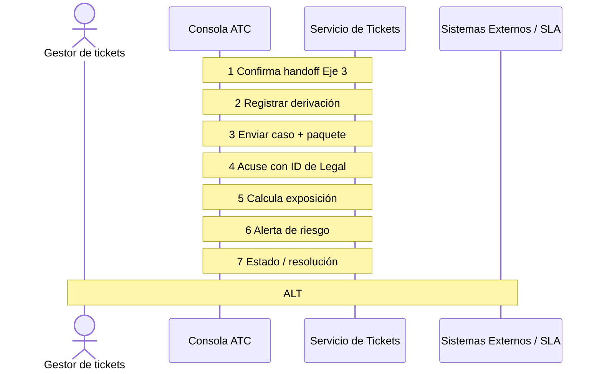
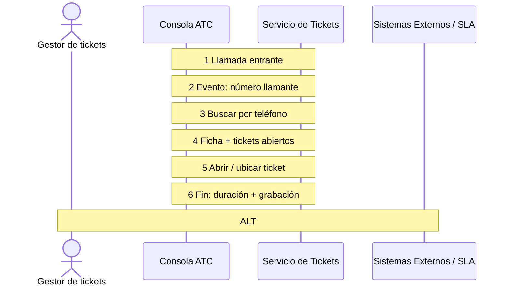
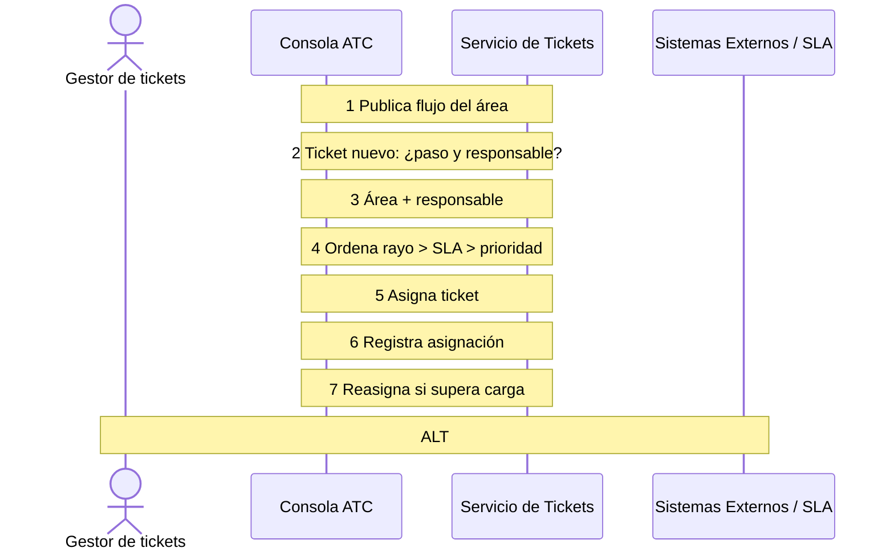
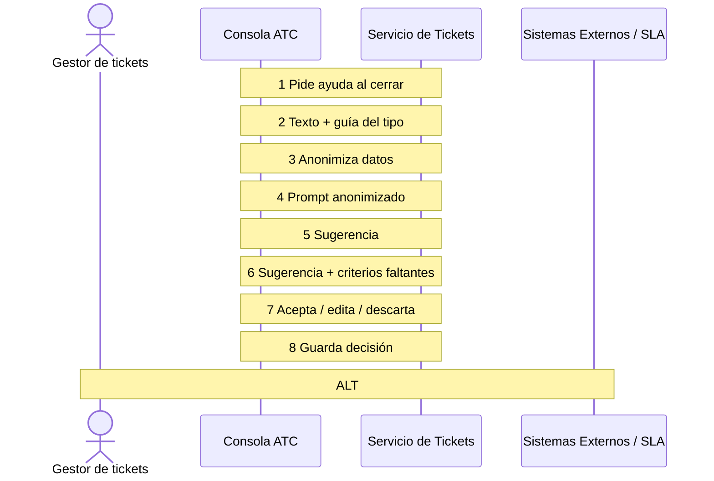
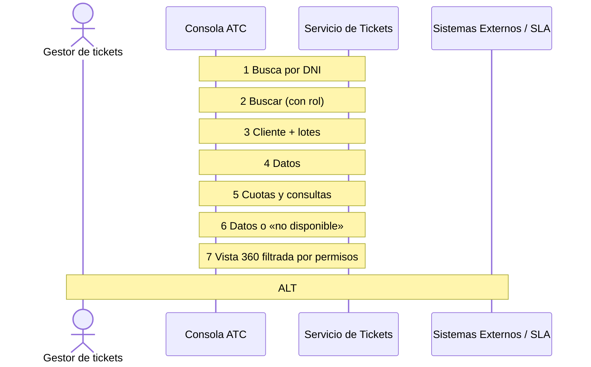

# 05 · HISTORIAS DE USUARIO DETALLADAS (60 HISTORIAS)
## Plataforma de Atención al Cliente «Aybar Atiende» · AYBARCORP SAC

---

## [US-031] HU-ATC-031: Generar el informe diario y el quincenal

### Metadatos de la Historia de Usuario
- **ID Historia:** `[US-031]` (`HU-ATC-031`)
- **Requerimiento Funcional de Origen:** `RF-SVC-031`
- **Funcionalidad Padre:** `[FEAT-14]` (`FT-ATC-14`)
- **Épica Padre:** `[EPIC-07]` (`EP-ATC-07`)
- **Prioridad:** Debería
- **Estimación con IA:** 4 h con IA
- **Asignación / Fechas:** Iteración 2 · Dev 3 · mar 27-oct ESTADO
- **Estado DoR:** Pendiente DoR
- **Requerimiento Textual:** RF-SVC-031 · El sistema debe generar el informe diario operativo y el informe quincenal analítico.

### Narrativa de Usuario
> **COMO** coordinador CX
> **QUIERO** recibir un informe diario operativo y uno quincenal analítico
> **PARA** que las jefaturas y el Comité decidan con datos consolidados

### Criterios de Aceptación (Escenarios Gherkin)
#### CA-01 · Diario
```gherkin
DADO el cierre de una jornada
CUANDO se genera el informe
ENTONCES incluye tickets por eje, NPS preliminar, derivaciones y cumplimiento de SLA.
```

#### CA-02 · Quincenal
```gherkin
DADO el cierre de una quincena
CUANDO se genera el informe
ENTONCES incluye tendencias de KPI y adopción de Mi Portal.
```

### Reglas de Negocio Asociadas
- **—**

**Fuera de alcance:**
Informes de otros dominios. Diseño / UX Prototipo › Torre de Control (Informes) Notas técnicas y dependencias DEP-10 KPI Engine Datos de prueba / analítica Sin evento específico; datos de prueba: 2 razones sociales, 3 tipos de ticket y 1 feriado.

### Especificaciones Técnicas y Dependencias
- **Diseño / UX:** ``
- **Entidades y Dependencias:** ``
- **Evento de Analítica / Telemetría:** ``

### Definición de Terminado (DoD) para la Historia
- [ ] Criterios de aceptación cubiertos por pruebas automatizadas (generadas con IA y revisadas por el dev).
- [ ] Revisión de pares obligatoria en Pull Request y análisis SAST sin vulnerabilidades en verde.
- [ ] Accesibilidad y diseño responsivo verificados (escritorio y móvil).
- [ ] Emisión del evento de telemetría `` validada.
- [ ] Bitácoras con hash verificado HMAC-SHA256 y cero PII expuesto (RNF-AUD-004 · RNF-SEC-008).
- [ ] Documentación técnica de la funcionalidad actualizada.
- [ ] Aceptado formalmente por el Dueño de Producto (PO) a las 17:00.

### Diagrama de Secuencia
```mermaid
sequenceDiagram
    autonumber
```

---

## [US-032] HU-ATC-032: Auditar registros paralelos del dato de cliente

### Metadatos de la Historia de Usuario
- **ID Historia:** `[US-032]` (`HU-ATC-032`)
- **Requerimiento Funcional de Origen:** `RF-SVC-032`
- **Funcionalidad Padre:** `[FEAT-14]` (`FT-ATC-14`)
- **Épica Padre:** `[EPIC-07]` (`EP-ATC-07`)
- **Prioridad:** Debería
- **Estimación con IA:** 3 h con IA
- **Asignación / Fechas:** Iteración 2 · Dev 3 · mar 27-oct → mié 28-oct
- **Estado DoR:** Pendiente DoR
- **Requerimiento Textual:** RF-SVC-032 · El sistema debe auditar quincenalmente la existencia de registros paralelos del dato de cliente fuera de SIGDA/TAXON.

### Narrativa de Usuario
> **COMO** CDO o coordinador CX
> **QUIERO** una auditoría quincenal de registros paralelos del dato de cliente
> **PARA** mantener una única fuente del cliente

### Criterios de Aceptación (Escenarios Gherkin)
#### CA-01 · Corte
```gherkin
DADO el corte quincenal
CUANDO se ejecuta la auditoría
ENTONCES el número de registros paralelos detectados debe ser cero.
```

#### CA-02 · Hallazgo
```gherkin
DADO un registro paralelo detectado
CUANDO se reporta
ENTONCES se eleva como gate no compensable, no como observación menor.
```

### Reglas de Negocio Asociadas
- **RN-SVC-026**

**Fuera de alcance:**
Limpieza de datos en otros sistemas. Diseño / UX Prototipo › Torre de Control (auditoría) Notas técnicas y dependencias DEP-01 SIGDA/TAXON Datos de prueba / analítica Métrica registros_paralelos

### Especificaciones Técnicas y Dependencias
- **Diseño / UX:** ``
- **Entidades y Dependencias:** ``
- **Evento de Analítica / Telemetría:** ``

### Definición de Terminado (DoD) para la Historia
- [ ] Criterios de aceptación cubiertos por pruebas automatizadas (generadas con IA y revisadas por el dev).
- [ ] Revisión de pares obligatoria en Pull Request y análisis SAST sin vulnerabilidades en verde.
- [ ] Accesibilidad y diseño responsivo verificados (escritorio y móvil).
- [ ] Emisión del evento de telemetría `` validada.
- [ ] Bitácoras con hash verificado HMAC-SHA256 y cero PII expuesto (RNF-AUD-004 · RNF-SEC-008).
- [ ] Documentación técnica de la funcionalidad actualizada.
- [ ] Aceptado formalmente por el Dueño de Producto (PO) a las 17:00.

### Diagrama de Secuencia
```mermaid
sequenceDiagram
    autonumber
```

---

## [US-033] HU-ATC-033: Registrar un reclamo de garantía vinculado a la entrega

### Metadatos de la Historia de Usuario
- **ID Historia:** `[US-033]` (`HU-ATC-033`)
- **Requerimiento Funcional de Origen:** `RF-SVC-033`
- **Funcionalidad Padre:** `[FEAT-10]` (`FT-ATC-10`)
- **Épica Padre:** `[EPIC-05]` (`EP-ATC-05`)
- **Prioridad:** Debería
- **Estimación con IA:** 4 h con IA
- **Asignación / Fechas:** Iteración 2 · Dev 1 · mar 27-oct → mié 28-oct
- **Estado DoR:** Pendiente DoR
- **Requerimiento Textual:** RF-SVC-033 · El sistema debe registrar el reclamo de garantía tipificado y vinculado obligatoriamente a un Acta de Entrega existente.

### Narrativa de Usuario
> **COMO** gestor de Postventa
> **QUIERO** registrar el reclamo de garantía tipificado y vinculado al Acta de Entrega
> **PARA** gestionar la postventa sobre el mismo caso que originó la entrega

### Criterios de Aceptación (Escenarios Gherkin)
#### CA-01 · Vínculo obligatorio
```gherkin
DADO un cliente que reporta un defecto
CUANDO registro el reclamo
ENTONCES queda vinculado a un CONTRACT_UNIT_HANDOVER existente; sin entrega no hay reclamo.
```

#### CA-02 · Catálogo cerrado
```gherkin
DADO un reclamo registrado
CUANDO lo tipifico
ENTONCES el tipo pertenece al catálogo: estructural, impermeabilización, acabados o instalaciones.
```

### Reglas de Negocio Asociadas
- **RN-SVC-027**

**Fuera de alcance:**
Órdenes de trabajo. Diseño / UX Prototipo › Garantías postventa Notas técnicas y dependencias CONTRACT_WARRANTY_CLAIM, CONTRACT_UNIT_HANDOVER · DEP-07 Datos de prueba / analítica Evento garantía_registrada {tipo}

### Especificaciones Técnicas y Dependencias
- **Diseño / UX:** ``
- **Entidades y Dependencias:** ``
- **Evento de Analítica / Telemetría:** ``

### Definición de Terminado (DoD) para la Historia
- [ ] Criterios de aceptación cubiertos por pruebas automatizadas (generadas con IA y revisadas por el dev).
- [ ] Revisión de pares obligatoria en Pull Request y análisis SAST sin vulnerabilidades en verde.
- [ ] Accesibilidad y diseño responsivo verificados (escritorio y móvil).
- [ ] Emisión del evento de telemetría `` validada.
- [ ] Bitácoras con hash verificado HMAC-SHA256 y cero PII expuesto (RNF-AUD-004 · RNF-SEC-008).
- [ ] Documentación técnica de la funcionalidad actualizada.
- [ ] Aceptado formalmente por el Dueño de Producto (PO) a las 17:00.

### Diagrama de Secuencia
```mermaid
sequenceDiagram
    autonumber
```

---

## [US-034] HU-ATC-034: Validar la vigencia de la garantía contra la cobertura

### Metadatos de la Historia de Usuario
- **ID Historia:** `[US-034]` (`HU-ATC-034`)
- **Requerimiento Funcional de Origen:** `RF-SVC-034`
- **Funcionalidad Padre:** `[FEAT-10]` (`FT-ATC-10`)
- **Épica Padre:** `[EPIC-05]` (`EP-ATC-05`)
- **Prioridad:** Debería
- **Estimación con IA:** 2 h con IA
- **Asignación / Fechas:** Iteración 2 · Dev 1 · mié 28-oct ESTADO
- **Estado DoR:** Pendiente DoR
- **Requerimiento Textual:** RF-SVC-034 · El sistema debe validar la vigencia contra el periodo de cobertura y la fecha real de entrega, y rechazar automáticamente lo que está fuera de cobertura.

### Narrativa de Usuario
> **COMO** gestor de Postventa
> **QUIERO** que el sistema valide la fecha del reclamo contra la cobertura y la entrega
> **PARA** rechazar automáticamente lo que está fuera de cobertura

### Criterios de Aceptación (Escenarios Gherkin)
#### CA-01 · Validación
```gherkin
DADO un reclamo nuevo
CUANDO se registra
ENTONCES se valida su fecha contra el periodo vigente y la fecha real de entrega antes de admitirlo.
```

#### CA-02 · Fuera de cobertura
```gherkin
DADO un reclamo fuera del periodo
CUANDO se valida
ENTONCES se marca como no procedente por vigencia y se informa al cliente el motivo.
```

### Reglas de Negocio Asociadas
- **RN-SVC-027**

**Fuera de alcance:**
— Diseño / UX Prototipo › Garantías (chip de cobertura) Notas técnicas y dependencias MAE_WARRANTY_COVERAGE_PERIOD · DEP-07 Datos de prueba / analítica Evento garantía_no_procedente

### Especificaciones Técnicas y Dependencias
- **Diseño / UX:** ``
- **Entidades y Dependencias:** ``
- **Evento de Analítica / Telemetría:** ``

### Definición de Terminado (DoD) para la Historia
- [ ] Criterios de aceptación cubiertos por pruebas automatizadas (generadas con IA y revisadas por el dev).
- [ ] Revisión de pares obligatoria en Pull Request y análisis SAST sin vulnerabilidades en verde.
- [ ] Accesibilidad y diseño responsivo verificados (escritorio y móvil).
- [ ] Emisión del evento de telemetría `` validada.
- [ ] Bitácoras con hash verificado HMAC-SHA256 y cero PII expuesto (RNF-AUD-004 · RNF-SEC-008).
- [ ] Documentación técnica de la funcionalidad actualizada.
- [ ] Aceptado formalmente por el Dueño de Producto (PO) a las 17:00.

### Diagrama de Secuencia
```mermaid
sequenceDiagram
    autonumber
```

---

## [US-035] HU-ATC-035: Registrar la inspección técnica antes de resolver

### Metadatos de la Historia de Usuario
- **ID Historia:** `[US-035]` (`HU-ATC-035`)
- **Requerimiento Funcional de Origen:** `RF-SVC-035`
- **Funcionalidad Padre:** `[FEAT-10]` (`FT-ATC-10`)
- **Épica Padre:** `[EPIC-05]` (`EP-ATC-05`)
- **Prioridad:** Debería
- **Estimación con IA:** 3 h con IA
- **Asignación / Fechas:** Iteración 2 · Dev 1 · mié 28-oct ESTADO
- **Estado DoR:** Pendiente DoR
- **Requerimiento Textual:** RF-SVC-035 · El sistema debe registrar la inspección técnica con su evidencia antes de resolver el reclamo.

### Narrativa de Usuario
> **COMO** gestor de Postventa
> **QUIERO** programar y registrar la inspección con su informe y fotos antes de resolver
> **PARA** aprobar, rechazar o resolver con trazabilidad completa

### Criterios de Aceptación (Escenarios Gherkin)
#### CA-01 · Inspección
```gherkin
DADO un reclamo en revisión
CUANDO programo la inspección
ENTONCES queda la fecha y, luego, el informe y las fotos antes de resolver.
```

#### CA-02 · Resolución
```gherkin
DADO un reclamo inspeccionado
CUANDO lo resuelvo
ENTONCES pasa a APPROVED, REJECTED o RESOLVED con fecha y descripción.
```

### Reglas de Negocio Asociadas
- **—**

**Fuera de alcance:**
Costeo de la reparación. Diseño / UX Prototipo › Garantías Notas técnicas y dependencias CONTRACT_WARRANTY_CLAIM Datos de prueba / analítica Evento inspección_registrada

### Especificaciones Técnicas y Dependencias
- **Diseño / UX:** ``
- **Entidades y Dependencias:** ``
- **Evento de Analítica / Telemetría:** ``

### Definición de Terminado (DoD) para la Historia
- [ ] Criterios de aceptación cubiertos por pruebas automatizadas (generadas con IA y revisadas por el dev).
- [ ] Revisión de pares obligatoria en Pull Request y análisis SAST sin vulnerabilidades en verde.
- [ ] Accesibilidad y diseño responsivo verificados (escritorio y móvil).
- [ ] Emisión del evento de telemetría `` validada.
- [ ] Bitácoras con hash verificado HMAC-SHA256 y cero PII expuesto (RNF-AUD-004 · RNF-SEC-008).
- [ ] Documentación técnica de la funcionalidad actualizada.
- [ ] Aceptado formalmente por el Dueño de Producto (PO) a las 17:00.

### Diagrama de Secuencia
```mermaid
sequenceDiagram
    autonumber
```

---

## [US-036] HU-ATC-036: Escalar la garantía a Eje 3 y gestionar la adenda

### Metadatos de la Historia de Usuario
- **ID Historia:** `[US-036]` (`HU-ATC-036`)
- **Requerimiento Funcional de Origen:** `RF-SVC-036`
- **Funcionalidad Padre:** `[FEAT-10]` (`FT-ATC-10`)
- **Épica Padre:** `[EPIC-05]` (`EP-ATC-05`)
- **Prioridad:** Debería
- **Estimación con IA:** 3 h con IA
- **Asignación / Fechas:** Iteración 2 · Dev 1 · mié 28-oct → jue 29-oct
- **Estado DoR:** Pendiente DoR
- **Requerimiento Textual:** RF-SVC-036 · El sistema debe escalar a Eje 3 un reclamo de garantía que derive en conflicto legal y permitir gestionar la reincorporación contractual por adenda.

### Narrativa de Usuario
> **COMO** gestor de Postventa
> **QUIERO** escalar a Legal un reclamo de garantía con conflicto y gestionar la adenda cuando corresponda
> **PARA** no resolver en Postventa lo que es legal y cerrar la reincorporación contractual

### Criterios de Aceptación (Escenarios Gherkin)
#### CA-01 · Conflicto
```gherkin
DADO un reclamo que recibe carta notarial
CUANDO se detecta
ENTONCES se deriva a Eje 3 sin intentar resolverlo en Eje 2.
```

#### CA-02 · Adenda
```gherkin
DADO un caso de reincorporación contractual tras una devolución
CUANDO se gestiona
ENTONCES se resuelve con una adenda registrada en Postventa.
```

### Reglas de Negocio Asociadas
- **RN-SVC-021**

**Fuera de alcance:**
Redacción de la adenda (Legal). Diseño / UX Prototipo › Garantías Notas técnicas y dependencias Reutiliza el gate de FT-ATC-07 Datos de prueba / analítica Sin evento específico; datos de prueba: 2 razones sociales, 3 tipos de ticket y 1 feriado.

### Especificaciones Técnicas y Dependencias
- **Diseño / UX:** ``
- **Entidades y Dependencias:** ``
- **Evento de Analítica / Telemetría:** ``

### Definición de Terminado (DoD) para la Historia
- [ ] Criterios de aceptación cubiertos por pruebas automatizadas (generadas con IA y revisadas por el dev).
- [ ] Revisión de pares obligatoria en Pull Request y análisis SAST sin vulnerabilidades en verde.
- [ ] Accesibilidad y diseño responsivo verificados (escritorio y móvil).
- [ ] Emisión del evento de telemetría `` validada.
- [ ] Bitácoras con hash verificado HMAC-SHA256 y cero PII expuesto (RNF-AUD-004 · RNF-SEC-008).
- [ ] Documentación técnica de la funcionalidad actualizada.
- [ ] Aceptado formalmente por el Dueño de Producto (PO) a las 17:00.

### Diagrama de Secuencia
```mermaid
sequenceDiagram
    autonumber
```

---

## [US-037] HU-ATC-037: Registrar el riesgo verbal y la secuencia de Frases Ancla

### Metadatos de la Historia de Usuario
- **ID Historia:** `[US-037]` (`HU-ATC-037`)
- **Requerimiento Funcional de Origen:** `RF-SVC-037`
- **Funcionalidad Padre:** `[FEAT-15]` (`FT-ATC-15`)
- **Épica Padre:** `[EPIC-08]` (`EP-ATC-08`)
- **Prioridad:** Podría · alcance flexible
- **Estimación con IA:** 2 h con IA
- **Asignación / Fechas:** Iteración 2 · Dev 3 · mié 28-oct ESTADO
- **Estado DoR:** Pendiente DoR
- **Requerimiento Textual:** RF-SVC-037 · El sistema debe registrar la clasificación de riesgo de la intervención en vivo y la secuencia de Frases Ancla (4, 5, 6) aplicada.

### Narrativa de Usuario
> **COMO** moderador de evento
> **QUIERO** registrar la clasificación de riesgo y qué Frases Ancla apliqué
> **PARA** contener la insistencia antes de derivar formalmente

### Criterios de Aceptación (Escenarios Gherkin)
#### CA-01 · Frase 4
```gherkin
DADO un propietario que divaga
CUANDO aplico la Frase 4
ENTONCES queda registrado el intento de concreción.
```

#### CA-02 · Frase 6
```gherkin
DADO un propietario que persiste tras la Frase 5
CUANDO aplico la Frase 6
ENTONCES el sistema exige registrar el caso para cerrar el tema en sala.
```

### Reglas de Negocio Asociadas
- **RN-SVC-030**

**Fuera de alcance:**
Guion completo del moderador. Diseño / UX Prototipo › EntregaFest en vivo Notas técnicas y dependencias Entidad por modelar (R-06) Datos de prueba / analítica Evento frase_ancla {n}

### Especificaciones Técnicas y Dependencias
- **Diseño / UX:** ``
- **Entidades y Dependencias:** ``
- **Evento de Analítica / Telemetría:** ``

### Definición de Terminado (DoD) para la Historia
- [ ] Criterios de aceptación cubiertos por pruebas automatizadas (generadas con IA y revisadas por el dev).
- [ ] Revisión de pares obligatoria en Pull Request y análisis SAST sin vulnerabilidades en verde.
- [ ] Accesibilidad y diseño responsivo verificados (escritorio y móvil).
- [ ] Emisión del evento de telemetría `` validada.
- [ ] Bitácoras con hash verificado HMAC-SHA256 y cero PII expuesto (RNF-AUD-004 · RNF-SEC-008).
- [ ] Documentación técnica de la funcionalidad actualizada.
- [ ] Aceptado formalmente por el Dueño de Producto (PO) a las 17:00.

### Diagrama de Secuencia
```mermaid
sequenceDiagram
    autonumber
```

---

## [US-038] HU-ATC-038: Derivar de inmediato a la Estación 4 sin debate

### Metadatos de la Historia de Usuario
- **ID Historia:** `[US-038]` (`HU-ATC-038`)
- **Requerimiento Funcional de Origen:** `RF-SVC-038`
- **Funcionalidad Padre:** `[FEAT-15]` (`FT-ATC-15`)
- **Épica Padre:** `[EPIC-08]` (`EP-ATC-08`)
- **Prioridad:** Podría · alcance flexible
- **Estimación con IA:** 2 h con IA
- **Asignación / Fechas:** Iteración 2 · Dev 3 · mié 28-oct ESTADO
- **Estado DoR:** Pendiente DoR
- **Requerimiento Textual:** RF-SVC-038 · El sistema debe registrar la derivación inmediata a la Estación 4 de todo caso sensible o imputación penal en vivo.

### Narrativa de Usuario
> **COMO** moderador de evento
> **QUIERO** que al detectar «estafa», «fraude», «abuso» o «delito» el sistema me pida derivar a la Estación 4
> **PARA** cerrar el tema en sala sin debatirlo

### Criterios de Aceptación (Escenarios Gherkin)
#### CA-01 · Palabra gatillo
```gherkin
DADO un propietario que menciona una palabra de riesgo muy alto
CUANDO la identifico
ENTONCES el sistema exige la derivación inmediata a la Estación 4.
```

#### CA-02 · Sin reapertura
```gherkin
DADO un caso derivado
CUANDO se cierra el tema en sala
ENTONCES el moderador no puede reabrirlo; queda con el especialista de la Estación 4.
```

### Reglas de Negocio Asociadas
- **RN-SVC-028**
- **RN-SVC-029**

**Fuera de alcance:**
— Diseño / UX Prototipo › EntregaFest (detector de palabras) Notas técnicas y dependencias Entidad por modelar Datos de prueba / analítica Evento derivación_estación4

### Especificaciones Técnicas y Dependencias
- **Diseño / UX:** ``
- **Entidades y Dependencias:** ``
- **Evento de Analítica / Telemetría:** ``

### Definición de Terminado (DoD) para la Historia
- [ ] Criterios de aceptación cubiertos por pruebas automatizadas (generadas con IA y revisadas por el dev).
- [ ] Revisión de pares obligatoria en Pull Request y análisis SAST sin vulnerabilidades en verde.
- [ ] Accesibilidad y diseño responsivo verificados (escritorio y móvil).
- [ ] Emisión del evento de telemetría `` validada.
- [ ] Bitácoras con hash verificado HMAC-SHA256 y cero PII expuesto (RNF-AUD-004 · RNF-SEC-008).
- [ ] Documentación técnica de la funcionalidad actualizada.
- [ ] Aceptado formalmente por el Dueño de Producto (PO) a las 17:00.

### Diagrama de Secuencia
```mermaid
sequenceDiagram
    autonumber
```

---

## [US-039] HU-ATC-039: Registrar el caso con la etiqueta estándar

### Metadatos de la Historia de Usuario
- **ID Historia:** `[US-039]` (`HU-ATC-039`)
- **Requerimiento Funcional de Origen:** `RF-SVC-039`
- **Funcionalidad Padre:** `[FEAT-15]` (`FT-ATC-15`)
- **Épica Padre:** `[EPIC-08]` (`EP-ATC-08`)
- **Prioridad:** Podría · alcance flexible
- **Estimación con IA:** 2 h con IA
- **Asignación / Fechas:** Iteración 2 · Dev 3 · mié 28-oct → jue 29-oct
- **Estado DoR:** Pendiente DoR
- **Requerimiento Textual:** RF-SVC-039 · El sistema debe registrar todo caso sensible del evento con la etiqueta «Atención especial — derivación a Legal».

### Narrativa de Usuario
> **COMO** coordinador CX o personal de apoyo
> **QUIERO** que cada caso del evento se registre con la etiqueta estándar
> **PARA** darle un seguimiento uniforme en el Registro de Casos Sensibles

### Criterios de Aceptación (Escenarios Gherkin)
#### CA-01 · Etiqueta
```gherkin
DADO un caso sensible detectado en el evento
CUANDO se registra
ENTONCES usa literalmente «Atención especial — derivación a Legal».
```

#### CA-02 · Revisión
```gherkin
DADO el cierre del bloque
CUANDO el coordinador revisa el registro
ENTONCES cada caso aparece con su estado (sí/no derivado a la Estación 4).
```

### Reglas de Negocio Asociadas
- **RN-SVC-028**

**Fuera de alcance:**
— Diseño / UX Prototipo › EntregaFest (registro de casos) Notas técnicas y dependencias Registro de Casos Sensibles Datos de prueba / analítica Sin evento específico; datos de prueba: 2 razones sociales, 3 tipos de ticket y 1 feriado.

### Especificaciones Técnicas y Dependencias
- **Diseño / UX:** ``
- **Entidades y Dependencias:** ``
- **Evento de Analítica / Telemetría:** ``

### Definición de Terminado (DoD) para la Historia
- [ ] Criterios de aceptación cubiertos por pruebas automatizadas (generadas con IA y revisadas por el dev).
- [ ] Revisión de pares obligatoria en Pull Request y análisis SAST sin vulnerabilidades en verde.
- [ ] Accesibilidad y diseño responsivo verificados (escritorio y móvil).
- [ ] Emisión del evento de telemetría `` validada.
- [ ] Bitácoras con hash verificado HMAC-SHA256 y cero PII expuesto (RNF-AUD-004 · RNF-SEC-008).
- [ ] Documentación técnica de la funcionalidad actualizada.
- [ ] Aceptado formalmente por el Dueño de Producto (PO) a las 17:00.

### Diagrama de Secuencia
```mermaid
sequenceDiagram
    autonumber
```

---

## [US-040] HU-ATC-040: Sincronizar con Legal los tickets derivados a Eje 3

### Metadatos de la Historia de Usuario
- **ID Historia:** `[US-040]` (`HU-ATC-040`)
- **Requerimiento Funcional de Origen:** `RF-SVC-040`
- **Funcionalidad Padre:** `[FEAT-16]` (`FT-ATC-16`)
- **Épica Padre:** `[EPIC-10]` (`EP-ATC-10`)
- **Prioridad:** Debe
- **Estimación con IA:** 5 h con IA
- **Asignación / Fechas:** Iteración 1 · Dev 4 · vie 23-oct ESTADO
- **Estado DoR:** Pendiente DoR
- **Requerimiento Textual:** RF-SVC-040 · El sistema debe sincronizar los tickets derivados a Eje 3 con la herramienta que usa el equipo de Legal (responsable: Rosario), enviando el paquete mínimo y recibiendo estado y resolución. Feedback presentación · ítem 2

### Narrativa de Usuario
> **COMO** responsable legal de reclamos
> **QUIERO** recibir en mi herramienta los tickets derivados a Eje 3 con su paquete mínimo y devolver su estado
> **PARA** seguir cada caso legal en un solo lugar sin registrarlo dos veces

### Criterios de Aceptación (Escenarios Gherkin)
#### CA-01 · Envío a Legal
```gherkin
DADO un ticket derivado a Eje 3
CUANDO se confirma el handoff
ENTONCES el caso aparece en la herramienta de Legal con el paquete mínimo y el N.º de ticket.
```

#### CA-02 · Estado de vuelta
```gherkin
DADO un caso que Legal actualiza o resuelve en su herramienta
CUANDO se sincroniza
ENTONCES el ticket refleja el nuevo estado sin registro manual.
```

#### CA-03 · Legal no disponible (agregado por PO)
```gherkin
DADO que la herramienta de Legal no responde
CUANDO se confirma un handoff a Eje 3
ENTONCES el envío queda en cola, se reintenta y el ticket muestra «pendiente de sincronizar».
```

### Reglas de Negocio Asociadas
- **RN-SVC-021 Gate: un caso de conflicto no se resuelve en Eje 1/2**
- **RN-SVC-022 Gate: derivación sin paquete mínimo**

**Fuera de alcance:**
Gestión del expediente judicial. Diseño / UX Prototipo › Ticket › pestaña Legal

### Especificaciones Técnicas y Dependencias
- **Diseño / UX:** ``
- **Entidades y Dependencias:** `ENT-SVC-001 SVC_TICKET, ENT-SVC-003 SVC_TICKET_ASSIGNMENT_LOG · DEP-12`
- **Evento de Analítica / Telemetría:** `Evento legal_sync {estado} Preguntas abiertas ¿Qué herramienta usa hoy Legal (sistema, Excel, correo)? ¿Rosario es la dueña funcional de la integración? ¿La sincronización es en línea o por lotes?`

### Definición de Terminado (DoD) para la Historia
- [ ] Criterios de aceptación cubiertos por pruebas automatizadas (generadas con IA y revisadas por el dev).
- [ ] Revisión de pares obligatoria en Pull Request y análisis SAST sin vulnerabilidades en verde.
- [ ] Accesibilidad y diseño responsivo verificados (escritorio y móvil).
- [ ] Emisión del evento de telemetría `Evento legal_sync {estado} Preguntas abiertas ¿Qué herramienta usa hoy Legal (sistema, Excel, correo)? ¿Rosario es la dueña funcional de la integración? ¿La sincronización es en línea o por lotes?` validada.
- [ ] Bitácoras con hash verificado HMAC-SHA256 y cero PII expuesto (RNF-AUD-004 · RNF-SEC-008).
- [ ] Documentación técnica de la funcionalidad actualizada.
- [ ] Aceptado formalmente por el Dueño de Producto (PO) a las 17:00.

### Diagrama de Secuencia


---

## [US-041] HU-ATC-041: Priorizar los reclamos con riesgo de denuncia por su exposición

### Metadatos de la Historia de Usuario
- **ID Historia:** `[US-041]` (`HU-ATC-041`)
- **Requerimiento Funcional de Origen:** `RF-SVC-041`
- **Funcionalidad Padre:** `[FEAT-16]` (`FT-ATC-16`)
- **Épica Padre:** `[EPIC-10]` (`EP-ATC-10`)
- **Prioridad:** Debe
- **Estimación con IA:** 4 h con IA
- **Asignación / Fechas:** Iteración 2 · Dev 4 · vie 23-oct → lun 26-oct
- **Estado DoR:** Pendiente DoR
- **Requerimiento Textual:** RF-SVC-041 · El sistema debe identificar los tickets con riesgo de escalar a denuncia o INDECOPI y calcular su exposición económica (monto reclamado + interés legal referencial del 8 %) para priorizarlos y alertar a Legal. Feedback presentación · ítem 16

### Narrativa de Usuario
> **COMO** coordinador CX
> **QUIERO** ver la exposición económica de cada reclamo con riesgo de denuncia y recibir una alerta antes del plazo
> **PARA** actuar antes de que el caso llegue a denuncia

### Criterios de Aceptación (Escenarios Gherkin)
#### CA-01 · Cálculo de exposición
```gherkin
DADO un reclamo con monto
CUANDO se registra o cambia
ENTONCES el sistema calcula la exposición (monto + interés legal al día) y la muestra en el ticket y en la Torre de Control.
```

#### CA-02 · Alerta a Legal
```gherkin
DADO un ticket que supera el umbral de riesgo de denuncia
CUANDO se evalúa
ENTONCES se marca como prioritario y se alerta a Legal antes del vencimiento del plazo.
```

#### CA-03 · Sin monto (agregado por PO)
```gherkin
DADO un reclamo sin monto registrado
CUANDO se evalúa el riesgo
ENTONCES la exposición se muestra como «por estimar» y el caso no se descarta de la priorización.
```

### Reglas de Negocio Asociadas
- **RN-SVC-034 Exposición económica por denuncia**
- **RN-SVC-016 Clasificación de riesgo objetiva y recalibrable**

**Fuera de alcance:**
Cálculo de costas procesales. Diseño / UX Prototipo › Torre de Control (columna «exposición»)

### Especificaciones Técnicas y Dependencias
- **Diseño / UX:** ``
- **Entidades y Dependencias:** `ENT-SVC-001 SVC_TICKET, ENT-SVC-010 SVC_COMPLAINT_BOOK_ENTRY · DEP-12`
- **Evento de Analítica / Telemetría:** `Evento riesgo_denuncia {exposicion} Preguntas abiertas ¿El 8 % es la tasa de interés legal que Legal quiere usar o un referencial? ¿Qué señales definen riesgo de denuncia (reincidencia, monto, palabras, abogado)? ¿Umbral de alerta?`

### Definición de Terminado (DoD) para la Historia
- [ ] Criterios de aceptación cubiertos por pruebas automatizadas (generadas con IA y revisadas por el dev).
- [ ] Revisión de pares obligatoria en Pull Request y análisis SAST sin vulnerabilidades en verde.
- [ ] Accesibilidad y diseño responsivo verificados (escritorio y móvil).
- [ ] Emisión del evento de telemetría `Evento riesgo_denuncia {exposicion} Preguntas abiertas ¿El 8 % es la tasa de interés legal que Legal quiere usar o un referencial? ¿Qué señales definen riesgo de denuncia (reincidencia, monto, palabras, abogado)? ¿Umbral de alerta?` validada.
- [ ] Bitácoras con hash verificado HMAC-SHA256 y cero PII expuesto (RNF-AUD-004 · RNF-SEC-008).
- [ ] Documentación técnica de la funcionalidad actualizada.
- [ ] Aceptado formalmente por el Dueño de Producto (PO) a las 17:00.

### Diagrama de Secuencia


---

## [US-042] HU-ATC-042: Atender la llamada con la ficha del cliente y registrarla en el ticket

### Metadatos de la Historia de Usuario
- **ID Historia:** `[US-042]` (`HU-ATC-042`)
- **Requerimiento Funcional de Origen:** `RF-SVC-042`
- **Funcionalidad Padre:** `[FEAT-17]` (`FT-ATC-17`)
- **Épica Padre:** `[EPIC-10]` (`EP-ATC-10`)
- **Prioridad:** Debe
- **Estimación con IA:** 5 h con IA
- **Asignación / Fechas:** Iteración 1 · Dev 4 · jue 22-oct ESTADO
- **Estado DoR:** Pendiente DoR
- **Requerimiento Textual:** RF-SVC-042 · El sistema debe integrarse con la plataforma que usa el equipo de call center para mostrar los datos del cliente al recibir la llamada (screen pop), abrir o ubicar su ticket y registrar la llamada como interacción con su grabación. Feedback presentación · ítem 5

### Narrativa de Usuario
> **COMO** gestor de tickets del call center
> **QUIERO** ver la ficha del cliente al contestar y que la llamada quede registrada en su ticket
> **PARA** atender sin cambiar de sistema ni volver a escribir los datos

### Criterios de Aceptación (Escenarios Gherkin)
#### CA-01 · Screen pop
```gherkin
DADO una llamada entrante de un número registrado
CUANDO el gestor de tickets contesta
ENTONCES ve la ficha del cliente y sus tickets abiertos en 2 s o menos.
```

#### CA-02 · Registro de la llamada
```gherkin
DADO una llamada finalizada
CUANDO se cierra
ENTONCES queda registrada como interacción del ticket con duración y enlace a la grabación.
```

#### CA-03 · Número desconocido (agregado por PO)
```gherkin
DADO una llamada de un número no registrado
CUANDO contesto
ENTONCES veo la búsqueda del cliente abierta para identificarlo o registrarlo como interesado.
```

### Reglas de Negocio Asociadas
- **RN-SVC-005 Empresa y línea obligatorias**

**Fuera de alcance:**
Marcador predictivo; campañas salientes. Diseño / UX Prototipo › Consola (panel de llamada) Notas técnicas y dependencias ENT-SVC-001 SVC_TICKET, ENT-SVC-004 SVC_TICKET_INTERACTION, ENT-REF-001 MAE_CHANNEL · DEP-11

### Especificaciones Técnicas y Dependencias
- **Diseño / UX:** ``
- **Entidades y Dependencias:** ``
- **Evento de Analítica / Telemetría:** `Evento llamada_registrada {duracion} Preguntas abiertas ¿Qué plataforma de call center usa hoy el equipo (proveedor y versión)? ¿Expone API o CTI para screen pop y grabaciones?`

### Definición de Terminado (DoD) para la Historia
- [ ] Criterios de aceptación cubiertos por pruebas automatizadas (generadas con IA y revisadas por el dev).
- [ ] Revisión de pares obligatoria en Pull Request y análisis SAST sin vulnerabilidades en verde.
- [ ] Accesibilidad y diseño responsivo verificados (escritorio y móvil).
- [ ] Emisión del evento de telemetría `Evento llamada_registrada {duracion} Preguntas abiertas ¿Qué plataforma de call center usa hoy el equipo (proveedor y versión)? ¿Expone API o CTI para screen pop y grabaciones?` validada.
- [ ] Bitácoras con hash verificado HMAC-SHA256 y cero PII expuesto (RNF-AUD-004 · RNF-SEC-008).
- [ ] Documentación técnica de la funcionalidad actualizada.
- [ ] Aceptado formalmente por el Dueño de Producto (PO) a las 17:00.

### Diagrama de Secuencia


---

## [US-043] HU-ATC-043: Configurar el flujo de trabajo de un tipo de ticket por área

### Metadatos de la Historia de Usuario
- **ID Historia:** `[US-043]` (`HU-ATC-043`)
- **Requerimiento Funcional de Origen:** `RF-SVC-043`
- **Funcionalidad Padre:** `[FEAT-18]` (`FT-ATC-18`)
- **Épica Padre:** `[EPIC-09]` (`EP-ATC-09`)
- **Prioridad:** Debe
- **Estimación con IA:** 6 h con IA
- **Asignación / Fechas:** Iteración 1 · Dev 3 · lun 19-oct → mar 20-oct
- **Estado DoR:** Pendiente DoR
- **Requerimiento Textual:** RF-SVC-043 · El sistema debe permitir configurar, sin desarrollo, el flujo de trabajo (workflow) de cada tipo de ticket por área: pasos, estados, responsables, aprobaciones y SLA de cada paso. Feedback presentación · ítem 6

### Narrativa de Usuario
> **COMO** administrador funcional
> **QUIERO** definir sin desarrollo los pasos, estados, responsables y SLA del flujo de cada tipo de ticket por área
> **PARA** adaptar la atención a cada área sin esperar cambios de sistema

### Criterios de Aceptación (Escenarios Gherkin)
#### CA-01 · Flujo aplicado
```gherkin
DADO un tipo de ticket de Cobranza
CUANDO el administrador define sus pasos y responsables
ENTONCES los nuevos tickets de ese tipo siguen el flujo configurado.
```

#### CA-02 · Versión del flujo
```gherkin
DADO un flujo modificado
CUANDO se publica
ENTONCES solo aplica a tickets nuevos y los abiertos conservan su flujo y SLA congelado.
```

#### CA-03 · Flujo incompleto (agregado por PO)
```gherkin
DADO un flujo sin responsable en un paso
CUANDO intento publicarlo
ENTONCES el sistema no lo publica e indica el paso incompleto.
```

### Reglas de Negocio Asociadas
- **RN-SVC-006 Asignación append-only**
- **RN-SVC-001 Precedencia SLA**

**Fuera de alcance:**
Editor gráfico de procesos (BPMN). Diseño / UX Prototipo › Configuración › Flujos

### Especificaciones Técnicas y Dependencias
- **Diseño / UX:** ``
- **Entidades y Dependencias:** `ENT-SVC-014 SVC_WORKFLOW_DEFINITION, ENT-SVC-007 MAE_Área, ENT-SVC-008 MAE_SLA_POLICY`
- **Evento de Analítica / Telemetría:** `Evento flujo_publicado {area, tipo} Preguntas abiertas ¿Cuántas áreas necesitan flujo propio en el piloto? ¿Quién aprueba los cambios de flujo?`

### Definición de Terminado (DoD) para la Historia
- [ ] Criterios de aceptación cubiertos por pruebas automatizadas (generadas con IA y revisadas por el dev).
- [ ] Revisión de pares obligatoria en Pull Request y análisis SAST sin vulnerabilidades en verde.
- [ ] Accesibilidad y diseño responsivo verificados (escritorio y móvil).
- [ ] Emisión del evento de telemetría `Evento flujo_publicado {area, tipo} Preguntas abiertas ¿Cuántas áreas necesitan flujo propio en el piloto? ¿Quién aprueba los cambios de flujo?` validada.
- [ ] Bitácoras con hash verificado HMAC-SHA256 y cero PII expuesto (RNF-AUD-004 · RNF-SEC-008).
- [ ] Documentación técnica de la funcionalidad actualizada.
- [ ] Aceptado formalmente por el Dueño de Producto (PO) a las 17:00.

### Diagrama de Secuencia


---

## [US-044] HU-ATC-044: Trabajar desde una bandeja única ordenada por urgencia

### Metadatos de la Historia de Usuario
- **ID Historia:** `[US-044]` (`HU-ATC-044`)
- **Requerimiento Funcional de Origen:** `RF-SVC-044`
- **Funcionalidad Padre:** `[FEAT-18]` (`FT-ATC-18`)
- **Épica Padre:** `[EPIC-09]` (`EP-ATC-09`)
- **Prioridad:** Debe
- **Estimación con IA:** 5 h con IA
- **Asignación / Fechas:** Iteración 1 · Dev 3 · mar 20-oct ESTADO
- **Estado DoR:** Pendiente DoR
- **Requerimiento Textual:** RF-SVC-044 · El sistema debe ofrecer una bandeja orquestadora que reúne los tickets de todos los canales y los ordena y asigna según flujo, prioridad, marca de rayo y vencimiento de SLA. Feedback presentación · ítem 11

### Narrativa de Usuario
> **COMO** gestor de tickets
> **QUIERO** ver en una sola bandeja los tickets de todos los canales ordenados por rayo, vencimiento de SLA y prioridad
> **PARA** atender primero lo más urgente

### Criterios de Aceptación (Escenarios Gherkin)
#### CA-01 · Orden de la bandeja
```gherkin
DADO tickets de teléfono, WhatsApp, correo y Mi Portal
CUANDO el gestor de tickets abre la bandeja
ENTONCES los ve juntos ordenados por rayo, SLA más próximo y prioridad.
```

#### CA-02 · Asignación por flujo
```gherkin
DADO un ticket nuevo sin responsable
CUANDO entra a la bandeja
ENTONCES el orquestador lo asigna según el flujo del área o lo deja en la cola del área.
```

#### CA-03 · Sin permiso de área (agregado por PO)
```gherkin
DADO un ticket de un área a la que no pertenezco
CUANDO abro la bandeja
ENTONCES no lo veo, salvo que sea supervisor de esa área.
```

### Reglas de Negocio Asociadas
- **RN-SVC-031 Prioridad rayo controlada**
- **RN-SVC-008 Alerta única por ciclo**

**Fuera de alcance:**
Bandejas personalizadas por gestor. Diseño / UX Prototipo › Bandeja

### Especificaciones Técnicas y Dependencias
- **Diseño / UX:** ``
- **Entidades y Dependencias:** `ENT-SVC-001 SVC_TICKET, ENT-SVC-003 SVC_TICKET_ASSIGNMENT_LOG`
- **Evento de Analítica / Telemetría:** `Evento bandeja_tomado {orden} Preguntas abiertas ¿La asignación es automática (push) o el gestor de tickets toma el siguiente (pull)? ¿Se mezclan tickets de varias áreas en la misma bandeja?`

### Definición de Terminado (DoD) para la Historia
- [ ] Criterios de aceptación cubiertos por pruebas automatizadas (generadas con IA y revisadas por el dev).
- [ ] Revisión de pares obligatoria en Pull Request y análisis SAST sin vulnerabilidades en verde.
- [ ] Accesibilidad y diseño responsivo verificados (escritorio y móvil).
- [ ] Emisión del evento de telemetría `Evento bandeja_tomado {orden} Preguntas abiertas ¿La asignación es automática (push) o el gestor de tickets toma el siguiente (pull)? ¿Se mezclan tickets de varias áreas en la misma bandeja?` validada.
- [ ] Bitácoras con hash verificado HMAC-SHA256 y cero PII expuesto (RNF-AUD-004 · RNF-SEC-008).
- [ ] Documentación técnica de la funcionalidad actualizada.
- [ ] Aceptado formalmente por el Dueño de Producto (PO) a las 17:00.

### Diagrama de Secuencia


---

## [US-045] HU-ATC-045: Marcar un ticket crítico con el rayo de prioridad

### Metadatos de la Historia de Usuario
- **ID Historia:** `[US-045]` (`HU-ATC-045`)
- **Requerimiento Funcional de Origen:** `RF-SVC-045`
- **Funcionalidad Padre:** `[FEAT-18]` (`FT-ATC-18`)
- **Épica Padre:** `[EPIC-09]` (`EP-ATC-09`)
- **Prioridad:** Debería
- **Estimación con IA:** 2 h con IA
- **Asignación / Fechas:** Iteración 1 · Dev 3 · mié 21-oct ESTADO
- **Estado DoR:** Pendiente DoR
- **Requerimiento Textual:** RF-SVC-045 · El sistema debe permitir marcar un ticket con un icono de rayo que lo sube al tope de la bandeja, registrando quien lo marco y por que. Feedback presentación · ítem 10

### Narrativa de Usuario
> **COMO** supervisor o líder
> **QUIERO** marcar un ticket con el icono de rayo indicando el motivo
> **PARA** que se atienda de inmediato sin cambiar su tipo ni su SLA

### Criterios de Aceptación (Escenarios Gherkin)
#### CA-01 · Marca con motivo
```gherkin
DADO un ticket crítico
CUANDO el líder lo marca con rayo e indica el motivo
ENTONCES aparece primero en la bandeja con el icono visible y queda en la bitácora.
```

#### CA-02 · Permiso
```gherkin
DADO un gestor de tickets sin rol de líder
CUANDO intenta marcar el rayo
ENTONCES la acción no esta disponible.
```

#### CA-03 · Límite del área (agregado por PO)
```gherkin
DADO un área con el 10 % de su bandeja ya marcada con rayo
CUANDO intento marcar otro
ENTONCES el sistema me avisa que se superó el límite y pide confirmar o desmarcar otro.
```

### Reglas de Negocio Asociadas
- **RN-SVC-031 Prioridad rayo controlada**

**Fuera de alcance:**
Cambio automático del SLA por el rayo. Diseño / UX Prototipo › Bandeja (icono rayo) Notas técnicas y dependencias ENT-SVC-001 SVC_TICKET

### Especificaciones Técnicas y Dependencias
- **Diseño / UX:** ``
- **Entidades y Dependencias:** ``
- **Evento de Analítica / Telemetría:** `Evento rayo_marcado {motivo} Preguntas abiertas ¿Quiénes pueden marcar el rayo? ¿El rayo cambia el SLA o solo el orden? ¿Hay un límite por bandeja?`

### Definición de Terminado (DoD) para la Historia
- [ ] Criterios de aceptación cubiertos por pruebas automatizadas (generadas con IA y revisadas por el dev).
- [ ] Revisión de pares obligatoria en Pull Request y análisis SAST sin vulnerabilidades en verde.
- [ ] Accesibilidad y diseño responsivo verificados (escritorio y móvil).
- [ ] Emisión del evento de telemetría `Evento rayo_marcado {motivo} Preguntas abiertas ¿Quiénes pueden marcar el rayo? ¿El rayo cambia el SLA o solo el orden? ¿Hay un límite por bandeja?` validada.
- [ ] Bitácoras con hash verificado HMAC-SHA256 y cero PII expuesto (RNF-AUD-004 · RNF-SEC-008).
- [ ] Documentación técnica de la funcionalidad actualizada.
- [ ] Aceptado formalmente por el Dueño de Producto (PO) a las 17:00.

### Diagrama de Secuencia


---

## [US-046] HU-ATC-046: Reasignar automáticamente al gestor con menos carga

### Metadatos de la Historia de Usuario
- **ID Historia:** `[US-046]` (`HU-ATC-046`)
- **Requerimiento Funcional de Origen:** `RF-SVC-046`
- **Funcionalidad Padre:** `[FEAT-18]` (`FT-ATC-18`)
- **Épica Padre:** `[EPIC-09]` (`EP-ATC-09`)
- **Prioridad:** Debería
- **Estimación con IA:** 4 h con IA
- **Asignación / Fechas:** Iteración 1 · Dev 3 · mié 21-oct ESTADO
- **Estado DoR:** Pendiente DoR
- **Requerimiento Textual:** RF-SVC-046 · El sistema debe reasignar un ticket al gestor de tickets disponible del mismo área y habilidad con menor carga de trabajo cuando el responsable no esta disponible o su carga supera el límite. Feedback presentación · ítem 18

### Narrativa de Usuario
> **COMO** supervisor ATC
> **QUIERO** que un ticket pase al gestor disponible del mismo área y habilidad con menos carga cuando el responsable está saturado o ausente
> **PARA** evitar incumplimientos por saturación

### Criterios de Aceptación (Escenarios Gherkin)
#### CA-01 · Balanceo
```gherkin
DADO un gestor de tickets con carga mayor al límite
CUANDO entra un ticket nuevo
ENTONCES se asigna al gestor de tickets disponible con menos tickets activos ponderados y se registra el motivo
REASSIGNMENT_CARGA.
```

#### CA-02 · Exclusiones
```gherkin
DADO un ticket con rayo, en Eje 3 o con interacción en curso
CUANDO corre el balanceo
ENTONCES no se reasigna.
```

#### CA-03 · Nadie disponible (agregado por PO)
```gherkin
DADO que no hay gestores disponibles en el área
CUANDO corre el balanceo
ENTONCES el ticket queda en la cola del área y se alerta al supervisor.
```

### Reglas de Negocio Asociadas
- **RN-SVC-033 Reasignación por menor carga**
- **RN-SVC-006 Asignación append-only**

**Fuera de alcance:**
Gestión de turnos y vacaciones. Diseño / UX Prototipo › Bandeja (supervisor)

### Especificaciones Técnicas y Dependencias
- **Diseño / UX:** ``
- **Entidades y Dependencias:** `ENT-SVC-003 SVC_TICKET_ASSIGNMENT_LOG, ENT-SVC-001 SVC_TICKET · DEP-02`
- **Evento de Analítica / Telemetría:** `Evento reasignacion_carga Preguntas abiertas ¿Cómo se mide la carga (n.º de tickets, ponderado por prioridad, tiempo estimado)? ¿Se considera ausencia por vacaciones o turno?`

### Definición de Terminado (DoD) para la Historia
- [ ] Criterios de aceptación cubiertos por pruebas automatizadas (generadas con IA y revisadas por el dev).
- [ ] Revisión de pares obligatoria en Pull Request y análisis SAST sin vulnerabilidades en verde.
- [ ] Accesibilidad y diseño responsivo verificados (escritorio y móvil).
- [ ] Emisión del evento de telemetría `Evento reasignacion_carga Preguntas abiertas ¿Cómo se mide la carga (n.º de tickets, ponderado por prioridad, tiempo estimado)? ¿Se considera ausencia por vacaciones o turno?` validada.
- [ ] Bitácoras con hash verificado HMAC-SHA256 y cero PII expuesto (RNF-AUD-004 · RNF-SEC-008).
- [ ] Documentación técnica de la funcionalidad actualizada.
- [ ] Aceptado formalmente por el Dueño de Producto (PO) a las 17:00.

### Diagrama de Secuencia


---

## [US-047] HU-ATC-047: Consultar la guía de solución del tipo de ticket

### Metadatos de la Historia de Usuario
- **ID Historia:** `[US-047]` (`HU-ATC-047`)
- **Requerimiento Funcional de Origen:** `RF-SVC-047`
- **Funcionalidad Padre:** `[FEAT-19]` (`FT-ATC-19`)
- **Épica Padre:** `[EPIC-09]` (`EP-ATC-09`)
- **Prioridad:** Debería
- **Estimación con IA:** 4 h con IA
- **Asignación / Fechas:** Iteración 1 · Dev 3 · mié 21-oct → jue 22-oct
- **Estado DoR:** Pendiente DoR
- **Requerimiento Textual:** RF-SVC-047 · El sistema debe mostrar al gestor de tickets una guía de como solucionar cada tipo de ticket (pasos, plantillas de respuesta, documentos requeridos y criterios de cierre) mantenida por el administrador funcional. Feedback presentación · ítem 7

### Narrativa de Usuario
> **COMO** gestor de tickets
> **QUIERO** ver en el ticket la guía de cómo resolver ese tipo: pasos, plantillas y criterios de cierre
> **PARA** resolver de forma estándar en el primer contacto

### Criterios de Aceptación (Escenarios Gherkin)
#### CA-01 · Guía en el ticket
```gherkin
DADO un ticket de tipo «Consulta de cuenta»
CUANDO el gestor de tickets lo abre
ENTONCES ve la guía de ese tipo con pasos, plantillas y criterios de cierre.
```

#### CA-02 · Versión
```gherkin
DADO una guía actualizada por el administrador
CUANDO se publica
ENTONCES los gestores de tickets ven la nueva versión y queda el historial de versiones.
```

#### CA-03 · Tipo sin guía (agregado por PO)
```gherkin
DADO un tipo de ticket sin guía publicada
CUANDO abro el ticket
ENTONCES veo el aviso «sin guía» y el sistema lo reporta al administrador funcional.
```

### Reglas de Negocio Asociadas
- **RN-SVC-023 Gate: cierre fuera de Mi Portal**

**Fuera de alcance:**
Gestión documental de manuales. Diseño / UX Prototipo › Ticket (panel guía)

### Especificaciones Técnicas y Dependencias
- **Diseño / UX:** ``
- **Entidades y Dependencias:** `ENT-SVC-015 SVC_KNOWLEDGE_ARTICLE, ENT-SVC-005 MAE_TICKET_TYPE`
- **Evento de Analítica / Telemetría:** `Evento guia_consultada {tipo} Preguntas abiertas ¿Quién redacta y aprueba las guías por área? ¿Existe hoy un manual de atención que sirva de base?`

### Definición de Terminado (DoD) para la Historia
- [ ] Criterios de aceptación cubiertos por pruebas automatizadas (generadas con IA y revisadas por el dev).
- [ ] Revisión de pares obligatoria en Pull Request y análisis SAST sin vulnerabilidades en verde.
- [ ] Accesibilidad y diseño responsivo verificados (escritorio y móvil).
- [ ] Emisión del evento de telemetría `Evento guia_consultada {tipo} Preguntas abiertas ¿Quién redacta y aprueba las guías por área? ¿Existe hoy un manual de atención que sirva de base?` validada.
- [ ] Bitácoras con hash verificado HMAC-SHA256 y cero PII expuesto (RNF-AUD-004 · RNF-SEC-008).
- [ ] Documentación técnica de la funcionalidad actualizada.
- [ ] Aceptado formalmente por el Dueño de Producto (PO) a las 17:00.

### Diagrama de Secuencia


---

## [US-048] HU-ATC-048: Recibir retroalimentación de IA mientras atiendo y cierro

### Metadatos de la Historia de Usuario
- **ID Historia:** `[US-048]` (`HU-ATC-048`)
- **Requerimiento Funcional de Origen:** `RF-SVC-048`
- **Funcionalidad Padre:** `[FEAT-19]` (`FT-ATC-19`)
- **Épica Padre:** `[EPIC-09]` (`EP-ATC-09`)
- **Prioridad:** Podría · alcance flexible
- **Estimación con IA:** 5 h con IA
- **Asignación / Fechas:** Iteración 1 · Dev 3 · jue 22-oct → vie 23-oct
- **Estado DoR:** Pendiente DoR
- **Requerimiento Textual:** RF-SVC-048 · El sistema debe usar IA para retroalimentar al gestor de tickets mientras atiende y al cerrar: sugerir respuesta, verificar que se cumplan los criterios de cierre de la guía y señalar tono o datos faltantes. Feedback presentación · ítem 8

### Narrativa de Usuario
> **COMO** gestor de tickets
> **QUIERO** que la IA me sugiera respuesta y me avise qué criterios de cierre faltan
> **PARA** cerrar con mejor calidad y aprender en el momento

### Criterios de Aceptación (Escenarios Gherkin)
#### CA-01 · Sugerencia
```gherkin
DADO un gestor de tickets que redacta una respuesta
CUANDO pide ayuda o va a cerrar
ENTONCES la IA sugiere texto y lista los criterios de cierre pendientes; el gestor de tickets acepta, edita o descarta.
```

#### CA-02 · Registro de la decisión
```gherkin
DADO una sugerencia de IA
CUANDO el gestor de tickets decide
ENTONCES queda registrada (aceptada/editada/descartada) sin datos personales en el registro.
```

#### CA-03 · Datos personales (agregado por PO)
```gherkin
DADO un texto con DNI o datos de tarjeta
CUANDO pido ayuda a la IA
ENTONCES los datos se anonimizan antes de enviarse al modelo.
```

### Reglas de Negocio Asociadas
- **RN-SVC-032 IA asesora, el gestor de tickets decide**
- **RN-SVC-012 DLP en bitácoras**

**Fuera de alcance:**
Respuesta automática de la IA al cliente. Diseño / UX Prototipo › Ticket (asistente)

### Especificaciones Técnicas y Dependencias
- **Diseño / UX:** ``
- **Entidades y Dependencias:** `ENT-SVC-016 SVC_AI_SUGGESTION_LOG, ENT-SVC-004 SVC_TICKET_INTERACTION · DEP-14`
- **Evento de Analítica / Telemetría:** `Evento ia_sugerencia {decision} Preguntas abiertas ¿Qué proveedor o modelo de IA esta aprobado por TI y Seguridad? ¿Se permite enviar datos del cliente al modelo o solo texto anonimizado?`

### Definición de Terminado (DoD) para la Historia
- [ ] Criterios de aceptación cubiertos por pruebas automatizadas (generadas con IA y revisadas por el dev).
- [ ] Revisión de pares obligatoria en Pull Request y análisis SAST sin vulnerabilidades en verde.
- [ ] Accesibilidad y diseño responsivo verificados (escritorio y móvil).
- [ ] Emisión del evento de telemetría `Evento ia_sugerencia {decision} Preguntas abiertas ¿Qué proveedor o modelo de IA esta aprobado por TI y Seguridad? ¿Se permite enviar datos del cliente al modelo o solo texto anonimizado?` validada.
- [ ] Bitácoras con hash verificado HMAC-SHA256 y cero PII expuesto (RNF-AUD-004 · RNF-SEC-008).
- [ ] Documentación técnica de la funcionalidad actualizada.
- [ ] Aceptado formalmente por el Dueño de Producto (PO) a las 17:00.

### Diagrama de Secuencia


---

## [US-049] HU-ATC-049: Buscar al cliente y llamarlo desde su ficha

### Metadatos de la Historia de Usuario
- **ID Historia:** `[US-049]` (`HU-ATC-049`)
- **Requerimiento Funcional de Origen:** `RF-SVC-049`
- **Funcionalidad Padre:** `[FEAT-20]` (`FT-ATC-20`)
- **Épica Padre:** `[EPIC-10]` (`EP-ATC-10`)
- **Prioridad:** Debe
- **Estimación con IA:** 4 h con IA
- **Asignación / Fechas:** Iteración 1 · Dev 4 · lun 19-oct ESTADO
- **Estado DoR:** Pendiente DoR
- **Requerimiento Textual:** RF-SVC-049 · El sistema debe ofrecer un motor de búsqueda de clientes por DNI, nombre, código de cliente, lote, teléfono o N.º de ticket, con opción de llamar a la cuenta desde la ficha. Feedback presentación · ítem 9

### Narrativa de Usuario
> **COMO** gestor de tickets
> **QUIERO** buscar al cliente por DNI, nombre, código, lote, teléfono o N.º de ticket y llamarlo desde la ficha
> **PARA** ubicarlo en segundos y contactarlo sin marcar a mano

### Criterios de Aceptación (Escenarios Gherkin)
#### CA-01 · Búsqueda
```gherkin
DADO un DNI o código de cliente
CUANDO el gestor de tickets busca
ENTONCES obtiene el cliente desde SIGDA/TAXON en 2 s o menos con sus tickets y lotes.
```

#### CA-02 · Llamar desde la ficha
```gherkin
DADO un cliente encontrado
CUANDO el gestor de tickets pulsa «Llamar»
ENTONCES se inicia la llamada por la plataforma de call center y queda como interacción del ticket.
```

#### CA-03 · Varias coincidencias (agregado por PO)
```gherkin
DADO una búsqueda por nombre con varios resultados
CUANDO busco
ENTONCES veo la lista con DNI parcial y lote para elegir al cliente correcto.
```

### Reglas de Negocio Asociadas
- **RN-SVC-026 Cero registros paralelos del dato de cliente**
- **RN-SVC-036 Búsqueda respeta permisos**

**Fuera de alcance:**
Edición de datos del cliente. Diseño / UX Prototipo › Búsqueda de cliente

### Especificaciones Técnicas y Dependencias
- **Diseño / UX:** ``
- **Entidades y Dependencias:** `ENT-SVC-017 SVC_SEARCH_INDEX, ENT-SVC-001 SVC_TICKET · DEP-01 · DEP-11`
- **Evento de Analítica / Telemetría:** `Evento cliente_buscado {criterio} Preguntas abiertas ¿Qué significa «llamar la cuenta»: llamada telefónica (click-to-call) o consultar la cuenta del cliente? ¿Qué campos de búsqueda son obligatorios?`

### Definición de Terminado (DoD) para la Historia
- [ ] Criterios de aceptación cubiertos por pruebas automatizadas (generadas con IA y revisadas por el dev).
- [ ] Revisión de pares obligatoria en Pull Request y análisis SAST sin vulnerabilidades en verde.
- [ ] Accesibilidad y diseño responsivo verificados (escritorio y móvil).
- [ ] Emisión del evento de telemetría `Evento cliente_buscado {criterio} Preguntas abiertas ¿Qué significa «llamar la cuenta»: llamada telefónica (click-to-call) o consultar la cuenta del cliente? ¿Qué campos de búsqueda son obligatorios?` validada.
- [ ] Bitácoras con hash verificado HMAC-SHA256 y cero PII expuesto (RNF-AUD-004 · RNF-SEC-008).
- [ ] Documentación técnica de la funcionalidad actualizada.
- [ ] Aceptado formalmente por el Dueño de Producto (PO) a las 17:00.

### Diagrama de Secuencia


---

## [US-050] HU-ATC-050: Ver la consulta 360 del cliente dentro del ticket

### Metadatos de la Historia de Usuario
- **ID Historia:** `[US-050]` (`HU-ATC-050`)
- **Requerimiento Funcional de Origen:** `RF-SVC-050`
- **Funcionalidad Padre:** `[FEAT-20]` (`FT-ATC-20`)
- **Épica Padre:** `[EPIC-10]` (`EP-ATC-10`)
- **Prioridad:** Debe
- **Estimación con IA:** 5 h con IA
- **Asignación / Fechas:** Iteración 1 · Dev 4 · mar 20-oct ESTADO
- **Estado DoR:** Pendiente DoR
- **Requerimiento Textual:** RF-SVC-050 · El sistema debe mostrar en el ticket un submódulo de consulta del cliente con su detalle: lotes, cuotas y estado de cuenta, correos y mensajes, tickets e interacciones previas y documentos. Feedback presentación · ítem 12

### Narrativa de Usuario
> **COMO** gestor de tickets
> **QUIERO** ver en el ticket los lotes, cuotas, correos, tickets previos y documentos del cliente
> **PARA** responder sin salir del ticket

### Criterios de Aceptación (Escenarios Gherkin)
#### CA-01 · Consulta 360
```gherkin
DADO un ticket con cliente identificado
CUANDO el gestor de tickets abre la pestaña del cliente
ENTONCES ve sus lotes, cuotas, correos y tickets previos consultados en línea (sin copiarlos).
```

#### CA-02 · Sección restringida
```gherkin
DADO un gestor de tickets sin permiso a estado de cuenta
CUANDO abre la consulta
ENTONCES esa sección aparece restringida.
```

#### CA-03 · Fuente caída (agregado por PO)
```gherkin
DADO que Cobranza no responde
CUANDO abro la consulta 360
ENTONCES las demás secciones cargan y la de cuotas muestra «no disponible» con hora del intento.
```

### Reglas de Negocio Asociadas
- **RN-SVC-036 Búsqueda respeta permisos**
- **RN-SVC-026 Cero registros paralelos del dato de cliente**

**Fuera de alcance:**
Edición de datos de las fuentes. Diseño / UX Prototipo › Ticket › pestaña Cliente

### Especificaciones Técnicas y Dependencias
- **Diseño / UX:** ``
- **Entidades y Dependencias:** `ENT-SVC-001 SVC_TICKET, ENT-SVC-004 SVC_TICKET_INTERACTION · DEP-01 · DEP-08`
- **Evento de Analítica / Telemetría:** `Evento consulta360 {secciones} Preguntas abiertas ¿Qué sistemas fuente alimentan cada sección (SIGDA/TAXON, Cobranza, Contratos, correo)? ¿Qué secciones ve cada rol?`

### Definición de Terminado (DoD) para la Historia
- [ ] Criterios de aceptación cubiertos por pruebas automatizadas (generadas con IA y revisadas por el dev).
- [ ] Revisión de pares obligatoria en Pull Request y análisis SAST sin vulnerabilidades en verde.
- [ ] Accesibilidad y diseño responsivo verificados (escritorio y móvil).
- [ ] Emisión del evento de telemetría `Evento consulta360 {secciones} Preguntas abiertas ¿Qué sistemas fuente alimentan cada sección (SIGDA/TAXON, Cobranza, Contratos, correo)? ¿Qué secciones ve cada rol?` validada.
- [ ] Bitácoras con hash verificado HMAC-SHA256 y cero PII expuesto (RNF-AUD-004 · RNF-SEC-008).
- [ ] Documentación técnica de la funcionalidad actualizada.
- [ ] Aceptado formalmente por el Dueño de Producto (PO) a las 17:00.

### Diagrama de Secuencia


---

## [US-051] HU-ATC-051: Continuar la atención cuando la consulta del cliente falla

### Metadatos de la Historia de Usuario
- **ID Historia:** `[US-051]` (`HU-ATC-051`)
- **Requerimiento Funcional de Origen:** `RF-SVC-051`
- **Funcionalidad Padre:** `[FEAT-20]` (`FT-ATC-20`)
- **Épica Padre:** `[EPIC-10]` (`EP-ATC-10`)
- **Prioridad:** Debe
- **Estimación con IA:** 3 h con IA
- **Asignación / Fechas:** Iteración 1 · Dev 4 · mar 20-oct → mié 21-oct
- **Estado DoR:** Pendiente DoR
- **Requerimiento Textual:** RF-SVC-051 · El sistema debe manejar las excepciones de la consulta del cliente: cliente no encontrado, interesado sin contrato, datos incompletos o sistema fuente no disponible, permitiendo continuar el registro con un flujo controlado. Feedback presentación · ítem 14

### Narrativa de Usuario
> **COMO** gestor de tickets
> **QUIERO** registrar la solicitud aunque el cliente no se encuentre o el sistema fuente no responda
> **PARA** no perder la solicitud

### Criterios de Aceptación (Escenarios Gherkin)
#### CA-01 · Cliente no encontrado
```gherkin
DADO un DNI que no existe en SIGDA/TAXON
CUANDO el gestor de tickets registra
ENTONCES el ticket se crea como «Interesado» con datos mínimos y queda pendiente de vincular al cliente.
```

#### CA-02 · Sistema fuente caído
```gherkin
DADO SIGDA/TAXON no disponible
CUANDO el gestor de tickets busca
ENTONCES ve un aviso, registra el ticket con datos mínimos y el sistema reintenta la vinculación automáticamente.
```

#### CA-03 · Vinculación posterior (agregado por PO)
```gherkin
DADO un ticket con vinculación pendiente
CUANDO el sistema fuente vuelve a responder
ENTONCES el ticket se vincula al cliente y se registra el cambio en la bitácora.
```

### Reglas de Negocio Asociadas
- **RN-SVC-026 Cero registros paralelos del dato de cliente**
- **RN-SVC-005 Empresa y línea obligatorias**

**Fuera de alcance:**
Alta de clientes nuevos en SIGDA. Diseño / UX Prototipo › Nuevo ticket (modo excepción)

### Especificaciones Técnicas y Dependencias
- **Diseño / UX:** ``
- **Entidades y Dependencias:** `ENT-SVC-001 SVC_TICKET · DEP-01`
- **Evento de Analítica / Telemetría:** `Evento consulta_excepcion {motivo} Preguntas abiertas Confirmar a que se refiere «excepción para la consulta de usuario»: ¿cliente no encontrado, permisos especiales o caída del sistema fuente?`

### Definición de Terminado (DoD) para la Historia
- [ ] Criterios de aceptación cubiertos por pruebas automatizadas (generadas con IA y revisadas por el dev).
- [ ] Revisión de pares obligatoria en Pull Request y análisis SAST sin vulnerabilidades en verde.
- [ ] Accesibilidad y diseño responsivo verificados (escritorio y móvil).
- [ ] Emisión del evento de telemetría `Evento consulta_excepcion {motivo} Preguntas abiertas Confirmar a que se refiere «excepción para la consulta de usuario»: ¿cliente no encontrado, permisos especiales o caída del sistema fuente?` validada.
- [ ] Bitácoras con hash verificado HMAC-SHA256 y cero PII expuesto (RNF-AUD-004 · RNF-SEC-008).
- [ ] Documentación técnica de la funcionalidad actualizada.
- [ ] Aceptado formalmente por el Dueño de Producto (PO) a las 17:00.

### Diagrama de Secuencia
```mermaid
sequenceDiagram
    autonumber
    actor Gestor as Gestor de tickets
    participant UI as Consola ATC
    participant Core as Servicio de Tickets
    participant Ext as Sistemas Externos / SLA
    Note over UI,Core: 1 Busca por DNI
    Note over UI,Core: 2 Buscar (con rol)
    Note over UI,Core: 3 Cliente + lotes
    Note over UI,Core: 4 Datos
    Note over UI,Core: 5 Cuotas y consultas
    Note over UI,Core: 6 Datos o «no disponible»
    Note over UI,Core: 7 Vista 360 filtrada por permisos
    Note over Gestor,Ext: ALT
```

---

## [US-052] HU-ATC-052: Consultar datos específicos con el motor de José

### Metadatos de la Historia de Usuario
- **ID Historia:** `[US-052]` (`HU-ATC-052`)
- **Requerimiento Funcional de Origen:** `RF-SVC-052`
- **Funcionalidad Padre:** `[FEAT-20]` (`FT-ATC-20`)
- **Épica Padre:** `[EPIC-10]` (`EP-ATC-10`)
- **Prioridad:** Debería
- **Estimación con IA:** 3 h con IA
- **Asignación / Fechas:** Iteración 1 · Dev 4 · mié 21-oct ESTADO
- **Estado DoR:** Pendiente DoR
- **Requerimiento Textual:** RF-SVC-052 · El sistema debe consumir el motor de consultas que ya construyó José para obtener datos especificos del cliente, integrándolo por API en lugar de desarrollar uno nuevo. Feedback presentación · ítem 17

### Narrativa de Usuario
> **COMO** gestor de tickets
> **QUIERO** ejecutar consultas específicas del cliente usando el motor que ya construyó José
> **PARA** obtener el dato sin un desarrollo nuevo

### Criterios de Aceptación (Escenarios Gherkin)
#### CA-01 · Consulta vía API
```gherkin
DADO una consulta especifica del cliente (p. ej.. saldo de un lote)
CUANDO el gestor de tickets la ejecuta desde el ticket
ENTONCES la respuesta proviene del motor de consultas de José vía API.
```

#### CA-02 · Motor no disponible
```gherkin
DADO el motor no disponible
CUANDO se consulta
ENTONCES el ticket muestra un aviso y no bloquea la atención.
```

#### CA-03 · Permisos (agregado por PO)
```gherkin
DADO una consulta sobre datos que mi rol no puede ver
CUANDO la ejecuto
ENTONCES el motor no devuelve el dato y queda registrado el intento.
```

### Reglas de Negocio Asociadas
- **RN-SVC-036 Búsqueda respeta permisos**

**Fuera de alcance:**
Mantenimiento del motor de José. Diseño / UX Prototipo › Ticket › Consultas rápidas Notas técnicas y dependencias ENT-SVC-017 SVC_SEARCH_INDEX · DEP-13

### Especificaciones Técnicas y Dependencias
- **Diseño / UX:** ``
- **Entidades y Dependencias:** ``
- **Evento de Analítica / Telemetría:** `Evento consulta_motor {consulta} Preguntas abiertas ¿Qué expone hoy el motor de José (API, base de datos, reportes)? ¿Quién lo mantiene y con que SLA?`

### Definición de Terminado (DoD) para la Historia
- [ ] Criterios de aceptación cubiertos por pruebas automatizadas (generadas con IA y revisadas por el dev).
- [ ] Revisión de pares obligatoria en Pull Request y análisis SAST sin vulnerabilidades en verde.
- [ ] Accesibilidad y diseño responsivo verificados (escritorio y móvil).
- [ ] Emisión del evento de telemetría `Evento consulta_motor {consulta} Preguntas abiertas ¿Qué expone hoy el motor de José (API, base de datos, reportes)? ¿Quién lo mantiene y con que SLA?` validada.
- [ ] Bitácoras con hash verificado HMAC-SHA256 y cero PII expuesto (RNF-AUD-004 · RNF-SEC-008).
- [ ] Documentación técnica de la funcionalidad actualizada.
- [ ] Aceptado formalmente por el Dueño de Producto (PO) a las 17:00.

### Diagrama de Secuencia
```mermaid
sequenceDiagram
    autonumber
    actor Gestor as Gestor de tickets
    participant UI as Consola ATC
    participant Core as Servicio de Tickets
    participant Ext as Sistemas Externos / SLA
    Note over UI,Core: 1 Busca por DNI
    Note over UI,Core: 2 Buscar (con rol)
    Note over UI,Core: 3 Cliente + lotes
    Note over UI,Core: 4 Datos
    Note over UI,Core: 5 Cuotas y consultas
    Note over UI,Core: 6 Datos o «no disponible»
    Note over UI,Core: 7 Vista 360 filtrada por permisos
    Note over Gestor,Ext: ALT
```

---

## [US-053] HU-ATC-053: Buscar documentos del cliente por significado

### Metadatos de la Historia de Usuario
- **ID Historia:** `[US-053]` (`HU-ATC-053`)
- **Requerimiento Funcional de Origen:** `RF-SVC-053`
- **Funcionalidad Padre:** `[FEAT-20]` (`FT-ATC-20`)
- **Épica Padre:** `[EPIC-10]` (`EP-ATC-10`)
- **Prioridad:** Podría · alcance flexible
- **Estimación con IA:** 5 h con IA
- **Asignación / Fechas:** Iteración 1 · Dev 4 · mié 21-oct → jue 22-oct
- **Estado DoR:** Pendiente DoR
- **Requerimiento Textual:** RF-SVC-053 · El sistema debe indexar con un modelo de red neuronal (búsqueda semántica) los archivos y documentos de los clientes para que el motor de búsqueda encuentre información por significado y no solo por palabras exactas. Feedback presentación · ítem 19

### Narrativa de Usuario
> **COMO** gestor de tickets
> **QUIERO** buscar en lenguaje natural dentro de los documentos del cliente
> **PARA** encontrar el documento aunque no sepa cómo está escrito

### Criterios de Aceptación (Escenarios Gherkin)
#### CA-01 · Búsqueda semántica
```gherkin
DADO una búsqueda en lenguaje natural (p. ej.. «adenda de cambio de lote»)
CUANDO el gestor de tickets la ejecuta
ENTONCES obtiene los documentos del cliente más relevantes con su fragmento.
```

#### CA-02 · Documento restringido
```gherkin
DADO un documento que el rol del gestor de tickets no puede ver
CUANDO busca
ENTONCES no aparece en los resultados.
```

#### CA-03 · Sin resultados (agregado por PO)
```gherkin
DADO una búsqueda sin coincidencias relevantes
CUANDO la ejecuto
ENTONCES veo sugerencias de búsqueda por palabras exactas.
```

### Reglas de Negocio Asociadas
- **RN-SVC-036 Búsqueda respeta permisos**
- **RN-SVC-012 DLP en bitácoras**

**Fuera de alcance:**
Indexación de repositorios no aprobados. Diseño / UX Prototipo › Búsqueda (documentos)

### Especificaciones Técnicas y Dependencias
- **Diseño / UX:** ``
- **Entidades y Dependencias:** `ENT-SVC-017 SVC_SEARCH_INDEX, ENT-GOV-004 GOV_DOCUMENT_REPOSITORY · DEP-06 · DEP-14`
- **Evento de Analítica / Telemetría:** `Evento busqueda_semantica Preguntas abiertas ¿Qué repositorios de documentos se indexan (S3, GLI, correo)? ¿Hay restricciones legales para indexar contratos?`

### Definición de Terminado (DoD) para la Historia
- [ ] Criterios de aceptación cubiertos por pruebas automatizadas (generadas con IA y revisadas por el dev).
- [ ] Revisión de pares obligatoria en Pull Request y análisis SAST sin vulnerabilidades en verde.
- [ ] Accesibilidad y diseño responsivo verificados (escritorio y móvil).
- [ ] Emisión del evento de telemetría `Evento busqueda_semantica Preguntas abiertas ¿Qué repositorios de documentos se indexan (S3, GLI, correo)? ¿Hay restricciones legales para indexar contratos?` validada.
- [ ] Bitácoras con hash verificado HMAC-SHA256 y cero PII expuesto (RNF-AUD-004 · RNF-SEC-008).
- [ ] Documentación técnica de la funcionalidad actualizada.
- [ ] Aceptado formalmente por el Dueño de Producto (PO) a las 17:00.

### Diagrama de Secuencia
```mermaid
sequenceDiagram
    autonumber
    actor Gestor as Gestor de tickets
    participant UI as Consola ATC
    participant Core as Servicio de Tickets
    participant Ext as Sistemas Externos / SLA
    Note over UI,Core: 1 Busca por DNI
    Note over UI,Core: 2 Buscar (con rol)
    Note over UI,Core: 3 Cliente + lotes
    Note over UI,Core: 4 Datos
    Note over UI,Core: 5 Cuotas y consultas
    Note over UI,Core: 6 Datos o «no disponible»
    Note over UI,Core: 7 Vista 360 filtrada por permisos
    Note over Gestor,Ext: ALT
```

---

## [US-054] HU-ATC-054: Ver mi avance diario y el de mi equipo

### Metadatos de la Historia de Usuario
- **ID Historia:** `[US-054]` (`HU-ATC-054`)
- **Requerimiento Funcional de Origen:** `RF-SVC-054`
- **Funcionalidad Padre:** `[FEAT-21]` (`FT-ATC-21`)
- **Épica Padre:** `[EPIC-09]` (`EP-ATC-09`)
- **Prioridad:** Debería
- **Estimación con IA:** 4 h con IA
- **Asignación / Fechas:** Iteración 1 · Dev 3 · vie 23-oct ESTADO
- **Estado DoR:** Pendiente DoR
- **Requerimiento Textual:** RF-SVC-054 · El sistema debe mostrar a cada gestor de tickets y a su líder un tablero de avance diario: tickets atendidos, pendientes, cumplimiento de SLA, tiempo medio y CSAT. Feedback presentación · ítem 13

### Narrativa de Usuario
> **COMO** gestor de tickets y su líder
> **QUIERO** ver un tablero con tickets atendidos, pendientes, en riesgo y CSAT del día
> **PARA** seguir la productividad y corregir a tiempo

### Criterios de Aceptación (Escenarios Gherkin)
#### CA-01 · Tablero del gestor
```gherkin
DADO un gestor de tickets en su jornada
CUANDO abre su tablero
ENTONCES ve sus tickets atendidos, pendientes, en riesgo y su CSAT del día actualizados.
```

#### CA-02 · Tablero del líder
```gherkin
DADO un líder
CUANDO abre el tablero de su equipo
ENTONCES ve el avance diario de cada gestor de tickets y puede ir al ticket en riesgo.
```

#### CA-03 · Privacidad (agregado por PO)
```gherkin
DADO un gestor que abre el tablero
CUANDO consulta el avance
ENTONCES ve solo el suyo; el del equipo es visible para su líder.
```

### Reglas de Negocio Asociadas
- **RN-SVC-025 Cierre end-to-end en 72 horas hábiles**

**Fuera de alcance:**
Evaluación de desempeño. Diseño / UX Prototipo › Mi día Notas técnicas y dependencias ENT-SVC-001 SVC_TICKET, ENT-SVY-001 SVY_SURVEY_RESPONSE · DEP-02

### Especificaciones Técnicas y Dependencias
- **Diseño / UX:** ``
- **Entidades y Dependencias:** ``
- **Evento de Analítica / Telemetría:** `Evento tablero_visto Preguntas abiertas ¿Qué metas diarias tiene cada gestor de tickets? ¿El tablero del gestor de tickets es visible para sus pares?`

### Definición de Terminado (DoD) para la Historia
- [ ] Criterios de aceptación cubiertos por pruebas automatizadas (generadas con IA y revisadas por el dev).
- [ ] Revisión de pares obligatoria en Pull Request y análisis SAST sin vulnerabilidades en verde.
- [ ] Accesibilidad y diseño responsivo verificados (escritorio y móvil).
- [ ] Emisión del evento de telemetría `Evento tablero_visto Preguntas abiertas ¿Qué metas diarias tiene cada gestor de tickets? ¿El tablero del gestor de tickets es visible para sus pares?` validada.
- [ ] Bitácoras con hash verificado HMAC-SHA256 y cero PII expuesto (RNF-AUD-004 · RNF-SEC-008).
- [ ] Documentación técnica de la funcionalidad actualizada.
- [ ] Aceptado formalmente por el Dueño de Producto (PO) a las 17:00.

### Diagrama de Secuencia
```mermaid
sequenceDiagram
    autonumber
    actor Gestor as Gestor de tickets
    participant UI as Consola ATC
    participant Core as Servicio de Tickets
    participant Ext as Sistemas Externos / SLA
    Note over UI,Core: 1 Evento ticket.asignado
    Note over UI,Core: 2 ¿Líder del gestor?
    Note over UI,Core: 3 Líder
    Note over UI,Core: 4 Correo con copia
    Note over UI,Core: 5 Actualiza indicadores
    Note over Gestor,Ext: ALT
```

---

## [US-055] HU-ATC-055: Recibir un correo al asignarme un ticket, con copia a mi líder

### Metadatos de la Historia de Usuario
- **ID Historia:** `[US-055]` (`HU-ATC-055`)
- **Requerimiento Funcional de Origen:** `RF-SVC-055`
- **Funcionalidad Padre:** `[FEAT-21]` (`FT-ATC-21`)
- **Épica Padre:** `[EPIC-09]` (`EP-ATC-09`)
- **Prioridad:** Debe
- **Estimación con IA:** 2 h con IA
- **Asignación / Fechas:** Iteración 1 · Dev 3 · vie 23-oct ESTADO
- **Estado DoR:** Pendiente DoR
- **Requerimiento Textual:** RF-SVC-055 · El sistema debe enviar una alerta por correo al gestor de tickets cada vez que se le asigna o reasigna un ticket, con copia a su líder, indicando N.º, tipo, prioridad y vencimiento de SLA. Feedback presentación · ítem 15

### Narrativa de Usuario
> **COMO** gestor de tickets
> **QUIERO** recibir un correo cada vez que me asignan o reasignan un ticket, con copia a mi líder
> **PARA** que ninguna asignación pase desapercibida

### Criterios de Aceptación (Escenarios Gherkin)
#### CA-01 · Correo de asignación
```gherkin
DADO un ticket asignado a un gestor de tickets
CUANDO se guarda la asignación
ENTONCES el gestor de tickets recibe un correo en 1 min o menos con copia a su líder.
```

#### CA-02 · Reasignación masiva
```gherkin
DADO una reasignación masiva
CUANDO se ejecuta
ENTONCES cada gestor de tickets recibe un solo correo con el resumen de sus tickets.
```

#### CA-03 · Sin líder (agregado por PO)
```gherkin
DADO un gestor sin líder registrado en NEXUS
CUANDO se le asigna un ticket
ENTONCES el correo sale solo al gestor y se alerta al administrador para completar el dato.
```

### Reglas de Negocio Asociadas
- **RN-SVC-035 Aviso de asignación con copia al líder**
- **RN-SVC-012 DLP en bitácoras**

**Fuera de alcance:**
Notificaciones por WhatsApp interno. Diseño / UX Plantilla de correo de asignación Notas técnicas y dependencias ENT-SVC-003 SVC_TICKET_ASSIGNMENT_LOG · DEP-02

### Especificaciones Técnicas y Dependencias
- **Diseño / UX:** ``
- **Entidades y Dependencias:** ``
- **Evento de Analítica / Telemetría:** `Evento correo_asignacion Preguntas abiertas ¿El correo incluye datos del cliente o solo el enlace al ticket (por DLP)? ¿Quién es el líder de cada gestor de tickets (fuente NEXUS)?`

### Definición de Terminado (DoD) para la Historia
- [ ] Criterios de aceptación cubiertos por pruebas automatizadas (generadas con IA y revisadas por el dev).
- [ ] Revisión de pares obligatoria en Pull Request y análisis SAST sin vulnerabilidades en verde.
- [ ] Accesibilidad y diseño responsivo verificados (escritorio y móvil).
- [ ] Emisión del evento de telemetría `Evento correo_asignacion Preguntas abiertas ¿El correo incluye datos del cliente o solo el enlace al ticket (por DLP)? ¿Quién es el líder de cada gestor de tickets (fuente NEXUS)?` validada.
- [ ] Bitácoras con hash verificado HMAC-SHA256 y cero PII expuesto (RNF-AUD-004 · RNF-SEC-008).
- [ ] Documentación técnica de la funcionalidad actualizada.
- [ ] Aceptado formalmente por el Dueño de Producto (PO) a las 17:00.

### Diagrama de Secuencia
```mermaid
sequenceDiagram
    autonumber
    actor Gestor as Gestor de tickets
    participant UI as Consola ATC
    participant Core as Servicio de Tickets
    participant Ext as Sistemas Externos / SLA
    Note over UI,Core: 1 Evento ticket.asignado
    Note over UI,Core: 2 ¿Líder del gestor?
    Note over UI,Core: 3 Líder
    Note over UI,Core: 4 Correo con copia
    Note over UI,Core: 5 Actualiza indicadores
    Note over Gestor,Ext: ALT
```

---

## [US-056] HU-ATC-056: Abrir el caso de resolución por 3 meses impagos

### Metadatos de la Historia de Usuario
- **ID Historia:** `[US-056]` (`HU-ATC-056`)
- **Requerimiento Funcional de Origen:** `RF-SVC-056`
- **Funcionalidad Padre:** `[FEAT-22]` (`FT-ATC-22`)
- **Épica Padre:** `[EPIC-11]` (`EP-ATC-11`)
- **Prioridad:** Debe
- **Estimación con IA:** 4 h con IA
- **Asignación / Fechas:** Iteración 2 · Dev 4 · lun 26-oct ESTADO
- **Estado DoR:** Pendiente DoR
- **Requerimiento Textual:** RF-SVC-056 · El sistema debe generar automáticamente un ticket de resolución de contrato cuando un cliente acumula 3 meses (cuotas) sin pagar, o cuando se registra un reclamo con 3 meses de no pago, y derivarlo al flujo de resolución con Cobranza y Legal. Feedback 2.ª reunión · ítem 1

### Narrativa de Usuario
> **COMO** analista de Cobranza
> **QUIERO** que el sistema abra un caso de resolución de contrato cuando un cliente acumula 3 meses sin pagar
> **PARA** aplicar la cláusula resolutoria a tiempo y con trazabilidad

### Criterios de Aceptación (Escenarios Gherkin)
#### CA-01 · Detección diaria
```gherkin
DADO un contrato con 3 cuotas vencidas e impagas según Cobranza
CUANDO corre la evaluación diaria
ENTONCES se crea un ticket «Resolución de contrato» vinculado al cliente y al lote, y se deriva al flujo de Cobranza y Legal.
```

#### CA-02 · Regularización
```gherkin
DADO un cliente que regulariza su deuda antes de la resolución
CUANDO Cobranza registra el pago
ENTONCES el ticket se cierra como «Regularizado» y el proceso se detiene.
```

#### CA-03 · Reclamo abierto (agregado por PO)
```gherkin
DADO un cliente con 3 meses impagos y un reclamo abierto en el Libro
CUANDO se evalúa el caso
ENTONCES el caso queda en «suspendido por reclamo» hasta responderlo (propuesta del PO, a validar con Legal).
```

### Reglas de Negocio Asociadas
- **RN-SVC-037 Causal de resolución por 3 meses impagos**
- **RN-SVC-006 Asignación append-only**

**Fuera de alcance:**
Redacción de la resolución y carta notarial. Diseño / UX Prototipo › Casos de resolución

### Especificaciones Técnicas y Dependencias
- **Diseño / UX:** ``
- **Entidades y Dependencias:** `ENT-SVC-001 SVC_TICKET, ENT-SVC-018 SVC_CONTRACT_DEFAULT_ALERT, ENT-SVC-014 SVC_WORKFLOW_DEFINITION · DEP-08`
- **Evento de Analítica / Telemetría:** `Evento caso_resolucion {meses} Preguntas abiertas ¿El disparador son 3 cuotas consecutivas o acumuladas? ¿Se cuenta desde el vencimiento o desde el reclamo? Si el cliente tiene un reclamo abierto en el Libro de Reclamaciones, ¿se suspende la resolución hasta responderlo? ¿El contrato exige carta notarial?`

### Definición de Terminado (DoD) para la Historia
- [ ] Criterios de aceptación cubiertos por pruebas automatizadas (generadas con IA y revisadas por el dev).
- [ ] Revisión de pares obligatoria en Pull Request y análisis SAST sin vulnerabilidades en verde.
- [ ] Accesibilidad y diseño responsivo verificados (escritorio y móvil).
- [ ] Emisión del evento de telemetría `Evento caso_resolucion {meses} Preguntas abiertas ¿El disparador son 3 cuotas consecutivas o acumuladas? ¿Se cuenta desde el vencimiento o desde el reclamo? Si el cliente tiene un reclamo abierto en el Libro de Reclamaciones, ¿se suspende la resolución hasta responderlo? ¿El contrato exige carta notarial?` validada.
- [ ] Bitácoras con hash verificado HMAC-SHA256 y cero PII expuesto (RNF-AUD-004 · RNF-SEC-008).
- [ ] Documentación técnica de la funcionalidad actualizada.
- [ ] Aceptado formalmente por el Dueño de Producto (PO) a las 17:00.

### Diagrama de Secuencia
```mermaid
sequenceDiagram
    autonumber
    actor Gestor as Gestor de tickets
    participant UI as Consola ATC
    participant Core as Servicio de Tickets
    participant Ext as Sistemas Externos / SLA
    Note over UI,Core: 1 Cuotas vencidas por contrato
    Note over UI,Core: 2 Contratos con 3 meses
    Note over UI,Core: 3 Abrir caso de resolución
    Note over UI,Core: 4 Alerta de cancelación
    Note over UI,Core: 5 Alerta al cliente (constancia)
    Note over UI,Core: 6 Carta al proyecto
    Note over UI,Core: 7 Carta + copia supervisor
    Note over Gestor,Ext: ALT
```

---

## [US-057] HU-ATC-057: Enviar al cliente la alerta de cancelación en paralelo

### Metadatos de la Historia de Usuario
- **ID Historia:** `[US-057]` (`HU-ATC-057`)
- **Requerimiento Funcional de Origen:** `RF-SVC-057`
- **Funcionalidad Padre:** `[FEAT-22]` (`FT-ATC-22`)
- **Épica Padre:** `[EPIC-11]` (`EP-ATC-11`)
- **Prioridad:** Debe
- **Estimación con IA:** 3 h con IA
- **Asignación / Fechas:** Iteración 2 · Dev 4 · lun 26-oct → mar 27-oct
- **Estado DoR:** Pendiente DoR
- **Requerimiento Textual:** RF-SVC-057 · El sistema debe enviar al cliente, en paralelo al proceso de resolución, una alerta de cancelación del servicio (deuda, plazo para regularizar y consecuencias) por correo, WhatsApp y Mi Portal, dejando constancia de envío. Feedback 2.ª reunión · ítem 2

### Narrativa de Usuario
> **COMO** analista de Cobranza
> **QUIERO** que al abrir el caso se envíe de inmediato al cliente la alerta de cancelación del servicio
> **PARA** que el cliente pueda regularizar antes de la resolución

### Criterios de Aceptación (Escenarios Gherkin)
#### CA-01 · Envío en paralelo
```gherkin
DADO un ticket de resolución de contrato creado
CUANDO se registra
ENTONCES en ese mismo momento se envía al cliente la alerta de cancelación del servicio, sin esperar el avance del flujo
de resolución.
```

#### CA-02 · Constancia
```gherkin
DADO una alerta enviada
CUANDO se consulta el ticket
ENTONCES se ve la constancia (fecha, hora, canal, destinatario y estado de entrega) como evidencia.
```

#### CA-03 · Canal fallido (agregado por PO)
```gherkin
DADO que el correo del cliente rebota
CUANDO se envía la alerta
ENTONCES se reintenta por WhatsApp y Mi Portal y la constancia registra cada intento.
```

### Reglas de Negocio Asociadas
- **RN-SVC-038 Alerta de cancelación en paralelo**
- **RN-SVC-012 DLP en bitácoras**

**Fuera de alcance:**
Gestión de cobranza telefónica. Diseño / UX Plantilla de alerta de cancelación

### Especificaciones Técnicas y Dependencias
- **Diseño / UX:** ``
- **Entidades y Dependencias:** `ENT-SVC-018 SVC_CONTRACT_DEFAULT_ALERT, ENT-SVC-004 SVC_TICKET_INTERACTION · DEP-08`
- **Evento de Analítica / Telemetría:** `Evento alerta_cancelacion {canal} Preguntas abiertas ¿Qué significa «cancelación del servicio»: resolución del contrato, suspensión de beneficios u otro? ¿Qué plazo de regularización se da al cliente? ¿Legal aprueba el texto de la alerta?`

### Definición de Terminado (DoD) para la Historia
- [ ] Criterios de aceptación cubiertos por pruebas automatizadas (generadas con IA y revisadas por el dev).
- [ ] Revisión de pares obligatoria en Pull Request y análisis SAST sin vulnerabilidades en verde.
- [ ] Accesibilidad y diseño responsivo verificados (escritorio y móvil).
- [ ] Emisión del evento de telemetría `Evento alerta_cancelacion {canal} Preguntas abiertas ¿Qué significa «cancelación del servicio»: resolución del contrato, suspensión de beneficios u otro? ¿Qué plazo de regularización se da al cliente? ¿Legal aprueba el texto de la alerta?` validada.
- [ ] Bitácoras con hash verificado HMAC-SHA256 y cero PII expuesto (RNF-AUD-004 · RNF-SEC-008).
- [ ] Documentación técnica de la funcionalidad actualizada.
- [ ] Aceptado formalmente por el Dueño de Producto (PO) a las 17:00.

### Diagrama de Secuencia
```mermaid
sequenceDiagram
    autonumber
    actor Gestor as Gestor de tickets
    participant UI as Consola ATC
    participant Core as Servicio de Tickets
    participant Ext as Sistemas Externos / SLA
    Note over UI,Core: 1 Cuotas vencidas por contrato
    Note over UI,Core: 2 Contratos con 3 meses
    Note over UI,Core: 3 Abrir caso de resolución
    Note over UI,Core: 4 Alerta de cancelación
    Note over UI,Core: 5 Alerta al cliente (constancia)
    Note over UI,Core: 6 Carta al proyecto
    Note over UI,Core: 7 Carta + copia supervisor
    Note over Gestor,Ext: ALT
```

---

## [US-058] HU-ATC-058: Enviar la carta de alerta al responsable del proyecto y su

### Metadatos de la Historia de Usuario
- **ID Historia:** `[US-058]` (`HU-ATC-058`)
- **Requerimiento Funcional de Origen:** `RF-SVC-058`
- **Funcionalidad Padre:** `[FEAT-22]` (`FT-ATC-22`)
- **Épica Padre:** `[EPIC-11]` (`EP-ATC-11`)
- **Prioridad:** Debe
- **Estimación con IA:** 3 h con IA
- **Asignación / Fechas:** Iteración 2 · Dev 4 · mar 27-oct ESTADO
- **Estado DoR:** Pendiente DoR
- **Requerimiento Textual:** RF-SVC-058 · El sistema debe generar y enviar una carta de alerta al responsable del proyecto del lote, con copia a su supervisor, indicando cliente, deuda, estado del caso y fecha prevista de resolución. Feedback 2.ª reunión · ítem 3

### Narrativa de Usuario
> **COMO** responsable de proyecto
> **QUIERO** recibir una carta de alerta de cada caso de resolución de mi proyecto, con copia a mi supervisor
> **PARA** gestionar el caso antes de que se resuelva

### Criterios de Aceptación (Escenarios Gherkin)
#### CA-01 · Carta con copia
```gherkin
DADO un ticket de resolución de contrato
CUANDO se crea
ENTONCES se genera la carta de alerta desde la plantilla y se envía al responsable del proyecto con copia a su supervisor.
```

#### CA-02 · Escalamiento
```gherkin
DADO una carta enviada
CUANDO el responsable no registra una acción en el plazo definido
ENTONCES el caso se escala al supervisor según la matriz de escalamiento.
```

#### CA-03 · Sin responsable (agregado por PO)
```gherkin
DADO un lote cuyo proyecto no tiene responsable registrado
CUANDO se genera la carta
ENTONCES se envía al supervisor del área comercial y se alerta para completar el maestro.
```

### Reglas de Negocio Asociadas
- **RN-SVC-039 Carta de alerta al responsable del proyecto**
- **RN-SVC-035 Aviso de asignación con copia al líder**

**Fuera de alcance:**
Firma digital de la carta. Diseño / UX Plantilla de carta de alerta

### Especificaciones Técnicas y Dependencias
- **Diseño / UX:** ``
- **Entidades y Dependencias:** `ENT-SVC-018 SVC_CONTRACT_DEFAULT_ALERT, ENT-GOV-004 GOV_DOCUMENT_REPOSITORY · DEP-15`
- **Evento de Analítica / Telemetría:** `Evento carta_alerta Preguntas abiertas ¿Quién es el responsable de cada proyecto y su supervisor (fuente maestra)? ¿La carta es un correo formal o un PDF firmado? ¿Qué acción se espera del responsable del proyecto?`

### Definición de Terminado (DoD) para la Historia
- [ ] Criterios de aceptación cubiertos por pruebas automatizadas (generadas con IA y revisadas por el dev).
- [ ] Revisión de pares obligatoria en Pull Request y análisis SAST sin vulnerabilidades en verde.
- [ ] Accesibilidad y diseño responsivo verificados (escritorio y móvil).
- [ ] Emisión del evento de telemetría `Evento carta_alerta Preguntas abiertas ¿Quién es el responsable de cada proyecto y su supervisor (fuente maestra)? ¿La carta es un correo formal o un PDF firmado? ¿Qué acción se espera del responsable del proyecto?` validada.
- [ ] Bitácoras con hash verificado HMAC-SHA256 y cero PII expuesto (RNF-AUD-004 · RNF-SEC-008).
- [ ] Documentación técnica de la funcionalidad actualizada.
- [ ] Aceptado formalmente por el Dueño de Producto (PO) a las 17:00.

### Diagrama de Secuencia
```mermaid
sequenceDiagram
    autonumber
    actor Gestor as Gestor de tickets
    participant UI as Consola ATC
    participant Core as Servicio de Tickets
    participant Ext as Sistemas Externos / SLA
    Note over UI,Core: 1 Cuotas vencidas por contrato
    Note over UI,Core: 2 Contratos con 3 meses
    Note over UI,Core: 3 Abrir caso de resolución
    Note over UI,Core: 4 Alerta de cancelación
    Note over UI,Core: 5 Alerta al cliente (constancia)
    Note over UI,Core: 6 Carta al proyecto
    Note over UI,Core: 7 Carta + copia supervisor
    Note over Gestor,Ext: ALT
```

---

## [US-059] HU-ATC-059: Registrar el ingreso de una persona al proyecto

### Metadatos de la Historia de Usuario
- **ID Historia:** `[US-059]` (`HU-ATC-059`)
- **Requerimiento Funcional de Origen:** `RF-SVC-059`
- **Funcionalidad Padre:** `[FEAT-23]` (`FT-ATC-23`)
- **Épica Padre:** `[EPIC-11]` (`EP-ATC-11`)
- **Prioridad:** Debería
- **Estimación con IA:** 4 h con IA
- **Asignación / Fechas:** Iteración 2 · Dev 4 · mar 27-oct → mié 28-oct
- **Estado DoR:** Pendiente DoR
- **Requerimiento Textual:** RF-SVC-059 · El sistema debe permitir registrar el ingreso de una persona al proyecto con un formulario simple (nombre, DNI, teléfono, motivo, lote o área a visitar y fecha y hora) que genera automáticamente un ticket asignado al responsable del proyecto. Feedback 2.ª reunión · ítem 5

### Narrativa de Usuario
> **COMO** personal de control de acceso
> **QUIERO** registrar desde el celular, con un formulario simple, a cada persona que ingresa al proyecto
> **PARA** que su visita quede registrada y su motivo se atienda

### Criterios de Aceptación (Escenarios Gherkin)
#### CA-01 · Formulario simple
```gherkin
DADO una persona que llega al proyecto
CUANDO el personal completa el formulario simple en el celular (máximo 6 campos)
ENTONCES se crea un ticket «Ingreso a proyecto» con número y se notifica al responsable del proyecto.
```

#### CA-02 · Cliente reconocido
```gherkin
DADO un DNI que ya es cliente
CUANDO se registra el ingreso
ENTONCES el ticket se vincula automáticamente a su ficha y a su lote.
```

#### CA-03 · Sin conexión (agregado por PO)
```gherkin
DADO que no hay internet en la garita
CUANDO registro un ingreso
ENTONCES el formulario lo guarda en el celular y lo envía al recuperar la conexión.
```

### Reglas de Negocio Asociadas
- **RN-SVC-041 Formulario simple genera ticket**
- **RN-SVC-005 Empresa y línea obligatorias**

**Fuera de alcance:**
Control de salida y torniquetes. Diseño / UX Prototipo › Formulario de ingreso (móvil)

### Especificaciones Técnicas y Dependencias
- **Diseño / UX:** ``
- **Entidades y Dependencias:** `ENT-SVC-019 SVC_SIMPLE_FORM_DEFINITION, ENT-SVC-001 SVC_TICKET, ENT-REF-001 MAE_CHANNEL`
- **Evento de Analítica / Telemetría:** `Evento ingreso_proyecto Preguntas abiertas ¿Qué personas ingresan (clientes, interesados, contratistas, proveedores)? ¿Se registra también la salida? ¿Todo ingreso es un ticket o solo los que traen una solicitud? ¿Hay conectividad en el proyecto?`

### Definición de Terminado (DoD) para la Historia
- [ ] Criterios de aceptación cubiertos por pruebas automatizadas (generadas con IA y revisadas por el dev).
- [ ] Revisión de pares obligatoria en Pull Request y análisis SAST sin vulnerabilidades en verde.
- [ ] Accesibilidad y diseño responsivo verificados (escritorio y móvil).
- [ ] Emisión del evento de telemetría `Evento ingreso_proyecto Preguntas abiertas ¿Qué personas ingresan (clientes, interesados, contratistas, proveedores)? ¿Se registra también la salida? ¿Todo ingreso es un ticket o solo los que traen una solicitud? ¿Hay conectividad en el proyecto?` validada.
- [ ] Bitácoras con hash verificado HMAC-SHA256 y cero PII expuesto (RNF-AUD-004 · RNF-SEC-008).
- [ ] Documentación técnica de la funcionalidad actualizada.
- [ ] Aceptado formalmente por el Dueño de Producto (PO) a las 17:00.

### Diagrama de Secuencia
```mermaid
sequenceDiagram
    autonumber
    actor Gestor as Gestor de tickets
    participant UI as Consola ATC
    participant Core as Servicio de Tickets
    participant Ext as Sistemas Externos / SLA
    Note over UI,Core: 1 Completa formulario
    Note over UI,Core: 2 Crear ticket
    Note over UI,Core: 3 ¿Cupo en bus y horario?
    Note over UI,Core: 4 Cupo descontado
    Note over UI,Core: 5 Confirmación
    Note over UI,Core: 6 Punto y hora de embarque
    Note over Gestor,Ext: ALT
```

---

## [US-060] HU-ATC-060: Reservar un cupo en el bus del Entrega Fest

### Metadatos de la Historia de Usuario
- **ID Historia:** `[US-060]` (`HU-ATC-060`)
- **Requerimiento Funcional de Origen:** `RF-SVC-060`
- **Funcionalidad Padre:** `[FEAT-23]` (`FT-ATC-23`)
- **Épica Padre:** `[EPIC-11]` (`EP-ATC-11`)
- **Prioridad:** Debería
- **Estimación con IA:** 3 h con IA
- **Asignación / Fechas:** Iteración 2 · Dev 4 · mié 28-oct ESTADO
- **Estado DoR:** Pendiente DoR
- **Requerimiento Textual:** RF-SVC-060 · El sistema debe permitir que el cliente solicite cupo en los buses del Entrega Fest con un formulario simple que genera un ticket, controla el aforo por bus y horario y envía la confirmación con punto y hora de embarque. Feedback 2.ª reunión · ítem 6

### Narrativa de Usuario
> **COMO** cliente convocado al Entrega Fest
> **QUIERO** reservar mi cupo en un bus indicando acompañantes y punto de embarque
> **PARA** llegar al evento de entrega de mi lote sin coordinar por teléfono

### Criterios de Aceptación (Escenarios Gherkin)
#### CA-01 · Reserva con aforo
```gherkin
DADO un cliente convocado al Entrega Fest
CUANDO completa el formulario con acompañantes y punto de embarque
ENTONCES se crea un ticket, se descuenta el cupo del bus y recibe la confirmación por WhatsApp o correo.
```

#### CA-02 · Lista de espera
```gherkin
DADO un bus sin cupo
CUANDO el cliente intenta reservar
ENTONCES el formulario ofrece otro bus u horario o lo deja en lista de espera.
```

#### CA-03 · Cancelación (agregado por PO)
```gherkin
DADO un cliente con cupo confirmado
CUANDO cancela su reserva
ENTONCES el cupo se libera y se asigna al primero de la lista de espera, que recibe la confirmación.
```

### Reglas de Negocio Asociadas
- **RN-SVC-042 Aforo de buses del Entrega Fest**
- **RN-SVC-041 Formulario simple genera ticket**

**Fuera de alcance:**
Contratación y pago del proveedor de buses. Diseño / UX Prototipo › Formulario Entrega Fest

### Especificaciones Técnicas y Dependencias
- **Diseño / UX:** ``
- **Entidades y Dependencias:** `ENT-SVC-020 SVC_EVENT_BUS_BOOKING, ENT-SVC-019 SVC_SIMPLE_FORM_DEFINITION, ENT-SVC-001 SVC_TICKET`
- **Evento de Analítica / Telemetría:** `Evento reserva_bus {acompanantes} Preguntas abiertas Confirmar el alcance de «Buses entrega fest»: ¿reserva de cupo del cliente, logística de buses con el proveedor o ambas? ¿Cuántos acompañantes se permiten? ¿Se asocia al proyecto y a la fecha de entrega?`

### Definición de Terminado (DoD) para la Historia
- [ ] Criterios de aceptación cubiertos por pruebas automatizadas (generadas con IA y revisadas por el dev).
- [ ] Revisión de pares obligatoria en Pull Request y análisis SAST sin vulnerabilidades en verde.
- [ ] Accesibilidad y diseño responsivo verificados (escritorio y móvil).
- [ ] Emisión del evento de telemetría `Evento reserva_bus {acompanantes} Preguntas abiertas Confirmar el alcance de «Buses entrega fest»: ¿reserva de cupo del cliente, logística de buses con el proveedor o ambas? ¿Cuántos acompañantes se permiten? ¿Se asocia al proyecto y a la fecha de entrega?` validada.
- [ ] Bitácoras con hash verificado HMAC-SHA256 y cero PII expuesto (RNF-AUD-004 · RNF-SEC-008).
- [ ] Documentación técnica de la funcionalidad actualizada.
- [ ] Aceptado formalmente por el Dueño de Producto (PO) a las 17:00.

### Diagrama de Secuencia
```mermaid
sequenceDiagram
    autonumber
    actor Gestor as Gestor de tickets
    participant UI as Consola ATC
    participant Core as Servicio de Tickets
    participant Ext as Sistemas Externos / SLA
    Note over UI,Core: 1 Completa formulario
    Note over UI,Core: 2 Crear ticket
    Note over UI,Core: 3 ¿Cupo en bus y horario?
    Note over UI,Core: 4 Cupo descontado
    Note over UI,Core: 5 Confirmación
    Note over UI,Core: 6 Punto y hora de embarque
    Note over Gestor,Ext: ALT
```

---
