# Diagrama entidad-relación

**Revisión del 20-oct-2026, desde el Modelo de Datos Corporativo v7 (fragmento 10 SERVICE, diapositivas 115 a 117).** Se dibujan las 13 entidades de SERVICE con sus claves (`int`) y una línea por clave foránea, más el outbox `SVC_OUTBOX_EVENT`, que no está en el v7: es cambio al v7 de ATC (ADR-013; ED-23). Los pares `<Campo>ListID` y `<Campo>ID` se dibujan como una sola relación hacia `MAE_GENERIC_LIST_VALUE` (la columna `ListID` apunta a `MAE_GENERIC_LIST`). Las entidades de otros fragmentos aparecen sin atributos: sus claves no están transcritas en el Anexo A. Fuente del diagrama: `er-diagrama.mmd`.

**Dónde viven (DT-06):** en la base única del modelo v7, en Azure Database for PostgreSQL, con las relaciones como FK físicas. Las 13 tablas de SERVICE las crea ATC; las de otros fragmentos (`PARTY`, `ORG_COMPANY`, `MAE_CHANNEL`, `MAE_GENERIC_LIST_VALUE`…) no las crea ni las recrea: quién las migra está en `registro-de-tablas.md` (C-11). **Nota del 28-oct-2026:** el diagrama conserva los **nombres lógicos del v7** (`MAE_GENERIC_LIST_VALUE`, `MAE_CHANNEL`, `PARTY`…). ATC no escribe en `MAE_GENERIC_LIST_VALUE` ni en `MAE_CHANNEL` de PJ-05: sus pares de lista y sus `ChannelID` apuntan a tablas propias de ATC con la misma forma (`SVC_GENERIC_LIST_VALUE` y `SVC_CHANNEL`; `registro-de-tablas.md` §3, supuesto de diseño), y sus excepciones de integridad van a `SVC_INTEGRITY_EXCEPTION_LOG`, no a `GOV_INTEGRITY_EXCEPTION`. Las relaciones no cambian y `er-diagrama.mmd` no se toca. `MAE_AREA` es solo la cola de atención del ticket (C-07).

```mermaid
erDiagram
  MAE_TICKET_TYPE ||--o{ MAE_SLA_POLICY : "TicketTypeID"
  MAE_TICKET_PRIORITY ||--o{ MAE_SLA_POLICY : "PriorityID"
  MAE_GENERIC_LIST_VALUE ||--o{ MAE_SLA_POLICY : "TimeBasisID"
  ORG_COMPANY ||--o{ SVC_TICKET : "CompanyID"
  ORG_COMPANY_ADDRESS ||--o{ SVC_TICKET : "CompanyAddressID"
  PARTY ||--o{ SVC_TICKET : "PartyID"
  CONTRACT ||--o{ SVC_TICKET : "ContractID"
  AST_UNIT ||--o{ SVC_TICKET : "UnitID"
  MAE_CHANNEL ||--o{ SVC_TICKET : "ChannelID"
  MAE_TICKET_TYPE ||--o{ SVC_TICKET : "TicketTypeID"
  MAE_BUSINESS_LINE ||--o{ SVC_TICKET : "BusinessLineID"
  ORG_PRODUCT ||--o{ SVC_TICKET : "ProductID"
  MAE_TICKET_PRIORITY ||--o{ SVC_TICKET : "PriorityID"
  MAE_SLA_POLICY ||--o{ SVC_TICKET : "SLAPolicyID"
  MAE_GENERIC_LIST_VALUE ||--o{ SVC_TICKET : "TicketStatusID"
  PARTY ||--o{ SVC_TICKET : "CreatedByPartyID"
  PARTY ||--o{ SVC_TICKET : "CurrentOwnerPartyID"
  MAE_AREA ||--o{ SVC_TICKET : "CurrentAreaID"
  SVC_TICKET ||--o{ SVC_TICKET_STATUS_LOG : "TicketID"
  MAE_GENERIC_LIST_VALUE ||--o{ SVC_TICKET_STATUS_LOG : "TicketStatusID"
  PARTY ||--o{ SVC_TICKET_STATUS_LOG : "ChangedByPartyID"
  SVC_TICKET ||--o{ SVC_TICKET_ASSIGNMENT_LOG : "TicketID"
  MAE_AREA ||--o{ SVC_TICKET_ASSIGNMENT_LOG : "AreaID"
  PARTY ||--o{ SVC_TICKET_ASSIGNMENT_LOG : "AssignedToPartyID"
  MAE_GENERIC_LIST_VALUE ||--o{ SVC_TICKET_ASSIGNMENT_LOG : "AssignmentReasonID"
  PARTY ||--o{ SVC_TICKET_ASSIGNMENT_LOG : "AssignedByPartyID"
  SVC_TICKET ||--o{ SVC_TICKET_INTERACTION : "TicketID"
  MAE_CHANNEL ||--o{ SVC_TICKET_INTERACTION : "ChannelID"
  MAE_GENERIC_LIST_VALUE ||--o{ SVC_TICKET_INTERACTION : "InteractionTypeID"
  PARTY ||--o{ SVC_TICKET_INTERACTION : "AgentPartyID"
  SVC_TICKET ||--o{ SVC_SLA_BREACH_ALERT : "TicketID"
  MAE_SLA_POLICY ||--o{ SVC_SLA_BREACH_ALERT : "SLAPolicyID"
  MAE_GENERIC_LIST_VALUE ||--o{ SVC_SLA_BREACH_ALERT : "BreachTypeID"
  PARTY ||--o{ SVC_SLA_BREACH_ALERT : "AlertedPartyID"
  MAE_CHANNEL ||--o{ SVC_SLA_BREACH_ALERT : "ChannelID"
  SVC_TICKET ||--o| SVC_COMPLAINT_BOOK_ENTRY : "TicketID"
  ORG_COMPANY ||--o{ SVC_COMPLAINT_BOOK_ENTRY : "CompanyID"
  ORG_COMPANY_ADDRESS ||--o{ SVC_COMPLAINT_BOOK_ENTRY : "CompanyAddressID"
  MAE_GENERIC_LIST_VALUE ||--o{ SVC_COMPLAINT_BOOK_ENTRY : "ComplaintTypeID"
  MAE_CURRENCY ||--o{ SVC_COMPLAINT_BOOK_ENTRY : "CurrencyID"
  MAE_CHANNEL ||--o{ SVC_COMPLAINT_BOOK_ENTRY : "ExtensionCommunicationChannelID"
  PARTY ||--o{ SVC_COMPLAINT_BOOK_ENTRY : "ResponderPartyID"
  PARTY ||--o{ SVC_COMPLAINT_BOOK_ENTRY : "ClosedByPartyID"
  MAE_GENERIC_LIST_VALUE ||--o{ SVC_COMPLAINT_BOOK_ENTRY : "ComplaintStatusID"
  SVC_COMPLAINT_BOOK_ENTRY ||--o{ SVC_COMPLAINT_BOOK_ENTRY_STATUS_LOG : "TicketID"
  MAE_GENERIC_LIST_VALUE ||--o{ SVC_COMPLAINT_BOOK_ENTRY_STATUS_LOG : "ComplaintStatusID"
  PARTY ||--o{ SVC_COMPLAINT_BOOK_ENTRY_STATUS_LOG : "ChangedByPartyID"
  SVC_COMPLAINT_BOOK_ENTRY ||--o{ SVC_COMPLAINT_APPEAL : "TicketID"
  MAE_GENERIC_LIST_VALUE ||--o{ SVC_COMPLAINT_APPEAL : "AppealLevelID"
  MAE_GENERIC_LIST_VALUE ||--o{ SVC_COMPLAINT_APPEAL : "AppealStatusID"
  SVC_COMPLAINT_APPEAL ||--o{ SVC_COMPLAINT_APPEAL_STATUS_LOG : "ComplaintAppealID"
  MAE_GENERIC_LIST_VALUE ||--o{ SVC_COMPLAINT_APPEAL_STATUS_LOG : "AppealStatusID"
  PARTY ||--o{ SVC_COMPLAINT_APPEAL_STATUS_LOG : "ChangedByPartyID"
  SVC_TICKET ||--o{ SVC_OUTBOX_EVENT : "TicketID"
  ORG_COMPANY ||--o{ SVC_OUTBOX_EVENT : "CompanyID"
  MAE_GENERIC_LIST_VALUE ||--o{ SVC_OUTBOX_EVENT : "EventTypeID"
  MAE_GENERIC_LIST_VALUE ||--o{ SVC_OUTBOX_EVENT : "PublishStatusID"
  MAE_AREA {
    int AreaID PK
  }
  MAE_TICKET_TYPE {
    int TicketTypeID PK
  }
  MAE_TICKET_PRIORITY {
    int PriorityID PK
  }
  MAE_SLA_POLICY {
    int SLAPolicyID PK
    int TicketTypeID FK
    int PriorityID FK
    int TimeBasisListID FK
    int TimeBasisID FK
  }
  SVC_TICKET {
    int TicketID PK
    int CompanyID FK
    int CompanyAddressID FK
    int PartyID FK
    int ContractID FK
    int UnitID FK
    int ChannelID FK
    int TicketTypeID FK
    int BusinessLineID FK
    int ProductID FK
    int PriorityID FK
    int SLAPolicyID FK
    int TicketStatusListID FK
    int TicketStatusID FK
    int CreatedByPartyID FK
    int CurrentOwnerPartyID FK
    int CurrentAreaID FK
  }
  SVC_TICKET_STATUS_LOG {
    int TicketStatusLogID PK
    int TicketID FK
    int TicketStatusListID FK
    int TicketStatusID FK
    int ChangedByPartyID FK
  }
  SVC_TICKET_ASSIGNMENT_LOG {
    int TicketAssignmentLogID PK
    int TicketID FK
    int AreaID FK
    int AssignedToPartyID FK
    int AssignmentReasonListID FK
    int AssignmentReasonID FK
    int AssignedByPartyID FK
  }
  SVC_TICKET_INTERACTION {
    int TicketInteractionID PK
    int TicketID FK
    int ChannelID FK
    int InteractionTypeListID FK
    int InteractionTypeID FK
    int AgentPartyID FK
  }
  SVC_SLA_BREACH_ALERT {
    int SLABreachAlertID PK
    int TicketID FK
    int SLAPolicyID FK
    int BreachTypeListID FK
    int BreachTypeID FK
    int AlertedPartyID FK
    int ChannelID FK
  }
  SVC_COMPLAINT_BOOK_ENTRY {
    int TicketID PK, FK
    int CompanyID FK
    int CompanyAddressID FK
    int ComplaintTypeListID FK
    int ComplaintTypeID FK
    int CurrencyID FK
    int ExtensionCommunicationChannelID FK
    int ResponderPartyID FK
    int ClosedByPartyID FK
    int ComplaintStatusListID FK
    int ComplaintStatusID FK
  }
  SVC_COMPLAINT_BOOK_ENTRY_STATUS_LOG {
    int ComplaintBookEntryStatusLogID PK
    int TicketID FK
    int ComplaintStatusListID FK
    int ComplaintStatusID FK
    int ChangedByPartyID FK
  }
  SVC_COMPLAINT_APPEAL {
    int ComplaintAppealID PK
    int TicketID FK
    int AppealLevelListID FK
    int AppealLevelID FK
    int AppealStatusListID FK
    int AppealStatusID FK
  }
  SVC_COMPLAINT_APPEAL_STATUS_LOG {
    int ComplaintAppealStatusLogID PK
    int ComplaintAppealID FK
    int AppealStatusListID FK
    int AppealStatusID FK
    int ChangedByPartyID FK
  }
  SVC_OUTBOX_EVENT {
    int OutboxEventID PK "ADR-013, cambio al v7"
    int TicketID FK
    int CompanyID FK
    int EventTypeListID FK
    int EventTypeID FK
    int PublishStatusListID FK
    int PublishStatusID FK
    int UserAccountID "user_account_id del token, sin FK; nulo en los jobs"
  }
```

- Las relaciones de las 13 entidades del v7 son 53 líneas (el v7 declara 61 para el fragmento; la diferencia viene de agrupar los pares ListID/ID y de las FK a `MAE_GENERIC_LIST`, que no se dibujan). El outbox suma 4.
- `SVC_COMPLAINT_BOOK_ENTRY` es una extensión 1:1 de `SVC_TICKET`: su PK es `TicketID`, que a la vez es FK.
- Las bitácoras (`*_STATUS_LOG`, `SVC_TICKET_ASSIGNMENT_LOG`) tienen PK propia y una fila por cambio. El Excel del PO pide firmar 5 bitácoras append-only (RNF-AUD-004): las tres `*_STATUS_LOG`, `SVC_TICKET_ASSIGNMENT_LOG` y `SVC_SLA_BREACH_ALERT`; el v7 firma otras 4 (`SVC_TICKET`, `SVC_TICKET_INTERACTION`, `SVC_COMPLAINT_BOOK_ENTRY` y `SVC_COMPLAINT_APPEAL`). ADR-002 firma las 9; la columna `IntegrityHash` de las 5 bitácoras es un cambio al v7 (ED-23).
- `SVC_COMPLAINT_APPEAL` es 1 a N por asiento: así lo dibuja el PLT-04 v1.3 (HU-016 §6.5) y lo permite el esquema de claves del v7.
- **`PARTY` es la fuente viva del cliente (DT-06, 22-oct).** `SVC_TICKET.PartyID` es clave foránea física a `PARTY` del v7: es una referencia, no una copia. La diferencia con el ADR-03, RN-SVC-026, RNF-INT-007 y DEP-01 del PO está listada en ED-19. ATC no crea la `PARTY` del «Interesado» (HU-051): en PJ-05 la Party no verificada solo la crea el autorregistro de Control de acceso (R29, A26); el ticket se registra «sin cliente vinculado» (`PartyID` nulo), con sus datos mínimos en `SVC_TICKET_PROSPECT`, hasta que el job de vinculación complete el `PartyID` (ED-05). El mapa documento → `PartyID` de los clientes existentes es una dependencia y supuesto nuevo de ATC: PJ-05 no tiene búsqueda por documento (D-119) y el simulador no lo prueba (28-oct). Ver el diccionario, C-1.
- Las líneas desde `PARTY` hacia las bitácoras (`ChangedByPartyID`, `AssignedToPartyID`, `AgentPartyID`…) son colaboradores. El token trae `user_account_id`, no `PartyID`: ATC lo traduce con `CuentaPersonaPort`, un puerto de ATC cuyo adaptador real no está definido en PJ-05 (hoy, el simulador; ED-01 y ED-08). No hay un `GRANT` acordado sobre `IDN_USER_ACCOUNT` ni lo habrá: *cruce del Líder Técnico del 28-oct (C14): ATC no lee esa tabla; `PartyID` sale del claim `party_id` (S28-4).*
- **El outbox es `SVC_OUTBOX_EVENT`** (ADR-013), en el fragmento SERVICE, como cambio al v7 (`registro-de-tablas.md` §3; ED-23). Se dibuja con sus claves (el ticket del evento, la empresa y los pares de lista del tipo de evento, `SVC_OUTBOX_EVENT_TYPE`, y del estado de publicación) y con `UserAccountID`, el `user_account_id` del token de quien hizo el cambio (nulo en los jobs; sin FK: es una tabla técnica que se purga a los 7 días; ADR-013). Las demás columnas están en el diccionario. `INTG_OUTBOX_EVENT` (INTEGRATION-HUB) no se usa: es para envíos a sistemas externos. La identidad (Control de acceso; ATC no crea tablas de identidad, C-11) vive fuera de SERVICE y no se dibuja.
- Las demás tablas y columnas nuevas de ATC (`SVC_TICKET_PROSPECT`, `SVC_TICKET_ACTIVITY`, flujos, subtipos, pausas del SLA, `SVC_NOTIFICATION_LOG` y las del registro §3) no se dibujan aquí: sus columnas, tipos y nulabilidad están en el diccionario (ED-15, ED-16).

Generado por IA: borrador completo (Claude, 2026-10-19), versión base v3 de Jesús Chávez Elías en Nexora; actualizado por Brayan con IA (Claude, 2026-10-21) a la v1.3 del PO: 5 bitácoras firmadas (RNF-AUD-004), cardinalidad de la apelación del PLT-04 y conflicto abierto por la clave a PARTY. — Revisado por: (pendiente)

Actualizado el 22-oct-2026 por Jesús Chávez Elías con IA (Claude) a partir de la revisión del Líder Técnico (DT-02, DT-03, DT-04 y DT-06 de `analisis/decisiones.md` v0.3). — Revisado por: (pendiente)

## Historial de cambios

| Versión | Fecha | Autor | Cambio |
|---|---|---|---|
| 0.1 | 2026-10-19 a 2026-10-22 | Jesús Chávez Elías y Brayan Hurtado, con IA | Diagrama desde el v7 y decisiones del 22-oct (versiones de Nexora hasta la v5) |
| 0.2 | 2026-10-26 | Brayan Hurtado, con IA | Base única en Azure con FK físicas (DT-06) y enlace al registro de tablas (C-11); `MAE_AREA` como cola (C-07); ATC no crea la `PARTY` del interesado (P-037); colaboradores y `PartyID` del token (P-033). El diagrama no cambia |
| 0.3 | 2026-10-26 | Brayan Hurtado, con IA | El outbox es `SVC_OUTBOX_EVENT` (ADR-013 v0.3 y v0.4) y se dibuja como cambio al v7 propuesto, con 4 relaciones y la columna `UserAccountID` (sin FK); las 9 tablas firmadas de ADR-002 |
| 0.3 | 2026-10-26 | Brayan Hurtado, con IA | Barrido de coherencia (misma versión, sin cambio de contenido): el outbox cita ADR-013 v0.4, la versión vigente (decía v0.3). |
| 0.4 | 2026-10-26 | Brayan Hurtado, con IA | Decisiones del equipo (`analisis/decisiones.md` v0.7): interesado «sin cliente vinculado» con `SVC_TICKET_PROSPECT` (ED-05); `PartyID` del colaborador por el vínculo de la cuenta (ED-01); outbox y columna `IntegrityHash` como cambios al v7 (ED-23); tablas nuevas remitidas al diccionario (ED-15, ED-16); diferencias con el PO en ED-19. El diagrama solo cambia la etiqueta del outbox |
| 0.5 | 2026-10-26 | Brayan Hurtado, con IA | Revisión interna del equipo del 26-oct: citas a documentos del paquete sin número de versión, que lo fija Nexora (O-22); sin cambio del modelo. Desde esta versión cada cambio de texto sube la versión (O-26) |
| 0.6 | 2026-10-27 | Brayan Hurtado, con IA | Sin cambio de contenido: las revisiones del 26-oct se citan como internas del equipo, no del Líder Técnico (`analisis/decisiones.md`, nota del 27-oct) |
| 0.7 | 2026-10-28 | Jesús Chávez Elías, con IA | ATC se adapta a PJ-05 (C1, C11): nota de nombres lógicos (listas y canal propios de ATC, excepciones en `SVC_INTEGRITY_EXCEPTION_LOG`); `CuentaPersonaPort` sin `GRANT` acordado; mapa documento → `PartyID` como supuesto. El diagrama no cambia |
| 0.8 | 2026-10-28 | Jesús Chávez Elías, con IA | Cruce del Líder Técnico del 28-oct (C14): ATC no lee `IDN_USER_ACCOUNT`; `PartyID` por el claim `party_id`. El diagrama no cambia |

Actualizado el 26-oct-2026 por Brayan Hurtado con IA (Claude) a partir de la revisión del Líder Técnico del 22-oct (DT-06, C-07 y C-11). — Revisado por: (pendiente)

Actualizado el 26-oct-2026 (v0.3) por Brayan Hurtado con IA (Claude) a partir de las revisiones internas técnica y de coherencia del 26-oct (outbox de ADR-013 v0.3 y tablas firmadas de ADR-002). — Revisado por: (pendiente)

Actualizado el 26-oct-2026 (v0.4) por Brayan Hurtado con IA (Claude) a partir de las decisiones del equipo del 26-oct (ED-01, ED-05, ED-15, ED-16, ED-19 y ED-23 de `analisis/decisiones.md` v0.7). — Revisado por: (pendiente)

Actualizado el 26-oct-2026 (v0.5) por Brayan Hurtado con IA (Claude): revisión interna del equipo (O-22). — Revisado por: (pendiente)

Actualizado el 28-oct-2026 (v0.7) por Jesús Chávez Elías con IA (Claude): ATC se adapta a PJ-05; el diagrama no cambia. — Revisado por: (pendiente)

Actualizado el 28-oct-2026 (v0.8) por Jesús Chávez Elías con IA (Claude) a partir del cruce del Líder Técnico del 28-oct (C14). — Revisado por: (pendiente)
