# ER - lado de escritura (PostgreSQL)

Va en `docs/datos/er.md`. Extiende el diagrama del DoR (PLT-05) con las
entidades que estaban "por modelar" y las que surgieron de las 60 HU. Detalle
de campos en `docs/datos/diccionario.md`.

```mermaid
erDiagram
    MAE_TICKET_TYPE ||--o{ SVC_TICKET : tipifica
    MAE_SLA_POLICY }o--|| MAE_TICKET_TYPE : "aplica a"
    MAE_AREA ||--o{ SVC_TICKET_ASIGNACION : recibe
    MAE_CHANNEL ||--o{ SVC_TICKET_INTERACCION : canaliza

    SVC_TICKET ||--|{ SVC_TICKET_ESTADO_HISTORIAL : "historial (append-only)"
    SVC_TICKET ||--|{ SVC_TICKET_ASIGNACION : "asignaciones (append-only)"
    SVC_TICKET ||--o{ SVC_TICKET_INTERACCION : interacciones
    SVC_TICKET ||--o{ SVC_TICKET_ALERTA_SLA : alertas
    SVC_TICKET ||--o| SVC_TICKET_NOTA_EMOCIONAL : "nota emocional"
    SVC_TICKET ||--o{ SVC_TICKET_HANDOFF : handoffs
    SVC_TICKET ||--o| SVC_COMPLAINT_BOOK_ENTRY : "asiento (1:0..1, solo QUEJA/RECLAMO)"
    SVC_TICKET ||--o| SVY_SURVEY_RESPONSE : encuesta

    SVC_COMPLAINT_BOOK_ENTRY ||--o{ SVC_COMPLAINT_APPEAL : apelaciones
    SVC_COMPLAINT_BOOK_ENTRY ||--o{ SVC_COMPLAINT_BOOK_ALERTA : alertas

    SVC_SENSITIVE_CASE ||--o{ SVC_SENSITIVE_CASE_ESCALATION : escalamientos
    SVC_SENSITIVE_CASE ||--o{ SVC_SENSITIVE_CASE_LINK : vinculaciones
    SVC_TICKET ||--o| SVC_SENSITIVE_CASE : "origina (si tipo sensible)"

    SVC_WARRANTY_CLAIM ||--|{ SVC_WARRANTY_INSPECTION : inspecciones
    SVC_TICKET ||--o| SVC_WARRANTY_CLAIM : "origina (si tipo WARRANTY_CLAIM)"

    SVC_EVENT_SENSITIVE_CASE }o--o| SVC_TICKET : "registra (EntregaFest)"

    MAE_TICKET_TYPE ||--o{ SVC_WORKFLOW_DEFINITION : "flujo configurado"
    MAE_TICKET_TYPE ||--o{ SVC_KNOWLEDGE_ARTICLE : "guia de solucion"
    SVC_TICKET ||--o{ SVC_AI_SUGGESTION_LOG : "sugerencias IA"
    SVC_TICKET ||--o{ SVC_CONTRACT_DEFAULT_ALERT : "alertas de mora"
    SVC_SIMPLE_FORM_DEFINITION ||--o{ SVC_TICKET : "genera"
    SVC_BUS_SEAT_RESERVATION }o--|| SVC_TICKET : "reserva de"
```

## Notas de cardinalidad que no son obvias

- `SVC_TICKET ||--o| SVC_COMPLAINT_BOOK_ENTRY`: **1:0..1**, solo si
  `TicketTypeID.RequiresComplaintBook = true` (RN-SVC-011: el flag tipifica, la
  calificación legal la da la existencia de la fila).
- `SVC_COMPLAINT_BOOK_ENTRY` tiene FK compuesta `(TicketID, CompanyID)` con
  `RESTRICT` — la empresa del asiento es inmutable (RN-SVC-013).
- `SVC_TICKET_ESTADO_HISTORIAL` y `SVC_TICKET_ASIGNACION` son **append-only**:
  nunca se actualiza una fila, solo se inserta (RN-SVC-006). Los campos
  denormalizados `SVC_TICKET.CurrentAreaID` / `EstadoActual` se recalculan
  desde la última fila de cada bitácora.
- `SVC_SENSITIVE_CASE` no siempre nace de un `SVC_TICKET`: puede originarse
  directo de una de las 5 líneas de ingreso (HU-ATC-020) y vincularse a un
  ticket después, o nunca. Relación opcional en ambos sentidos.
- `SVC_WARRANTY_CLAIM.HandoverID` apunta a `CONTRACT_UNIT_HANDOVER`, que es
  una entidad del dominio **Contratos y Activos** (otro servicio/bounded
  context) — no se modela aquí, se consulta por API (mismo patrón que
  SIGDA/TAXON, `ADR-003`). Dibujarla como FK local sería el error que el
  `RN-SVC-026` prohíbe (registro paralelo del dato de otro dominio).

## Proyección a Mongo (lado de lectura)

No hay ER de Mongo — son vistas materializadas, no relaciones. Colecciones
previstas y de qué eventos se reconstruyen:

| Colección | Alimentada por evento(s) | La usa |
|---|---|---|
| `vista_ticket` | `ticket.created`, `ticket.status_changed`, `ticket.assigned` | Bandeja orquestadora (HU-ATC-044), casillero (HU-ATC-009) |
| `vista_libro_reclamaciones` | `complaint_book_entry.created/updated` | Vigilancia de plazo legal (HU-ATC-015), reportes |
| `vista_caso_sensible` | `sensitive_case.created/escalated/closed` | Monitoreo Torre de Control (HU-ATC-030) |
| `vista_productividad_gestor` | `ticket.status_changed`, `survey_response.created` | Tablero de avance diario (HU-ATC-054) |

La proyección vive en el **servicio** (consumer Kafka → Mongo), no en un
starter genérico (skill `aybar-cqrs`). **Sin outbox implementado en el SDK**
(skill `aybar-outbox`): el commit en Postgres y el publish a Kafka no son
atómicos — un fallo entre ambos pierde el evento y la proyección Mongo queda
atrás, sin error visible. Ninguno de los 8 ADR conocidos cubre esto
explícitamente; es una decisión pendiente para G3: implementar outbox en el
servicio (ADR nuevo) o aceptar el riesgo por escrito con su mitigación (job de
reconciliación periódica entre Postgres y Mongo).

Generado por IA — Revisado por: pendiente (Líder técnico, F4/G3)
