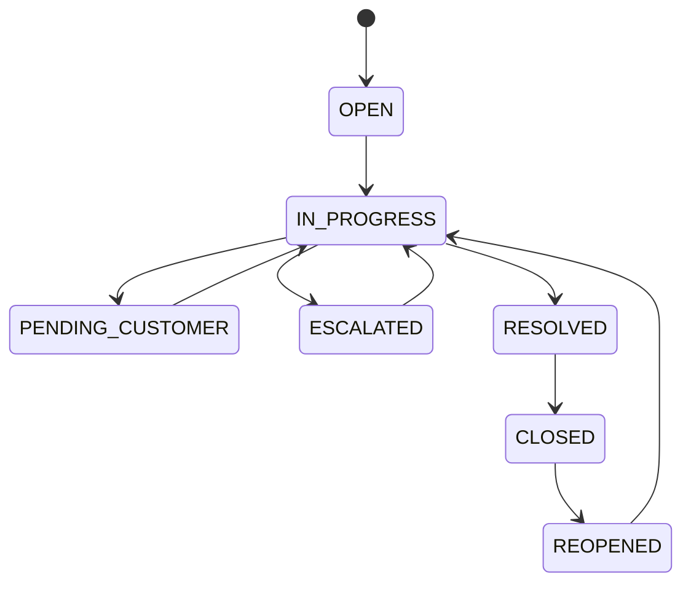
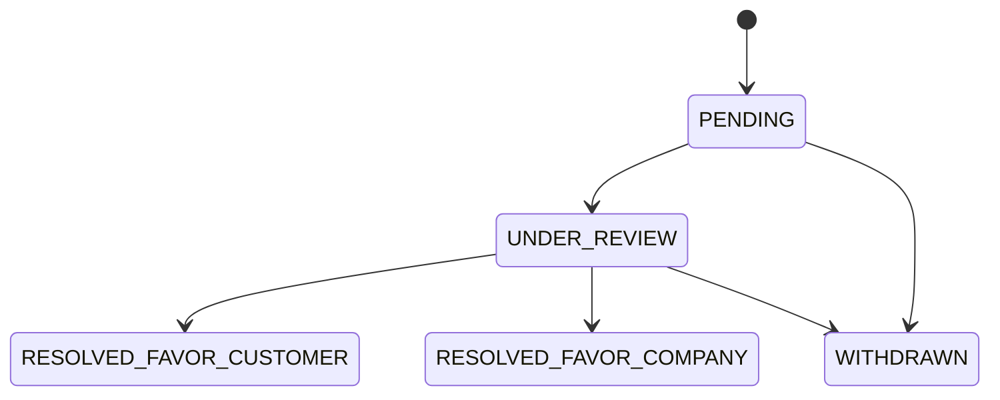
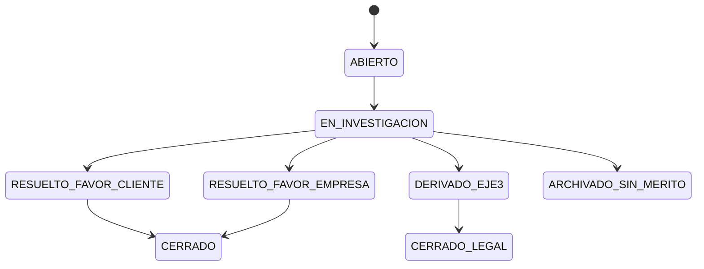
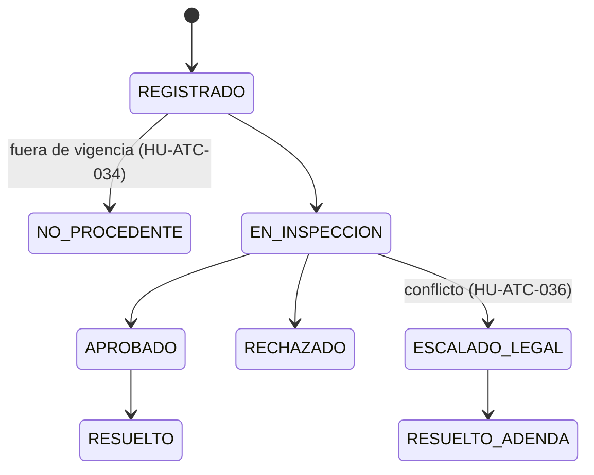
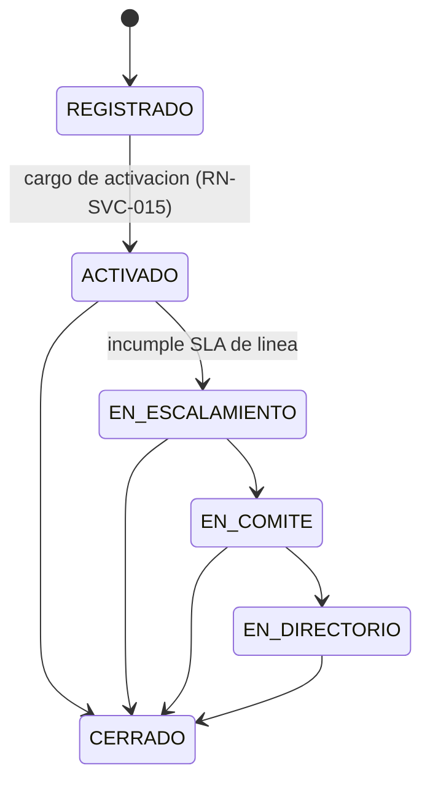

# Estados y transiciones

Va en `docs/datos/estados.md`. Cada máquina de estados aquí descrita es la
fuente para `docs/dor/` (sección "Modelado") y para las pruebas de transición
del test plan (F5/F8).

## 1 Ciclo de vida del ticket (RF-SVC-004, HU-ATC-004) — fijo, igual para todo ticket

Cada transición agrega una fila a `SVC_TICKET_ESTADO_HISTORIAL` (append-only,
RN-SVC-006) con fecha, autor (o `SYSTEM`) e `IntegrityHash`. La reapertura
(`CLOSED → REOPENED`) incrementa `ReopenCount` y recalcula
`ReopenedResolutionDueDateTime` con la política vigente al reabrir, sin borrar
el compromiso original (RN-SVC-007, HU-ATC-011).

**Pregunta abierta sin resolver, todavía no registrada en ningún documento del
paquete:** este es el **único** modelo de estados que tiene todo ticket. La
capa configurable de `HU-ATC-043` (flujo por área y tipo: pasos, estados,
responsables, aprobaciones) define algo adicional — no está definido todavía
si esos "pasos" son sub-estados dentro de `IN_PROGRESS` (sin tocar esta
máquina) o si necesita extenderla. Mientras no se resuelva, este modelo trata
el flujo configurable de `HU-ATC-043` como una capa **informativa/de proceso**
sobre `SVC_WORKFLOW_DEFINITION`, sin estados propios en `SVC_TICKET`. Debe
quedar como pregunta abierta bloqueante en `FT-ATC-02` y `FT-ATC-18`, y como
decisión en `docs/analisis/decisiones.md` antes de G4.

## 2 Apelaciones (HU-ATC-016)

## 3 Cierre de casos sensibles (HU-ATC-025) — 8 estados homologados

El PDF/artefacto no enumeran los 8 estados por nombre — pregunta abierta nueva,
todavía no registrada en `FT-ATC-09`, pendiente de confirmar con Legal/Gerencia
ATC. Se deja la máquina abierta con los que sí se pueden inferir de las HU
relacionadas, a completar en refinamiento:

8 nombres mostrados (`ABIERTO`...`ARCHIVADO_SIN_MERITO`): **provisionales**,
completar con el nombre oficial de cada uno de los 8 estados homologados antes
de que esta feature pase G4.

## 4 Reclamo de garantía (Postventa, HU-ATC-033..036)

## 5 Caso sensible Mesa SGD / Eje 3 (HU-ATC-020..025)

Generado por IA — Revisado por: pendiente (Líder técnico, F4/G3)
