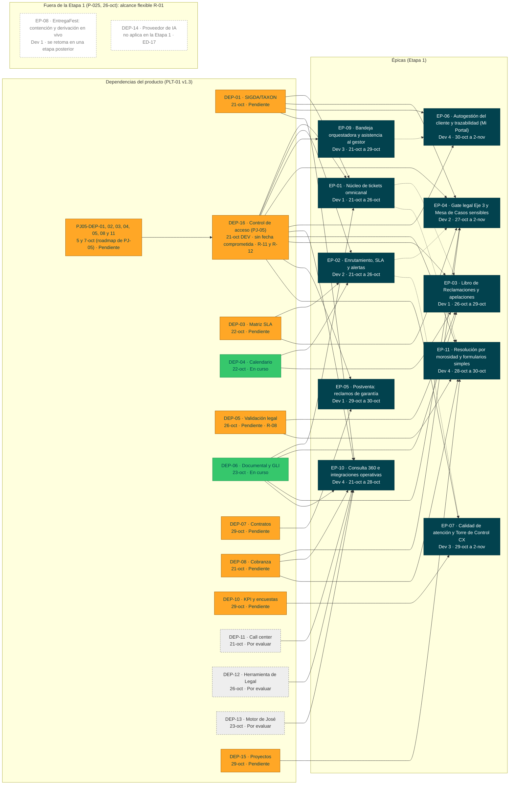

# PLT-01 - Roadmap de producto

Va en `docs/roadmap/`. Recoge las dependencias, los riesgos y los hitos del producto. Esta versión
usa el plan v1.3 del PO del 16-oct (PLT-01 a PLT-05) y el Excel `ATC_requerimientos (3).xlsx`, con la
división por etapas. **Corte de esta versión: lun 26-oct-2026, día 4 de desarrollo** (la v0.2 era del
mié 21-oct, día 1). A esa fecha no hay ningún documento del paquete aprobado en Nexora: cada uno queda listo para la firma de su rol (`decisiones.md`, P-024 y ED-21). **v0.7 (26-oct): P-025 decidida por el equipo** (Brayan Hurtado; `decisiones.md`): las 28 h nuevas de DT-02 entran como trabajo técnico de la fundación y salen de la Etapa 1 las 5 HU de alcance flexible del PO (R-01): HU-ATC-037, 038 y 039 (EP-ATC-08 completa), 048 y 053. La Etapa 1 queda en **57 HU y 227 h** de historias, **10 épicas y 22 funcionalidades**, más **28 h técnicas**; las 5 HU se retoman en una etapa posterior. **v0.8 (26-oct, revisión interna del equipo):** el recorte del alcance flexible es el **R-01 del PO**: el equipo lo activó y el PO conserva la decisión de revertirlo (H-06); el sobrecosto real se calcula en §1; criterio de corte de la UAT en PRE (R-12); la DEP-16 suma PRE y, hasta la v0.9, el permiso de lectura sobre `IDN_USER_ACCOUNT` (ED-01; retirado el 28-oct: PJ-05 no documenta ningún `GRANT`); el plazo del Libro es de 15 días hábiles improrrogables (ED-28) y el tipo de ticket «Validación de identidad (prospecto)» entra en la Etapa 1 sin horas nuevas (ED-09). **v0.9 (28-oct, contraste con Control de acceso, PJ-05):** ATC se adapta a lo que PJ-05 documenta; la DEP-16 se parte en subdependencias `PJ05-DEP-nn` con las fechas del propio roadmap de PJ-05 (sin fecha comprometida actual); PRE y producción están fuera de la entrega E1 de PJ-05, y el Go del 03-nov vale solo para PRE con el emisor de pruebas de ATC *(texto del 28-oct, superado por la revisión del Líder Técnico del 29-oct, punto 2: sin plan B de emisor de pruebas en la UAT)*; las horas que ese contraste suma sin tarea se declaran **fuera del plan del PO** (§1), sin tocar las 243 h del PO. **v0.12 (29-oct, revisión del Líder Técnico del 29-oct, puntos 1 a 7):** se retira el plan B de la UAT (H-08, R-12: si Control de acceso no está en PRE para la UAT, la UAT se reprograma; el emisor de pruebas queda solo para desarrollo local, ED-08); la UAT exige Control de acceso en PRE (no en DEV); la DEP-16 dice una sola cosa; la solicitud S28 se envió el 29-oct a Sony Montoya, con copia al Líder Técnico (sin respuesta aún); ADR-022 aprobado según el Líder Técnico y las 108 tareas no se registran hasta que responda D1 a D5.

| Producto | Product Owner | Versión / Fecha |
|---|---|---|
| Aybar Atiende · plataforma ATC: tickets omnicanal, SLA, Libro de Reclamaciones, casos sensibles y autogestión del cliente | Eddie Huamaní | v0.9 · 2026-10-28 (plan del PO v1.3 · 16-oct-2026) |
| **Horizonte** | **Visión del producto** | **Estado** |
| Etapa 1: diseño del jue 08 al mar 20-oct, desarrollo del mié 21-oct al mar 03-nov-2026 (iteración 1: 21–27-oct; iteración 2: 28-oct–03-nov; el 03-nov es el día de UAT y Go/No-Go) | Toda solicitud del cliente se registra una sola vez, se atiende con un plazo trazable y se cierra con evidencia, sin exposición ante INDECOPI | Borrador · en desarrollo desde el 21-oct |

> Fuente de verdad: `docs/analisis/decisiones.md`. Si este roadmap la contradice, manda el registro y el roadmap se corrige.

## 1 Roadmap por trimestre

El horizonte es corto: toda la Etapa 1 cae en el T4 2026. Las columnas muestran la ventana de
desarrollo de cada épica (PLT-01 v1.3 §2b). Los desarrolladores son los del PLT-01 v1.3.

| Épica | Nombre | Prioridad (MoSCoW) | T1 2026 | T2 2026 | T3 2026 | T4 2026 | Horizonte |
|---|---|---|---|---|---|---|---|
| EP-ATC-01 | Núcleo de tickets omnicanal | Debe | | | | 21-oct a 26-oct · Dev 1 (Brayan) · 22 h; además, la fundación técnica de DT-02 (28 h entre los 4 desarrolladores, P-025) | Ahora (sin G4 aprobado) |
| EP-ATC-02 | Enrutamiento, SLA y alertas | Debe | | | | 21-oct a 26-oct · Dev 2 (Jesús) · 28 h | Ahora (sin G4 aprobado) |
| EP-ATC-03 | Libro de Reclamaciones y apelaciones | Debe | | | | 26-oct a 29-oct · Dev 1 (Brayan) · 21 h | Ahora (sin G4 aprobado) |
| EP-ATC-04 | Gate legal Eje 3 y Mesa de Casos sensibles | Debe | | | | 27-oct a 2-nov · Dev 2 (Jesús) · 32 h | Ahora (sin G4 aprobado) |
| EP-ATC-05 | Postventa: reclamos de garantía | Debería | | | | 29-oct a 30-oct · Dev 1 (Brayan) · 12 h | Ahora (sin G4 aprobado) |
| EP-ATC-06 | Autogestión del cliente y trazabilidad (Mi Portal) | Debe | | | | 30-oct a 2-nov · Dev 4 (Daniel) · 9 h | Ahora (sin G4 aprobado) |
| EP-ATC-07 | Calidad de atención y Torre de Control CX | Debería | | | | 29-oct a 2-nov · Dev 3 (Michel) · 16 h | Ahora (sin G4 aprobado) |
| EP-ATC-08 | EntregaFest: contención y derivación en vivo | Podría | | | | Fuera de la Etapa 1 (P-025); en el PLT-01: 30-oct a 2-nov · Dev 1 (Brayan) · 6 h | Siguiente: etapa posterior (alcance flexible, R-01) |
| EP-ATC-09 | Bandeja orquestadora y asistencia al gestor | Debe | | | | 21-oct a 29-oct · Dev 3 (Michel) · 44 h (39 h en la Etapa 1: sin HU-048, P-025) | Ahora (sin G4 aprobado) |
| EP-ATC-10 | Consulta 360 e integraciones operativas | Debe | | | | 21-oct a 28-oct · Dev 4 (Daniel) · 36 h (31 h en la Etapa 1: sin HU-053, P-025) | Ahora (sin G4 aprobado) |
| EP-ATC-11 | Resolución por morosidad y formularios simples | Debe | | | | 28-oct a 30-oct · Dev 4 (Daniel) · 17 h | Ahora (sin G4 aprobado) |

**Capacidad** (PLT-01 v1.3 §2c): el equipo tiene comprometidas 243 h de una capacidad de 252 h (96 %),
con 63 h por persona. Los días 1 a 9 tienen 7 h cada uno y el día 10 es de UAT y pase.

**Tras P-025 (propuesta del equipo, 26-oct):** 227 h de historias más 28 h técnicas de DT-02 = **255 h**. El recorte del alcance flexible es el **R-01 del PO**: el equipo lo activó y el PO conserva la decisión de revertirlo (H-06). Por persona (entre paréntesis, el PLT-01):

- Dev 1 (Brayan): EP-01 → EP-03 → EP-05, 55 h de historias + 9 h técnicas (outbox y re-proyección) = 64 h (102 %). EP-08 sale de la Etapa 1 (PLT-01: EP-01 → EP-03 → EP-05 → EP-08, 61 h, 97 %).
- Dev 2 (Jesús): EP-02 → EP-04, 60 h + 4 h técnicas (publicador del outbox) = 64 h (102 %) (PLT-01: 60 h, 95 %).
- Dev 3 (Michel): EP-09 → EP-07, 55 h (sin HU-048) + 9 h técnicas (proyector, purga y métrica del outbox) = 64 h (102 %) (PLT-01: 60 h, 95 %).
- Dev 4 (Daniel): EP-10 → EP-11 → EP-06, 57 h (sin HU-053) + 6 h técnicas (bus en Event Hubs) = 63 h (100 %) (PLT-01: 62 h, 98 %).

Las 28 h técnicas son la fundación de la iteración 1 (tareas DT02-T01 a DT02-T06 de `backlog/tareas/EP-ATC-01.json`, con fechas del 21 al 27-oct): bus y outbox primero, luego publicador y proyector, y la re-proyección al final. Las primeras vistas de lectura dependen del proyector (DT02-T05, hasta el 26-oct), así que HU-009, HU-044 y HU-050 no cierran en su fecha del PO (`analisis-dependencias.md`, A-15).

**Sobrecosto real (revisión interna del equipo, O-05 y O-06): 7 h**, no 3 h (`decisiones.md`, P-025, punto 7). Capacidad del PLT-01 v1.3: 7 h los días 1 a 9 y el día 10 de UAT y pase, **63 h por persona y 252 h el equipo** (iteración 1, días 1 a 5: 35 h; iteración 2, días 6 a 9: 28 h). La carga del backlog, con las 28 h técnicas en la iteración 1 (sus fechas), es de 255 h: **3 h más** (Brayan 1, Jesús 1, Michel 1 y Daniel 0). Más la reestimación de ADR-009 que el backlog no aplica (043-T07 de Michel, +2,5 h; 008-T01 de Jesús, +1,5 h): **7 h** (Brayan 1, Jesús 2,5, Michel 3,5 y Daniel 0).

| Desarrollador | Iteración 1 (capacidad 35 h) | Iteración 2 (capacidad 28 h) | Total (capacidad 63 h) |
|---|---|---|---|
| Brayan | 32 de historias + 9 técnicas = 41 h (+6) | 23 h (−5) | 64 h (+1) |
| Jesús | 35 + 4 + 1,5 de ADR-009 = 40,5 h (+5,5) | 25 h (−3) | 65,5 h (+2,5) |
| Michel | 33 + 9 + 2,5 de ADR-009 = 44,5 h (+9,5) | 22 h (−6) | 66,5 h (+3,5) |
| Daniel | 27 + 6 = 33 h (−2) | 30 h (+2) | 63 h (0) |
| Equipo | 159 h (+19) | 100 h (−12) | 259 h (+7) |

**Horas fuera del plan del PO (revisión del 28-oct; estimación por confirmar):** el contraste con Control de acceso (PJ-05) deja trabajo de ATC sin tarea ni horas en el backlog del 26-oct. Se estima **+8 a +14 h** sobre las +7 h ya declaradas (en total, de 15 a 21 h sobre la capacidad de 252 h; cálculo marcado «estimación de la revisión del 28-oct, por confirmar», no es un dato del PO ni del equipo). Piezas: generar y versionar los dos lotes del catálogo, 2 a 3 h; `AlcanceDeEmpresa` y su matriz de pruebas global, empresa y ambos, 3 a 4 h; `AuthorizationEventPublisher` y el listener de auditoría, 1 a 2 h; emisor de pruebas operado en PRE (R-12), 2 a 4 h *(pieza sin objeto desde la revisión del Líder Técnico del 29-oct, punto 2: ya no hay emisor de pruebas en PRE; las horas no se modifican y quedan por reasignar, por confirmar)*; pruebas del criterio `aud` con `aybar-atc` (ver `roles-y-permisos-atc.md`), 0 a 1 h. Van como tareas con su estimación y una marca de origen en `backlog/tareas/EP-ATC-01.json` y `EP-ATC-09.json`, **fuera de las historias**: no cambian las 243 h del PO, las 227 h de las 57 HU ni las 255 h de la tabla de arriba (como ADR-002, «0 h fuera del plan del PO»). Daniel está al 100 % y la iteración 2 no tiene holgura: el PO decide en el control del 29-oct con la cifra completa.

La iteración 1 no cabe: la demo del 27-oct no muestra todas sus historias y lo que falte pasa a la iteración 2, que solo tiene 14 h libres (Brayan, Jesús y Michel). **Dueño: el PO** (R-01), que lo acepta al firmar G4 o decide en el control de alcance del 29-oct qué más sale; si revierte el recorte, vuelven 16 h y el sobrecosto pasa a 23 h.

La EP-ATC-08 pasa a Dev 1 para liberar a Dev 3, que construye las prioridades 1 y 3. Por iteración:
la 1 tiene 29 historias (132 h) y la 2 tiene 33 historias (111 h). En la Etapa 1, tras P-025: la 1 tiene 28 historias (127 h; sale HU-053) y la 2 tiene 29 (100 h; salen HU-037, 038, 039 y 048).

**Orden de prioridad 1-3** (se construyen primero en su desarrollador):

1. HU-ATC-043, el flujo por tipo, subtipo y área (Dev 3, 21–22-oct).
2. HU-ATC-050, la consulta 360 en el ticket (Dev 4, 21–22-oct).
3. HU-ATC-067, el visor del proceso 3D (Dev 3, 23–27-oct).

**Dependencias lógicas entre épicas** (A → B: A termina antes de que empiece B):

| De | A | Fuente | Fechas | ¿El calendario la respeta? |
|---|---|---|---|---|
| EP-ATC-01 | EP-ATC-03 | Gantt del PLT-01 v1.3 (p. 4) | EP-01 termina el lun 26-oct · EP-03 empieza el lun 26-oct | Sí, sin holgura (mismo día) |
| EP-ATC-01 | EP-ATC-11 | Gantt del PLT-01 v1.3 (p. 4) | lun 26-oct → mié 28-oct | Sí |
| EP-ATC-02 | EP-ATC-04 | Gantt del PLT-01 v1.3 (p. 4) | lun 26-oct → mar 27-oct | Sí |
| EP-ATC-02 | EP-ATC-07 | Gantt del PLT-01 v1.3 (p. 4) | lun 26-oct → jue 29-oct | Sí |
| EP-ATC-09 | EP-ATC-06 | Gantt del PLT-01 v1.3 (p. 4) | jue 29-oct → vie 30-oct | Sí |
| EP-ATC-04 | EP-ATC-08 | PLT-02 v1.3, EP-ATC-08 («EP-ATC-04 gate legal») | EP-04 termina el lun 02-nov · EP-08 empieza el vie 30-oct | **No** (A-03 de `analisis-dependencias.md`). **Deja de aplicar en la Etapa 1:** EP-08 sale por P-025 (A-03 resuelto) |

Son las 6 dependencias que lleva el `depende_de` de las épicas en la carga de Nexora (`nexora-items/`); en la Etapa 1 quedan 5, porque EP-04 → EP-08 sale con EP-08 (P-025). Las dos que llegan por una sola historia, HU-026 → HU-036 (FT-07 → FT-10) y HU-019 → HU-066 (FT-13 → FT-24), quedan en la historia y en su funcionalidad y no suben a la épica, porque EP-04 → EP-05 y EP-07 → EP-06 irían contra el calendario. En la Etapa 1 hay 49 dependencias entre historias y 16 entre funcionalidades, en 4 olas (0 a 3), y la ruta crítica es HU-001 → 002 → 004 → 006 → 012 → 013 → 015 → 016 (34 h); antes de P-025 eran 54 y 17, en 5 olas. El detalle está en `analisis-dependencias.md` §1 y §4. Desde la revisión interna del equipo (O-06), las primeras lecturas esperan al proyector de DT-02 (DT02-T05, 23 al 26-oct): `aybar paquete plan` da 5 olas en la Etapa 1 (0 a 4) y FT-15 (fuera) sola en la ola 5, con 0 h; HU-009, HU-044 y HU-050 no cierran antes del 26-oct (A-15).

Hitos:

| Hito | Fecha | Criterio de cumplimiento (observable) | Épicas |
|---|---|---|---|
| H-01 | 2026-10-16 | Etapas acordadas: alcance de la Etapa 1 y RN-SVC-043 en el Excel (PLT-01 §1, entregable del PO y el patrocinador) | todas |
| H-02 | 2026-10-19 | Cierre funcional: 62 historias con criterios Gherkin, orden de prioridad 1-3, alcance de la Etapa 1 y preguntas resueltas o parametrizadas. Evidencia: PLT-02, 03 y 04 v1.3 aprobados y prototipo v2.0 (PLT-01, criterios de salida) | todas |
| H-03 | 2026-10-20 | Comité DoR, cierre técnico y ADR: arquitectura de desarrollo, modelo de datos, RNF con umbral, contratos de interfaz con simulador, CI/CD y ambientes DEV/QA. También las 11 ADR registradas y cada funcionalidad «Lista» o «Lista con condiciones» con fecha (PLT-01 y PLT-05) | todas |
| H-04 | 2026-10-21 | Inicio de desarrollo con los requerimientos y las ADR cerrados (PLT-01 §2). La iteración 1 empieza por las prioridades 1-3 | todas |
| H-05 | 2026-10-27 | Demo de la iteración 1: se muestran las 29 historias de la iteración 1 (PLT-04); 28 tras P-025, que saca HU-053 de la Etapa 1. Criterio de aceptación de la demo (decisión del equipo, 26-oct): cada historia se muestra contra sus criterios Gherkin, en local o en DEV | todas |
| H-06 | 2026-10-29 | Control de alcance: si hay atraso, sale primero el alcance flexible (HU-ATC-037, 038, 039, 048 y 053) sin afectar la v1.0 (PLT-01 R-01). **El alcance flexible ya salió el 26-oct por P-025** (para dar cabida a las 28 h de DT-02): el equipo activó el R-01 del PO, y **el PO conserva la decisión de revertirlo** en este control o al firmar G4. El control del 29-oct revisa el avance de las 57 HU y de las tareas técnicas y el sobrecosto real (§1); un atraso se lleva al PO en ese control | todas |
| H-07 | 2026-11-02 18:00 | Congelamiento de código (PLT-01, cadencia) | todas |
| H-08 | 2026-11-03 | UAT, demo final y Go/No-Go de la v1.0: día de UAT y pase, sin desarrollo nuevo, con capacitación (R-10). La UAT es en PRE. **Criterio de corte (revisión del Líder Técnico del 29-oct, punto 2): si Control de acceso no está en PRE para la UAT, la UAT se reprograma; no se hace con el emisor de pruebas (Líder Técnico, 29-oct).** El emisor de pruebas queda solo para desarrollo local (ED-08). Producción exige el emisor de PJ-05 (ED-08) y no tiene fecha en PJ-05, donde PRE y producción están fuera de la entrega E1. *Texto del 28-oct, superado por la revisión del Líder Técnico del 29-oct, punto 2:* «si Control de acceso no está en PRE el lun 02-nov a mediodía, corre con el emisor de pruebas de ATC operado en PRE y el PO decide el Go/No-Go con ese dato (R-12). El Go del 03-nov vale solo para PRE con el emisor de pruebas de ATC». *Cruce del Líder Técnico del 28-oct (C-12): el emisor de pruebas solo vale en local; la UAT del 03-nov exige Control de acceso en PRE (revisión del Líder Técnico del 29-oct, punto 6: el «DEV» del cruce del 28-oct estaba mal). R-11 y R-12 quedan en revisión; no son un riesgo aceptado por el Líder Técnico.* | todas |

Estado de los hitos al 26-oct:

- No consta en Nexora la aprobación de los PLT-02, 03 y 04 (H-02).
- Las 14 ADR están listas para la firma del Líder Técnico (H-03, acuerdo 6 del PLT-05).
- Los 23 DoR dicen «con condiciones», un valor que el marco del SDK no admite (solo READY o NO READY).
- G2 (diseño de las pantallas) está en el paquete en borrador, sin aprobar.
- H-05 (demo de la iteración 1, 27-oct) usa el criterio que fijó el equipo: cada historia contra sus criterios Gherkin.

Horizonte:

- **Ahora:** las 10 épicas de la Etapa 1 (EP-ATC-08 sale por P-025), con desarrollo del 21-oct al 3-nov. **Ninguna tiene G4 cerrado**. El DoR
  del PLT-05 es «listo con condiciones» y G2 está en borrador (sin aprobar), aunque las 57 historias de la Etapa 1
  tienen pantalla.
- **Siguiente:** el alcance flexible que sale de la Etapa 1 por P-025 (26-oct) y se retoma en una etapa posterior: EP-ATC-08 (FT-ATC-15: HU-037, 038 y 039), HU-048 (FT-19) y HU-053 (FT-20), 16 h, con sus tareas en `roadmap/alcance-diferido.md`.
- **Después:** los pendientes de producto, como los conectores automáticos de WhatsApp y correo
  (PLT-01 §2), sin épica.

## 2 Dependencias

Fuente: PLT-01 v1.3 §3, con 14 dependencias. La numeración salta la DEP-09, que no es de la Etapa 1.
**Cambio del 22-oct-2026:** la DEP-02 (maestro local de RR. HH.) se retira y la DEP-16 (Control de acceso, PJ-05) ocupa su lugar, según el Líder Técnico (DT-03, ADR-009). **Cambio del 26-oct-2026:** la DEP-16 la pide el Líder Técnico en su revisión (C-12), con su responsable y su estado; no está en el PLT-01 del PO, y es una diferencia listada en ED-19; el equipo la acepta como **riesgo con mitigación** (R-11 y R-12; P-026 y ED-08 de `decisiones.md`). Sus épicas salen de las historias que la tienen. **Cambio del 28-oct-2026:** la DEP-16 se parte en las subdependencias de PJ-05 (filas `PJ05-DEP-nn`, con el prefijo para no confundirlas con la DEP-01 a DEP-15 de ATC, que usan otra numeración), con las fechas del propio roadmap de PJ-05 (PLT-01 de PJ-05, `:100-110`). **Cambio del 28-oct-2026 (cruce del Líder Técnico, C18):** el Líder Técnico manda enviar la solicitud al área de Roles y Permisos (Sony Montoya, con copia a él) con fecha comprometida; sus 8 puntos S28-1 a S28-8 (`arquitectura/roles-y-permisos-atc.md` §13, enviada el 29-oct a Sony Montoya, con copia al Líder Técnico; sin respuesta aún) se enlazan con la DEP-16 y las `PJ05-DEP-nn` (filas siguientes y `analisis-dependencias.md`). Manda sobre el criterio «no se envían correos». **Cambio del 29-oct-2026 (revisión del Líder Técnico del 29-oct, puntos 1 a 6):** la solicitud S28-1 a S28-8 (`Docs\correo-sony-solicitud-S28.txt`) está redactada y corregida, **se envió el 29-oct**: solicitud corregida enviada el 29-oct a Sony Montoya, con copia al Líder Técnico (fecha de envío registrada el 29-oct; sin respuesta aún); orden del Líder Técnico: enviarla el 29-oct. Se retira el plan B de la UAT (H-08, R-12) y la UAT exige Control de acceso en PRE.
«Fecha requerida» es el inicio de la primera historia que bloquea la dependencia. El contrato de
interfaz y el simulador de cada una se cierran en la etapa de diseño (20-oct).

**A la fecha de esta versión, ninguna tiene una fecha comprometida por su responsable** (para la DEP-16 y sus `PJ05-DEP-nn`, según la copia sellada de PJ-05 del 22-oct; no consta una fecha comprometida actual). En el SDK el
estado es Pendiente, Comprometida o Resuelta, y todas están en Pendiente. El PLT-01 las marca En curso,
Pendiente o Por evaluar, y ese estado se conserva entre paréntesis. Cada una tiene su riesgo con mitigación
(§3): R-02 (contrato de interfaz y simulador) para las que son una API o un sistema, R-03 para la DEP-03,
R-08 para la DEP-05 y R-11 y R-12 para la DEP-16.

| ID | Dependencia | Tipo | Bloquea a | Responsable | Fecha requerida | Estado |
|---|---|---|---|---|---|---|
| DEP-01 | API de SIGDA/TAXON: consulta de cliente y KYC (única fuente del dato) | Interna | EP-01, EP-04, EP-06, EP-10 | CDO / Equipo Datos | 2026-10-21 | Pendiente (PLT-01: Pendiente) |
| DEP-16 | **Control de acceso (PJ-05) en DEV, QA y PRE, y en producción para el pase: emisor, clientes OAuth de ATC, catálogo de ATC aprobado y gestores invitados** (C-12 del Líder Técnico; la UAT del 03-nov es en PRE). Se parte en las subdependencias `PJ05-DEP-nn` de las filas siguientes. Incluye el login de clientes de Mi Portal (DT-04) y la política de API Management con la audiencia `aybar-atc` (ED-06; D-224 de PJ-05). Hoy: el claim `party_id` se pide en S28-4; sin fecha comprometida; sin plan B de emisor de pruebas (revisión del Líder Técnico del 29-oct, puntos 2 y 5). `CuentaPersonaPort` es un puerto de ATC: hasta que exista el claim se usa el simulador, solo en local (ED-08). Los gestores de cada cola los decide ATC (ED-03) como solución interina, sin guardar copias; S28-4 pide consultarlos por API (punto 4). *Texto superado (v0.9): ver la nota «Texto superado de la DEP-16 (v0.9)» bajo la tabla.* Reemplaza a la DEP-02 (maestro local con carga de RR. HH.) por DT-03. Mientras tanto, en local: el emisor de pruebas `herramientas/emisor-local.mjs` del repositorio `AybarCorp/aybar-access-control-deus` | Interna | las 10 épicas de la Etapa 1 (hasta el 26-oct, EP-01, 02, 04, 06, 09, 10 y 11): las HU que autentican, autorizan por rol o leen líderes o al cliente autenticado (bloque «Depende de» de cada HU): 24 HU (23 en la Etapa 1: HU-053 sale) hasta el 26-oct y, desde el 28-oct, también las demás cuyas operaciones del contrato tienen `x-roles` no vacío y no la declaraban (p. ej. HU-012 y HU-059; los 69 `operationId` exigen un rol del token, salvo las 8 de Mi Portal, que dependen de la cuenta y el `PartyID`); con ese cambio la declaran las 62 HU del paquete (57 en la Etapa 1) y los 23 DoR. En DEV, sin emisor no responde ningún endpoint protegido | Control de acceso (PJ-05); cada subdependencia, el responsable de su roadmap (filas siguientes) | 2026-10-21 (DEV); 2026-10-23 (QA, E2E desde el día 3); 2026-11-02 12:00 (PRE; hora del criterio de corte retirado el 29-oct: ya no hay corte con emisor de pruebas, la UAT se reprograma si falta); producción: antes del pase a producción posterior al 03-nov, **sin fecha en PJ-05** | Pendiente · **sin fecha comprometida; en riesgo, mitigado**: según la copia sellada de PJ-05 (22-oct) está documentado y aprobado según su sello, sin constancia de que esté construido ni desplegado en ningún ambiente (su plan de pruebas dice «nada ejecutado»; Pre-Producción «no existe todavía»; PRE y producción están fuera de la entrega E1 de PJ-05). Mitigación: emisor de pruebas y simulador de `CuentaPersonaPort` solo en local (ED-08); R-11 (DEV/QA) en revisión del Líder Técnico, no aceptado; para la UAT en PRE, si Control de acceso no está en PRE la UAT se reprograma, sin emisor de pruebas (R-12; revisión del Líder Técnico del 29-oct, punto 2) *(texto del 28-oct superado: «en local, DEV y QA» y «criterio de corte» con emisor de pruebas en PRE; P-040, ED-08)*. No está en el PLT-01 del PO (diferencia listada en ED-19). *Enlace con la solicitud al área (cruce del Líder Técnico del 28-oct, C18; `arquitectura/roles-y-permisos-atc.md` §13; solicitud corregida enviada el 29-oct a Sony Montoya, con copia al Líder Técnico (fecha de envío registrada el 29-oct; sin respuesta aún)):* S28-1 (registro de ATC como consumidor), S28-2 (clientes OAuth por ambiente con `crear-cliente-publico`), S28-3 (`aybar-atc` como audiencia y política de API Management), S28-4 (claim `party_id`, estado de la cuenta y gestores por rol, consultables por API con el token de servicio), S28-5 (aprobar el catálogo, corregido por el ADR-022; cifras: 108 tareas en la Etapa 1; ADR-022 aprobado según el Líder Técnico (29-oct); el recálculo C21 sigue en borrador hasta que responda D1 a D5; no se registran las 108 tareas hasta entonces), S28-6 (gestores como cuentas `EMPLOYEE` y `PROSPECT_VALIDATOR`), S28-7 (acceso de lectura a PJ-05 en Nexora), S28-8 (**Control de acceso en DEV, QA y PRE; en PRE antes del 03-nov. La UAT es en PRE**; texto del 28-oct superado: «en DEV antes del 03-nov»). *Cruce del Líder Técnico del 28-oct (C-12): el emisor de pruebas solo vale en local; la UAT del 03-nov exige Control de acceso en PRE (revisión del Líder Técnico del 29-oct, punto 6: el «DEV» del cruce del 28-oct estaba mal). R-11 y R-12 quedan en revisión; no son un riesgo aceptado por el Líder Técnico.* |
| PJ05-DEP-01 | (de PJ-05, DEP-01) Registro de la aplicación en Google, Microsoft Entra ID y Apple: el ingreso de los gestores internos con Google | Externa | login de gestores | TL de PJ-05 | 2026-10-05 (roadmap de PJ-05) | Pendiente según la copia sellada de PJ-05; fecha vencida |
| PJ05-DEP-02 | (de PJ-05, DEP-02) Azure Communication Services: dominio de correo y WhatsApp; el envío de la invitación del gestor (sin él, el enlace sale en el log ⚠) | Externa | invitación de gestores | TL de PJ-05 | 2026-10-05 (roadmap de PJ-05) | Pendiente según la copia sellada de PJ-05; fecha vencida |
| PJ05-DEP-03 | (de PJ-05, DEP-03) Roles por empresa: la tabla `NEX_USER_COMPANY_ROLE` y el claim `company_roles` | Interna | `AlcanceDeEmpresa` (C-08) | TL de PJ-05 | 2026-10-05 (roadmap de PJ-05) | Pendiente según la copia sellada de PJ-05; fecha vencida |
| PJ05-DEP-04 | (de PJ-05, DEP-04) Puerta F4 de Gobierno de Datos: crear en la base única las tablas de otros fragmentos (`PARTY`, `ORG_COMPANY`, maestros) | Interna | las FK de ATC a esas tablas (DEU-01) | TL de PJ-05 y Gobierno de Datos | 2026-10-05 (roadmap de PJ-05) | Pendiente según la copia sellada de PJ-05; fecha vencida |
| PJ05-DEP-05 | (de PJ-05, DEP-05) Aprobación del fragmento 24 AUTHORITY | Interna | capa B de PJ-05 | TL y Data Chief de PJ-05 | sin fecha en PJ-05 | Pendiente. Capa B: **no condiciona la Etapa 1 de ATC**; se lista porque lo cita la revisión |
| PJ05-DEP-08 | (de PJ-05, DEP-08) Suscripción de Azure con los ambientes de desarrollo y QA, PostgreSQL y Key Vault. PRE y producción están fuera de la entrega E1 de PJ-05 | Técnica | todos los ambientes de Control de acceso | TL de PJ-05 | 2026-10-05 (roadmap de PJ-05); PRE y producción, sin fecha | Pendiente según la copia sellada de PJ-05; fecha vencida |
| PJ05-DEP-11 | (de PJ-05, DEP-11) Carga inicial de personas: `PARTY`, `PARTY_IDENTIFICATION` y `PARTY_COMMUNICATION` desde LEGACY_ANTIGUO, SLIN y URBEMIND (D-60; HU-IDN-061 CA-12). Sin ella todo cliente entra como `PROSPECT` (Mi Portal responde 403) y ningún gestor puede ser invitado (D-46): sin gestores invitados no hay login | Técnica | HU de Mi Portal (HU-064 a 066), gestores reales (HU-008, 046, 054, 055 y 067) | sin responsable en PJ-05 («pendiente — D-60») | 2026-10-07 (roadmap de PJ-05) | Pendiente según la copia sellada de PJ-05; fecha vencida. En DEV, QA y PRE, personas sintéticas (ED-08). Se enlaza con S28-6 (gestores invitados) y S28-8 (fecha en DEV); *Cruce del Líder Técnico del 28-oct (C-12): el emisor de pruebas solo vale en local; la UAT del 03-nov exige Control de acceso en PRE (revisión del Líder Técnico del 29-oct, punto 6: el «DEV» del cruce del 28-oct estaba mal). R-11 y R-12 quedan en revisión; no son un riesgo aceptado por el Líder Técnico.* |
| DEP-03 | Decisión de negocio: matriz SLA por tipo y prioridad y plazos de línea de la Mesa SGD (RNF-REN-003) | Interna | EP-02, EP-04 | Gerencia ATC · Mesa SGD | 2026-10-22 | Pendiente (PLT-01: Pendiente) |
| DEP-04 | Calendario MAE_TIME + MAE_HOLIDAY por geografía | Técnica | EP-02, EP-03 | Equipo Datos | 2026-10-22 | Pendiente · mitigación: mientras falten esas tablas, el calendario configurado y versionado de ATC (feriados nacionales de Perú), firmado por la Gerencia ATC; tenerlo firmado es condición del Go/No-Go (ED-11) (PLT-01: En curso) |
| DEP-05 | Validación legal: formato del asiento, textos y plazos del Libro | Legal | EP-03, EP-11 | Gerencia Legal | 2026-10-26 | Pendiente · riesgo R-08 con mitigación: el formato del asiento es el Anexo I del Reglamento del Libro de Reclamaciones y la evidencia se conserva 2 años (art. 12; ED-13); las plantillas siguen la norma (PLT-01: Pendiente) |
| DEP-06 | Repositorio documental (Azure Blob con inmutabilidad, ADR-006) + GOV_DOCUMENT_REPOSITORY y GLI | Técnica | EP-01, EP-03, EP-04, EP-10 | Arquitectura / Legal | 2026-10-23 | Pendiente (PLT-01: En curso) |
| DEP-07 | Contratos y Activos: API de contrato, unidad, Acta de Entrega y cobertura | Interna | EP-05 | Equipo Contratos | 2026-10-29 | Pendiente (PLT-01: Pendiente) |
| DEP-08 | Cobranza: estado de cuenta, historial de pagos y cuotas vencidas por contrato (desfase ≤ 24 h) | Interna | EP-04, EP-10, EP-11 | Cobranza | 2026-10-21 | Pendiente (PLT-01: Pendiente) |
| DEP-10 | KPI Engine + SVY_SURVEY_RESPONSE (encuestas) | Interna | EP-07 | Equipo Datos / BI | 2026-10-29 | Pendiente (PLT-01: Pendiente) |
| DEP-11 | Plataforma del call center: API/CTI para screen pop, registro de llamadas, grabación y click-to-call | Externa | EP-10 | TI / proveedor de call center | 2026-10-21 | Pendiente (PLT-01: Por evaluar) |
| DEP-12 | Herramienta de Legal (responsable: Rosario): API o intercambio para sincronizar casos de Eje 3 | Interna | EP-10 | Gerencia Legal · TI | 2026-10-26 | Pendiente (PLT-01: Por evaluar) |
| DEP-13 | Motor de consultas de José: contrato de API y responsable de mantenimiento | Interna | EP-10 | José · TI | 2026-10-23 | Pendiente (PLT-01: Por evaluar) |
| DEP-14 | Proveedor de IA aprobado por TI y Seguridad, con política de datos personales | Técnica | EP-09, EP-10 | TI · Seguridad | 2026-10-23 | Pendiente · proveedor decidido por el equipo: Azure OpenAI Service en la suscripción de Azure de ATC (ED-17); la habilitación de TI y Seguridad es una aprobación y, mientras no esté, el servicio usa su simulador (R-02) (PLT-01: Por evaluar). **No aplica en la Etapa 1** (P-025): HU-048 y HU-053 salen y la guía de HU-047 no usa IA |
| DEP-15 | Maestro de responsables de proyecto y supervisores (fuente única) | Interna | EP-11 | Gerencia Comercial · Datos | 2026-10-29 | Pendiente (PLT-01: Pendiente) |

**Lo que las historias suman al PLT-01 (26-oct).** El bloque «Depende de» de cada HU (PLT-03, PLT-04 y PLT-05) suma dos épicas a la columna del PLT-01, que se deja como está: la DEP-01 alcanza también a EP-07 (HU-032, PLT-04) y la DEP-05 a EP-10 (HU-041, 8 % de RN-SVC-034, PLT-05). El PLT-01 pone la DEP-06 en EP-01, pero ninguna HU de EP-01 la nombra. La tabla se deja como la pone el PLT-01 y la diferencia queda anotada aquí. El detalle está en `analisis-dependencias.md` §2. **Estado de PJ-05 (28-oct):** «documentado y aprobado según su sello del 22-oct», no «construido ni desplegado»: su README dice «capa A construida», pero su plan de pruebas dice «nada ejecutado» y no tiene gates G5 a G9; las fechas de sus dependencias (05/10 y 07/10) ya vencieron y siguen «Pendiente» en la copia. El plan de PJ-05 (PLT-01, 01-oct) llega hasta su entrega E1 y no menciona el catálogo (FT-CAT-01) ni a los servicios consumidores; sus tareas no tienen horas. Lo que PJ-05 no documenta (adaptador de `CuentaPersonaPort`, ruta para otorgar `CATALOG_REGISTRAR`, emisor de pruebas en PRE) es **supuesto de diseño de ATC**, con su puerto o simulador (ED-08), no un acuerdo.

**Texto superado de la DEP-16 (v0.9), fuera de la celda (revisión del Líder Técnico del 29-oct, punto 5):** **No incluye ningún `GRANT` sobre `IDN_USER_ACCOUNT` ni un claim `party_id`:** PJ-05 no los documenta (el token trae `user_account_id` y no `PartyID`; solo hay 4 roles de base; D-119 impide leer las tablas de personas; `GET /cuentas/{id}` exige `ROLE_IT_ADMIN`). `CuentaPersonaPort` es un **puerto de ATC**: su adaptador real no está definido en PJ-05; hoy se usa el simulador (ED-08) y la forma del adaptador (claim `party_id`, `/oauth2/userinfo`, endpoint interno o vista) es una opción de diseño de ATC, sin plazo y sin depender de nadie. No incluye una API de líderes y gestores: ATC los resuelve con sus propios datos y el rol del token (ED-03).

**Desarrollo local mientras no haya DEP-16 (mitigación del riesgo R-11).** El emisor de pruebas de Control de acceso (`node herramientas/emisor-local.mjs`, puerto 9000; el backend apunta con `AYBAR_ISSUER_URI=http://localhost:9000`) entrega tokens con `realm_access.roles`, `user_account_id` y `preferred_username`, y la audiencia que se pida en `aud`. No emite `company_roles`, `companyId` ni `PartyID`: las pruebas de empresa (C-08) usan tokens de prueba de Spring Security, el `PartyID` sale del simulador de `CuentaPersonaPort` (ED-01, ED-08) y los gestores y clientes son personas sintéticas (ED-08). Pasar al emisor de PJ-05 es cambiar `AYBAR_ISSUER_URI` (supuesto de PJ-05, PLT-01 `:150-151`: su prueba TC-E2E-10 está sin ejecutar). Para la UAT en PRE no hay emisor de pruebas: si Control de acceso no está en PRE, la UAT se reprograma (R-12; revisión del Líder Técnico del 29-oct, punto 2; *texto del 28-oct superado: «rige el criterio de corte del R-12»*). *Cruce del Líder Técnico del 28-oct (C-12): el emisor de pruebas solo vale en local; la UAT del 03-nov exige Control de acceso en PRE (revisión del Líder Técnico del 29-oct, punto 6: el «DEV» del cruce del 28-oct estaba mal). R-11 y R-12 quedan en revisión; no son un riesgo aceptado por el Líder Técnico.* El emisor de pruebas es de uso de ATC: no consta en los documentos de PJ-05 y no va a producción.

Según el PLT-01 §3, sin contrato de interfaz y simulador a la fecha requerida la historia no se marca Lista; con ellos, se construye contra el simulador y el sistema real se activa cuando su responsable lo entrega (R-02; la DEP-16, R-11). Al 26-oct ya pasó la
fecha requerida de 9 dependencias (DEP-01, DEP-16, DEP-08 y DEP-11 del 21-oct; DEP-03 y DEP-04 del
22-oct; DEP-06, DEP-13 y DEP-14 del 23-oct; la DEP-14 ya no aplica en la Etapa 1, P-025) y hoy vence la de DEP-05 y DEP-12. La DEP-16 está **en riesgo, mitigado** (R-11): PJ-05 no tiene fecha comprometida en ningún ambiente de ATC y el equipo acepta el riesgo con el emisor de pruebas local (P-040, ED-08). *Cruce del Líder Técnico del 28-oct (C-12): el emisor de pruebas solo vale en local; la UAT del 03-nov exige Control de acceso en PRE (revisión del Líder Técnico del 29-oct, punto 6: el «DEV» del cruce del 28-oct estaba mal). R-11 y R-12 quedan en revisión; no son un riesgo aceptado por el Líder Técnico.* El análisis completo (matriz, olas, ruta crítica y
hallazgos) está en `analisis-dependencias.md`. El diagrama está en `dependencias.mmd`: las flechas
continuas van de dependencia a épica y las punteadas son las dependencias lógicas entre épicas. EP-08 y DEP-14 van en el grupo «Fuera de la Etapa 1», sin flechas (P-025).

## 3 Riesgos

Fuente: PLT-01 v1.3 §4, con los 10 riesgos más relevantes de la Etapa 1. El equipo suma el R-11 y el R-12 el 26-oct (ED-08); los textos de R-01 a R-10 son los del PO.

| ID | Riesgo | Prob. | Impacto | Nivel | Mitigación / contingencia | Dueño |
|---|---|---|---|---|---|---|
| R-01 | Plan con poca holgura: 243 h comprometidas de 252 h de capacidad (96 %); Dev 4 al 98 % | Alta | Alto | ALTO | Alcance «flexible» (RF-048, 053, 037-039) definido de antemano; control de alcance el jue 29-oct; las prioridades 1-3 (HU-043, 050, 067) se construyen primero | PO |
| R-02 | APIs externas no disponibles en el plazo (SIGDA/TAXON, call center, Legal, Cobranza, motor de José) | Alta | Alto | ALTO | Contratos de interfaz y simuladores cerrados en la etapa de diseño (20-oct); pase a producción de cada integración condicionado a su API real | Líder técnico |
| R-03 | Matriz SLA y plazos de línea de la Mesa SGD sin definir al iniciar el motor SLA (jue 22-oct) | Alta | Alto | ALTO | Matriz provisional parametrizable firmada por Gerencia ATC al cierre de diseño (20-oct) | Gerencia ATC |
| R-04 | Calidad del código generado con IA (errores sutiles, seguridad, deuda técnica) | Media | Alto | ALTO | Revisión de pares obligatoria, pruebas automatizadas generadas y revisadas por el desarrollador, análisis SAST y guía de prompts del equipo | Líder técnico |
| R-05 | Sin QA dedicado y UAT concentrada en un día (mar 03-nov) | Media | Alto | ALTO | Aceptación diaria del PO a las 17:00, pruebas E2E automatizadas desde el día 3 y usuarios clave citados para la UAT | PO · Jefe Operaciones UX |
| R-06 | Ítems con alcance ambiguo (8 % de interés, rayo, «llamar la cuenta», cancelación del servicio, buses, acceso del cliente a Mi Portal) | Alta | Medio | ALTO | Cerrarlos en el cierre funcional del 19-oct; lo no resuelto se construye parametrizable | PO |
| R-07 | Datos personales expuestos en bitácoras, búsqueda, Mi Portal o prompts de IA (Ley 29733) | Media | Alto | ALTO | DLP (RNF-SEC-008), anonimización antes de la IA (RNF-SEC-009), permisos del origen (RNF-SEC-010) y visibilidad del cliente (RN-SVC-044) | Seguridad TI |
| R-08 | Textos legales (Libro, alerta de cancelación, carta al proyecto) sin validar al pase | Media | Alto | ALTO | Plantillas configurables; validación de Legal antes del lun 26-oct (Libro) y del mié 28-oct (morosidad) | Gerencia Legal |
| R-09 | Ausencia de un desarrollador (bus factor de 1 por épica) | Baja | Alto | MEDIO | Documentación viva generada con IA, revisión cruzada diaria y repositorio común; replanificar con el alcance flexible | Líder técnico |
| R-10 | Adopción: el equipo sigue en Excel/WhatsApp y el cliente no usa Mi Portal | Media | Medio | MEDIO | Capacitación el mar 03-nov, término «Gestor de tickets» en toda la interfaz (RNF-USA-003), aviso con enlace a Mi Portal en cada ticket y retiro de herramientas paralelas | Jefe Operaciones UX |
| R-11 | Control de acceso (PJ-05) sin fecha comprometida en DEV ni en QA (DEP-16): emisor de tokens, clientes OAuth de ATC, catálogo aprobado y gestores invitados; su plan (E1, 01-oct) no incluye el catálogo y sus fechas de ambientes (05/10) ya vencieron (riesgo que suma el equipo el 26-oct; ED-08). Riesgo residual: el primer contacto con un token real será el día de la integración, antes del congelamiento del 02-nov, y `company_roles`, `companyId` y `party_id` no se ejercitan con token real hasta entonces | Alta | Alto | ALTO | **Riesgo con mitigación en local, DEV y QA, aceptado por el equipo (ED-08); el PO y el Líder Técnico lo aceptan al firmar G4 [texto del 26-oct y 28-oct superado en lo que dice «aceptado»: Cruce del Líder Técnico del 28-oct (C-12): el emisor de pruebas solo vale en local; la UAT del 03-nov exige Control de acceso en PRE (revisión del Líder Técnico del 29-oct, punto 6: el «DEV» del cruce del 28-oct estaba mal). R-11 y R-12 quedan en revisión; no son un riesgo aceptado por el Líder Técnico. Enlace: S28-2, S28-4 y S28-8]:** desarrollo y pruebas (también los E2E de QA) con el emisor de pruebas `herramientas/emisor-local.mjs` de `AybarCorp/aybar-access-control-deus` (commit `5bab9dc`), tokens de prueba de Spring Security para `company_roles` y `companyId`, simulador de `CuentaPersonaPort` para el `PartyID` (el adaptador real no está definido en PJ-05) y personas sintéticas; prueba de humo con el emisor real el primer día que exista cualquier ambiente de PJ-05; pasar al emisor de PJ-05 es cambiar `AYBAR_ISSUER_URI`, sin tocar el código (supuesto de PJ-05, con su prueba TC-E2E-10 sin ejecutar). En PRE rige el R-12 (sin emisor de pruebas: la UAT se reprograma); R-11 queda en revisión del Líder Técnico (no aceptado); en producción no hay emisor de pruebas ni simulador (ADR-004). *Cruce del Líder Técnico del 28-oct (C-12): el emisor de pruebas solo vale en local; la UAT del 03-nov exige Control de acceso en PRE (revisión del Líder Técnico del 29-oct, punto 6: el «DEV» del cruce del 28-oct estaba mal). R-11 y R-12 quedan en revisión; no son un riesgo aceptado por el Líder Técnico.* | Equipo ATC |
| R-12 | UAT del 03-nov sin Control de acceso en PRE (DEP-16): PRE está fuera de la entrega E1 de PJ-05 y su plan de pruebas dice que Pre-Producción «no existe todavía»; sin el emisor de PJ-05 no hay login real en PRE (riesgo que suma el equipo el 26-oct; ED-08) | Alta | Alto | ALTO | **Criterio de corte (revisión del Líder Técnico del 29-oct, punto 2): si Control de acceso no está en PRE para la UAT, la UAT se reprograma; no se hace con el emisor de pruebas (Líder Técnico, 29-oct).** El emisor de pruebas queda solo para desarrollo local (ED-08). *Texto del 28-oct, superado por la revisión del Líder Técnico del 29-oct, punto 2:* **Criterio de corte:** si Control de acceso no está en PRE el lun 02-nov a mediodía, la UAT del 03-nov corre en PRE con el emisor de pruebas de ATC operado en PRE (`AYBAR_ISSUER_URI` apuntando a él; su operación tiene tarea y horas estimadas fuera del plan del PO, §1) y el `PartyID` del simulador de `CuentaPersonaPort` con personas sintéticas, y el PO decide el Go/No-Go con ese dato. **El «Go» vale solo para PRE con el emisor de pruebas de ATC.** *Cruce del Líder Técnico del 28-oct (C-12): el emisor de pruebas solo vale en local; la UAT del 03-nov exige Control de acceso en PRE (revisión del Líder Técnico del 29-oct, punto 6: el «DEV» del cruce del 28-oct estaba mal). R-11 y R-12 quedan en revisión; no son un riesgo aceptado por el Líder Técnico.* El emisor de pruebas y el simulador no van a producción: el pase a producción exige el emisor de PJ-05 (ED-08; ADR-014), que no tiene fecha en PJ-05. Quién despliega el emisor de pruebas en PRE, con qué identidad y en cuál suscripción es un supuesto de diseño de ATC que el equipo fija; PJ-05 no lo documenta | PO (Go/No-Go) · Equipo ATC (mitigación) |

Matriz de probabilidad por impacto:

| Prob. \ Impacto | Bajo | Medio | Alto |
|---|---|---|---|
| **Alta** |  | R-06 | R-01, R-02, R-03, R-11, R-12 |
| **Media** |  | R-10 | R-04, R-05, R-07, R-08 |
| **Baja** |  |  | R-09 |

Según el PLT-01, los más urgentes son R-01 (plan con poca holgura), R-02 (APIs externas) y R-03
(matriz SLA, que se necesitaba al cierre de diseño del 20-oct). **R-01 (26-oct, P-025):** el R-01 es del PO. El equipo activó el 26-oct el recorte del alcance flexible que el PO previó en su mitigación (salen HU-037, 038, 039, 048 y 053) para dar cabida a las 28 h de DT-02; el PO conserva la decisión de revertirlo. Queda un **sobrecosto real de 7 h** (§1), con dueño el PO; R-09 ya no tiene alcance flexible para replanificar. Los de nivel ALTO (10 de 12) se revisan
en la daily.

Supuestos (PLT-01 v1.3, del PO, autor del plan):
- S-01: la etapa de diseño del 08 al 20-oct cierra los requerimientos funcionales, los técnicos y las ADR.
- S-02: los 4 desarrolladores están dedicados al 100 % del 21-oct al 03-nov, con asistentes de IA.
- S-03: el PO acepta historias a diario, a las 17:00.
- S-04: las integraciones externas se construyen contra simuladores.
- S-05: la plataforma es Azure (PostgreSQL con alta disponibilidad entre zonas y Blob Storage con inmutabilidad), según el Líder Técnico (ADR-014, DT-07). Lo decidió el Líder Técnico el 22-oct (DT-07).

Restricciones:
- RES-01: la Etapa 1 tiene un plazo fijo de 10 días hábiles de desarrollo, del 21-oct al 03-nov-2026 (fuente: PLT-01).
- RES-02: no hay QA dedicado (fuente: PLT-01).
- RES-03: rigen la Ley 29571, art. 24, y la Ley 29733 (fuente: PLT-01).
- RES-04: la IA solo sugiere (RN-SVC-032) (fuente: PLT-01).

Nota del equipo sobre RES-03 (ED-28): el art. 24.1 de la Ley 29571, con el texto de la Ley 31435, fija **15 días hábiles improrrogables** para responder un reclamo; la prórroga única de HU-013 no se aplica y queda deshabilitada por parámetro. No cambia ninguna fecha, hora ni épica.

## 4 Control de versiones y aprobación

| Versión | Fecha | Autor | Cambio | Aprobado por |
|---|---|---|---|---|
| v0.1 | 2026-10-19 | Jesús (Dev 2), con IA (Claude) | Versión inicial con el plan v1.3 (v1 y v2 en Nexora) | |
| v0.2 | 2026-10-21 | Brayan (Dev 1), con IA (Claude) | Añade la dependencia lógica EP-09 → EP-06 del Gantt del PLT-01 (p. 4) y la tabla de dependencias entre épicas. Pone el PO (Eddie Huamaní), los nombres de los desarrolladores, la capacidad por persona, las iteraciones y los hitos del 16 y el 19-oct con su criterio. Quita los textos caducos: el «Excel no entregado», «en refinamiento hasta el 20-oct» y las fechas «hoy, 19-oct». Deja el roadmap solo con la Etapa 1 | |
| v0.3 | 2026-10-22 | Jesús Chávez Elías, con IA (Claude) | Cambios de la revisión del Líder Técnico: la DEP-02 pasa a la DEP-16 (Control de acceso), la DEP-06 usa Azure Blob con inmutabilidad y el supuesto S-05 dice Azure. No cambia ninguna fecha, hora ni épica | |
| v0.4 | 2026-10-26 | Brayan Hurtado, con IA (Claude) | DEP-16 con el nombre que pide el Líder Técnico (C-12), su responsable, la fecha requerida, «sin fecha comprometida (PJ-05 no la tiene)», estado en riesgo y el emisor de pruebas local; sus épicas salen de las 23 HU que la tienen (suma EP-04, EP-06, EP-10 y EP-11). Nota con lo que las HU suman a DEP-01 y DEP-05. No cambia ninguna fecha, hora ni épica del PO | |
| v0.5 | 2026-10-26 | Brayan Hurtado, con IA (Claude) | Corte al lun 26-oct (día 4): estado de los hitos y fechas vencidas de las dependencias al 26-oct. G2 está en borrador (ya no «no existe»). La DEP-16 la tienen 24 HU (suma HU-049, RN-SVC-036; P-034); sus épicas no cambian. Regla del `depende_de` de las épicas en la carga de Nexora (las 6 dependencias lógicas) y enlace a las 54 dependencias entre historias y 17 entre funcionalidades del análisis v0.5. La DEP-16 la tiene que aceptar todavía el PO (P-026, abierta). No cambia ninguna fecha, hora ni épica del PO | |
| v0.6 | 2026-10-26 | Brayan Hurtado, con IA (Claude) | Decisiones del equipo de `analisis/decisiones.md` v0.7: la DEP-16 pasa a riesgo aceptado con mitigación (R-11 nuevo, ED-08) y sin la API de líderes y gestores (ED-03); DEP-05 con el Anexo I del Reglamento y 2 años de retención (R-08, ED-13); DEP-14 con el proveedor decidido (ED-17); cada dependencia con su riesgo y su mitigación (R-02, R-03, R-08, R-11); criterio de la demo H-05; ADR listas para la firma; supuestos y S-05 como decisiones ya tomadas. No cambia ninguna fecha, hora ni épica del PO | |
| v0.7 | 2026-10-26 | Brayan Hurtado, con IA (Claude) | P-025 decidida por el equipo (`analisis/decisiones.md` v0.8): EP-08 y las HU-037, 038, 039, 048 y 053 (alcance flexible, R-01) salen de la Etapa 1 y pasan a «Siguiente»; la Etapa 1 queda en 57 HU y 227 h de historias, 10 épicas y 22 funcionalidades, más 28 h técnicas de DT-02 en la fundación. Capacidad por persona tras P-025 (64, 64, 64 y 63 h; 255 h sobre 252 h, 3 h de riesgo aceptado), iteraciones (28 HU y 127 h; 29 HU y 100 h), EP-04 → EP-08 deja de aplicar (5 dependencias entre épicas en la Etapa 1), 49 dependencias entre historias y 16 entre funcionalidades en 4 olas, ruta crítica de 34 h, H-05 y H-06 con P-025, DEP-14 sin efecto en la Etapa 1 y DEP-16 en 23 HU de la Etapa 1, R-01 con su mitigación aplicada; diagrama con EP-08 y DEP-14 fuera de la Etapa 1. No cambia ninguna fecha, hora ni épica del PO | |
| v0.8 | 2026-10-26 | Brayan Hurtado, con IA (Claude) | Revisión interna del equipo: el recorte flexible es el R-01 del PO, que el equipo activó y el PO puede revertir (H-06 y R-01); sobrecosto real de 7 h con su cálculo por desarrollador e iteración (§1); criterio de corte de la UAT en PRE (H-08 y R-12, nuevo); DEP-16 en DEV, QA y PRE, con el permiso de lectura sobre `IDN_USER_ACCOUNT`; DEP-04 con el calendario configurado como condición del Go/No-Go; nota de RES-03 (Ley 31435, ED-28); 28 h técnicas con fechas en la iteración 1 y lecturas tras el proyector (5 olas en `plan`, O-06); citas sin versión. No cambia ninguna fecha, hora ni épica del PO | |
| v0.9 | 2026-10-28 | Jesús Chávez Elías, con IA (Claude) | Contraste con Control de acceso (PJ-05; ATC se adapta a lo que PJ-05 documenta): DEP-16 partida en `PJ05-DEP-01, 02, 03, 04, 05, 08 y 11` con las fechas del roadmap de PJ-05 (vencidas, Pendiente) y sin fecha comprometida actual; sin `GRANT` ni claim `party_id` acordados (`CuentaPersonaPort` es un puerto de ATC con simulador); PJ-05 «documentado y aprobado según su sello», no «construido ni desplegado»; PRE y producción fuera de la entrega E1 de PJ-05: el Go del 03-nov vale solo para PRE con el emisor de pruebas de ATC (H-08, R-12); R-11 con riesgo residual del primer contacto con token real; horas fuera del plan del PO: +8 a +14 h, estimación por confirmar (§1); diagrama con el nodo PJ05. No cambia ninguna fecha, hora ni épica del PO | |
| v0.10 | 2026-10-28 | Jesús Chávez Elías, con IA (Claude) | Cruce del Líder Técnico del 28-oct (C14 a C20), que manda sobre «no se envían correos»: DEP-16 y `PJ05-DEP-nn` enlazadas con la solicitud S28-1 a S28-8 (a enviar por el equipo; `roles-y-permisos-atc.md` §13); claim `party_id` pedido (S28-4), sin lectura de `IDN_USER_ACCOUNT`; R-11, R-12 y H-08 con la nota C-12 (emisor de pruebas solo en local; no es riesgo aceptado por el Líder Técnico). No cambia ninguna fecha, hora ni épica | |
| v0.12 | 2026-10-29 | Jesús Chávez Elías, con IA (Claude) | revisión del Líder Técnico del 29-oct (puntos 1 a 7): se retira el plan B de la UAT (H-08 y R-12: si Control de acceso no está en PRE la UAT se reprograma; emisor de pruebas solo en local; R-11 en revisión); la UAT exige Control de acceso en PRE (no DEV); DEP-16 con una sola lectura (texto de la v0.9 pasado a nota superada; `party_id` en S28-4, sin fecha comprometida, sin plan B); S28 preparada y aún no enviada, S28-8 corregido; ADR-022 aprobado según el Líder Técnico y 108 tareas sin registrar hasta D1 a D5. No cambia ninguna fecha, hora, cifra ni estado | |
| v0.13 | 2026-10-29 | Jesús Chávez Elías, con IA (Claude) | Registrado el envío de la solicitud S28 a Sony Montoya el 29-oct | |

Aprueba: PO. Solo `estado: approved` en `origin/main` (o la aprobación en Nexora) es evidencia.

Generado por IA: borrador completo. Versión base de Nexora (v2, de Jesús, 19-oct), actualizada a la v1.3 del PO (Etapa 1) por Brayan con IA (Claude, 21-oct-2026). Texto adaptado al alcance de la Etapa 1 (se omiten las frases de los documentos del PO que remiten a fases posteriores). — Revisado por: (pendiente)

Actualizado el 22-oct-2026 por Jesús Chávez Elías con IA (Claude) a partir de la revisión del Líder Técnico (DT-03, DT-04 y DT-07 de `analisis/decisiones.md` v0.3). — Revisado por: (pendiente)

Actualizado el 26-oct-2026 por Brayan Hurtado con IA (Claude) a partir de la revisión del Líder Técnico del 22-oct (C-04 y C-12) y de las dependencias de las historias. — Revisado por: (pendiente)

Actualizado el 26-oct-2026 (v0.5) por Brayan Hurtado con IA (Claude) a partir de las revisiones de coherencia del 26-oct: corte de fechas, G2 en borrador, DEP-16 en 24 HU y regla de las dependencias entre épicas. — Revisado por: (pendiente)

Actualizado el 26-oct-2026 (v0.6) por Brayan Hurtado con IA (Claude) a partir de las decisiones del equipo del 26-oct (`analisis/decisiones.md` v0.7): DEP-16 como riesgo aceptado con mitigación (R-11). — Revisado por: (pendiente)

Actualizado el 26-oct-2026 (v0.7) por Brayan Hurtado con IA (Claude): P-025 decidida por el equipo (`analisis/decisiones.md` v0.8): alcance de la Etapa 1 (57 HU, 227 h, 10 épicas y 22 funcionalidades, más 28 h técnicas), capacidad, olas y ruta crítica recalculadas. — Revisado por: (pendiente)

Historial: 0.8 · 2026-10-26 · Brayan Hurtado, con IA · Revisión interna del equipo: R-01 del PO reversible, sobrecosto real de 7 h, criterio de corte de la UAT en PRE (R-12), DEP-16 con PRE y permiso sobre `IDN_USER_ACCOUNT`, plazo del Libro sin prórroga (ED-28). — Revisado por: (pendiente)

Actualizado el 28-oct-2026 (v0.9) por Jesús Chávez Elías con IA (Claude) a partir del contraste con la documentación de Control de acceso (PJ-05): DEP-16 en subdependencias `PJ05-DEP-nn`, estado de PJ-05, Go del 03-nov solo para PRE y horas fuera del plan del PO. — Revisado por: (pendiente)

Historial: 0.9 · 2026-10-28 · Jesús Chávez Elías, con IA · DEP-16 en `PJ05-DEP-nn` con las fechas de PJ-05, sin `GRANT` ni claim acordados, estado de PJ-05, PRE y producción fuera de su E1 (Go solo para PRE), R-11 y R-12 reescritos, +8 a +14 h fuera del plan del PO (estimación por confirmar). — Revisado por: (pendiente)

Actualizado el 28-oct-2026 (v0.10) por Jesús Chávez Elías con IA (Claude): cruce del Líder Técnico del 28-oct (C14 a C20): DEP-16 enlazada con S28-1 a S28-8, R-11 y R-12 en revisión. — Revisado por: (pendiente)

Historial: 0.10 · 2026-10-28 · Jesús Chávez Elías, con IA · DEP-16 enlazada con la solicitud S28-1 a S28-8, claim `party_id` pedido, R-11 y R-12 en revisión (nota C-12). — Revisado por: (pendiente)

Actualizado el 28-oct-2026 (v0.11) por Jesús Chávez Elías con IA (Claude): C21, S28-5 con 108 tareas (recálculo en borrador; ADR-022 aún en borrador). — Revisado por: (pendiente)

Actualizado el 29-oct-2026 (v0.12) por Jesús Chávez Elías con IA (Claude): revisión del Líder Técnico del 29-oct (puntos 1 a 7): plan B de la UAT retirado (H-08, R-12), UAT exige Control de acceso en PRE, DEP-16 con una sola lectura, S28 preparada sin enviar. — Revisado por: (pendiente)

Historial: 0.12 · 2026-10-29 · Jesús Chávez Elías, con IA · Revisión del Líder Técnico del 29-oct: H-08 y R-12 sin plan B (reprogramar la UAT), DEP-16 con una sola lectura, S28-8 corregido, D0 y D1 a D5. — Revisado por: (pendiente)

Actualizado el 29-oct-2026 (v0.13) por Jesús Chávez Elías con IA (Claude): registro del envío de la solicitud S28 a Sony Montoya el 29-oct, con copia al Líder Técnico. — Revisado por: (pendiente)

Historial: 0.13 · 2026-10-29 · Jesús Chávez Elías, con IA · Registrado el envío de la solicitud S28 a Sony Montoya el 29-oct. — Revisado por: (pendiente)
