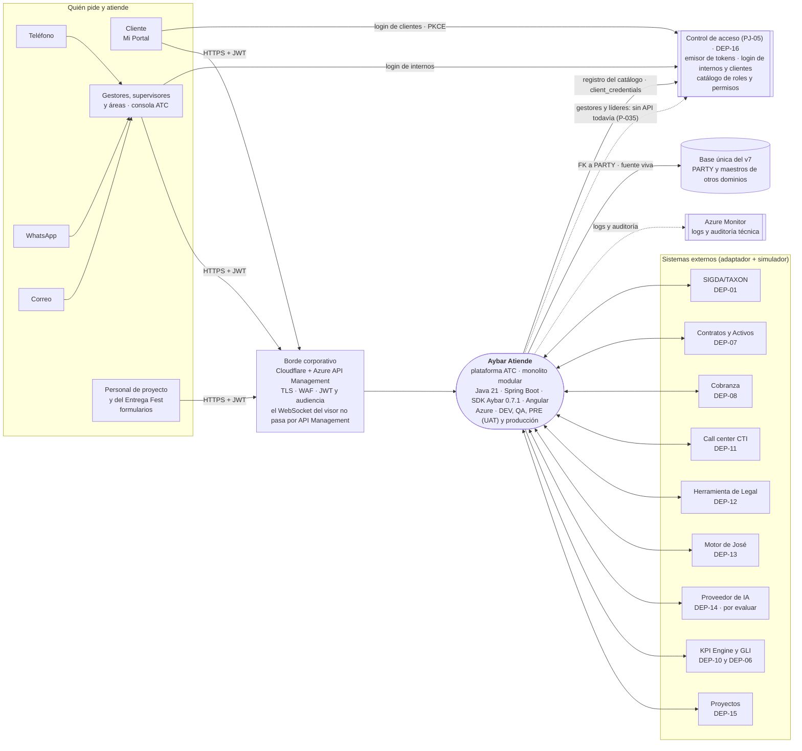
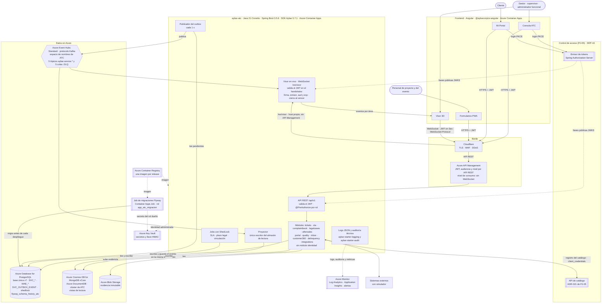
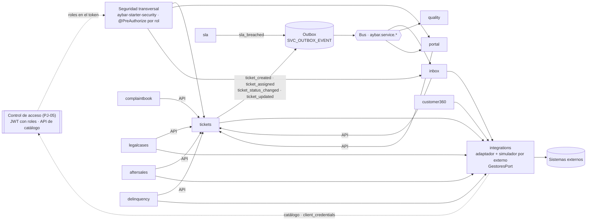
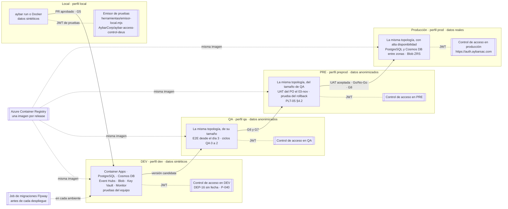
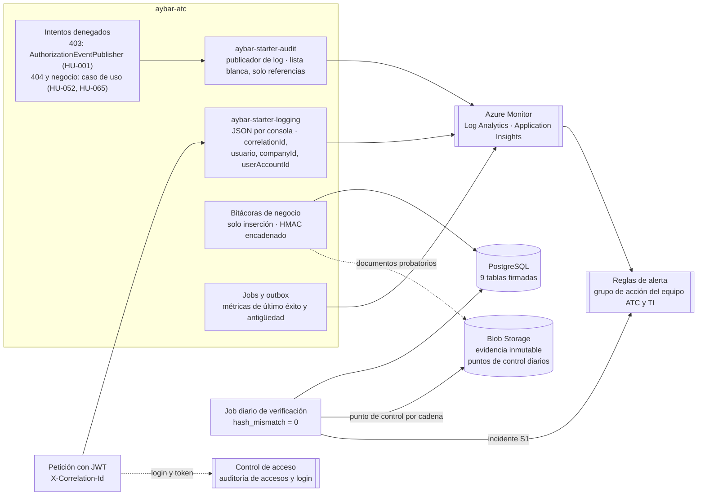

# Diagrama de arquitectura · C4

Va en `docs/arquitectura/` y se enlaza desde el envío de G3 y desde la sección 4 del DoR. Fuentes: `c4-contexto.mmd`, `c4-contenedores.mmd` y `modulos.mmd` (Mermaid; cualquier visor de Mermaid o `mmdc` los dibuja); los diagramas de ambientes y de logs y auditoría están solo en este documento. Versión 0.4 del 26-oct-2026: dibuja las decisiones DT-01 a DT-10 del Líder Técnico (`analisis/decisiones.md` v0.5) y responde a la evidencia «Diagramas» de su revisión del 22-oct (§4): emisor de Control de acceso, Azure, sin módulo `identidad`, visor alimentado por el servicio, logs y auditoría, y ambientes. La v0.4 aplica su segunda revisión: el WebSocket del visor se autentica en el *handshake* y no pasa por API Management, la UAT va en PRE (PLT-05 §4.2) y hay un job de migraciones aparte. Los cinco diagramas se validaron con `mmdc` (Mermaid CLI) el 26-oct.

| DT | Dónde se ve |
|---|---|
| DT-01 Stack del SDK Aybar 0.7.1 (Java 21, Spring Boot, Angular) | Contexto y contenedores |
| DT-02 CQRS con outbox, bus y proyector único escritor | Contenedores y módulos |
| DT-03 Sin módulo `identidad`; ATC consume la seguridad | Contenedores y módulos |
| DT-04 y DT-05 Login y emisor de Control de acceso | Contexto y contenedores |
| DT-06 Base única del v7, `PARTY` fuente viva | Contexto y contenedores |
| DT-07 Azure, con Cloudflare y API Management en el borde | Contexto, contenedores, ambientes y logs |
| DT-08 Jobs con ShedLock | Contenedores |
| DT-10 `client_credentials` hacia Control de acceso | Contexto, contenedores y módulos |

## 1 Contexto

## 2 Contenedores

Reglas que muestra el diagrama:
- Se **escribe** en PostgreSQL y se **lee** del almacén de lectura; la lectura no abre JDBC (skill `aybar-cqrs`), salvo los jobs de plazos (ADR-005). El **proyector del servicio es el único** que escribe en el almacén de lectura, con su credencial propia (DT-02, ADR-012).
- Cada cambio guarda su evento en `SVC_OUTBOX_EVENT` en la misma transacción y el publicador lo envía al bus cada 1 s, con los tópicos del SDK `aybar.service.*` (ADR-013).
- **El visor 3D recibe los eventos del servicio por WebSocket, no del bus:** el consumidor del visor está dentro de `aybar-atc` y reenvía a cada conexión los eventos de las áreas que su rol permite (ADR-010). El JWT viaja en `Sec-WebSocket-Protocol` y el servicio lo valida en el *handshake* con `aybar-starter-security` (firma, emisor, audiencia y vencimiento); al vencer, cierra la conexión y el visor se reconecta. `/ws/visor` entra por Cloudflare al ingreso de Container Apps y **no pasa por API Management**, porque su nivel de consumo no admite WebSocket (`https://learn.microsoft.com/en-us/azure/api-management/websocket-api`).
- Los módulos no se tocan las tablas: se hablan por su API pública o por eventos (ADR-001). Solo `integrations` habla con los sistemas externos (ADR-004).
- El almacén de lectura guarda lo de ATC, no el dato del cliente; `PARTY` es la fuente viva (ADR-003, DT-06).
- **ATC no administra identidad** (DT-03): el emisor, el login de internos y de clientes, los roles y los permisos son de Control de acceso. ATC valida el JWT con las llaves públicas del emisor, autoriza por los roles del token y registra su catálogo con `client_credentials` (ADR-009, DT-10). La consulta de gestores y líderes no existe todavía en Control de acceso (P-035).
- Los jobs corren con ShedLock sobre PostgreSQL (ADR-005). Las migraciones Flyway corren en un job aparte, con el rol dueño de las tablas y la tabla de historial `flyway_schema_history_atc`; el servicio no migra (ADR-001, punto 5).
- Event Hubs y Cosmos DB son exclusivos de ATC en cada ambiente: Event Hubs Standard admite 10 event hubs por espacio de nombres y ATC usa los 10 (ADR-013), y en Cosmos DB los usuarios secundarios tienen permisos de clúster (ADR-012).
- Los secretos y la llave HMAC se leen de Key Vault con identidad administrada; los logs y la auditoría técnica van a Azure Monitor; cada release es una imagen del registro (ADR-014).

## 3 Módulos

Los nombres en inglés son los paquetes y las etiquetas del contrato (ADR-001). No hay módulo de identidad.

## 4 Ambientes

Fuente: ADR-014 (punto 8) y PLT-05 v1.3 §4.2 («Ambiente QA · E2E desde el día 3», «Ambiente PRE · UAT 03-nov»). PRE entra en la Etapa 1 con la UAT del PO. Cada ambiente tiene sus propios recursos de Azure; el registro de imágenes es uno, y el job de migraciones corre en cada ambiente antes del despliegue. El costo de cada ambiente está en `arquitectura/costo-cloud.md` v0.4 (USD 2.592,53 al mes con PRE). Ningún dato real sale de producción ni entra a un prompt de IA.

## 5 Logs y auditoría

Qué va a cada lado:
- **Logs técnicos:** JSON de `aybar-starter-logging` con `correlationId`, recogido por Azure Monitor (Log Analytics y Application Insights), sin datos personales (ADR-014; `seguridad.md`).
- **Auditoría técnica:** `aybar-starter-audit` con su publicador de log, porque no tiene destino Azure Blob (ADR-014; P-032). Incluye los intentos denegados que piden las historias: los 403 por falta de rol llegan por el `AuthorizationEventPublisher` que declara ATC, y las negaciones de negocio (404 del ticket de otro cliente, dato no permitido del motor) las emite el caso de uso (`seguridad.md`).
- **Evidencia de negocio:** las bitácoras firmadas con HMAC encadenado en PostgreSQL y los documentos probatorios en Blob Storage con inmutabilidad; el job diario verifica el hash y deja un punto de control por cadena en Blob Storage para detectar un borrado del final (ADR-002, ADR-006).
- **Alertas:** jobs sin éxito, antigüedad del outbox e incidentes de integridad, al grupo de acción del equipo ATC y de TI (ADR-005).
- **Auditoría de accesos:** la del login y de los tokens es de Control de acceso, no de ATC (DT-03).

## 6 Pendientes del diagrama

- Control de acceso disponible en DEV (DEP-16; P-026, P-040): sin emisor, los endpoints protegidos responden 401.
- Consulta de gestores y líderes con token de servicio (P-035): la flecha punteada del contexto.
- Audiencia del token en el borde y en el servicio (P-038).
- Autenticación del broker con Azure Event Hubs (P-032).
- La región de Azure y el nivel de la instancia corporativa de API Management (P-044).
- El host propio de `/ws/visor` en Cloudflare y la restricción de IP del ingreso (Seguridad TI y Líder Técnico; ADR-010).

## Historial de cambios

| Versión | Fecha | Autor | Cambio |
|---|---|---|---|
| 0.1 | 2026-10-19 | Jesús Chávez Elías, con IA | Borrador con el stack propuesto por el ADR-012 |
| 0.1 (v3 en Nexora) | 2026-10-21 | Brayan, con IA | Contexto sin fases posteriores y conflicto de stack señalado |
| 0.2 | 2026-10-22 | Jesús Chávez Elías, con IA | Sin módulo `identidad`; emisor y login de Control de acceso; Azure; módulos en inglés; visor alimentado por el servicio; Key Vault, Monitor y ShedLock en el diagrama |
| 0.3 | 2026-10-26 | Brayan Hurtado, con IA | Contenedores redibujados: el visor recibe los eventos del consumidor del servicio por WebSocket (antes salía del bus), outbox y publicador, proyector, Cloudflare y API Management, JWKS del emisor, identidad administrada, registro de imágenes y registro del catálogo; contexto con borde, base única y la consulta de gestores sin API (P-035); módulos con outbox y tópicos del SDK; diagramas nuevos de ambientes y de logs y auditoría; tabla DT → diagrama; validados con `mmdc` |
| 0.4 | 2026-10-26 | Brayan Hurtado, con IA | Segunda revisión del Líder Técnico: contenedores con `/ws/visor` por Cloudflare al ingreso, sin API Management (el nivel de consumo no admite WebSocket, verificado en Microsoft Learn), JWT validado en el *handshake* y job de migraciones; contexto y ambientes con PRE para la UAT del 03-nov (PLT-05 §4.2); logs con el `AuthorizationEventPublisher`, los intentos denegados desde el caso de uso y el punto de control diario; reglas y pendientes al día |

Generado por IA: borrador completo (Claude, 2026-10-19), versión base v3 de Nexora; actualizado con IA (Claude, 2026-10-22) a partir de la revisión del Líder Técnico del 22-oct y (Claude, 2026-10-26). — Revisado por: (pendiente) · Aprueba: TL
