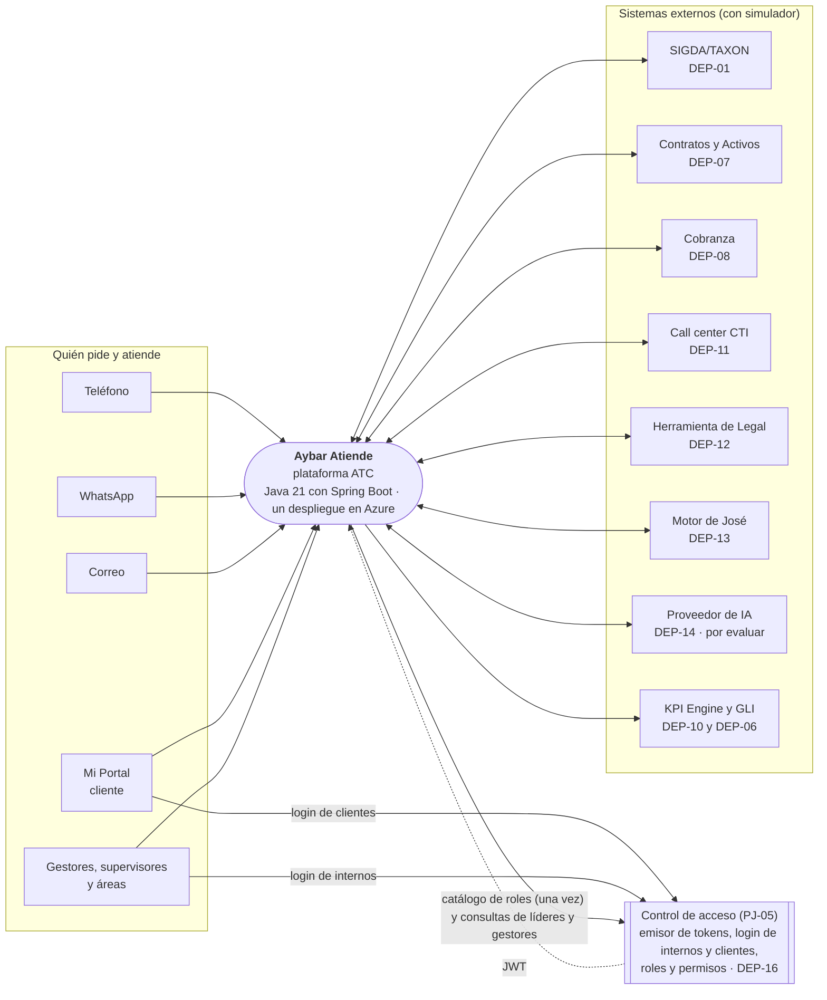
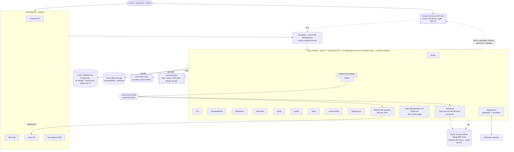
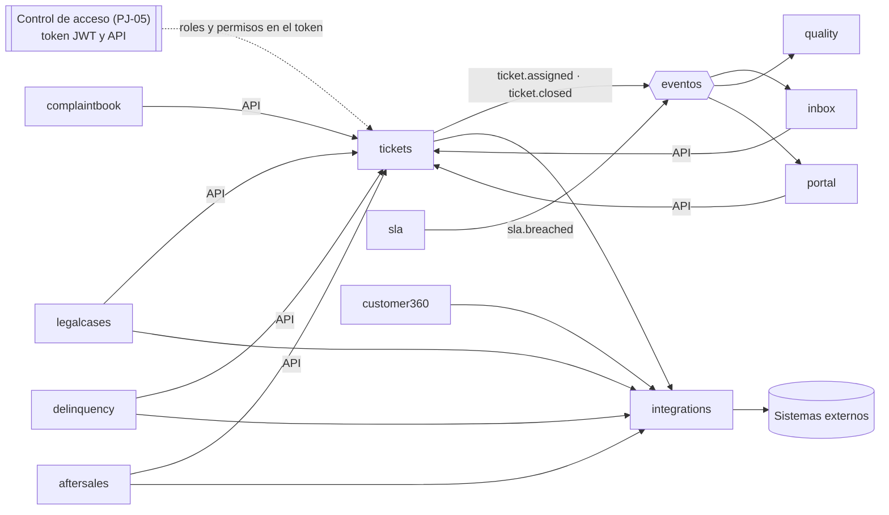

# Diagrama de arquitectura · C4

Va en `docs/arquitectura/` y se enlaza desde el envío de G3 y desde la sección 4 del DoR. Fuentes: `c4-contexto.mmd`, `c4-contenedores.mmd` y `modulos.mmd` (Mermaid; cualquier visor de Mermaid o `mmdc` los dibuja). Versión 0.2 del 22-oct-2026: dibuja las decisiones DT-01 a DT-10 del Líder Técnico (`analisis/decisiones.md` v0.3).

## 1 Contexto

## 2 Contenedores

Reglas que muestra el diagrama:
- Se **escribe** en PostgreSQL y se **lee** del almacén de lectura; la lectura no abre JDBC (skill `aybar-cqrs`). El **proyector del servicio es el único** que escribe en el almacén de lectura (DT-02, ADR-012).
- Cada cambio guarda su evento en la misma transacción (outbox) y un proceso lo publica al bus (ADR-013).
- Los módulos no se tocan las tablas: se hablan por su API pública o por eventos (ADR-001).
- Solo el módulo `integrations` habla con los sistemas externos (ADR-004).
- El almacén de lectura guarda lo de ATC, no el dato del cliente; `PARTY` es la fuente viva (ADR-003, DT-06).
- **ATC no administra identidad** (DT-03): el emisor de tokens, el login de internos y de clientes, los roles y los permisos son de Control de acceso. ATC valida el JWT, lee los roles del token y consulta a Control de acceso con `client_credentials` (ADR-009, DT-10).
- **El visor 3D recibe los eventos del servicio por WebSocket, no del bus** (ADR-010).
- Los jobs de SLA y plazo legal corren con ShedLock y leen PostgreSQL, no el almacén de lectura (ADR-005).
- Los ambientes son DEV, QA, PRE y producción, con una imagen versionada por release (ADR-014).

## 3 Módulos

Los nombres en inglés son propuesta del equipo (ADR-001). No hay módulo de identidad.

## 4 Pendientes del diagrama

- Control de acceso disponible en DEV (DEP-16, P-026): sin emisor, los endpoints protegidos no responden.
- Papel del frontend Angular: propuesta de una sola aplicación (`app`) en la Etapa 1; la confirma el Líder Técnico (P-004).
- Autenticación del broker con Azure Event Hubs y reparto de los eventos del visor entre réplicas (ADR-010, P-032).
- **No hay diagrama de ambientes ni de auditoría y logs.** Azure Monitor y Key Vault están en el de contenedores; los ambientes se listan en texto. Un diagrama propio queda por dibujar (condición del Líder Técnico para G3).
- `aybar-starter-audit` no tiene destino Azure Blob: la auditoría técnica va a log o archivo (ADR-014).
- Los nombres de módulo en inglés y los nombres lógicos de los eventos se confirman (ADR-001, ADR-013).

## Historial de cambios

| Versión | Fecha | Autor | Cambio |
|---|---|---|---|
| 0.1 | 2026-10-19 | Jesús Chávez Elías, con IA | Borrador con el stack propuesto por el ADR-012 |
| 0.1 (v3 en Nexora) | 2026-10-21 | Brayan, con IA | Contexto sin fases posteriores y conflicto de stack señalado |
| 0.2 | 2026-10-22 | Jesús Chávez Elías, con IA | Sin módulo `identidad`; emisor y login de Control de acceso; Azure; módulos en inglés; visor alimentado por el servicio; Key Vault, Monitor y ShedLock en el diagrama |

Generado por IA: borrador completo (Claude, 2026-10-19), versión base v3 de Nexora; actualizado con IA (Claude, 2026-10-22) a partir de la revisión del Líder Técnico del 22-oct. — Revisado por: (pendiente) · Aprueba: TL
