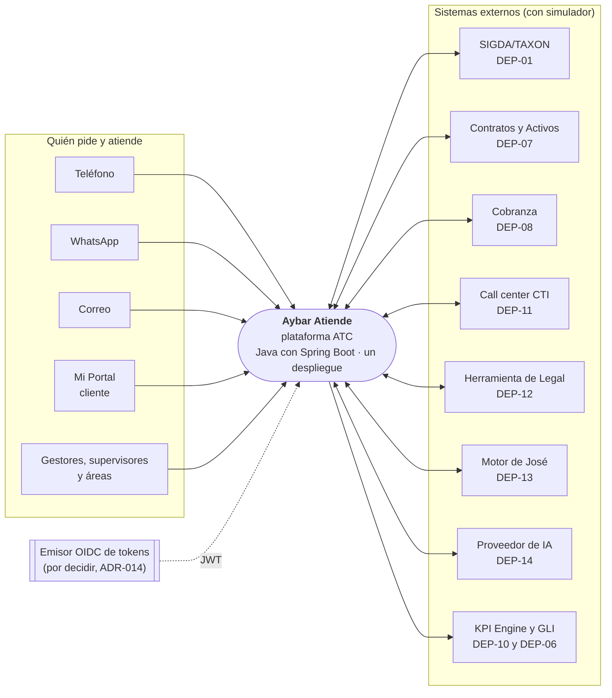
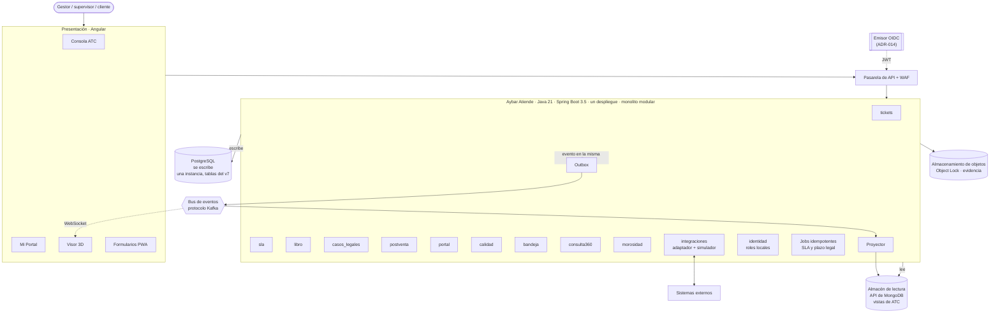
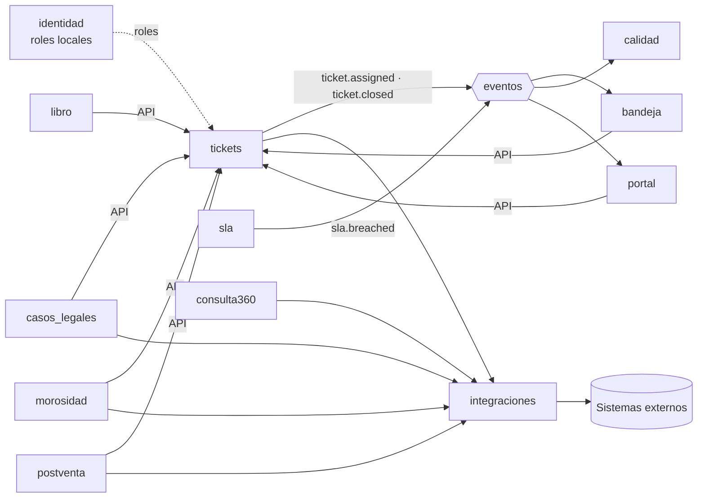

# Diagrama de arquitectura · C4

Va en `docs/arquitectura/` y se enlaza desde el envío de G3 y desde la sección 4 del DoR. Fuentes: `c4-contexto.mmd`, `c4-contenedores.mmd` y `modulos.mmd` (Mermaid; cualquier visor de Mermaid o `mmdc` los dibuja). Borrador del 2026-10-19, con los PLT v1.3 en refinamiento y el stack que propone el ADR-012 (pendiente de la decisión del líder técnico).

## 1 Contexto

## 2 Contenedores

Reglas que muestra el diagrama:
- Se **escribe** en PostgreSQL y se **lee** del almacén de lectura; la lectura no abre JDBC (skill `aybar-cqrs`).
- Cada cambio guarda su evento en la misma transacción (outbox) y un proceso lo publica al bus (ADR-013).
- Los módulos no se tocan las tablas: se hablan por su API pública o por eventos (ADR-001).
- Solo el módulo `integraciones` habla con los sistemas externos (ADR-004).
- El almacén de lectura guarda lo de ATC, no el dato del cliente (ADR-003).

## 3 Módulos

## 4 Pendientes del diagrama

- Marcar nube, orquestador y observabilidad: **por decidir** (ADR-014).
- Quién escribe en el almacén de lectura: el servicio (proyector) u otro proceso (ADR-012).
- Papel del frontend Angular: `app` o `shell` con remotos.
- Dónde vive el emisor de tokens de la Etapa 1.
- Stack del diagrama (Java con Spring Boot y Angular; PostgreSQL, almacén de lectura con API de MongoDB y bus de eventos): **conflicto abierto con el PLT-01 v1.3 (ADR-01 del PO, NestJS + React + una sola PostgreSQL Multi-AZ con índice de búsqueda): decide el líder técnico** (ADR-001, ADR-012 y ADR-013).

Generado por IA: borrador completo (Claude, 2026-10-19), versión base v2 de Jesús Chávez Elías en Nexora; actualizado por Brayan con IA (Claude, 2026-10-21) a la v1.3 del PO: contexto sin sistemas de fases posteriores y conflicto de stack señalado. Texto adaptado al alcance de la Etapa 1 (se omiten las frases que remiten a fases posteriores). — Revisado por: (pendiente)
