# Diagrama entidad-relación

```mermaid
erDiagram
  MAE_TICKET_TYPE ||--o{ MAE_SLA_POLICY : "TicketTypeID"
  MAE_TICKET_PRIORITY ||--o{ MAE_SLA_POLICY : "PriorityID"
  MAE_GENERIC_LIST_VALUE ||--o{ MAE_SLA_POLICY : "TimeBasisID"
  ORG_COMPANY ||--o{ SVC_TICKET : "CompanyID"
  ORG_COMPANY_ADDRESS ||--o{ SVC_TICKET : "CompanyAddressID"
  PARTY ||--o{ SVC_TICKET : "PartyID"
  CONTRACT ||--o{ SVC_TICKET : "ContractID"
  AST_UNIT ||--o{ SVC_TICKET : "UnitID"
  MAE_CHANNEL ||--o{ SVC_TICKET : "ChannelID"
  MAE_TICKET_TYPE ||--o{ SVC_TICKET : "TicketTypeID"
  MAE_BUSINESS_LINE ||--o{ SVC_TICKET : "BusinessLineID"
  ORG_PRODUCT ||--o{ SVC_TICKET : "ProductID"
  MAE_TICKET_PRIORITY ||--o{ SVC_TICKET : "PriorityID"
  MAE_SLA_POLICY ||--o{ SVC_TICKET : "SLAPolicyID"
  MAE_GENERIC_LIST_VALUE ||--o{ SVC_TICKET : "TicketStatusID"
  PARTY ||--o{ SVC_TICKET : "CreatedByPartyID"
  PARTY ||--o{ SVC_TICKET : "CurrentOwnerPartyID"
  MAE_AREA ||--o{ SVC_TICKET : "CurrentAreaID"
  SVC_TICKET ||--o{ SVC_TICKET_STATUS_LOG : "TicketID"
  MAE_GENERIC_LIST_VALUE ||--o{ SVC_TICKET_STATUS_LOG : "TicketStatusID"
  PARTY ||--o{ SVC_TICKET_STATUS_LOG : "ChangedByPartyID"
  SVC_TICKET ||--o{ SVC_TICKET_ASSIGNMENT_LOG : "TicketID"
  MAE_AREA ||--o{ SVC_TICKET_ASSIGNMENT_LOG : "AreaID"
  PARTY ||--o{ SVC_TICKET_ASSIGNMENT_LOG : "AssignedToPartyID"
  MAE_GENERIC_LIST_VALUE ||--o{ SVC_TICKET_ASSIGNMENT_LOG : "AssignmentReasonID"
  PARTY ||--o{ SVC_TICKET_ASSIGNMENT_LOG : "AssignedByPartyID"
  SVC_TICKET ||--o{ SVC_TICKET_INTERACTION : "TicketID"
  MAE_CHANNEL ||--o{ SVC_TICKET_INTERACTION : "ChannelID"
  MAE_GENERIC_LIST_VALUE ||--o{ SVC_TICKET_INTERACTION : "InteractionTypeID"
  PARTY ||--o{ SVC_TICKET_INTERACTION : "AgentPartyID"
  SVC_TICKET ||--o{ SVC_SLA_BREACH_ALERT : "TicketID"
  MAE_SLA_POLICY ||--o{ SVC_SLA_BREACH_ALERT : "SLAPolicyID"
  MAE_GENERIC_LIST_VALUE ||--o{ SVC_SLA_BREACH_ALERT : "BreachTypeID"
  PARTY ||--o{ SVC_SLA_BREACH_ALERT : "AlertedPartyID"
  MAE_CHANNEL ||--o{ SVC_SLA_BREACH_ALERT : "ChannelID"
  SVC_TICKET ||--o| SVC_COMPLAINT_BOOK_ENTRY : "TicketID"
  ORG_COMPANY ||--o{ SVC_COMPLAINT_BOOK_ENTRY : "CompanyID"
  ORG_COMPANY_ADDRESS ||--o{ SVC_COMPLAINT_BOOK_ENTRY : "CompanyAddressID"
  MAE_GENERIC_LIST_VALUE ||--o{ SVC_COMPLAINT_BOOK_ENTRY : "ComplaintTypeID"
  MAE_CURRENCY ||--o{ SVC_COMPLAINT_BOOK_ENTRY : "CurrencyID"
  MAE_CHANNEL ||--o{ SVC_COMPLAINT_BOOK_ENTRY : "ExtensionCommunicationChannelID"
  PARTY ||--o{ SVC_COMPLAINT_BOOK_ENTRY : "ResponderPartyID"
  PARTY ||--o{ SVC_COMPLAINT_BOOK_ENTRY : "ClosedByPartyID"
  MAE_GENERIC_LIST_VALUE ||--o{ SVC_COMPLAINT_BOOK_ENTRY : "ComplaintStatusID"
  SVC_COMPLAINT_BOOK_ENTRY ||--o{ SVC_COMPLAINT_BOOK_ENTRY_STATUS_LOG : "TicketID"
  MAE_GENERIC_LIST_VALUE ||--o{ SVC_COMPLAINT_BOOK_ENTRY_STATUS_LOG : "ComplaintStatusID"
  PARTY ||--o{ SVC_COMPLAINT_BOOK_ENTRY_STATUS_LOG : "ChangedByPartyID"
  SVC_COMPLAINT_BOOK_ENTRY ||--o{ SVC_COMPLAINT_APPEAL : "TicketID"
  MAE_GENERIC_LIST_VALUE ||--o{ SVC_COMPLAINT_APPEAL : "AppealLevelID"
  MAE_GENERIC_LIST_VALUE ||--o{ SVC_COMPLAINT_APPEAL : "AppealStatusID"
  SVC_COMPLAINT_APPEAL ||--o{ SVC_COMPLAINT_APPEAL_STATUS_LOG : "ComplaintAppealID"
  MAE_GENERIC_LIST_VALUE ||--o{ SVC_COMPLAINT_APPEAL_STATUS_LOG : "AppealStatusID"
  PARTY ||--o{ SVC_COMPLAINT_APPEAL_STATUS_LOG : "ChangedByPartyID"
  MAE_AREA {
    int AreaID PK
  }
  MAE_TICKET_TYPE {
    int TicketTypeID PK
  }
  MAE_TICKET_PRIORITY {
    int PriorityID PK
  }
  MAE_SLA_POLICY {
    int SLAPolicyID PK
    int TicketTypeID FK
    int PriorityID FK
    int TimeBasisListID FK
    int TimeBasisID FK
  }
  SVC_TICKET {
    int TicketID PK
    int CompanyID FK
    int CompanyAddressID FK
    int PartyID FK
    int ContractID FK
    int UnitID FK
    int ChannelID FK
    int TicketTypeID FK
    int BusinessLineID FK
    int ProductID FK
    int PriorityID FK
    int SLAPolicyID FK
    int TicketStatusListID FK
    int TicketStatusID FK
    int CreatedByPartyID FK
    int CurrentOwnerPartyID FK
    int CurrentAreaID FK
  }
  SVC_TICKET_STATUS_LOG {
    int TicketStatusLogID PK
    int TicketID FK
    int TicketStatusListID FK
    int TicketStatusID FK
    int ChangedByPartyID FK
  }
  SVC_TICKET_ASSIGNMENT_LOG {
    int TicketAssignmentLogID PK
    int TicketID FK
    int AreaID FK
    int AssignedToPartyID FK
    int AssignmentReasonListID FK
    int AssignmentReasonID FK
    int AssignedByPartyID FK
  }
  SVC_TICKET_INTERACTION {
    int TicketInteractionID PK
    int TicketID FK
    int ChannelID FK
    int InteractionTypeListID FK
    int InteractionTypeID FK
    int AgentPartyID FK
  }
  SVC_SLA_BREACH_ALERT {
    int SLABreachAlertID PK
    int TicketID FK
    int SLAPolicyID FK
    int BreachTypeListID FK
    int BreachTypeID FK
    int AlertedPartyID FK
    int ChannelID FK
  }
  SVC_COMPLAINT_BOOK_ENTRY {
    int TicketID PK, FK
    int CompanyID FK
    int CompanyAddressID FK
    int ComplaintTypeListID FK
    int ComplaintTypeID FK
    int CurrencyID FK
    int ExtensionCommunicationChannelID FK
    int ResponderPartyID FK
    int ClosedByPartyID FK
    int ComplaintStatusListID FK
    int ComplaintStatusID FK
  }
  SVC_COMPLAINT_BOOK_ENTRY_STATUS_LOG {
    int ComplaintBookEntryStatusLogID PK
    int TicketID FK
    int ComplaintStatusListID FK
    int ComplaintStatusID FK
    int ChangedByPartyID FK
  }
  SVC_COMPLAINT_APPEAL {
    int ComplaintAppealID PK
    int TicketID FK
    int AppealLevelListID FK
    int AppealLevelID FK
    int AppealStatusListID FK
    int AppealStatusID FK
  }
  SVC_COMPLAINT_APPEAL_STATUS_LOG {
    int ComplaintAppealStatusLogID PK
    int ComplaintAppealID FK
    int AppealStatusListID FK
    int AppealStatusID FK
    int ChangedByPartyID FK
  }
```

**Revisión del 20-oct-2026, desde el Modelo de Datos Corporativo v7 (fragmento 10 SERVICE, diapositivas 115 a 117).** Se dibujan las 13 entidades de SERVICE con sus claves (`int`) y una línea por clave foránea. Los pares `<Campo>ListID` y `<Campo>ID` se dibujan como una sola relación hacia `MAE_GENERIC_LIST_VALUE` (la columna `ListID` apunta a `MAE_GENERIC_LIST`). Las entidades de otros fragmentos aparecen sin atributos: sus claves no están transcritas en el Anexo A. Fuente del diagrama: `er-diagrama.mmd`.

- Las relaciones son 53 líneas (el v7 declara 61 para el fragmento; la diferencia viene de agrupar los pares ListID/ID y de las FK a `MAE_GENERIC_LIST`, que no se dibujan).
- `SVC_COMPLAINT_BOOK_ENTRY` es una extensión 1:1 de `SVC_TICKET`: su PK es `TicketID`, que a la vez es FK.
- Las bitácoras (`*_STATUS_LOG`, `SVC_TICKET_ASSIGNMENT_LOG`) tienen PK propia y una fila por cambio. El Excel del PO pide firmar 5 bitácoras append-only (RNF-AUD-004): las tres `*_STATUS_LOG`, `SVC_TICKET_ASSIGNMENT_LOG` y `SVC_SLA_BREACH_ALERT`; el v7 dice 4 firmadas en SERVICE: se concilia con Gobierno de Datos.
- `SVC_COMPLAINT_APPEAL` es 1 a N por asiento: así lo dibuja el PLT-04 v1.3 (HU-016 §6.5) y lo permite el esquema de claves del v7.
- **`PARTY` es la fuente viva del cliente (DT-06, 22-oct).** `SVC_TICKET.PartyID` es clave foránea física a `PARTY` del v7: es una referencia, no una copia. El PO reescribe el ADR-03, RN-SVC-026, RNF-INT-007 y DEP-01 (P-021, P-027). El ticket del «Interesado» (HU-051) se registra con una `PARTY` no verificada (R29 de PJ-05, según el Líder Técnico); quién la escribe sigue abierto (P-031). Ver el diccionario, C-1.
- El outbox (`INTG_OUTBOX_EVENT` del fragmento INTEGRATION-HUB, o `SVC_OUTBOX_EVENT` propia si no sirve, ADR-013) y la identidad (Control de acceso; ATC no crea tablas de identidad, C-11) viven fuera de SERVICE; no se redibujan aquí.

Generado por IA: borrador completo (Claude, 2026-10-19), versión base v3 de Jesús Chávez Elías en Nexora; actualizado por Brayan con IA (Claude, 2026-10-21) a la v1.3 del PO: 5 bitácoras firmadas (RNF-AUD-004), cardinalidad de la apelación del PLT-04 y conflicto abierto por la clave a PARTY. — Revisado por: (pendiente)

Actualizado el 22-oct-2026 por Jesús Chávez Elías con IA (Claude) a partir de la revisión del Líder Técnico (DT-02, DT-03, DT-04 y DT-06 de `analisis/decisiones.md` v0.3). — Revisado por: (pendiente)
