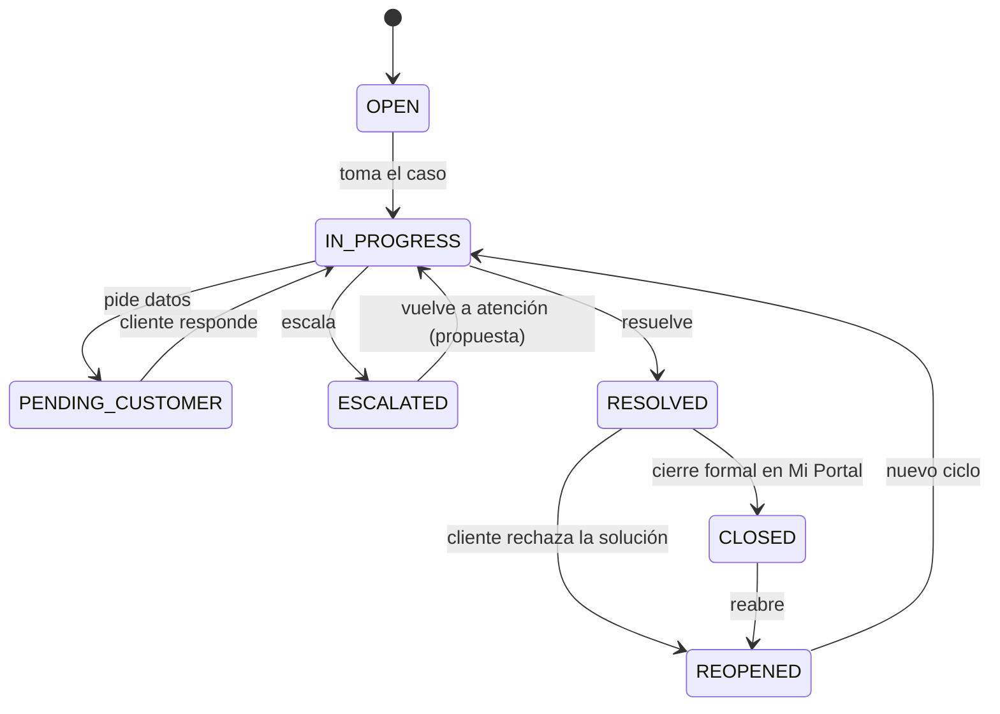
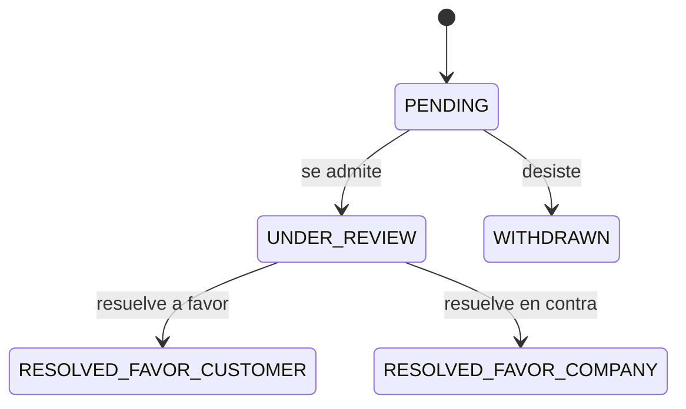

# Estados y transiciones del ticket

Estados del ticket (RF-SVC-004, PLT-04 HU-004 y PLT-05 §3): `OPEN`, `IN_PROGRESS`, `PENDING_CUSTOMER`, `ESCALATED`, `RESOLVED`, `CLOSED`, `REOPENED`. Son los códigos de la lista `SVC_TICKET_STATUS` del Excel del PO (02_RF_Micro, RF-SVC-004). Fuente del diagrama: `estados-ticket.mmd`.

**Cómo se guardan en el v7 (revisión del 20-oct-2026).** El estado no es un CHECK ni una columna de texto: es un par de columnas, `TicketStatusListID` (contra `MAE_GENERIC_LIST`) y `TicketStatusID` (contra `MAE_GENERIC_LIST_VALUE`), en `SVC_TICKET` y en `SVC_TICKET_STATUS_LOG`. Los siete estados se dan de alta como valores de la lista `SVC_TICKET_STATUS` con los códigos de arriba (Excel, RF-SVC-004); el orden de los valores no lo da el Excel. El libro y la apelación tienen listas propias, con sus bitácoras `SVC_COMPLAINT_BOOK_ENTRY_STATUS_LOG` y `SVC_COMPLAINT_APPEAL_STATUS_LOG`: los estados de la apelación están más abajo; los del asiento no tienen códigos ni en el PLT ni en el Excel.

**Qué fija el PO.** El PLT-04 v1.3 dibuja el ciclo de vida en la HU-004 (§6.1) y la vista del cliente en la HU-064 a 066 (§6.1):

| Transición | Disparador | Fuente |
|---|---|---|
| `OPEN` → `IN_PROGRESS` | El colaborador toma el caso | HU-004 §6.1 |
| `IN_PROGRESS` → `PENDING_CUSTOMER` | Pide datos al cliente | HU-004 §6.1 |
| `PENDING_CUSTOMER` → `IN_PROGRESS` | El cliente responde; desde Mi Portal, la respuesta queda como interacción visible y el SLA se reanuda | HU-004 §6.1; HU-066 CA-01 |
| `IN_PROGRESS` → `ESCALATED` | Escala | HU-004 §6.1 |
| `IN_PROGRESS` → `RESOLVED` | Resuelve | HU-004 §6.1 |
| `RESOLVED` → `CLOSED` | Cierre formal en Mi Portal: el cliente confirma la solución (se dispara la encuesta) o, si no responde, el ticket se cierra solo a los días hábiles configurados, con aviso | HU-004 §6.1; HU-066 CA-02 y CA-04; RN-SVC-023 |
| `RESOLVED` → `REOPENED` | El cliente rechaza la solución con un motivo: el ticket vuelve al área responsable y el motivo queda en la bitácora | HU-064 a 066 §6.1; HU-066 CA-03 |
| `CLOSED` → `REOPENED` | Reabre | HU-004 §6.1; HU-011 |
| `REOPENED` → `IN_PROGRESS` | Nuevo ciclo | HU-004 §6.1 |

Reglas del PO sobre esas transiciones:
- Un ticket `CLOSED` no pasa a `IN_PROGRESS` sin reabrirse: el sistema lo impide e indica que primero debe reabrirse (HU-004 CA-04; 409 en el contrato).
- Cada cambio agrega una fila a `SVC_TICKET_STATUS_LOG` con fecha y autor, y el puntero del ticket se actualiza; un cambio hecho por el sistema queda con marca automática en lugar de autor (HU-004 CA-01 y CA-03). La bitácora es append-only y firmada (RN-SVC-006; RNF-AUD-004; ADR-002) y cada cambio publica un evento (ADR-013).
- Al reabrir (HU-011; RN-SVC-007) se calcula `ReopenedResolutionDueDateTime` con la política vigente, el compromiso original no se reescribe y `ReopenCount` sube en uno; cada ciclo tiene sus propias alertas, una por ticket, tipo y ciclo (`ReopenCycleNumber`, RN-SVC-008). Los nombres de columna son del Excel (RF-SVC-011); los tipos, por confirmar con el v7.
- Un ticket con señal de conflicto no se resuelve ni se cierra en Eje 1/2 (HU-026; RN-SVC-021).

**Lo que el PO no fija.**
- La salida de `ESCALATED`: el PLT-04 no la dibuja. La transición `ESCALATED` → `IN_PROGRESS` del diagrama es propuesta del equipo y la confirma el PO.
- Dónde se validan las transiciones (en la aplicación o en la base): el v7 no lo define; se decide al escribir la migración.

Preguntas abiertas que afectan al modelo, con lo que ya fija el PO y la propuesta del mockup de la Etapa 1 (rama `feature/AYB-0001-propuesta-po-v1-3`; la confirma el PO):
- ¿Se pausa el SLA en `PENDING_CUSTOMER`? **El PO ya lo fija:** cuando el cliente responde, «el SLA se reanuda» (HU-066 CA-01). **Propuesta del mockup:** la pausa también corre el vencimiento de la actividad en curso del flujo y, al responder el cliente, los vencimientos se corren lo que duró la espera. El v7 congela la política al abrir el ticket y no tiene dónde guardar las pausas (desde, hasta, horas y motivo): propuesta de tabla a G3 y Gobierno de Datos.
- ¿Cuánto tiempo después de `RESOLVED` pasa a `CLOSED` si el cliente no responde? **El PO fija** que el ticket se cierra solo a los días hábiles configurados, con aviso al cliente (HU-066 CA-04); el número de días es su pregunta abierta. **Propuesta del mockup: 5 días hábiles**, configurables por el administrador funcional; el cierre lo hace un job. Lo normal sigue siendo la confirmación del cliente en Mi Portal (RN-SVC-023).
- Un caso de resolución por morosidad **suspendido por un reclamo abierto** frena también el flujo del ticket: la actividad en curso no se cierra ni corre su SLA (HU-056 CA-03).

## Apelación

Lista `SVC_COMPLAINT_APPEAL_STATUS` del Excel (RF-SVC-016), con el historial completo en `SVC_COMPLAINT_APPEAL_STATUS_LOG` (bitácora firmada, RNF-AUD-004). Transiciones del PLT-04 v1.3 (HU-016 §6.1):

- `WITHDRAWN` cierra la apelación y el ticket no puede volver a apelarse por la misma respuesta (HU-016 CA-03).
- Ante INDECOPI se registran `IndecopiCaseNumber`, la fecha y el resumen de la resolución (HU-016 CA-01); el número solo existe si la instancia es INDECOPI (RF-SVC-016).
- Cada estado queda con fecha y autor (HU-016 CA-02). Un asiento puede tener varias apelaciones (PLT-04 HU-016 §6.5: 1 a N).
- Instancia (`AppealLevel`): el Excel solo nombra el valor `INDECOPI`; el código de la instancia interna está pendiente.

## Asiento del Libro de Reclamaciones

El PLT-04 v1.3 (HU-012 a 015 §6.1) dibuja los estados del asiento sin códigos: registrado (15 días hábiles), prorrogado (+15, una sola vez), respondido con cargo, plazo vencido y en apelación. El Excel no trae la lista `ComplaintStatus`: sus códigos quedan pendientes. Una sola prórroga, comunicada antes del vencimiento original; el vencimiento prorrogado no se reescribe y manda sobre el original (HU-013, HU-015 CA-03; RN-SVC-009).

## Reclamo de garantía (fragmento CONTRACT)

Lista `CONTRACT_WARRANTY_CLAIM_STATUS` del Excel (RF-SVC-035): `REPORTED`, `UNDER_REVIEW`, `APPROVED`, `REJECTED`, `RESOLVED`. La inspección técnica va antes de resolver, y un reclamo fuera del periodo de cobertura, validado contra la fecha real de entrega, es «no procedente por vigencia» (HU-034, HU-035; RN-SVC-027). El v7 no trae bitácora de estados del reclamo.

## Caso sensible (Mesa SGD)

Sin tablas en el v7. El PLT-04 v1.3 los dibuja «por modelar» (R-06), sin códigos:
- Recepción y activación (HU-020 a 022 §6.1): registrado con su Código Único → cargo previo (limbo: el SLA de línea no corre) → activado (el SLA corre) → riesgo clasificado por la matriz objetiva → recalibrado cuando aparece un elemento nuevo.
- Escalamiento en cadena (HU-023 a 025 §6.1; RN-SVC-017): activo → alerta temprana (se acerca el umbral) → memorándum a la jefatura (vence el SLA) → Comité → Directorio, sin saltar niveles; el caso se cierra con evidencia.
- **Los 8 estados homologados de cierre** (RN-SVC-019 y RF-SVC-025 del Excel): conforme, con observación, con riesgo mitigado, con contingencia, por desistimiento, por derivación legal, por regularización documentaria y por acuerdo con el cliente. Un cierre sin evidencia no es cierre y el caso también puede reabrirse (RN-SVC-019). Faltan los códigos de los 8 valores.

## Estados y reglas de transición que piden las historias de Nexora

Contraste del 20-oct-2026 con las 62 historias de PJ-06. Lo que sigue sale de sus criterios de aceptación. Los valores de las listas `SVC_TICKET_STATUS`, `SVC_COMPLAINT_APPEAL_STATUS` y `CONTRACT_WARRANTY_CLAIM_STATUS` ya están en el Excel; los demás («Regularizado», «suspendido por reclamo» y otros) salen del texto de las historias y no tienen códigos hasta que Gobierno de Datos dé de alta las listas.

| Objeto | Estado o regla | Historia · criterio |
|---|---|---|
| Ticket | Un ticket `CLOSED` no pasa a `IN_PROGRESS` sin reabrirse antes: el sistema lo impide e indica que primero debe reabrirse (409) | HU-004 CA-04 |
| Ticket | El cambio de estado hecho por el sistema se registra con marca automática, sin autor | HU-004 CA-03 |
| Ticket | Al reabrir se calcula un nuevo compromiso; el original no se reescribe; `ReopenCount` cuenta los ciclos y cada ciclo tiene sus alertas | HU-011 CA-01, CA-02 |
| Ticket | `PENDING_CUSTOMER`: la respuesta del cliente en Mi Portal lo devuelve a atención y reanuda el SLA; rechazar la solución lo reabre y lo devuelve al área responsable; sin respuesta se cierra solo a los días hábiles configurados | HU-066 CA-01, 03, 04 |
| Ticket | Vinculación al cliente pendiente («Interesado»): datos mínimos, reintento automático si la fuente cayó, vínculo posterior en la bitácora | HU-051 CA-01 a 03 |
| Ticket | Pendiente de sincronizar con Legal: si la herramienta de Legal no responde, el envío queda en cola, se reintenta y el ticket lo muestra | HU-040 CA-03 |
| Ticket | Rayo de prioridad: marca con motivo y bitácora; solo líder; aviso al superar el 10 % de la bandeja del área | HU-045 CA-01 a 03 |
| Ticket | Señal de conflicto: bloquea resolver o cerrar en Eje 1/2 (gate no compensable) y exige derivar a Eje 3; un supervisor la retira con justificación y queda en el historial | HU-026 CA-01 a 03 |
| Ticket | Hitos: la primera fecha de resolución se conserva; `ClosedDateTime` no cambia salvo reapertura | HU-006 CA-01, CA-02 |
| Asiento del Libro | Una sola prórroga, comunicada antes del vencimiento original: la segunda se bloquea (409) y fuera de plazo se impide (422); el plazo prorrogado manda sobre el original | HU-013 CA-02 a 04, HU-015 CA-03 |
| Asiento del Libro | La respuesta formal solo es válida con el cargo adjunto | HU-014 CA-03 |
| Apelación | `WITHDRAWN`: cierra la apelación y el ticket no puede volver a apelarse por la misma respuesta | HU-016 CA-03 |
| Caso sensible | Cargo previo (el SLA de línea no corre) → cargo de activación (el reloj arranca); más de 2 días hábiles sin activar: caso en limbo | HU-021 CA-01 a 03 |
| Caso sensible | Escalamiento sin saltar niveles: jefatura (memorándum) → Comité → Directorio; al resolverse en Comité se detiene la cadena | HU-023 CA-02, CA-03 |
| Caso sensible | Cierre con uno de los 8 estados homologados y evidencia (los nombres los da el Excel, RN-SVC-019; ver arriba) | HU-025 CA-01 |
| Caso sensible | Handoff a Eje 3 completo (6 elementos) antes de enviar; sin confirmar tras 1 día hábil se alerta al supervisor del eje destino | HU-027 CA-01 a 03 |
| Reclamo de garantía | `APPROVED`, `REJECTED` o `RESOLVED` con fecha y descripción (la lista del Excel suma `REPORTED` y `UNDER_REVIEW`); «no procedente por vigencia» si la fecha cae fuera de la cobertura; la inspección va antes de resolver | HU-034 CA-02, HU-035 CA-01, CA-02 |
| Morosidad | Ticket «Resolución de contrato»: se cierra «Regularizado» si el cliente paga antes; queda «suspendido por reclamo» mientras haya un reclamo abierto en el Libro (propuesta del PO, a validar con Legal) | HU-056 CA-02, CA-03 |
| Flujo | Cada publicación crea una versión; solo aplica a tickets nuevos; los abiertos conservan su flujo y SLA congelado; sin flujo publicado se usa el del área y se avisa al administrador | HU-043 CA-02, CA-07 |
| Reserva de bus | Confirmada, en lista de espera o cancelada (la cancelación libera el cupo y lo pasa al primero de la lista) | HU-060 CA-01 a 03 |
| EntregaFest | Caso derivado a la Estación 4: el moderador no puede reabrirlo | HU-038 CA-02 |

Generado por IA: borrador completo (Claude, 2026-10-19), versión base v4 de Jesús Chávez Elías en Nexora; actualizado por Brayan con IA (Claude, 2026-10-21) a la v1.3 del PO: códigos de la lista `SVC_TICKET_STATUS`, transiciones del PLT-04 (HU-004 y HU-064 a 066, con la reapertura de HU-011 y HU-066), estados de la apelación, del asiento, del reclamo de garantía y de los casos sensibles con los 8 estados de cierre. — Revisado por: (pendiente)
