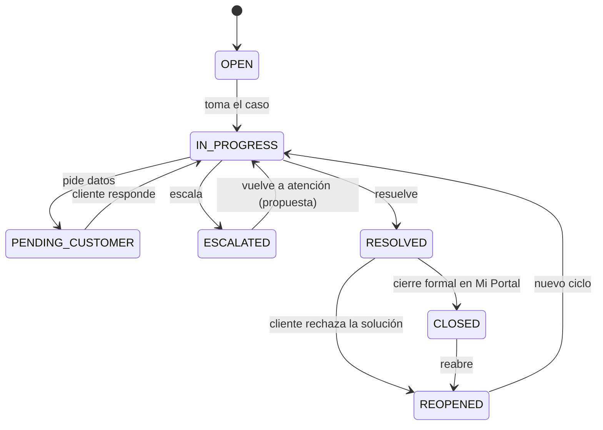
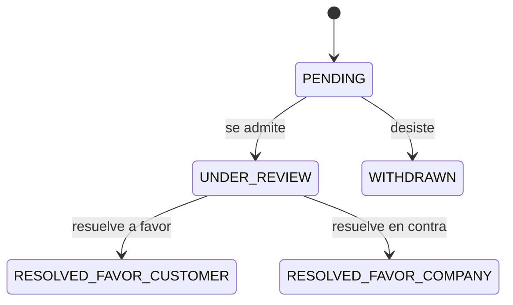

# Estados y transiciones del ticket

Estados del ticket (RF-SVC-004, PLT-04 HU-004 y PLT-05 §3): `OPEN`, `IN_PROGRESS`, `PENDING_CUSTOMER`, `ESCALATED`, `RESOLVED`, `CLOSED`, `REOPENED`. Son los códigos de la lista `SVC_TICKET_STATUS` del Excel del PO (02_RF_Micro, RF-SVC-004). Fuente del diagrama: `estados-ticket.mmd`.

**Cómo se guardan en el v7 (revisión del 20-oct-2026).** El estado no es un CHECK ni una columna de texto: es un par de columnas, `TicketStatusListID` (contra `MAE_GENERIC_LIST`) y `TicketStatusID` (contra `MAE_GENERIC_LIST_VALUE`), en `SVC_TICKET` y en `SVC_TICKET_STATUS_LOG`. Los siete estados se dan de alta como valores de la lista `SVC_TICKET_STATUS` con los códigos de arriba (Excel, RF-SVC-004); el orden de los valores no lo da el Excel. El libro y la apelación tienen listas propias, con sus bitácoras `SVC_COMPLAINT_BOOK_ENTRY_STATUS_LOG` y `SVC_COMPLAINT_APPEAL_STATUS_LOG`: los estados de la apelación están más abajo; los del asiento no tienen códigos ni en el PLT ni en el Excel.

**Qué fija el PO.** El PLT-04 v1.3 dibuja el ciclo de vida en la HU-004 (§6.1) y la vista del cliente en la HU-064 a 066 (§6.1):

| Transición | Disparador | Fuente |
|---|---|---|
| `OPEN` → `IN_PROGRESS` | El colaborador toma el caso | HU-004 §6.1 |
| `IN_PROGRESS` → `PENDING_CUSTOMER` | Pide datos al cliente | HU-004 §6.1 |
| `PENDING_CUSTOMER` → `IN_PROGRESS` | El cliente responde; desde Mi Portal, la respuesta queda como interacción visible y el SLA se reanuda | HU-004 §6.1; HU-066 CA-01 |
| `IN_PROGRESS` → `ESCALATED` | Escala | HU-004 §6.1 |
| `IN_PROGRESS` → `RESOLVED` | Resuelve | HU-004 §6.1 |
| `RESOLVED` → `CLOSED` | Cierre formal en Mi Portal: el cliente confirma la solución (se dispara la encuesta) o, si no responde, el ticket se cierra solo a los días hábiles configurados, con aviso | HU-004 §6.1; HU-066 CA-02 y CA-04; RN-SVC-023 |
| `RESOLVED` → `REOPENED` | El cliente rechaza la solución con un motivo: el ticket vuelve al área responsable y el motivo queda en la bitácora | HU-064 a 066 §6.1; HU-066 CA-03 |
| `CLOSED` → `REOPENED` | Reabre | HU-004 §6.1; HU-011 |
| `REOPENED` → `IN_PROGRESS` | Nuevo ciclo | HU-004 §6.1 |

Reglas del PO sobre esas transiciones:
- Un ticket `CLOSED` no pasa a `IN_PROGRESS` sin reabrirse: el sistema lo impide e indica que primero debe reabrirse (HU-004 CA-04; 409 en el contrato).
- Cada cambio agrega una fila a `SVC_TICKET_STATUS_LOG` con fecha y autor, y el puntero del ticket se actualiza; un cambio hecho por el sistema queda con marca automática en lugar de autor (HU-004 CA-01 y CA-03). La bitácora es append-only y firmada (RN-SVC-006; RNF-AUD-004; ADR-002) y cada cambio publica un evento (ADR-013).
- Al reabrir (HU-011; RN-SVC-007) se calcula `ReopenedResolutionDueDateTime` con la política vigente, el compromiso original no se reescribe y `ReopenCount` sube en uno; cada ciclo tiene sus propias alertas, una por ticket, tipo y ciclo (`ReopenCycleNumber`, RN-SVC-008). Los nombres de columna son del Excel (RF-SVC-011); los tipos, en `datos/diccionario.md` (ED-16).
- Un ticket con señal de conflicto no se resuelve ni se cierra en Eje 1/2 (HU-026; RN-SVC-021).

**Lo que el PO no fija y decide el equipo** (ED-26):
- La salida de `ESCALATED`: el PLT-04 no la dibuja. La transición `ESCALATED` → `IN_PROGRESS` del diagrama es decisión del equipo.
- Dónde se validan las transiciones: en la aplicación, en el caso de uso de cambio de estado; la bitácora firmada guarda cada cambio y la regla de calidad Q-004 del acta F4 vigila que no haya transiciones fuera de este diagrama.

Lo que afectaba al modelo y cómo queda: lo que fija el PO se mantiene y el resto lo decide el equipo con el mockup de la Etapa 1 (rama `feature/AYB-0001-propuesta-po-v1-3`; ED-15 y ED-26):
- ¿Se pausa el SLA en `PENDING_CUSTOMER`? **El PO ya lo fija:** cuando el cliente responde, «el SLA se reanuda» (HU-066 CA-01). **Decisión del equipo:** la pausa también corre el vencimiento de la actividad en curso del flujo y, al responder el cliente, los vencimientos se corren lo que duró la espera. Las pausas (desde, hasta, horas y motivo) van en `SVC_TICKET_SLA_PAUSE`, tabla de ATC (ED-15).
- ¿Cuánto tiempo después de `RESOLVED` pasa a `CLOSED` si el cliente no responde? **El PO fija** que el ticket se cierra solo a los días hábiles configurados, con aviso al cliente (HU-066 CA-04); **Decisión del equipo: 5 días hábiles**, configurables en `MAE_SLA_POLICY.AutoCloseBusinessDays` (ED-15; Q-066-1); el cierre lo hace un job. Lo normal sigue siendo la confirmación del cliente en Mi Portal (RN-SVC-023).
- Un caso de resolución por morosidad **suspendido por un reclamo abierto** frena también el flujo del ticket: la actividad en curso no se cierra ni corre su SLA (HU-056 CA-03). La suspensión se guarda como pausa en `SVC_TICKET_SLA_PAUSE` y la actividad queda `PAUSED` (ED-15; Q-056-3).

## Apelación

Lista `SVC_COMPLAINT_APPEAL_STATUS` del Excel (RF-SVC-016), con el historial completo en `SVC_COMPLAINT_APPEAL_STATUS_LOG` (bitácora firmada, RNF-AUD-004). Transiciones del PLT-04 v1.3 (HU-016 §6.1):

- `WITHDRAWN` cierra la apelación y el ticket no puede volver a apelarse por la misma respuesta (HU-016 CA-03).
- Ante INDECOPI se registran `IndecopiCaseNumber`, la fecha y el resumen de la resolución (HU-016 CA-01); el número solo existe si la instancia es INDECOPI (RF-SVC-016).
- Cada estado queda con fecha y autor (HU-016 CA-02). Un asiento puede tener varias apelaciones (PLT-04 HU-016 §6.5: 1 a N).
- Instancia: lista `SVC_COMPLAINT_APPEAL_LEVEL` con `INTERNAL` e `INDECOPI` (el Excel solo nombra `INDECOPI`; ED-26).

## Asiento del Libro de Reclamaciones

El PLT-04 v1.3 (HU-012 a 015 §6.1) dibuja los estados del asiento sin códigos: registrado (15 días hábiles), prorrogado (+15, una sola vez), respondido con cargo, plazo vencido y en apelación. El Excel no trae la lista: el equipo la fija como `SVC_COMPLAINT_STATUS` con `REGISTERED`, `EXTENDED`, `RESPONDED` y `CLOSED`; «plazo vencido» es la alerta `LEGAL_RESPONSE_OVERDUE` y «en apelación», una apelación abierta en `SVC_COMPLAINT_APPEAL` (ED-26). La hoja, la carta y los cargos se conservan 2 años desde el registro (ED-13). Una sola prórroga, comunicada antes del vencimiento original; el vencimiento prorrogado no se reescribe y manda sobre el original (HU-013, HU-015 CA-03; RN-SVC-009). **Con la Ley 31435 el plazo es de 15 días hábiles improrrogables** (art. 24.1 del Código de Protección y Defensa del Consumidor; El Peruano, 22-mar-2022): ATC deshabilita la prórroga por parámetro, `EXTENDED` y el paso «prorrogado» quedan sin uso y el parámetro existe solo si una norma futura la permite (ED-28; la diferencia con HU-013 y RN-SVC-009 está listada en ED-19).

## Reclamo de garantía (fragmento CONTRACT)

Lista `CONTRACT_WARRANTY_CLAIM_STATUS` del Excel (RF-SVC-035): `REPORTED`, `UNDER_REVIEW`, `APPROVED`, `REJECTED`, `RESOLVED`. La inspección técnica va antes de resolver, y un reclamo fuera del periodo de cobertura, validado contra la fecha real de entrega, es «no procedente por vigencia» (HU-034, HU-035; RN-SVC-027). El v7 no trae bitácora de estados del reclamo: el historial va en la bitácora de su ticket (`SVC_TICKET_STATUS_LOG`).

## Caso sensible (Mesa SGD)

Sin tablas en el v7: son tablas de ATC (cambio al v7; `registro-de-tablas.md` §3). El PLT-04 v1.3 los dibuja «por modelar» (R-06) y el equipo fija sus códigos y plazos (ED-26; FT-08 y FT-09):
- Recepción y activación (HU-020 a 022 §6.1): registrado con su Código Único → cargo previo (limbo: el SLA de línea no corre) → activado (el SLA corre) → riesgo clasificado por la matriz objetiva → recalibrado cuando aparece un elemento nuevo.
- Escalamiento en cadena (HU-023 a 025 §6.1; RN-SVC-017): activo → alerta temprana (2 días hábiles antes del vencimiento) → memorándum a la jefatura (+1 día hábil) → Comité (+3) → Directorio (+5), sin saltar niveles; el caso se cierra con evidencia. SLA de línea en días hábiles: Indecopi 10, Libro 15, Cartas notariales 10, Legal Atiende 5 y Backlog 20.
- **Los 8 estados homologados de cierre** (RN-SVC-019 y RF-SVC-025 del Excel): conforme, con observación, con riesgo mitigado, con contingencia, por desistimiento, por derivación legal, por regularización documentaria y por acuerdo con el cliente. Un cierre sin evidencia no es cierre y el caso también puede reabrirse (RN-SVC-019). Códigos (lista `SVC_CASE_CLOSURE_STATUS`; ED-26): `COMPLIANT`, `WITH_OBSERVATION`, `RISK_MITIGATED`, `WITH_CONTINGENCY`, `BY_WITHDRAWAL`, `BY_LEGAL_REFERRAL`, `BY_DOCUMENT_REGULARIZATION` y `BY_CUSTOMER_AGREEMENT`.

## Estados y reglas de transición que piden las historias de Nexora

Contraste del 20-oct-2026 con las 62 historias de PJ-06. Lo que sigue sale de sus criterios de aceptación. Los valores de las listas `SVC_TICKET_STATUS`, `SVC_COMPLAINT_APPEAL_STATUS` y `CONTRACT_WARRANTY_CLAIM_STATUS` ya están en el Excel; los demás («Regularizado», «suspendido por reclamo» y otros) salen del texto de las historias y sus códigos los fija el equipo (ED-26; `datos/diccionario.md`, «Listas de valores»).

| Objeto | Estado o regla | Historia · criterio |
|---|---|---|
| Ticket | Un ticket `CLOSED` no pasa a `IN_PROGRESS` sin reabrirse antes: el sistema lo impide e indica que primero debe reabrirse (409) | HU-004 CA-04 |
| Ticket | El cambio de estado hecho por el sistema se registra con marca automática, sin autor | HU-004 CA-03 |
| Ticket | Al reabrir se calcula un nuevo compromiso; el original no se reescribe; `ReopenCount` cuenta los ciclos y cada ciclo tiene sus alertas | HU-011 CA-01, CA-02 |
| Ticket | `PENDING_CUSTOMER`: la respuesta del cliente en Mi Portal lo devuelve a atención y reanuda el SLA; rechazar la solución lo reabre y lo devuelve al área responsable; sin respuesta se cierra solo a los días hábiles configurados | HU-066 CA-01, 03, 04 |
| Ticket | «Sin cliente vinculado» («Interesado»): datos mínimos en `SVC_TICKET_PROSPECT`, reintento automático de la vinculación, vínculo posterior en la bitácora y borrado de los datos mínimos; si nunca se vincula, purga a los 30 días hábiles del cierre (2 años si hay asiento del Libro) (ED-05; O-11) | HU-051 CA-01 a 03 |
| Ticket | Envío a Legal en cola: si la herramienta de Legal no responde, el envío queda en el outbox, se reintenta y el ticket lo muestra | HU-040 CA-03 |
| Ticket | Rayo de prioridad: marca con motivo y bitácora; solo el líder (`ATC_SUPERVISOR`); aviso al superar el 10 % de la bandeja del área | HU-045 CA-01 a 03 |
| Ticket | Señal de conflicto: bloquea resolver o cerrar en Eje 1/2 (gate no compensable) y exige derivar a Eje 3; un supervisor la retira con justificación y queda en el historial | HU-026 CA-01 a 03 |
| Ticket | Hitos: la primera fecha de resolución se conserva; `ClosedDateTime` no cambia salvo reapertura | HU-006 CA-01, CA-02 |
| Asiento del Libro | Prórroga deshabilitada por la Ley 31435 (15 días hábiles improrrogables): `prorrogarPlazo` responde 422 (ED-28). Solo si una norma futura la habilita: una sola, comunicada antes del vencimiento original; la segunda se bloquea (409) y fuera de plazo se impide (422); el plazo prorrogado manda sobre el original | HU-013 CA-02 a 04, HU-015 CA-03 |
| Asiento del Libro | La respuesta formal solo es válida con el cargo adjunto | HU-014 CA-03 |
| Apelación | `WITHDRAWN`: cierra la apelación y el ticket no puede volver a apelarse por la misma respuesta | HU-016 CA-03 |
| Caso sensible | Cargo previo (el SLA de línea no corre) → cargo de activación (el reloj arranca); más de 2 días hábiles sin activar: caso en limbo | HU-021 CA-01 a 03 |
| Caso sensible | Escalamiento sin saltar niveles: jefatura (memorándum) → Comité → Directorio; al resolverse en Comité se detiene la cadena | HU-023 CA-02, CA-03 |
| Caso sensible | Cierre con uno de los 8 estados homologados y evidencia (los nombres los da el Excel, RN-SVC-019; ver arriba) | HU-025 CA-01 |
| Caso sensible | Handoff a Eje 3 completo (6 elementos) antes de enviar; sin confirmar tras 1 día hábil se alerta al supervisor del eje destino | HU-027 CA-01 a 03 |
| Reclamo de garantía | `APPROVED`, `REJECTED` o `RESOLVED` con fecha y descripción (la lista del Excel suma `REPORTED` y `UNDER_REVIEW`); «no procedente por vigencia» si la fecha cae fuera de la cobertura; la inspección va antes de resolver | HU-034 CA-02, HU-035 CA-01, CA-02 |
| Morosidad | Ticket «Resolución de contrato»: se cierra «Regularizado» si el cliente paga antes; queda «suspendido por reclamo» mientras haya un reclamo abierto en el Libro (Q-056-3). Códigos del caso: lista `SVC_DEFAULT_CASE_STATUS` (`OPEN`, `SUSPENDED_BY_COMPLAINT`, `REGULARIZED`, `RESOLVED`; diccionario) | HU-056 CA-02, CA-03 |
| Flujo | Cada publicación crea una versión; solo aplica a tickets nuevos; los abiertos conservan su flujo y SLA congelado; sin flujo publicado se usa el del área y se avisa al rol `ATC_ADMIN_FUNCIONAL` (aviso por rol, ED-03) | HU-043 CA-02, CA-07 |
| Reserva de bus | Confirmada, en lista de espera o cancelada (la cancelación libera el cupo y lo pasa al primero de la lista) | HU-060 CA-01 a 03 |
| EntregaFest | Caso derivado a la Estación 4: el moderador no puede reabrirlo | HU-038 CA-02 · fuera de la Etapa 1 (P-025): se aplica cuando se retome |

Generado por IA: borrador completo (Claude, 2026-10-19), versión base v4 de Jesús Chávez Elías en Nexora; actualizado por Brayan con IA (Claude, 2026-10-21) a la v1.3 del PO: códigos de la lista `SVC_TICKET_STATUS`, transiciones del PLT-04 (HU-004 y HU-064 a 066, con la reapertura de HU-011 y HU-066), estados de la apelación, del asiento, del reclamo de garantía y de los casos sensibles con los 8 estados de cierre. — Revisado por: (pendiente)

## Historial de cambios

| Versión | Fecha | Autor | Cambio |
|---|---|---|---|
| 0.1 | 2026-10-19 a 2026-10-21 | Jesús Chávez Elías y Brayan Hurtado, con IA | Estados y transiciones desde el v7 y la v1.3 del PO (versiones de Nexora hasta la v4) |
| 0.2 | 2026-10-26 | Brayan Hurtado, con IA | Frontmatter completo para el acta F4, de la que es evidencia: owner (Jesús Chávez Elías, autor de la versión base), aprobador (Líder Técnico, como el resto de `datos/`), versión, fecha, relacionados e historial. Los estados no cambian |
| 0.3 | 2026-10-26 | Brayan Hurtado, con IA | Decisiones del equipo (`analisis/decisiones.md` v0.7): salida de `ESCALATED` y validación de transiciones (ED-26); pausas en `SVC_TICKET_SLA_PAUSE` y cierre automático a los 5 días hábiles (ED-15); códigos del asiento, de la instancia de apelación y de los 8 cierres de casos sensibles, y plazos de la Mesa SGD (ED-26); retención de la evidencia del Libro (ED-13); interesado «sin cliente vinculado» (ED-05). Los estados del ticket no cambian |
| 0.4 | 2026-10-26 | Brayan Hurtado, con IA | P-025 decidida por el equipo (`analisis/decisiones.md` v0.8): la regla de EntregaFest (HU-038) queda marcada «fuera de la Etapa 1» |
| 0.5 | 2026-10-26 | Brayan Hurtado, con IA | Revisión final del Líder Técnico del 26-oct: asiento con 15 días hábiles improrrogables y prórroga deshabilitada (Ley 31435; ED-28; O-01); purga de los datos mínimos del interesado (O-11); códigos del caso de resolución. Desde esta versión cada cambio de texto sube la versión (O-26) |

Actualizado el 26-oct-2026 (v0.2) por Brayan Hurtado con IA (Claude) a partir de la revisión del Líder Técnico del 26-oct (hallazgo 19): frontmatter e historial. — Revisado por: (pendiente)

Actualizado el 26-oct-2026 (v0.3) por Brayan Hurtado con IA (Claude) a partir de las decisiones del equipo del 26-oct (ED-03, ED-05, ED-13, ED-15 y ED-26 de `analisis/decisiones.md` v0.7). — Revisado por: (pendiente)

Actualizado el 26-oct-2026 (v0.4) por Brayan Hurtado con IA (Claude): P-025 decidida por el equipo (`analisis/decisiones.md` v0.8). — Revisado por: (pendiente)

Actualizado el 26-oct-2026 (v0.5) por Brayan Hurtado con IA (Claude): revisión final del Líder Técnico (O-01 y O-11). — Revisado por: (pendiente)
