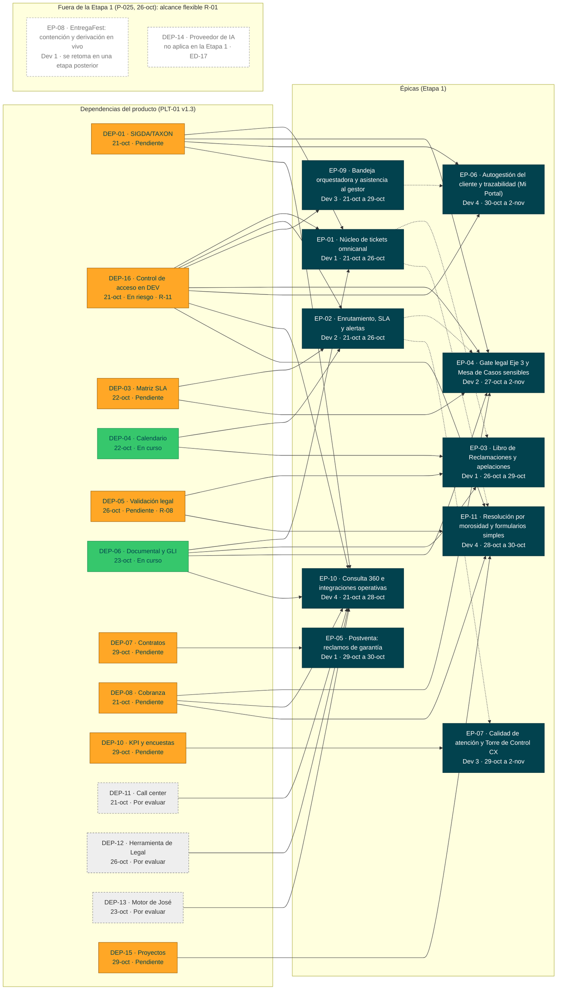

# PLT-01 - Roadmap de producto

Va en `docs/roadmap/`. Recoge las dependencias, los riesgos y los hitos del producto. Esta versión
usa el plan v1.3 del PO del 16-oct (PLT-01 a PLT-05) y el Excel `ATC_requerimientos (3).xlsx`, con la
división por etapas. **Corte de esta versión: lun 26-oct-2026, día 4 de desarrollo** (la v0.2 era del
mié 21-oct, día 1). A esa fecha no hay ningún documento del paquete aprobado en Nexora: cada uno queda listo para la firma de su rol (`decisiones.md` v0.7, P-024 y ED-21). **v0.7 (26-oct): P-025 decidida por el equipo** (Brayan Hurtado; `decisiones.md` v0.8): las 28 h nuevas de DT-02 entran como trabajo técnico de la fundación y salen de la Etapa 1 las 5 HU de alcance flexible del PO (R-01): HU-ATC-037, 038 y 039 (EP-ATC-08 completa), 048 y 053. La Etapa 1 queda en **57 HU y 227 h** de historias, **10 épicas y 22 funcionalidades**, más **28 h técnicas**; las 5 HU se retoman en una etapa posterior.

| Producto | Product Owner | Versión / Fecha |
|---|---|---|
| Aybar Atiende · plataforma ATC: tickets omnicanal, SLA, Libro de Reclamaciones, casos sensibles y autogestión del cliente | Eddie Huamaní | v0.7 · 2026-10-26 (plan del PO v1.3 · 16-oct-2026) |
| **Horizonte** | **Visión del producto** | **Estado** |
| Etapa 1: diseño del jue 08 al mar 20-oct, desarrollo del mié 21-oct al mar 03-nov-2026 (iteración 1: 21–27-oct; iteración 2: 28-oct–03-nov; el 03-nov es el día de UAT y Go/No-Go) | Toda solicitud del cliente se registra una sola vez, se atiende con un plazo trazable y se cierra con evidencia, sin exposición ante INDECOPI | Borrador · en desarrollo desde el 21-oct |

> Fuente de verdad: `docs/analisis/decisiones.md`. Si este roadmap la contradice, manda el registro y el roadmap se corrige.

## 1 Roadmap por trimestre

El horizonte es corto: toda la Etapa 1 cae en el T4 2026. Las columnas muestran la ventana de
desarrollo de cada épica (PLT-01 v1.3 §2b). Los desarrolladores son los del PLT-01 v1.3.

| Épica | Nombre | Prioridad (MoSCoW) | T1 2026 | T2 2026 | T3 2026 | T4 2026 | Horizonte |
|---|---|---|---|---|---|---|---|
| EP-ATC-01 | Núcleo de tickets omnicanal | Debe | | | | 21-oct a 26-oct · Dev 1 (Brayan) · 22 h; además, la fundación técnica de DT-02 (28 h entre los 4 desarrolladores, P-025) | Ahora (sin G4 aprobado) |
| EP-ATC-02 | Enrutamiento, SLA y alertas | Debe | | | | 21-oct a 26-oct · Dev 2 (Jesús) · 28 h | Ahora (sin G4 aprobado) |
| EP-ATC-03 | Libro de Reclamaciones y apelaciones | Debe | | | | 26-oct a 29-oct · Dev 1 (Brayan) · 21 h | Ahora (sin G4 aprobado) |
| EP-ATC-04 | Gate legal Eje 3 y Mesa de Casos sensibles | Debe | | | | 27-oct a 2-nov · Dev 2 (Jesús) · 32 h | Ahora (sin G4 aprobado) |
| EP-ATC-05 | Postventa: reclamos de garantía | Debería | | | | 29-oct a 30-oct · Dev 1 (Brayan) · 12 h | Ahora (sin G4 aprobado) |
| EP-ATC-06 | Autogestión del cliente y trazabilidad (Mi Portal) | Debe | | | | 30-oct a 2-nov · Dev 4 (Daniel) · 9 h | Ahora (sin G4 aprobado) |
| EP-ATC-07 | Calidad de atención y Torre de Control CX | Debería | | | | 29-oct a 2-nov · Dev 3 (Michel) · 16 h | Ahora (sin G4 aprobado) |
| EP-ATC-08 | EntregaFest: contención y derivación en vivo | Podría | | | | Fuera de la Etapa 1 (P-025); en el PLT-01: 30-oct a 2-nov · Dev 1 (Brayan) · 6 h | Siguiente: etapa posterior (alcance flexible, R-01) |
| EP-ATC-09 | Bandeja orquestadora y asistencia al gestor | Debe | | | | 21-oct a 29-oct · Dev 3 (Michel) · 44 h (39 h en la Etapa 1: sin HU-048, P-025) | Ahora (sin G4 aprobado) |
| EP-ATC-10 | Consulta 360 e integraciones operativas | Debe | | | | 21-oct a 28-oct · Dev 4 (Daniel) · 36 h (31 h en la Etapa 1: sin HU-053, P-025) | Ahora (sin G4 aprobado) |
| EP-ATC-11 | Resolución por morosidad y formularios simples | Debe | | | | 28-oct a 30-oct · Dev 4 (Daniel) · 17 h | Ahora (sin G4 aprobado) |

**Capacidad** (PLT-01 v1.3 §2c): el equipo tiene comprometidas 243 h de una capacidad de 252 h (96 %),
con 63 h por persona. Los días 1 a 9 tienen 7 h cada uno y el día 10 es de UAT y pase.

**Tras P-025 (decisión del equipo, 26-oct):** 227 h de historias más 28 h técnicas de DT-02 = **255 h** sobre 252 h (101 %). Las 3 h de más las absorbe el equipo (riesgo aceptado). Por persona (entre paréntesis, el PLT-01):

- Dev 1 (Brayan): EP-01 → EP-03 → EP-05, 55 h de historias + 9 h técnicas (outbox y re-proyección) = 64 h (102 %). EP-08 sale de la Etapa 1 (PLT-01: EP-01 → EP-03 → EP-05 → EP-08, 61 h, 97 %).
- Dev 2 (Jesús): EP-02 → EP-04, 60 h + 4 h técnicas (publicador del outbox) = 64 h (102 %) (PLT-01: 60 h, 95 %).
- Dev 3 (Michel): EP-09 → EP-07, 55 h (sin HU-048) + 9 h técnicas (proyector, purga y métrica del outbox) = 64 h (102 %) (PLT-01: 60 h, 95 %).
- Dev 4 (Daniel): EP-10 → EP-11 → EP-06, 57 h (sin HU-053) + 6 h técnicas (bus en Event Hubs) = 63 h (100 %) (PLT-01: 62 h, 98 %).

Las 28 h técnicas son la fundación de la ola 0 (tareas DT02-T01 a DT02-T06 de `backlog/tareas/EP-ATC-01.json`): se construyen antes que las vistas de lectura y no mueven las fechas de las historias del PO.

La EP-ATC-08 pasa a Dev 1 para liberar a Dev 3, que construye las prioridades 1 y 3. Por iteración:
la 1 tiene 29 historias (132 h) y la 2 tiene 33 historias (111 h). En la Etapa 1, tras P-025: la 1 tiene 28 historias (127 h; sale HU-053) y la 2 tiene 29 (100 h; salen HU-037, 038, 039 y 048).

**Orden de prioridad 1-3** (se construyen primero en su desarrollador):

1. HU-ATC-043, el flujo por tipo, subtipo y área (Dev 3, 21–22-oct).
2. HU-ATC-050, la consulta 360 en el ticket (Dev 4, 21–22-oct).
3. HU-ATC-067, el visor del proceso 3D (Dev 3, 23–27-oct).

**Dependencias lógicas entre épicas** (A → B: A termina antes de que empiece B):

| De | A | Fuente | Fechas | ¿El calendario la respeta? |
|---|---|---|---|---|
| EP-ATC-01 | EP-ATC-03 | Gantt del PLT-01 v1.3 (p. 4) | EP-01 termina el lun 26-oct · EP-03 empieza el lun 26-oct | Sí, sin holgura (mismo día) |
| EP-ATC-01 | EP-ATC-11 | Gantt del PLT-01 v1.3 (p. 4) | lun 26-oct → mié 28-oct | Sí |
| EP-ATC-02 | EP-ATC-04 | Gantt del PLT-01 v1.3 (p. 4) | lun 26-oct → mar 27-oct | Sí |
| EP-ATC-02 | EP-ATC-07 | Gantt del PLT-01 v1.3 (p. 4) | lun 26-oct → jue 29-oct | Sí |
| EP-ATC-09 | EP-ATC-06 | Gantt del PLT-01 v1.3 (p. 4) | jue 29-oct → vie 30-oct | Sí |
| EP-ATC-04 | EP-ATC-08 | PLT-02 v1.3, EP-ATC-08 («EP-ATC-04 gate legal») | EP-04 termina el lun 02-nov · EP-08 empieza el vie 30-oct | **No** (A-03 de `analisis-dependencias.md`). **Deja de aplicar en la Etapa 1:** EP-08 sale por P-025 (A-03 resuelto) |

Son las 6 dependencias que lleva el `depende_de` de las épicas en la carga de Nexora (`nexora-items/`); en la Etapa 1 quedan 5, porque EP-04 → EP-08 sale con EP-08 (P-025). Las dos que llegan por una sola historia, HU-026 → HU-036 (FT-07 → FT-10) y HU-019 → HU-066 (FT-13 → FT-24), quedan en la historia y en su funcionalidad y no suben a la épica, porque EP-04 → EP-05 y EP-07 → EP-06 irían contra el calendario. En la Etapa 1 hay 49 dependencias entre historias y 16 entre funcionalidades, en 4 olas (0 a 3), y la ruta crítica es HU-001 → 002 → 004 → 006 → 012 → 013 → 015 → 016 (34 h); antes de P-025 eran 54 y 17, en 5 olas. El detalle está en `analisis-dependencias.md` §1 y §4, y `aybar paquete plan` da las mismas olas, con FT-15 (fuera de la Etapa 1) sola en la ola 4 con 0 h.

Hitos:

| Hito | Fecha | Criterio de cumplimiento (observable) | Épicas |
|---|---|---|---|
| H-01 | 2026-10-16 | Etapas acordadas: alcance de la Etapa 1 y RN-SVC-043 en el Excel (PLT-01 §1, entregable del PO y el patrocinador) | todas |
| H-02 | 2026-10-19 | Cierre funcional: 62 historias con criterios Gherkin, orden de prioridad 1-3, alcance de la Etapa 1 y preguntas resueltas o parametrizadas. Evidencia: PLT-02, 03 y 04 v1.3 aprobados y prototipo v2.0 (PLT-01, criterios de salida) | todas |
| H-03 | 2026-10-20 | Comité DoR, cierre técnico y ADR: arquitectura de desarrollo, modelo de datos, RNF con umbral, contratos de interfaz con simulador, CI/CD y ambientes DEV/QA. También las 11 ADR registradas y cada funcionalidad «Lista» o «Lista con condiciones» con fecha (PLT-01 y PLT-05) | todas |
| H-04 | 2026-10-21 | Inicio de desarrollo con los requerimientos y las ADR cerrados (PLT-01 §2). La iteración 1 empieza por las prioridades 1-3 | todas |
| H-05 | 2026-10-27 | Demo de la iteración 1: se muestran las 29 historias de la iteración 1 (PLT-04); 28 tras P-025, que saca HU-053 de la Etapa 1. Criterio de aceptación de la demo (decisión del equipo, 26-oct): cada historia se muestra contra sus criterios Gherkin, en local o en DEV | todas |
| H-06 | 2026-10-29 | Control de alcance: si hay atraso, sale primero el alcance flexible (HU-ATC-037, 038, 039, 048 y 053) sin afectar la v1.0 (PLT-01 R-01). **El alcance flexible ya salió el 26-oct por P-025** (para dar cabida a las 28 h de DT-02): el control del 29-oct revisa el avance de las 57 HU y de las tareas técnicas, y ya no queda alcance flexible; un atraso se lleva al PO en ese control | todas |
| H-07 | 2026-11-02 18:00 | Congelamiento de código (PLT-01, cadencia) | todas |
| H-08 | 2026-11-03 | UAT, demo final y Go/No-Go de la v1.0: día de UAT y pase, sin desarrollo nuevo, con capacitación (R-10) | todas |

Estado de los hitos al 26-oct:

- No consta en Nexora la aprobación de los PLT-02, 03 y 04 (H-02).
- Las 14 ADR (v0.5) están listas para la firma del Líder Técnico (H-03, acuerdo 6 del PLT-05).
- Los 23 DoR dicen «con condiciones», un valor que el marco del SDK no admite (solo READY o NO READY).
- G2 (diseño de las pantallas) está en el paquete en borrador (v0.3), sin aprobar.
- H-05 (demo de la iteración 1, 27-oct) usa el criterio que fijó el equipo: cada historia contra sus criterios Gherkin.

Horizonte:

- **Ahora:** las 10 épicas de la Etapa 1 (EP-ATC-08 sale por P-025), con desarrollo del 21-oct al 3-nov. **Ninguna tiene G4 cerrado**. El DoR
  del PLT-05 es «listo con condiciones» y G2 está en borrador (sin aprobar), aunque las 57 historias de la Etapa 1
  tienen pantalla.
- **Siguiente:** el alcance flexible que sale de la Etapa 1 por P-025 (26-oct) y se retoma en una etapa posterior: EP-ATC-08 (FT-ATC-15: HU-037, 038 y 039), HU-048 (FT-19) y HU-053 (FT-20), 16 h, con sus tareas en `roadmap/alcance-diferido.md`.
- **Después:** los pendientes de producto, como los conectores automáticos de WhatsApp y correo
  (PLT-01 §2), sin épica.

## 2 Dependencias

Fuente: PLT-01 v1.3 §3, con 14 dependencias. La numeración salta la DEP-09, que no es de la Etapa 1.
**Cambio del 22-oct-2026:** la DEP-02 (maestro local de RR. HH.) se retira y la DEP-16 (Control de acceso, PJ-05) ocupa su lugar, según el Líder Técnico (DT-03, ADR-009). **Cambio del 26-oct-2026:** la DEP-16 la pide el Líder Técnico en su revisión (C-12), con su responsable y su estado; no está en el PLT-01 del PO, y es una diferencia listada en ED-19; el equipo la acepta como **riesgo con mitigación** (R-11; P-026 y ED-08 de `decisiones.md` v0.7). Sus épicas salen de las historias que la tienen.
«Fecha requerida» es el inicio de la primera historia que bloquea la dependencia. El contrato de
interfaz y el simulador de cada una se cierran en la etapa de diseño (20-oct).

**A la fecha de esta versión, ninguna tiene una fecha comprometida por su responsable.** En el SDK el
estado es Pendiente, Comprometida o Resuelta, y todas están en Pendiente. El PLT-01 las marca En curso,
Pendiente o Por evaluar, y ese estado se conserva entre paréntesis. Cada una tiene su riesgo con mitigación
(§3): R-02 (contrato de interfaz y simulador) para las que son una API o un sistema, R-03 para la DEP-03,
R-08 para la DEP-05 y R-11 para la DEP-16.

| ID | Dependencia | Tipo | Bloquea a | Responsable | Fecha requerida | Estado |
|---|---|---|---|---|---|---|
| DEP-01 | API de SIGDA/TAXON: consulta de cliente y KYC (única fuente del dato) | Interna | EP-01, EP-04, EP-06, EP-10 | CDO / Equipo Datos | 2026-10-21 | Pendiente (PLT-01: Pendiente) |
| DEP-16 | **Control de acceso disponible en DEV: emisor, clientes OAuth de ATC, catálogo de ATC aprobado y gestores invitados** (C-12 del Líder Técnico). Incluye el login de clientes de Mi Portal (DT-04) y la política de API Management con la audiencia `aybar-atc` (ED-06). No incluye una API de líderes y gestores: ATC los resuelve con sus propios datos y el rol del token (ED-03). Reemplaza a la DEP-02 (maestro local con carga de RR. HH.) por DT-03. Mientras tanto, en local: el emisor de pruebas `herramientas/emisor-local.mjs` del repositorio `AybarCorp/aybar-access-control-deus` | Interna | EP-01, EP-02, EP-04, EP-06, EP-09, EP-10, EP-11: las 24 HU (23 en la Etapa 1: HU-053 sale) que autentican, autorizan por rol o leen líderes o al cliente autenticado (bloque «Depende de» de cada HU). En DEV, sin emisor no responde ningún endpoint protegido | Área de Roles y Permisos (Sony Montoya) | 2026-10-21 | Pendiente · **en riesgo, mitigado (R-11)**: PJ-05 no tiene plan en DEV y el equipo acepta el riesgo con el emisor de pruebas local (P-040, ED-08). No está en el PLT-01 (diferencia listada en ED-19) |
| DEP-03 | Decisión de negocio: matriz SLA por tipo y prioridad y plazos de línea de la Mesa SGD (RNF-REN-003) | Interna | EP-02, EP-04 | Gerencia ATC · Mesa SGD | 2026-10-22 | Pendiente (PLT-01: Pendiente) |
| DEP-04 | Calendario MAE_TIME + MAE_HOLIDAY por geografía | Técnica | EP-02, EP-03 | Equipo Datos | 2026-10-22 | Pendiente (PLT-01: En curso) |
| DEP-05 | Validación legal: formato del asiento, textos y plazos del Libro | Legal | EP-03, EP-11 | Gerencia Legal | 2026-10-26 | Pendiente · riesgo R-08 con mitigación: el formato del asiento es el Anexo I del Reglamento del Libro de Reclamaciones y la evidencia se conserva 2 años (art. 12; ED-13); las plantillas siguen la norma (PLT-01: Pendiente) |
| DEP-06 | Repositorio documental (Azure Blob con inmutabilidad, ADR-006) + GOV_DOCUMENT_REPOSITORY y GLI | Técnica | EP-01, EP-03, EP-04, EP-10 | Arquitectura / Legal | 2026-10-23 | Pendiente (PLT-01: En curso) |
| DEP-07 | Contratos y Activos: API de contrato, unidad, Acta de Entrega y cobertura | Interna | EP-05 | Equipo Contratos | 2026-10-29 | Pendiente (PLT-01: Pendiente) |
| DEP-08 | Cobranza: estado de cuenta, historial de pagos y cuotas vencidas por contrato (desfase ≤ 24 h) | Interna | EP-04, EP-10, EP-11 | Cobranza | 2026-10-21 | Pendiente (PLT-01: Pendiente) |
| DEP-10 | KPI Engine + SVY_SURVEY_RESPONSE (encuestas) | Interna | EP-07 | Equipo Datos / BI | 2026-10-29 | Pendiente (PLT-01: Pendiente) |
| DEP-11 | Plataforma del call center: API/CTI para screen pop, registro de llamadas, grabación y click-to-call | Externa | EP-10 | TI / proveedor de call center | 2026-10-21 | Pendiente (PLT-01: Por evaluar) |
| DEP-12 | Herramienta de Legal (responsable: Rosario): API o intercambio para sincronizar casos de Eje 3 | Interna | EP-10 | Gerencia Legal · TI | 2026-10-26 | Pendiente (PLT-01: Por evaluar) |
| DEP-13 | Motor de consultas de José: contrato de API y responsable de mantenimiento | Interna | EP-10 | José · TI | 2026-10-23 | Pendiente (PLT-01: Por evaluar) |
| DEP-14 | Proveedor de IA aprobado por TI y Seguridad, con política de datos personales | Técnica | EP-09, EP-10 | TI · Seguridad | 2026-10-23 | Pendiente · proveedor decidido por el equipo: Azure OpenAI Service en la suscripción de Azure de ATC (ED-17); la habilitación de TI y Seguridad es una aprobación y, mientras no esté, el servicio usa su simulador (R-02) (PLT-01: Por evaluar). **No aplica en la Etapa 1** (P-025): HU-048 y HU-053 salen y la guía de HU-047 no usa IA |
| DEP-15 | Maestro de responsables de proyecto y supervisores (fuente única) | Interna | EP-11 | Gerencia Comercial · Datos | 2026-10-29 | Pendiente (PLT-01: Pendiente) |

**Lo que las historias suman al PLT-01 (26-oct).** El bloque «Depende de» de cada HU (PLT-03, PLT-04 y PLT-05) suma dos épicas a la columna del PLT-01, que se deja como está: la DEP-01 alcanza también a EP-07 (HU-032, PLT-04) y la DEP-05 a EP-10 (HU-041, 8 % de RN-SVC-034, PLT-05). El PLT-01 pone la DEP-06 en EP-01, pero ninguna HU de EP-01 la nombra. La tabla se deja como la pone el PLT-01 y la diferencia queda anotada aquí. El detalle está en `analisis-dependencias.md` §2.

**Desarrollo local mientras no haya DEP-16 (mitigación del riesgo R-11).** El emisor de pruebas de Control de acceso (`node herramientas/emisor-local.mjs`, puerto 9000; el backend apunta con `AYBAR_ISSUER_URI=http://localhost:9000`) entrega tokens con `realm_access.roles`, `user_account_id` y `preferred_username`, y la audiencia que se pida en `aud`. No emite `company_roles`, `companyId` ni `PartyID`: las pruebas de empresa (C-08) usan tokens de prueba de Spring Security, el `PartyID` sale del simulador de `CuentaPersonaPort` (ED-01) y los gestores y clientes son personas sintéticas (ED-08). Pasar al emisor del área es cambiar `AYBAR_ISSUER_URI`.

Según el PLT-01 §3, sin contrato de interfaz y simulador a la fecha requerida la historia no se marca Lista; con ellos, se construye contra el simulador y el sistema real se activa cuando su responsable lo entrega (R-02; la DEP-16, R-11). Al 26-oct ya pasó la
fecha requerida de 9 dependencias (DEP-01, DEP-16, DEP-08 y DEP-11 del 21-oct; DEP-03 y DEP-04 del
22-oct; DEP-06, DEP-13 y DEP-14 del 23-oct; la DEP-14 ya no aplica en la Etapa 1, P-025) y hoy vence la de DEP-05 y DEP-12. La DEP-16 está **en riesgo, mitigado** (R-11): Control de acceso no tiene fecha en DEV y el equipo acepta el riesgo con el emisor de pruebas local (P-040, ED-08). El análisis completo (matriz, olas, ruta crítica y
hallazgos) está en `analisis-dependencias.md`. El diagrama está en `dependencias.mmd`: las flechas
continuas van de dependencia a épica y las punteadas son las dependencias lógicas entre épicas. EP-08 y DEP-14 van en el grupo «Fuera de la Etapa 1», sin flechas (P-025).

## 3 Riesgos

Fuente: PLT-01 v1.3 §4, con los 10 riesgos más relevantes de la Etapa 1. El equipo suma el R-11 el 26-oct (ED-08); los textos de R-01 a R-10 son los del PO.

| ID | Riesgo | Prob. | Impacto | Nivel | Mitigación / contingencia | Dueño |
|---|---|---|---|---|---|---|
| R-01 | Plan con poca holgura: 243 h comprometidas de 252 h de capacidad (96 %); Dev 4 al 98 % | Alta | Alto | ALTO | Alcance «flexible» (RF-048, 053, 037-039) definido de antemano; control de alcance el jue 29-oct; las prioridades 1-3 (HU-043, 050, 067) se construyen primero | PO |
| R-02 | APIs externas no disponibles en el plazo (SIGDA/TAXON, call center, Legal, Cobranza, motor de José) | Alta | Alto | ALTO | Contratos de interfaz y simuladores cerrados en la etapa de diseño (20-oct); pase a producción de cada integración condicionado a su API real | Líder técnico |
| R-03 | Matriz SLA y plazos de línea de la Mesa SGD sin definir al iniciar el motor SLA (jue 22-oct) | Alta | Alto | ALTO | Matriz provisional parametrizable firmada por Gerencia ATC al cierre de diseño (20-oct) | Gerencia ATC |
| R-04 | Calidad del código generado con IA (errores sutiles, seguridad, deuda técnica) | Media | Alto | ALTO | Revisión de pares obligatoria, pruebas automatizadas generadas y revisadas por el desarrollador, análisis SAST y guía de prompts del equipo | Líder técnico |
| R-05 | Sin QA dedicado y UAT concentrada en un día (mar 03-nov) | Media | Alto | ALTO | Aceptación diaria del PO a las 17:00, pruebas E2E automatizadas desde el día 3 y usuarios clave citados para la UAT | PO · Jefe Operaciones UX |
| R-06 | Ítems con alcance ambiguo (8 % de interés, rayo, «llamar la cuenta», cancelación del servicio, buses, acceso del cliente a Mi Portal) | Alta | Medio | ALTO | Cerrarlos en el cierre funcional del 19-oct; lo no resuelto se construye parametrizable | PO |
| R-07 | Datos personales expuestos en bitácoras, búsqueda, Mi Portal o prompts de IA (Ley 29733) | Media | Alto | ALTO | DLP (RNF-SEC-008), anonimización antes de la IA (RNF-SEC-009), permisos del origen (RNF-SEC-010) y visibilidad del cliente (RN-SVC-044) | Seguridad TI |
| R-08 | Textos legales (Libro, alerta de cancelación, carta al proyecto) sin validar al pase | Media | Alto | ALTO | Plantillas configurables; validación de Legal antes del lun 26-oct (Libro) y del mié 28-oct (morosidad) | Gerencia Legal |
| R-09 | Ausencia de un desarrollador (bus factor de 1 por épica) | Baja | Alto | MEDIO | Documentación viva generada con IA, revisión cruzada diaria y repositorio común; replanificar con el alcance flexible | Líder técnico |
| R-10 | Adopción: el equipo sigue en Excel/WhatsApp y el cliente no usa Mi Portal | Media | Medio | MEDIO | Capacitación el mar 03-nov, término «Gestor de tickets» en toda la interfaz (RNF-USA-003), aviso con enlace a Mi Portal en cada ticket y retiro de herramientas paralelas | Jefe Operaciones UX |
| R-11 | Control de acceso (PJ-05) sin fecha en DEV (DEP-16): emisor de tokens, clientes OAuth de ATC, catálogo aprobado y gestores invitados (riesgo que suma el equipo el 26-oct; ED-08) | Alta | Alto | ALTO | **Riesgo aceptado con mitigación:** desarrollo y pruebas con el emisor de pruebas `herramientas/emisor-local.mjs` de `AybarCorp/aybar-access-control-deus` (commit `5bab9dc`), tokens de prueba de Spring Security para `company_roles` y `companyId`, simulador de `CuentaPersonaPort` para el `PartyID` y personas sintéticas; pasar al emisor del área es cambiar `AYBAR_ISSUER_URI`, sin tocar el código | Equipo ATC |

Matriz de probabilidad por impacto:

| Prob. \ Impacto | Bajo | Medio | Alto |
|---|---|---|---|
| **Alta** |  | R-06 | R-01, R-02, R-03, R-11 |
| **Media** |  | R-10 | R-04, R-05, R-07, R-08 |
| **Baja** |  |  | R-09 |

Según el PLT-01, los más urgentes son R-01 (plan con poca holgura), R-02 (APIs externas) y R-03
(matriz SLA, que se necesitaba al cierre de diseño del 20-oct). **R-01 (26-oct, P-025):** su mitigación se aplicó: el alcance flexible salió de la Etapa 1 para dar cabida a las 28 h de DT-02. Queda un riesgo residual de 3 h sobre la capacidad (255 h de 252 h; Brayan, Jesús y Michel a 64 h y Daniel a 63 h), que acepta el equipo; R-09 ya no tiene alcance flexible para replanificar. Los de nivel ALTO (9 de 11) se revisan
en la daily.

Supuestos (PLT-01 v1.3, del PO, autor del plan):
- S-01: la etapa de diseño del 08 al 20-oct cierra los requerimientos funcionales, los técnicos y las ADR.
- S-02: los 4 desarrolladores están dedicados al 100 % del 21-oct al 03-nov, con asistentes de IA.
- S-03: el PO acepta historias a diario, a las 17:00.
- S-04: las integraciones externas se construyen contra simuladores.
- S-05: la plataforma es Azure (PostgreSQL con alta disponibilidad entre zonas y Blob Storage con inmutabilidad), según el Líder Técnico (ADR-014, DT-07). Lo decidió el Líder Técnico el 22-oct (DT-07).

Restricciones:
- RES-01: la Etapa 1 tiene un plazo fijo de 10 días hábiles de desarrollo, del 21-oct al 03-nov-2026 (fuente: PLT-01).
- RES-02: no hay QA dedicado (fuente: PLT-01).
- RES-03: rigen la Ley 29571, art. 24, y la Ley 29733 (fuente: PLT-01).
- RES-04: la IA solo sugiere (RN-SVC-032) (fuente: PLT-01).

## 4 Control de versiones y aprobación

| Versión | Fecha | Autor | Cambio | Aprobado por |
|---|---|---|---|---|
| v0.1 | 2026-10-19 | Jesús (Dev 2), con IA (Claude) | Versión inicial con el plan v1.3 (v1 y v2 en Nexora) | |
| v0.2 | 2026-10-21 | Brayan (Dev 1), con IA (Claude) | Añade la dependencia lógica EP-09 → EP-06 del Gantt del PLT-01 (p. 4) y la tabla de dependencias entre épicas. Pone el PO (Eddie Huamaní), los nombres de los desarrolladores, la capacidad por persona, las iteraciones y los hitos del 16 y el 19-oct con su criterio. Quita los textos caducos: el «Excel no entregado», «en refinamiento hasta el 20-oct» y las fechas «hoy, 19-oct». Deja el roadmap solo con la Etapa 1 | |
| v0.3 | 2026-10-22 | Jesús Chávez Elías, con IA (Claude) | Cambios de la revisión del Líder Técnico: la DEP-02 pasa a la DEP-16 (Control de acceso), la DEP-06 usa Azure Blob con inmutabilidad y el supuesto S-05 dice Azure. No cambia ninguna fecha, hora ni épica | |
| v0.4 | 2026-10-26 | Brayan Hurtado, con IA (Claude) | DEP-16 con el nombre que pide el Líder Técnico (C-12), su responsable, la fecha requerida, «sin fecha comprometida (PJ-05 no la tiene)», estado en riesgo y el emisor de pruebas local; sus épicas salen de las 23 HU que la tienen (suma EP-04, EP-06, EP-10 y EP-11). Nota con lo que las HU suman a DEP-01 y DEP-05. No cambia ninguna fecha, hora ni épica del PO | |
| v0.5 | 2026-10-26 | Brayan Hurtado, con IA (Claude) | Corte al lun 26-oct (día 4): estado de los hitos y fechas vencidas de las dependencias al 26-oct. G2 está en borrador (ya no «no existe»). La DEP-16 la tienen 24 HU (suma HU-049, RN-SVC-036; P-034); sus épicas no cambian. Regla del `depende_de` de las épicas en la carga de Nexora (las 6 dependencias lógicas) y enlace a las 54 dependencias entre historias y 17 entre funcionalidades del análisis v0.5. La DEP-16 la tiene que aceptar todavía el PO (P-026, abierta). No cambia ninguna fecha, hora ni épica del PO | |
| v0.6 | 2026-10-26 | Brayan Hurtado, con IA (Claude) | Decisiones del equipo de `analisis/decisiones.md` v0.7: la DEP-16 pasa a riesgo aceptado con mitigación (R-11 nuevo, ED-08) y sin la API de líderes y gestores (ED-03); DEP-05 con el Anexo I del Reglamento y 2 años de retención (R-08, ED-13); DEP-14 con el proveedor decidido (ED-17); cada dependencia con su riesgo y su mitigación (R-02, R-03, R-08, R-11); criterio de la demo H-05; ADR listas para la firma; supuestos y S-05 como decisiones ya tomadas. No cambia ninguna fecha, hora ni épica del PO | |
| v0.7 | 2026-10-26 | Brayan Hurtado, con IA (Claude) | P-025 decidida por el equipo (`analisis/decisiones.md` v0.8): EP-08 y las HU-037, 038, 039, 048 y 053 (alcance flexible, R-01) salen de la Etapa 1 y pasan a «Siguiente»; la Etapa 1 queda en 57 HU y 227 h de historias, 10 épicas y 22 funcionalidades, más 28 h técnicas de DT-02 en la fundación. Capacidad por persona tras P-025 (64, 64, 64 y 63 h; 255 h sobre 252 h, 3 h de riesgo aceptado), iteraciones (28 HU y 127 h; 29 HU y 100 h), EP-04 → EP-08 deja de aplicar (5 dependencias entre épicas en la Etapa 1), 49 dependencias entre historias y 16 entre funcionalidades en 4 olas, ruta crítica de 34 h, H-05 y H-06 con P-025, DEP-14 sin efecto en la Etapa 1 y DEP-16 en 23 HU de la Etapa 1, R-01 con su mitigación aplicada; diagrama con EP-08 y DEP-14 fuera de la Etapa 1. No cambia ninguna fecha, hora ni épica del PO | |

Aprueba: PO. Solo `estado: approved` en `origin/main` (o la aprobación en Nexora) es evidencia.

Generado por IA: borrador completo. Versión base de Nexora (v2, de Jesús, 19-oct), actualizada a la v1.3 del PO (Etapa 1) por Brayan con IA (Claude, 21-oct-2026). Texto adaptado al alcance de la Etapa 1 (se omiten las frases de los documentos del PO que remiten a fases posteriores). — Revisado por: (pendiente)

Actualizado el 22-oct-2026 por Jesús Chávez Elías con IA (Claude) a partir de la revisión del Líder Técnico (DT-03, DT-04 y DT-07 de `analisis/decisiones.md` v0.3). — Revisado por: (pendiente)

Actualizado el 26-oct-2026 por Brayan Hurtado con IA (Claude) a partir de la revisión del Líder Técnico del 22-oct (C-04 y C-12) y de las dependencias de las historias. — Revisado por: (pendiente)

Actualizado el 26-oct-2026 (v0.5) por Brayan Hurtado con IA (Claude) a partir de las revisiones de coherencia del 26-oct: corte de fechas, G2 en borrador, DEP-16 en 24 HU y regla de las dependencias entre épicas. — Revisado por: (pendiente)

Actualizado el 26-oct-2026 (v0.6) por Brayan Hurtado con IA (Claude) a partir de las decisiones del equipo del 26-oct (`analisis/decisiones.md` v0.7): DEP-16 como riesgo aceptado con mitigación (R-11). — Revisado por: (pendiente)

Actualizado el 26-oct-2026 (v0.7) por Brayan Hurtado con IA (Claude): P-025 decidida por el equipo (`analisis/decisiones.md` v0.8): alcance de la Etapa 1 (57 HU, 227 h, 10 épicas y 22 funcionalidades, más 28 h técnicas), capacidad, olas y ruta crítica recalculadas. — Revisado por: (pendiente)
