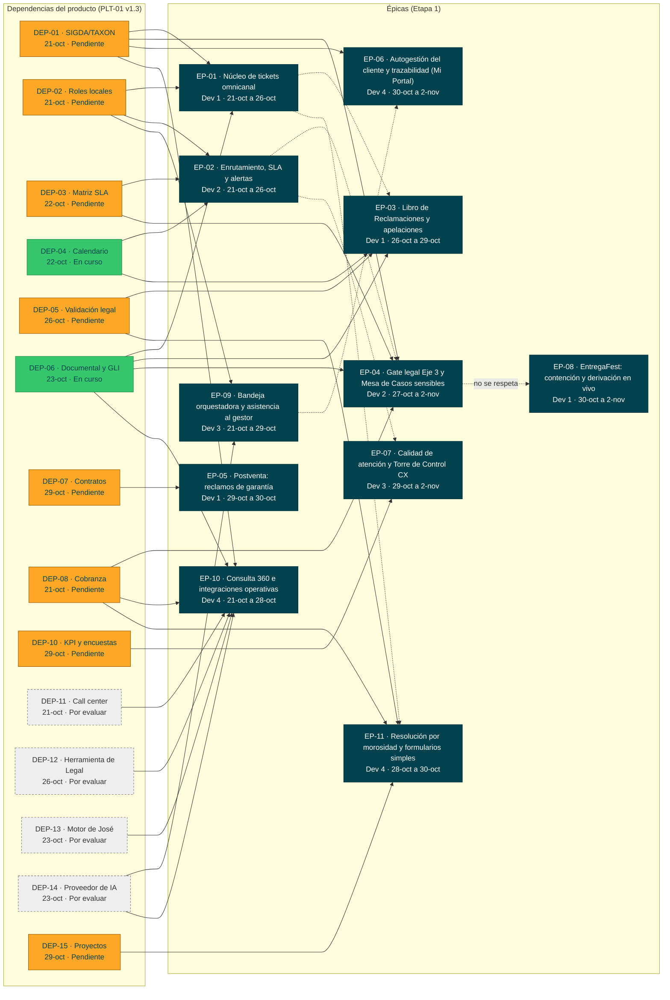

# PLT-01 - Roadmap de producto

Va en `docs/roadmap/`. Recoge las dependencias, los riesgos y los hitos del producto. Esta versión
usa el plan v1.3 del PO del 16-oct (PLT-01 a PLT-05) y el Excel `ATC_requerimientos (3).xlsx`, con la
división por etapas. Se actualizó el **mié 21-oct-2026, día 1 de desarrollo**. A esa fecha no hay
ningún documento del paquete aprobado en Nexora (`decisiones.md` P-024).

| Producto | Product Owner | Versión / Fecha |
|---|---|---|
| Aybar Atiende · plataforma ATC: tickets omnicanal, SLA, Libro de Reclamaciones, casos sensibles y autogestión del cliente | Eddie Huamaní | v0.2 · 2026-10-21 (plan del PO v1.3 · 16-oct-2026) |
| **Horizonte** | **Visión del producto** | **Estado** |
| Etapa 1: diseño del jue 08 al mar 20-oct, desarrollo del mié 21-oct al mar 03-nov-2026 (iteración 1: 21–27-oct; iteración 2: 28-oct–03-nov; el 03-nov es el día de UAT y Go/No-Go) | Toda solicitud del cliente se registra una sola vez, se atiende con un plazo trazable y se cierra con evidencia, sin exposición ante INDECOPI | Borrador · en desarrollo desde el 21-oct |

> Fuente de verdad: `docs/analisis/decisiones.md`. Si este roadmap la contradice, manda el registro y el roadmap se corrige.

## 1 Roadmap por trimestre

El horizonte es corto: toda la Etapa 1 cae en el T4 2026. Las columnas muestran la ventana de
desarrollo de cada épica (PLT-01 v1.3 §2b). Los desarrolladores son los del PLT-01 v1.3.

| Épica | Nombre | Prioridad (MoSCoW) | T1 2026 | T2 2026 | T3 2026 | T4 2026 | Horizonte |
|---|---|---|---|---|---|---|---|
| EP-ATC-01 | Núcleo de tickets omnicanal | Debe | | | | 21-oct a 26-oct · Dev 1 (Brayan) · 22 h | Ahora (sin G4 aprobado) |
| EP-ATC-02 | Enrutamiento, SLA y alertas | Debe | | | | 21-oct a 26-oct · Dev 2 (Jesús) · 28 h | Ahora (sin G4 aprobado) |
| EP-ATC-03 | Libro de Reclamaciones y apelaciones | Debe | | | | 26-oct a 29-oct · Dev 1 (Brayan) · 21 h | Ahora (sin G4 aprobado) |
| EP-ATC-04 | Gate legal Eje 3 y Mesa de Casos sensibles | Debe | | | | 27-oct a 2-nov · Dev 2 (Jesús) · 32 h | Ahora (sin G4 aprobado) |
| EP-ATC-05 | Postventa: reclamos de garantía | Debería | | | | 29-oct a 30-oct · Dev 1 (Brayan) · 12 h | Ahora (sin G4 aprobado) |
| EP-ATC-06 | Autogestión del cliente y trazabilidad (Mi Portal) | Debe | | | | 30-oct a 2-nov · Dev 4 (Daniel) · 9 h | Ahora (sin G4 aprobado) |
| EP-ATC-07 | Calidad de atención y Torre de Control CX | Debería | | | | 29-oct a 2-nov · Dev 3 (Michel) · 16 h | Ahora (sin G4 aprobado) |
| EP-ATC-08 | EntregaFest: contención y derivación en vivo | Podría | | | | 30-oct a 2-nov · Dev 1 (Brayan) · 6 h | Ahora (sin G4 aprobado) |
| EP-ATC-09 | Bandeja orquestadora y asistencia al gestor | Debe | | | | 21-oct a 29-oct · Dev 3 (Michel) · 44 h | Ahora (sin G4 aprobado) |
| EP-ATC-10 | Consulta 360 e integraciones operativas | Debe | | | | 21-oct a 28-oct · Dev 4 (Daniel) · 36 h | Ahora (sin G4 aprobado) |
| EP-ATC-11 | Resolución por morosidad y formularios simples | Debe | | | | 28-oct a 30-oct · Dev 4 (Daniel) · 17 h | Ahora (sin G4 aprobado) |

**Capacidad** (PLT-01 v1.3 §2c): el equipo tiene comprometidas 243 h de una capacidad de 252 h (96 %),
con 63 h por persona. Los días 1 a 9 tienen 7 h cada uno y el día 10 es de UAT y pase.

- Dev 1 (Brayan): EP-01 → EP-03 → EP-05 → EP-08, 61 h (97 %).
- Dev 2 (Jesús): EP-02 → EP-04, 60 h (95 %).
- Dev 3 (Michel): EP-09 → EP-07, 60 h (95 %).
- Dev 4 (Daniel): EP-10 → EP-11 → EP-06, 62 h (98 %).

La EP-ATC-08 pasa a Dev 1 para liberar a Dev 3, que construye las prioridades 1 y 3. Por iteración:
la 1 tiene 29 historias (132 h) y la 2 tiene 33 historias (111 h).

**Orden de prioridad 1-3** (se construyen primero en su desarrollador):

1. HU-ATC-043, el flujo por tipo, subtipo y área (Dev 3, 21–22-oct).
2. HU-ATC-050, la consulta 360 en el ticket (Dev 4, 21–22-oct).
3. HU-ATC-067, el visor del proceso 3D (Dev 3, 23–27-oct).

**Dependencias lógicas entre épicas** (A → B: A termina antes de que empiece B):

| De | A | Fuente | Fechas | ¿El calendario la respeta? |
|---|---|---|---|---|
| EP-ATC-01 | EP-ATC-03 | Gantt del PLT-01 v1.3 (p. 4) | EP-01 termina el lun 26-oct · EP-03 empieza el lun 26-oct | Sí, sin holgura (mismo día) |
| EP-ATC-01 | EP-ATC-11 | Gantt del PLT-01 v1.3 (p. 4) | lun 26-oct → mié 28-oct | Sí |
| EP-ATC-02 | EP-ATC-04 | Gantt del PLT-01 v1.3 (p. 4) | lun 26-oct → mar 27-oct | Sí |
| EP-ATC-02 | EP-ATC-07 | Gantt del PLT-01 v1.3 (p. 4) | lun 26-oct → jue 29-oct | Sí |
| EP-ATC-09 | EP-ATC-06 | Gantt del PLT-01 v1.3 (p. 4) | jue 29-oct → vie 30-oct | Sí |
| EP-ATC-04 | EP-ATC-08 | PLT-02 v1.3, EP-ATC-08 («EP-ATC-04 gate legal») | EP-04 termina el lun 02-nov · EP-08 empieza el vie 30-oct | **No** (A-03 de `analisis-dependencias.md`) |

Hitos:

| Hito | Fecha | Criterio de cumplimiento (observable) | Épicas |
|---|---|---|---|
| H-01 | 2026-10-16 | Etapas acordadas: alcance de la Etapa 1 y RN-SVC-043 en el Excel (PLT-01 §1, entregable del PO y el patrocinador) | todas |
| H-02 | 2026-10-19 | Cierre funcional: 62 historias con criterios Gherkin, orden de prioridad 1-3, alcance de la Etapa 1 y preguntas abiertas resueltas o parametrizadas. Evidencia: PLT-02, 03 y 04 v1.3 aprobados y prototipo v2.0 (PLT-01, criterios de salida) | todas |
| H-03 | 2026-10-20 | Comité DoR, cierre técnico y ADR: arquitectura de desarrollo, modelo de datos, RNF con umbral, contratos de interfaz con simulador, CI/CD y ambientes DEV/QA. También las 11 ADR registradas y cada funcionalidad «Lista» o «Lista con condiciones» con fecha (PLT-01 y PLT-05) | todas |
| H-04 | 2026-10-21 | Inicio de desarrollo con los requerimientos y las ADR cerrados (PLT-01 §2). La iteración 1 empieza por las prioridades 1-3 | todas |
| H-05 | 2026-10-27 | Demo de la iteración 1: se muestran las 29 historias de la iteración 1 (PLT-04). El criterio de aceptación de la demo está por definir con el PO | todas |
| H-06 | 2026-10-29 | Control de alcance: si hay atraso, sale primero el alcance flexible (HU-ATC-037, 038, 039, 048 y 053) sin afectar la v1.0 (PLT-01 R-01) | todas |
| H-07 | 2026-11-02 18:00 | Congelamiento de código (PLT-01, cadencia) | todas |
| H-08 | 2026-11-03 | UAT, demo final y Go/No-Go de la v1.0: día de UAT y pase, sin desarrollo nuevo, con capacitación (R-10) | todas |

Estado de los hitos al 21-oct:

- No consta en Nexora la aprobación de los PLT-02, 03 y 04 (H-02).
- Las ADR siguen pendientes (H-03, acuerdo 6 del PLT-05).
- Los 23 DoR dicen «con condiciones», un valor que el marco del SDK no admite (solo READY o NO READY).

Horizonte:

- **Ahora:** las 11 épicas, con desarrollo del 21-oct al 3-nov. **Ninguna tiene G4 cerrado**. El DoR
  del PLT-05 es «listo con condiciones» y G2 no existe en Nexora, aunque las 62 historias tienen
  pantalla.
- **Siguiente:** sin épicas en refinamiento fuera de la Etapa 1 en este plan.
- **Después:** los pendientes de producto, como los conectores automáticos de WhatsApp y correo
  (PLT-01 §2), sin épica.

## 2 Dependencias

Fuente: PLT-01 v1.3 §3, con 14 dependencias. La numeración salta la DEP-09, que no es de la Etapa 1.
«Fecha requerida» es el inicio de la primera historia que bloquea la dependencia. El contrato de
interfaz y el simulador de cada una se cierran en la etapa de diseño (20-oct).

**A la fecha de esta versión, ninguna tiene una fecha comprometida por su responsable.** En el SDK el
estado es Pendiente, Comprometida o Resuelta, y todas están en Pendiente. El PLT-01 las marca En curso,
Pendiente o Por evaluar, y ese estado se conserva entre paréntesis.

| ID | Dependencia | Tipo | Bloquea a | Responsable | Fecha requerida | Estado |
|---|---|---|---|---|---|---|
| DEP-01 | API de SIGDA/TAXON: consulta de cliente y KYC (única fuente del dato) | Interna | EP-01, EP-04, EP-06, EP-10 | CDO / Equipo Datos | 2026-10-21 | Pendiente (PLT-01: Pendiente) |
| DEP-02 | Maestro local de usuarios, roles, áreas y líderes de ATC (carga inicial de RR. HH.) | Interna | EP-01, EP-02, EP-09 | Gerencia ATC · RR. HH. | 2026-10-21 | Pendiente (PLT-01: Pendiente) |
| DEP-03 | Decisión de negocio: matriz SLA por tipo y prioridad y plazos de línea de la Mesa SGD (RNF-REN-003) | Interna | EP-02, EP-04 | Gerencia ATC · Mesa SGD | 2026-10-22 | Pendiente (PLT-01: Pendiente) |
| DEP-04 | Calendario MAE_TIME + MAE_HOLIDAY por geografía | Técnica | EP-02, EP-03 | Equipo Datos | 2026-10-22 | Pendiente (PLT-01: En curso) |
| DEP-05 | Validación legal: formato del asiento, textos y plazos del Libro | Legal | EP-03, EP-11 | Gerencia Legal | 2026-10-26 | Pendiente (PLT-01: Pendiente) |
| DEP-06 | Repositorio documental S3 + GOV_DOCUMENT_REPOSITORY y GLI | Técnica | EP-01, EP-03, EP-04, EP-10 | Arquitectura / Legal | 2026-10-23 | Pendiente (PLT-01: En curso) |
| DEP-07 | Contratos y Activos: API de contrato, unidad, Acta de Entrega y cobertura | Interna | EP-05 | Equipo Contratos | 2026-10-29 | Pendiente (PLT-01: Pendiente) |
| DEP-08 | Cobranza: estado de cuenta, historial de pagos y cuotas vencidas por contrato (desfase ≤ 24 h) | Interna | EP-04, EP-10, EP-11 | Cobranza | 2026-10-21 | Pendiente (PLT-01: Pendiente) |
| DEP-10 | KPI Engine + SVY_SURVEY_RESPONSE (encuestas) | Interna | EP-07 | Equipo Datos / BI | 2026-10-29 | Pendiente (PLT-01: Pendiente) |
| DEP-11 | Plataforma del call center: API/CTI para screen pop, registro de llamadas, grabación y click-to-call | Externa | EP-10 | TI / proveedor de call center | 2026-10-21 | Pendiente (PLT-01: Por evaluar) |
| DEP-12 | Herramienta de Legal (responsable: Rosario): API o intercambio para sincronizar casos de Eje 3 | Interna | EP-10 | Gerencia Legal · TI | 2026-10-26 | Pendiente (PLT-01: Por evaluar) |
| DEP-13 | Motor de consultas de José: contrato de API y responsable de mantenimiento | Interna | EP-10 | José · TI | 2026-10-23 | Pendiente (PLT-01: Por evaluar) |
| DEP-14 | Proveedor de IA aprobado por TI y Seguridad, con política de datos personales | Técnica | EP-09, EP-10 | TI · Seguridad | 2026-10-23 | Pendiente (PLT-01: Por evaluar) |
| DEP-15 | Maestro de responsables de proyecto y supervisores (fuente única) | Interna | EP-11 | Gerencia Comercial · Datos | 2026-10-29 | Pendiente (PLT-01: Pendiente) |

Una dependencia sin fecha comprometida deja en NO READY (G4) lo que bloquea. Hoy, 21-oct, ya se
necesitan DEP-01, DEP-02, DEP-08 y DEP-11. El análisis completo (matriz, olas, ruta crítica y
hallazgos) está en `analisis-dependencias.md`. El diagrama está en `dependencias.mmd`: las flechas
continuas van de dependencia a épica y las punteadas son las dependencias lógicas entre épicas.

## 3 Riesgos

Fuente: PLT-01 v1.3 §4, con los 10 riesgos más relevantes de la Etapa 1.

| ID | Riesgo | Prob. | Impacto | Nivel | Mitigación / contingencia | Dueño |
|---|---|---|---|---|---|---|
| R-01 | Plan con poca holgura: 243 h comprometidas de 252 h de capacidad (96 %); Dev 4 al 98 % | Alta | Alto | ALTO | Alcance «flexible» (RF-048, 053, 037-039) definido de antemano; control de alcance el jue 29-oct; las prioridades 1-3 (HU-043, 050, 067) se construyen primero | PO |
| R-02 | APIs externas no disponibles en el plazo (SIGDA/TAXON, call center, Legal, Cobranza, motor de José) | Alta | Alto | ALTO | Contratos de interfaz y simuladores cerrados en la etapa de diseño (20-oct); pase a producción de cada integración condicionado a su API real | Líder técnico |
| R-03 | Matriz SLA y plazos de línea de la Mesa SGD sin definir al iniciar el motor SLA (jue 22-oct) | Alta | Alto | ALTO | Matriz provisional parametrizable firmada por Gerencia ATC al cierre de diseño (20-oct) | Gerencia ATC |
| R-04 | Calidad del código generado con IA (errores sutiles, seguridad, deuda técnica) | Media | Alto | ALTO | Revisión de pares obligatoria, pruebas automatizadas generadas y revisadas por el desarrollador, análisis SAST y guía de prompts del equipo | Líder técnico |
| R-05 | Sin QA dedicado y UAT concentrada en un día (mar 03-nov) | Media | Alto | ALTO | Aceptación diaria del PO a las 17:00, pruebas E2E automatizadas desde el día 3 y usuarios clave citados para la UAT | PO · Jefe Operaciones UX |
| R-06 | Ítems con alcance ambiguo (8 % de interés, rayo, «llamar la cuenta», cancelación del servicio, buses, acceso del cliente a Mi Portal) | Alta | Medio | ALTO | Cerrarlos en el cierre funcional del 19-oct; lo no resuelto se construye parametrizable | PO |
| R-07 | Datos personales expuestos en bitácoras, búsqueda, Mi Portal o prompts de IA (Ley 29733) | Media | Alto | ALTO | DLP (RNF-SEC-008), anonimización antes de la IA (RNF-SEC-009), permisos del origen (RNF-SEC-010) y visibilidad del cliente (RN-SVC-044) | Seguridad TI |
| R-08 | Textos legales (Libro, alerta de cancelación, carta al proyecto) sin validar al pase | Media | Alto | ALTO | Plantillas configurables; validación de Legal antes del lun 26-oct (Libro) y del mié 28-oct (morosidad) | Gerencia Legal |
| R-09 | Ausencia de un desarrollador (bus factor de 1 por épica) | Baja | Alto | MEDIO | Documentación viva generada con IA, revisión cruzada diaria y repositorio común; replanificar con el alcance flexible | Líder técnico |
| R-10 | Adopción: el equipo sigue en Excel/WhatsApp y el cliente no usa Mi Portal | Media | Medio | MEDIO | Capacitación el mar 03-nov, término «Gestor de tickets» en toda la interfaz (RNF-USA-003), aviso con enlace a Mi Portal en cada ticket y retiro de herramientas paralelas | Jefe Operaciones UX |

Matriz de probabilidad por impacto:

| Prob. \ Impacto | Bajo | Medio | Alto |
|---|---|---|---|
| **Alta** |  | R-06 | R-01, R-02, R-03 |
| **Media** |  | R-10 | R-04, R-05, R-07, R-08 |
| **Baja** |  |  | R-09 |

Según el PLT-01, los más urgentes son R-01 (plan con poca holgura), R-02 (APIs externas) y R-03
(matriz SLA, que se necesitaba al cierre de diseño del 20-oct). Los de nivel ALTO (8 de 10) se revisan
en la daily.

Supuestos (PLT-01 v1.3; los confirma el PO, autor del plan):
- S-01: la etapa de diseño del 08 al 20-oct cierra los requerimientos funcionales, los técnicos y las ADR.
- S-02: los 4 desarrolladores están dedicados al 100 % del 21-oct al 03-nov, con asistentes de IA.
- S-03: el PO acepta historias a diario, a las 17:00.
- S-04: las integraciones externas se construyen contra simuladores.
- S-05: PostgreSQL Multi-AZ y S3 existen en la arquitectura vigente. Lo verifica el líder técnico; ver `decisiones.md` D-001 y D-003.

Restricciones:
- RES-01: la Etapa 1 tiene un plazo fijo de 10 días hábiles de desarrollo, del 21-oct al 03-nov-2026 (fuente: PLT-01).
- RES-02: no hay QA dedicado (fuente: PLT-01).
- RES-03: rigen la Ley 29571, art. 24, y la Ley 29733 (fuente: PLT-01).
- RES-04: la IA solo sugiere (RN-SVC-032) (fuente: PLT-01).

## 4 Control de versiones y aprobación

| Versión | Fecha | Autor | Cambio | Aprobado por |
|---|---|---|---|---|
| v0.1 | 2026-10-19 | Jesús (Dev 2), con IA (Claude) | Versión inicial con el plan v1.3 (v1 y v2 en Nexora) | |
| v0.2 | 2026-10-21 | Brayan (Dev 1), con IA (Claude) | Añade la dependencia lógica EP-09 → EP-06 del Gantt del PLT-01 (p. 4) y la tabla de dependencias entre épicas. Pone el PO (Eddie Huamaní), los nombres de los desarrolladores, la capacidad por persona, las iteraciones y los hitos del 16 y el 19-oct con su criterio. Quita los textos caducos: el «Excel no entregado», «en refinamiento hasta el 20-oct» y las fechas «hoy, 19-oct». Deja el roadmap solo con la Etapa 1 | |

Aprueba: PO. Solo `estado: approved` en `origin/main` (o la aprobación en Nexora) es evidencia.

Generado por IA: borrador completo. Versión base de Nexora (v2, de Jesús, 19-oct), actualizada a la v1.3 del PO (Etapa 1) por Brayan con IA (Claude, 21-oct-2026). Texto adaptado al alcance de la Etapa 1 (se omiten las frases de los documentos del PO que remiten a fases posteriores). — Revisado por: (pendiente)
