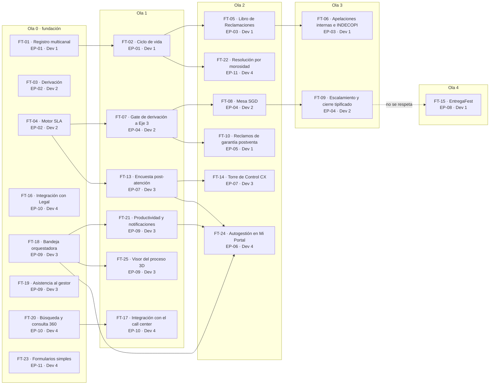

# Análisis de dependencias

Hecho el mié 21-oct-2026, día 1 de desarrollo, con el plan v1.3 del PO del 16-oct (PLT-01 a
PLT-05). El 22-oct se cambió la DEP-02 (maestro local de RR. HH.) por la DEP-16 (Control de acceso, PJ-05), según el Líder Técnico (DT-03). El 26-oct se alinearon las dependencias del producto con el bloque «Depende de» de cada HU (PLT-02, PLT-03, PLT-04, PLT-05 y DT-03) y la DEP-16 tomó el nombre y el estado que pide el Líder Técnico (C-12). **Corte de esta versión: lun 26-oct-2026, día 4 de desarrollo.** Las dependencias entre historias y entre features se recalcularon con las 54 del bloque «Depende de» (antes 50), y el backlog de tareas se alineó con ellas: `aybar paquete plan` da las mismas olas que la sección 4. Sigue los cuatro niveles del SDK Aybar:

- dependencias del producto (roadmap, sección 2);
- dependencias por requerimiento (trazabilidad de cada feature);
- dependencias por feature (DoR);
- dependencias entre tareas (`depende_de`, que ordena `aybar paquete plan`).

Los diagramas están en `dependencias.mmd` y `olas-features.mmd`.

## 1 Resumen

- **14 dependencias** del producto: las 13 del PLT-01 v1.3 §3 (se retiró la DEP-02) y la DEP-16, que pide el Líder Técnico (C-12). 9 internas, 3 técnicas, 1 legal y 1 externa. En
  el PLT-01 había 8 pendientes, 2 en curso y 4 por evaluar; la DEP-16 es pendiente y está **en riesgo**: Control de acceso no tiene fecha en DEV (P-040).
- **Ninguna tiene fecha comprometida por su responsable.** Solo tienen fecha requerida, y es el dato
  que más pesa en G4 (criterio 6).
- **9 de 14** se necesitaban en las tres primeras jornadas de desarrollo (21 al 23-oct): DEP-01, DEP-16 (antes DEP-02),
  DEP-03, DEP-04, DEP-06, DEP-08, DEP-11, DEP-13 y DEP-14. **Al corte (26-oct) esas 9 ya pasaron su fecha requerida y hoy vencen otras 2**, DEP-05 y DEP-12; solo DEP-07, DEP-10 y DEP-15 (29-oct) siguen en plazo. El PLT-01 marca en rojo 7 de ellas, las que siguen pendientes: DEP-01, 02,
  03, 08, 11, 13 y 14 (la DEP-02 se retiró; la DEP-16 ocupa su lugar).
- **53 de 62 historias** dependen de al menos una dependencia del producto, según la trazabilidad del
  PLT-03. Las 9 que no dependen de ninguna son HU-020, HU-021, HU-022, HU-037, HU-038, HU-039, HU-059,
  HU-060 y HU-067. **Con el bloque «Depende de» de cada HU (26-oct) son 57:** HU-020 a 022 suman la DEP-03
  (PLT-05) y HU-067 la DEP-16; solo HU-037, 038, 039, 059 y 060 no tienen ninguna.
- **54 dependencias entre historias** (bloque «Depende de» de cada HU), sin ciclos, en 11 niveles de orden. De dónde salen:
  - 35 son predecesoras de RF dentro de la misma feature (PLT-03 §2).
  - 8 son predecesoras entre features (PLT-02, tabla «Funcionalidades que componen la épica»).
  - 5 son flechas del Gantt del PLT-01 (p. 4).
  - 2 vienen de la PLT-02: EP-04 → EP-08 (HU-025 → HU-037) y la HU-043 que declara la EP-06 (HU-043 → HU-064).
  - 4 las escribe el PO en notas o criterios: HU-026 → HU-036 (notas de HU-036: «reutiliza el gate de FT-ATC-07», PLT-04), HU-019 → HU-066 (CA-02 de HU-066, PLT-04), y HU-043 → HU-067 y HU-044 → HU-067 (traza de FT-25 en el PLT-03, «eventos de la bandeja orquestadora (HU-043, 044)»; ficha de HU-043 en el PLT-04 y anexo del PLT-05).
  - Por nivel: el 0 tiene 14, el 1 tiene 13, el 2 tiene 9, el 3 tiene 9, el 4 tiene 4, el 5 tiene 6, el 6 tiene 2 y el 7 tiene 2. Los niveles 8, 9 y 10 tienen 1 cada uno.
- **17 dependencias entre features** (sección 4), en 5 olas y sin ciclos. Las dos que suma esta versión son FT-07 → FT-10 (HU-026 → HU-036) y FT-13 → FT-24 (HU-019 → HU-066); la carga de Nexora ya las tenía. `aybar paquete plan` da las mismas 5 olas (sección 4.3).
- **Ruta crítica por horas** (la cadena más larga de historias, recalculada con las 54): HU-003 → HU-029 → HU-026 → HU-028 →
  HU-020 → HU-022 → HU-023 → HU-025 → HU-037 → HU-038 → HU-039 (36 h). Pasa por EP-04 → EP-08, la
  dependencia que el calendario no respeta (A-03). Sin ella, la ruta crítica es HU-001 → HU-002 →
  HU-004 → HU-006 → HU-012 → HU-013 → HU-015 → HU-016 (34 h). Las 4 dependencias nuevas no la cambian.

## 2 Matriz dependencia × épica

● = la dependencia bloquea a la épica (PLT-01; para la DEP-16, las historias que la tienen). ○ = la suman las historias el 26-oct y el PLT-01 no la pone (lo confirma el PO). Las columnas son las 11 épicas del plan.

| Dependencia | EP-01 | EP-02 | EP-03 | EP-04 | EP-05 | EP-06 | EP-07 | EP-08 | EP-09 | EP-10 | EP-11 | Fecha requerida |
|---|:-:|:-:|:-:|:-:|:-:|:-:|:-:|:-:|:-:|:-:|:-:|---|
| DEP-01 SIGDA/TAXON | ● |  |  | ● |  | ● | ○ |  |  | ● |  | 21-oct |
| DEP-16 Control de acceso | ● | ● |  | ● |  | ● |  |  | ● | ● | ● | 21-oct |
| DEP-03 Matriz SLA |  | ● |  | ● |  |  |  |  |  |  |  | 22-oct |
| DEP-04 Calendario |  | ● | ● |  |  |  |  |  |  |  |  | 22-oct |
| DEP-05 Validación legal |  |  | ● |  |  |  |  |  |  | ○ | ● | 26-oct |
| DEP-06 Documental y GLI | ● |  | ● | ● |  |  |  |  |  | ● |  | 23-oct |
| DEP-07 Contratos |  |  |  |  | ● |  |  |  |  |  |  | 29-oct |
| DEP-08 Cobranza |  |  |  | ● |  |  |  |  |  | ● | ● | 21-oct |
| DEP-10 KPI y encuestas |  |  |  |  |  |  | ● |  |  |  |  | 29-oct |
| DEP-11 Call center |  |  |  |  |  |  |  |  |  | ● |  | 21-oct |
| DEP-12 Herramienta de Legal |  |  |  |  |  |  |  |  |  | ● |  | 26-oct |
| DEP-13 Motor de José |  |  |  |  |  |  |  |  |  | ● |  | 23-oct |
| DEP-14 Proveedor de IA |  |  |  |  |  |  |  |  | ● | ● |  | 23-oct |
| DEP-15 Proyectos |  |  |  |  |  |  |  |  |  |  | ● | 29-oct |

La DEP-16 toma sus épicas de las 24 historias que la tienen: las 12 que heredan la DEP-02 de la traza del PLT-03 (EP-01, EP-02 y EP-09) y 12 que autentican, autorizan por rol o leen líderes o al cliente autenticado (HU-001, 026, 027, 049, 050, 052, 053, 058, 064 a 066 y 067), que suman EP-04, EP-06, EP-10 y EP-11. La HU-049 se sumó el 26-oct con el mismo criterio que sus hermanas 050, 052 y 053: su regla RN-SVC-036 («Búsqueda respeta permisos») autoriza por rol (P-034). La HU-023 no la lleva: su cadena de escalamiento (jefatura de la Mesa SGD, Comité y Directorio) es la matriz de escalamiento de la Mesa, no un dato de Control de acceso (P-036). Tampoco la HU-051: lo que le falta es quién crea la `PARTY` del interesado, un dato que no viene del emisor ni de los roles (P-037). En DEV, sin el emisor no responde ningún endpoint protegido de ninguna épica; en local se trabaja con el emisor de pruebas (`roadmap/RMP-001-roadmap-aybar-atiende.md` §2), así que no bloquea la construcción de las demás. El PLT-01 pone la DEP-06 en EP-01, pero ninguna HU de EP-01 la nombra: lo decide el PO.

Las dependencias lógicas entre épicas (el Gantt del PLT-01 y la PLT-02) están en la sección 1 del
roadmap: EP-01 → EP-03, EP-01 → EP-11, EP-02 → EP-04, EP-02 → EP-07, EP-09 → EP-06 y EP-04 → EP-08. Son las 6 que lleva el `depende_de` de las épicas en la carga de Nexora. Las dos que llegan por una sola historia (HU-026 → HU-036 y HU-019 → HU-066) quedan en la historia y en su feature (FT-07 → FT-10 y FT-13 → FT-24) y no suben a la épica: a nivel de épica irían contra el calendario (EP-04 termina el 2-nov y EP-05 empieza el 29-oct; EP-07 termina el 2-nov y EP-06 empieza el 30-oct).

## 3 Dependencias por fecha requerida

| Fecha requerida | Días hábiles al corte (lun 26-oct) | Dependencia | Tipo | Responsable | Estado PLT-01 | Historias que bloquea | Con las HU (26-oct) |
|---|---|---|---|---|---|---|---|
| 21-oct | vencida hace 3 | DEP-01 SIGDA/TAXON | Interna | CDO / Equipo Datos | Pendiente | 13 | 14 |
| 21-oct | vencida hace 3 | DEP-16 Control de acceso | Interna | Área de Roles y Permisos (Sony Montoya) | Pendiente (nueva) · en riesgo | 12 | 24 |
| 21-oct | vencida hace 3 | DEP-08 Cobranza | Interna | Cobranza | Pendiente | 6 | 7 |
| 21-oct | vencida hace 3 | DEP-11 Call center | Externa | TI / proveedor de call center | Por evaluar | 1 | 2 |
| 22-oct | vencida hace 2 | DEP-03 Matriz SLA | Interna | Gerencia ATC · Mesa SGD | Pendiente | 4 | 7 |
| 22-oct | vencida hace 2 | DEP-04 Calendario | Técnica | Equipo Datos | En curso | 4 | 5 |
| 23-oct | vencida hace 1 | DEP-06 Documental y GLI | Técnica | Arquitectura / Legal | En curso | 8 | 9 |
| 23-oct | vencida hace 1 | DEP-13 Motor de José | Interna | José · TI | Por evaluar | 5 | 5 |
| 23-oct | vencida hace 1 | DEP-14 Proveedor de IA | Técnica | TI · Seguridad | Por evaluar | 2 | 3 |
| 26-oct | 0 (hoy) | DEP-05 Validación legal | Legal | Gerencia Legal | Pendiente | 4 | 9 |
| 26-oct | 0 (hoy) | DEP-12 Herramienta de Legal | Interna | Gerencia Legal · TI | Por evaluar | 2 | 2 |
| 29-oct | 3 | DEP-07 Contratos | Interna | Equipo Contratos | Pendiente | 4 | 4 |
| 29-oct | 3 | DEP-10 KPI y encuestas | Interna | Equipo Datos / BI | Pendiente | 4 | 4 |
| 29-oct | 3 | DEP-15 Proyectos | Interna | Gerencia Comercial · Datos | Pendiente | 3 | 3 |

«Historias que bloquea» sale de la trazabilidad RF → HU → DEP de cada funcionalidad del PLT-03 v1.3. La DEP-16 hereda las 12 de la DEP-02. «Con las HU (26-oct)» suma además las notas de cada ficha del PLT-04, el PLT-05 (anexo A, §1 y acuerdo 7) y DT-03, tal como quedan en el bloque «Depende de» de cada historia.
Las que siguen **Por evaluar** (DEP-11, DEP-12, DEP-13 y DEP-14) no tienen ni siquiera una respuesta
de su responsable sobre si pueden entregar. El PLT-01 fija la regla: sin contrato de interfaz y
simulador a la fecha indicada, la historia que bloquean no puede marcarse Lista y se cambia por otra
del mismo desarrollador.

## 4 Olas de features

Una feature depende de otra cuando una de sus historias depende de una historia de la otra. Las
dependencias entre historias son las 54 del bloque «Depende de» de cada HU (sección 1), que salen de
cinco fuentes:

- las predecesoras de cada RF dentro de su feature (PLT-03 §2);
- las predecesoras de cada feature (PLT-02, tabla «Funcionalidades que componen la épica»);
- las dependencias lógicas entre épicas (Gantt del PLT-01, p. 4, y PLT-02);
- las dos de la PLT-02 sobre historias (EP-04 → EP-08 y HU-043 → EP-06);
- las que el PO escribe en las notas y los criterios (PLT-03 y PLT-04).

Una dependencia entre features o entre épicas se lleva a las historias así: la última historia de la
predecesora, por fecha, va antes de la primera de la sucesora. Es el mismo criterio de la carga de
Nexora (`nexora-items/`), que tiene las mismas 54 dependencias entre historias y las mismas 17 entre
features.

La ola 0 son las features sin predecesoras (la «fundación» del plan del SDK). La fuente de cada
vínculo está en la tabla de la sección 4.2.

### 4.1 Olas

| Ola | Feature | Nombre | Épica | Dev | Depende de | Dependencias del producto | Primera fecha requerida | Ventana |
|---|---|---|---|---|---|---|---|---|
| 0 | FT-01 | Registro multicanal y tipificación | EP-01 | Dev 1 | — | DEP-01, DEP-16 | 21-oct | 21-oct a 22-oct |
| 0 | FT-03 | Derivación, reasignación y casillero | EP-02 | Dev 2 | — | DEP-16 | 21-oct | 21-oct a 22-oct |
| 0 | FT-04 | Motor SLA y alertas | EP-02 | Dev 2 | — | DEP-03, DEP-04 | 22-oct | 22-oct a 26-oct |
| 0 | FT-16 | Integración con Legal y prevención de denuncias | EP-10 | Dev 4 | — | DEP-05, DEP-12 | 26-oct | 26-oct a 28-oct |
| 0 | FT-18 | Bandeja orquestadora y flujos por área | EP-09 | Dev 3 | — | DEP-16 | 21-oct | 21-oct a 23-oct |
| 0 | FT-19 | Asistencia al gestor: guía e IA | EP-09 | Dev 3 | — | DEP-14 | 23-oct | 27-oct a 28-oct |
| 0 | FT-20 | Búsqueda y consulta 360 del cliente | EP-10 | Dev 4 | — | DEP-01, DEP-06, DEP-08, DEP-11, DEP-13, DEP-14, DEP-16 | 21-oct | 21-oct a 26-oct |
| 0 | FT-23 | Formularios simples: ingreso al proyecto y Entrega Fest | EP-11 | Dev 4 | — | — | — | 29-oct a 30-oct |
| 1 | FT-02 | Ciclo de vida, interacciones e hitos | EP-01 | Dev 1 | FT-01 | DEP-16 | 21-oct | 22-oct a 26-oct |
| 1 | FT-07 | Gate de derivación a Eje 3 y handoff | EP-04 | Dev 2 | FT-04 | DEP-01, DEP-08, DEP-16 | 21-oct | 27-oct a 28-oct |
| 1 | FT-13 | Encuesta post-atención | EP-07 | Dev 3 | FT-04 | DEP-10 | 29-oct | 29-oct a 29-oct |
| 1 | FT-17 | Integración con la plataforma del call center | EP-10 | Dev 4 | FT-20 | DEP-11 | 21-oct | 26-oct a 26-oct |
| 1 | FT-21 | Productividad y notificaciones del gestor | EP-09 | Dev 3 | FT-18 | DEP-16 | 21-oct | 28-oct a 29-oct |
| 1 | FT-25 | Visor del proceso 3D (operación en vivo) | EP-09 | Dev 3 | FT-18 | DEP-16 | 21-oct | 23-oct a 27-oct |
| 2 | FT-05 | Libro de Reclamaciones | EP-03 | Dev 1 | FT-02 | DEP-04, DEP-05, DEP-06 | 22-oct | 26-oct a 28-oct |
| 2 | FT-08 | Mesa SGD: recepción, activación y riesgo | EP-04 | Dev 2 | FT-07 | DEP-03 | 22-oct | 28-oct a 29-oct |
| 2 | FT-10 | Reclamos de garantía postventa | EP-05 | Dev 1 | FT-07 | DEP-07 | 29-oct | 29-oct a 30-oct |
| 2 | FT-14 | Torre de Control CX | EP-07 | Dev 3 | FT-13 | DEP-01, DEP-10 | 21-oct | 29-oct a 2-nov |
| 2 | FT-22 | Resolución de contrato por morosidad | EP-11 | Dev 4 | FT-02 | DEP-05, DEP-08, DEP-15, DEP-16 | 21-oct | 28-oct a 29-oct |
| 2 | FT-24 | Autogestión de tickets del cliente en Mi Portal | EP-06 | Dev 4 | FT-13, FT-18, FT-21 | DEP-01, DEP-16 | 21-oct | 30-oct a 2-nov |
| 3 | FT-06 | Apelaciones internas e INDECOPI | EP-03 | Dev 1 | FT-05 | DEP-05, DEP-06 | 23-oct | 28-oct a 29-oct |
| 3 | FT-09 | Escalamiento, vinculación y cierre tipificado | EP-04 | Dev 2 | FT-08 | DEP-06 | 23-oct | 29-oct a 2-nov |
| 4 | FT-15 | EntregaFest: contención en vivo | EP-08 | Dev 1 | FT-09 | — | — | 30-oct a 2-nov |

«Dependencias del producto» es la unión de las DEP del bloque «Depende de» de sus historias; «Primera fecha requerida», la más temprana de esas DEP. Cuadra con la sección 2 de cada DoR.

### 4.2 Vínculos entre features y de dónde salen

| De | A | Fuente | Historias |
|---|---|---|---|
| FT-01 | FT-02 | Predecesora de la feature (PLT-02) | HU-002 → HU-004 |
| FT-02 | FT-05 | Gantt del PLT-01: EP-01 → EP-03 | HU-006 → HU-012 |
| FT-05 | FT-06 | Predecesora de la feature (PLT-02) | HU-015 → HU-016 |
| FT-04 | FT-07 | Gantt del PLT-01: EP-02 → EP-04 | HU-029 → HU-026 |
| FT-07 | FT-08 | Predecesora de la feature (PLT-02) | HU-028 → HU-020 |
| FT-07 | FT-10 | PLT-04, notas de HU-036: «Reutiliza el gate de FT-ATC-07» (el gate es el CA-02 de HU-026). El calendario la respeta: FT-07 termina el 28-oct y FT-10 empieza el 29-oct | HU-026 → HU-036 |
| FT-08 | FT-09 | Predecesora de la feature (PLT-02) | HU-022 → HU-023 |
| FT-04 | FT-13 | Gantt del PLT-01: EP-02 → EP-07 | HU-029 → HU-019 |
| FT-13 | FT-14 | Predecesora de la feature (PLT-02) | HU-019 → HU-030 |
| FT-13 | FT-24 | PLT-04, CA-02 de HU-066: «se dispara la encuesta (HU-019)». El calendario la respeta: FT-13 es el 29-oct y FT-24 empieza el 30-oct | HU-019 → HU-066 |
| FT-09 | FT-15 | PLT-02, EP-08: «EP-ATC-04 (gate legal)». **No se respeta** (A-03) | HU-025 → HU-037 |
| FT-20 | FT-17 | Predecesora de la feature (PLT-02) | HU-053 → HU-042 |
| FT-18 | FT-21 | Predecesora de la feature (PLT-02) | HU-046 → HU-054 |
| FT-02 | FT-22 | Gantt del PLT-01: EP-01 → EP-11 | HU-006 → HU-056 |
| FT-18 | FT-25 | Predecesora de la feature (PLT-02); además, la traza de FT-25 del PLT-03 («eventos de la bandeja orquestadora (HU-043, 044)») y la ficha de HU-043 del PLT-04 | HU-046 → HU-067, HU-043 → HU-067, HU-044 → HU-067 |
| FT-21 | FT-24 | Gantt del PLT-01: **EP-09 → EP-06** (jue 29 → vie 30-oct) | HU-055 → HU-064 |
| FT-18 | FT-24 | PLT-02, EP-06: «HU-043 flujos por tipo y subtipo» | HU-043 → HU-064 |

### 4.3 Backlog de tareas y `aybar paquete plan`

`aybar paquete plan` arma las olas con el `depende_de` de las tareas (`backlog/tareas/*.json`): una
historia depende de otra si una de sus tareas depende de una tarea de la otra, y una feature, si una
de sus historias depende de una historia de otra feature. Para que dé las olas del PO:

- **Las 54 dependencias del PO están en las tareas.** 43 ya estaban, entre distintas tareas de las dos historias. El 26-oct se añadieron las 11 que faltaban, haciendo que la primera tarea de la historia sucesora dependa de la última de su predecesora: HU-002 → 004, 006 → 012, 006 → 056, 015 → 016, 025 → 037, 028 → 020, 029 → 019, 029 → 026, 046 → 054, 053 → 042 y 055 → 064.
- **Las dependencias técnicas son adicionales a las del PO** (por ejemplo, «usa la entidad Ticket de HU-001»). El backlog tiene 38 entre historias que el bloque «Depende de» no declara. Las que van entre features distintas solo se dejan si la feature predecesora está en una ola anterior: así no cambian las olas del PO.
- **17 dependencias técnicas entre tareas cambiaban las olas del PO** (la tarea predecesora es de una feature de la misma ola o de una posterior) y ya no van en `depende_de`. Ninguna se pierde: la tarea lo dice en su título. **El orden lo sostiene el calendario del PO**, que en las 17 termina la historia predecesora antes de que empiece la sucesora o el mismo día (en 2, sin holgura). Solo 4 tienen además la fundación del SDK, porque usan una tarea de dominio de la ola 0 (`plan` la pone en la fundación). `plan` no las ve: si una predecesora se atrasa, la sucesora espera (A-13).

| Tarea (feature, ola) | Usa | De (feature, ola) | Qué sostiene el orden |
|---|---|---|---|
| HU-ATC-003-T01 (FT-04, 0), HU-ATC-007-T01 (FT-03, 0), HU-ATC-059-T01 (FT-23, 0) | Entidad Ticket y `TicketRepository` | HU-ATC-001-T01 (FT-01, 0) | Fundación del SDK (tarea de dominio de la ola 0, se mergea antes de abrir las olas) y calendario: HU-001 termina el 21-oct; HU-007 empieza ese mismo día |
| HU-ATC-046-T01 (FT-18, 0) | Entidad `SVC_TICKET_ASSIGNMENT_LOG` | HU-ATC-007-T01 (FT-03, 0) | Fundación y calendario: HU-007 termina el 21-oct |
| HU-ATC-045-T01 (FT-18, 0) | Migración V2 de `SVC_TICKET` | HU-ATC-001-T02 (FT-01, 0) | Calendario: HU-001 termina el 21-oct |
| HU-ATC-003-T03 (FT-04, 0), HU-ATC-049-T01 (FT-20, 0), HU-ATC-051-T01 (FT-20, 0), HU-ATC-059-T03 (FT-23, 0) | `RegistrarTicketUseCase` | HU-ATC-001-T03 (FT-01, 0) | Calendario: HU-001 termina el 21-oct; HU-049 empieza ese mismo día, sin holgura |
| HU-ATC-011-T02 y HU-ATC-029-T01 (FT-04, 0), HU-ATC-019-T02 (FT-13, 1), HU-ATC-026-T02 (FT-07, 1) | `CambiarEstadoTicketUseCase` | HU-ATC-004-T03 (FT-02, 1) | Calendario: HU-004 termina el 22-oct. **En FT-04 el orden de las olas va al revés** |
| HU-ATC-042-T02 (FT-17, 1) | Entidad `SVC_TICKET_INTERACTION` | HU-ATC-005-T01 (FT-02, 1) | Calendario: HU-005 termina el 23-oct |
| HU-ATC-046-T02 (FT-18, 0) | Puerto `GestoresPort` | HU-ATC-008-T01 (FT-03, 0) | Calendario: HU-008 termina el 22-oct |
| HU-ATC-041-T01 (FT-16, 0) | Entidad `SVC_COMPLAINT_BOOK_ENTRY` | HU-ATC-012-T01 (FT-05, 2) | Calendario: HU-012 termina el 26-oct. **El orden de las olas va al revés** |
| HU-ATC-065-T03 (FT-24, 2) | Adaptador de notificaciones multicanal | HU-ATC-057-T01 (FT-22, 2) | Calendario: HU-057 termina el 29-oct (mismo desarrollador) |

Resultado al 26-oct: `aybar paquete validar` da 0 errores y 0 advertencias (321 tareas, 243 h, las
mismas horas por historia que el PLT-04) y `aybar paquete plan` da **5 olas, sin ciclos** de tareas,
historias ni features, con las mismas features por ola que la tabla 4.1. Además de las del PO, `plan`
muestra estas dependencias técnicas entre features, que no cambian la ola:

| Feature (ola) | Depende de (PO) | Además, en `plan` (técnicas del backlog) |
|---|---|---|
| FT-07 (1) | FT-04 | FT-01, FT-03 |
| FT-13 (1) | FT-04 | FT-01 |
| FT-21 (1) | FT-18 | FT-03 |
| FT-05 (2) | FT-02 | FT-01, FT-04 |
| FT-14 (2) | FT-13 | FT-01, FT-04 |
| FT-22 (2) | FT-02 | FT-01, FT-03, FT-16, FT-18 |
| FT-24 (2) | FT-13, FT-18, FT-21 | FT-01, FT-02, FT-04 |

## 5 Hallazgos

| # | Hallazgo | Severidad | Dueño |
|---|---|---|---|
| A-01 | **Ninguna dependencia tiene fecha comprometida** (0 de 14); solo fecha requerida. Con el marco del SDK, lo que bloquean queda en NO READY (G4, criterio 6). Al corte (26-oct) ya pasó la fecha requerida de 9 y hoy vence la de DEP-05 y DEP-12 | Bloquea G4 | Responsable de cada DEP |
| A-02 | 4 dependencias siguen «Por evaluar»: DEP-11, DEP-12, DEP-13 y DEP-14. Todas bloquean la épica EP-10; las de DEP-11, DEP-13 y DEP-14 ya pasaron su fecha requerida y la de DEP-12 vence hoy | Alto (R-02) | TL |
| A-03 | La dependencia EP-04 → EP-08 de la PLT-02 **no se respeta en las fechas**: EP-08 (Entrega Fest) empieza el 30-oct y EP-04 termina el 2-nov. Es la que alarga la ruta crítica a 36 h | Corregir | PO |
| A-04 | De las 54 dependencias entre historias, 1 tiene la predecesora terminando **después** de que empieza la dependiente: HU-025 → HU-037, que es la causa de A-03. En otras 28 la predecesora termina el mismo día en que empieza la dependiente, así que no hay holgura y cualquier retraso las rompe | Corregir | PO / TL |
| A-05 | **Corregido (26-oct).** El backlog de tareas v1.3 (11 JSON, 321 tareas, 243 h) se publicó en Nexora el 26-oct y reemplaza al de la línea v1.2. Su `depende_de` no recogía 11 dependencias del PO y tenía 17 técnicas que cambiaban las olas: `plan` daba 7 olas. Desde esta versión (local, por publicar) recoge las 54 y `plan` da las 5 olas de la sección 4 (4.3) | Corregido | Cada dueño de épica revisa la suya y rellena `revisado_por`; el equipo confirma las horas (PLT-05, acuerdo 1) |
| A-06 | Los responsables son áreas, no personas (por ejemplo «Equipo Datos» o «TI»). Para comprometer una fecha hace falta un nombre | Corregir | PO |
| A-07 | **Dependencia nueva que no está en el PLT-01:** la DEP-16 (Control de acceso, P-026), que reemplaza a la DEP-02: el emisor de tokens, el login de internos y de Mi Portal y los roles son de Control de acceso (DT-03, DT-04, DT-05; ADR-009, ADR-011 y ADR-014). Ya no hacen falta el canal ni el proveedor de envío del código de Mi Portal. El proveedor de IA ya figura como DEP-14. Hay que confirmar la fecha de la DEP-16 con su responsable | Informativa | TL |
| A-08 | La numeración del PLT-01 salta la DEP-09, que no es de la Etapa 1. En la Etapa 1, la identidad, los roles y los líderes salen de Control de acceso (DEP-16, ADR-009 v0.4); el plan del PO tenía el maestro local (DEP-02, ADR-09) | Informativa | — |
| A-09 | La versión 0.1 no tenía la dependencia lógica **EP-09 → EP-06** del Gantt del PLT-01 (p. 4), ni la HU-043 que la PLT-02 pone como dependencia de EP-06. Con ellas, FT-24 pasa de la ola 0 a la ola 2. El calendario las respeta: EP-09 termina el jue 29-oct, EP-06 empieza el vie 30-oct y HU-043 termina el 22-oct | Informativa (corregido en la v0.2) | PO confirma |
| A-10 | **La DEP-16 está en riesgo.** El único plan de PJ-05 es su entrega E1 (01 al 08-oct, con el login en QA el 08-oct), que ya pasó; su suscripción de Azure para DEV sigue pendiente y no hay fecha para tener en DEV el emisor, los clientes OAuth de ATC, el catálogo aprobado y los gestores invitados (P-040). ATC lo necesita desde el 21-oct. Mitigación: emisor de pruebas local y los pedidos al área de `decisiones.md` | Bloquea G4 (criterio 6 de 10 DoR) | Área de Roles y Permisos (Sony Montoya) |
| A-11 | **Los DoR no tenían todas las DEP de sus historias.** El 26-oct se añadieron, con la nota «(añadida el 26-oct desde PLT-03/PLT-04/PLT-05)»: DEP-16 en FT-01, 07, 20, 22, 24 y 25; DEP-05 en FT-06, 16 y 22; DEP-03 en FT-08. En FT-20 la DEP-16 suma la HU-049 (P-034), y los DoR de FT-14 y FT-16 dicen por qué historia la DEP-01 y la DEP-05 alcanzan a EP-07 y EP-10 | Corregido | PO confirma |
| A-12 | **Esta versión pasa de 50 a 54 dependencias entre historias y de 15 a 17 entre features**, con las que el bloque «Depende de» de cada HU toma del PO (sección 1): FT-10 sale de la ola 0 y pasa a la 2 (por FT-07) y FT-24 suma FT-13. Las olas siguen siendo 5 y la ruta crítica no cambia | Informativa (corregido en esta versión) | PO confirma |
| A-13 | **17 tareas de FT-03, 04, 07, 13, 16, 17, 18, 20, 23 y 24 usan piezas de otras features que el PO pone en la misma ola o en una posterior** (la entidad Ticket, su migración y `RegistrarTicketUseCase` de FT-01; `CambiarEstadoTicketUseCase` y `SVC_TICKET_INTERACTION` de FT-02; `GestoresPort` y `SVC_TICKET_ASSIGNMENT_LOG` de FT-03; `SVC_COMPLAINT_BOOK_ENTRY` de FT-05; el adaptador de notificaciones de FT-22). No van en `depende_de` para no cambiar las olas del PO, así que `plan` no las ordena: las sostiene el calendario del PO (y la fundación, en 4). **Dos van al revés de las olas:** FT-04 (ola 0) usa `CambiarEstadoTicketUseCase` de FT-02 (ola 1) en HU-011 y HU-029, y FT-16 (ola 0) usa la entidad del Libro de FT-05 (ola 2) en HU-041. Si la pieza se atrasa, la historia que la usa espera | Vigilar en la daily | Líder Técnico, con Jesús Chávez Elías (FT-04), Daniel David Lorenzo Ramos (FT-16) y Brayan Hurtado (FT-01, 02 y 05) |

## 6 Cómo se pasa esto al paquete del SDK

| Dónde | Qué se escribe | Estado (26-oct) |
|---|---|---|
| Roadmap, sección 2 (`docs/roadmap/RMP-001-roadmap-aybar-atiende.md`) | Las 14 dependencias con la forma de la plantilla y las 6 dependencias lógicas entre épicas | Hecho. En Nexora está la v4 del documento (`6da162eb28ba`, según G4); las versiones 0.4 y 0.5 del 26-oct son locales, por publicar |
| Cada feature, sección 5 (trazabilidad RF → HU → DEP → riesgo) | Una fila por requerimiento con su `DEP-NN` | Hecho: las 23 features v1.3 lo traen (en Nexora, pendientes de aprobación) |
| Cada historia, bloque «Depende de» | Las HU de las que depende y sus DEP | Hecho el 26-oct (54 dependencias; DEP-16 en 24 HU) |
| DoR por feature, sección 2 | Cada `DEP-NN` con **fecha comprometida**, y el diagrama (`dependencias.mmd`) | Falta la fecha comprometida. Los 23 DoR v1.3 dicen «con condiciones». Desde el 26-oct cada DoR tiene las DEP de sus historias (A-11) |
| `docs/backlog/tareas/<ÉPICA>.json` | Tareas por historia con `depende_de` (entre tareas), horas y capa | v1.3 publicado en Nexora el 26-oct (11 JSON, 321 tareas, 243 h). Desde esta versión (local, por publicar) su `depende_de` recoge las 54 dependencias del PO y `plan` da las olas de la sección 4 (A-05). Falta `revisado_por` de cada dueño de épica y la confirmación de horas del equipo |
| `docs/gates/AYB-0001/G2.md` | Diseño UX/UI de las pantallas: las 62 historias tienen `ui: true` | G2 v0.3 en el paquete, en borrador y sin aprobar. `aybar paquete validar` ya no avisa `ui-sin-g2` (0 advertencias) |

Comandos: `aybar paquete validar docs` (reglas `tarea-dependencia-inexistente`, `tareas-ciclo` y
`ui-sin-g2`) y `aybar paquete plan docs --json` (olas, listas para construir y ciclos). El paquete v1.3
con este análisis y este roadmap valida con 0 errores y 0 advertencias, y `plan` da 5 olas sin ciclos
(26-oct). El agente `analista-paquete` informa las contradicciones y `orquestador-feature` arma las
olas; deciden el PO y el TL.

| Versión | Fecha | Autor | Cambio |
|---|---|---|---|
| 0.1 | 2026-10-19 | Jesús (Dev 2), con IA | Versión inicial con el plan v1.3 (v1 en Nexora) |
| 0.2 | 2026-10-21 | Brayan (Dev 1), con IA | Añade EP-09 → EP-06 (Gantt) y HU-043 → HU-064 (PLT-02): FT-24 pasa a la ola 2 y hay 15 vínculos entre features y 50 entre historias. Recalcula los niveles, la ruta crítica (36 h por EP-04 → EP-08; 34 h sin ella) y la holgura (28 sin holgura). Pasa los días hábiles a hoy, 21-oct. A-05 describe ahora el backlog v1.2 de Nexora y se añade A-09 |
| 0.3 | 2026-10-22 | Jesús Chávez Elías, con IA | DEP-02 pasa a DEP-16 (Control de acceso) en el resumen, la matriz, las fechas, las olas y los hallazgos A-01, A-07 y A-08 |
| 0.4 | 2026-10-26 | Brayan Hurtado, con IA | Dependencias del producto alineadas con el bloque «Depende de» de las HU: la DEP-16 suma EP-04, EP-06, EP-10 y EP-11 (23 HU); ○ para lo que las HU suman a DEP-01 y DEP-05; columna «Con las HU»; dependencias de las olas por feature; 57 de 62 HU con alguna DEP. Hallazgos A-10 (DEP-16 en riesgo) y A-11 (DoR completados) |
| 0.5 | 2026-10-26 | Brayan Hurtado, con IA | Recalculado con las 54 dependencias entre historias del bloque «Depende de» (antes 50) y 17 entre features (FT-07 → FT-10 y FT-13 → FT-24): FT-10 pasa a la ola 2 y FT-24 suma FT-13; niveles 14/13/9/9/4/6/2/2/1/1/1; ruta crítica igual (36 h y 34 h). La fuente de las predecesoras de feature es la PLT-02. FT-05 suma DEP-04 (22-oct) y FT-14 DEP-01 (21-oct). La DEP-16 pasa a 24 HU (HU-049, P-034) y la HU-023 no la lleva (P-036). Corte de fechas al 26-oct. Sección 4.3 nueva: backlog alineado y `plan` con las mismas 5 olas; las 17 dependencias técnicas fuera de `depende_de` las sostiene el calendario (4 también la fundación) y A-13 nombra las dos que van al revés de las olas. A-05 corregido (backlog v1.3 publicado), §6 al 26-oct (G2 en borrador), hallazgos en orden A-01 a A-13 (A-12 y A-13 nuevos); se quita el detalle del backlog v1.2 |
| 0.5 | 2026-10-26 | Brayan Hurtado, con IA | Barrido de coherencia (misma versión, sin cambio de contenido): A-08 cita ADR-009 v0.4, la versión vigente (decía v0.3). |

Generado por IA: borrador completo. Versión base de Nexora (v1, de Jesús, 19-oct), actualizada a la v1.3 del PO (Etapa 1) por Brayan con IA (Claude, 21-oct-2026). Texto adaptado al alcance de la Etapa 1 (se omiten las frases de los documentos del PO que remiten a fases posteriores). — Revisado por: (pendiente)

Actualizado el 22-oct-2026 por Jesús Chávez Elías con IA (Claude) a partir de la revisión del Líder Técnico (DT-03, DT-04 y DT-07 de `analisis/decisiones.md` v0.3). — Revisado por: (pendiente)

Actualizado el 26-oct-2026 por Brayan Hurtado con IA (Claude) a partir de la revisión del Líder Técnico del 22-oct (C-12) y del bloque «Depende de» de las historias. — Revisado por: (pendiente)

Actualizado el 26-oct-2026 (v0.5) por Brayan Hurtado con IA (Claude) a partir de las revisiones de coherencia y del Líder Técnico del 26-oct: 54 dependencias entre historias, 17 entre features, backlog alineado con `aybar paquete plan`. — Revisado por: (pendiente)
