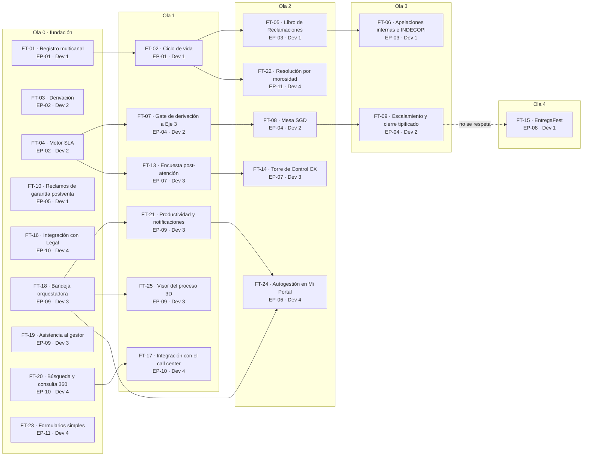

# Análisis de dependencias

Actualizado el mié 21-oct-2026, día 1 de desarrollo, con el plan v1.3 del PO del 16-oct (PLT-01 a
PLT-05). El 22-oct se cambió la DEP-02 (maestro local de RR. HH.) por la DEP-16 (Control de acceso, PJ-05), según el Líder Técnico (DT-03); el resto del análisis no cambia. Sigue los cuatro niveles del SDK Aybar:

- dependencias del producto (roadmap, sección 2);
- dependencias por requerimiento (trazabilidad de cada feature);
- dependencias por feature (DoR);
- dependencias entre tareas (`depende_de`, que ordena `aybar paquete plan`).

Los diagramas están en `dependencias.mmd` y `olas-features.mmd`.

## 1 Resumen

- **14 dependencias** del producto: las 13 del PLT-01 v1.3 §3 (se retiró la DEP-02) y la DEP-16 (propuesta). 9 internas, 3 técnicas, 1 legal y 1 externa. En
  el PLT-01 había 8 pendientes, 2 en curso y 4 por evaluar; la DEP-16 es pendiente.
- **Ninguna tiene fecha comprometida por su responsable.** Solo tienen fecha requerida, y es el dato
  que más pesa en G4 (criterio 6).
- **9 de 14** se necesitan en las tres primeras jornadas de desarrollo (21 al 23-oct): DEP-01, DEP-16 (antes DEP-02),
  DEP-03, DEP-04, DEP-06, DEP-08, DEP-11, DEP-13 y DEP-14. **Hoy, 21-oct, ya se necesitan 4**: DEP-01,
  DEP-16, DEP-08 y DEP-11. El PLT-01 marca en rojo 7 de ellas, las que siguen pendientes: DEP-01, 02,
  03, 08, 11, 13 y 14 (la DEP-02 se retiró; la DEP-16 ocupa su lugar).
- **53 de 62 historias** dependen de al menos una dependencia del producto, según la trazabilidad del
  PLT-03. Las 9 que no dependen de ninguna son HU-020, HU-021, HU-022, HU-037, HU-038, HU-039, HU-059,
  HU-060 y HU-067.
- **50 dependencias entre historias**, sin ciclos, en 11 niveles de orden. De dónde salen:
  - 35 son predecesoras de RF dentro de la misma feature (PLT-03).
  - 8 son predecesoras entre features (PLT-03).
  - 5 son flechas del Gantt del PLT-01 (p. 4).
  - 2 vienen de la PLT-02: EP-04 → EP-08 y la HU-043 que declara la EP-06.
  - Por nivel: el 0 tiene 14, el 1 tiene 13, el 2 tiene 10, el 3 tiene 8, el 4 tiene 4, el 5 tiene 6, el 6 tiene 2 y el 7 tiene 2. Los niveles 8, 9 y 10 tienen 1 cada uno.
- **15 dependencias entre features** (sección 4), en 5 olas y sin ciclos.
- **Ruta crítica por horas** (la cadena más larga de historias): HU-003 → HU-029 → HU-026 → HU-028 →
  HU-020 → HU-022 → HU-023 → HU-025 → HU-037 → HU-038 → HU-039 (36 h). Pasa por EP-04 → EP-08, la
  dependencia que el calendario no respeta (A-03). Sin ella, la ruta crítica es HU-001 → HU-002 →
  HU-004 → HU-006 → HU-012 → HU-013 → HU-015 → HU-016 (34 h).

## 2 Matriz dependencia × épica

● = la dependencia bloquea a la épica (PLT-01). Las columnas son las 11 épicas del plan.

| Dependencia | EP-01 | EP-02 | EP-03 | EP-04 | EP-05 | EP-06 | EP-07 | EP-08 | EP-09 | EP-10 | EP-11 | Fecha requerida |
|---|:-:|:-:|:-:|:-:|:-:|:-:|:-:|:-:|:-:|:-:|:-:|---|
| DEP-01 SIGDA/TAXON | ● |  |  | ● |  | ● |  |  |  | ● |  | 21-oct |
| DEP-16 Control de acceso | ● | ● |  |  |  |  |  |  | ● |  |  | 21-oct |
| DEP-03 Matriz SLA |  | ● |  | ● |  |  |  |  |  |  |  | 22-oct |
| DEP-04 Calendario |  | ● | ● |  |  |  |  |  |  |  |  | 22-oct |
| DEP-05 Validación legal |  |  | ● |  |  |  |  |  |  |  | ● | 26-oct |
| DEP-06 Documental y GLI | ● |  | ● | ● |  |  |  |  |  | ● |  | 23-oct |
| DEP-07 Contratos |  |  |  |  | ● |  |  |  |  |  |  | 29-oct |
| DEP-08 Cobranza |  |  |  | ● |  |  |  |  |  | ● | ● | 21-oct |
| DEP-10 KPI y encuestas |  |  |  |  |  |  | ● |  |  |  |  | 29-oct |
| DEP-11 Call center |  |  |  |  |  |  |  |  |  | ● |  | 21-oct |
| DEP-12 Herramienta de Legal |  |  |  |  |  |  |  |  |  | ● |  | 26-oct |
| DEP-13 Motor de José |  |  |  |  |  |  |  |  |  | ● |  | 23-oct |
| DEP-14 Proveedor de IA |  |  |  |  |  |  |  |  | ● | ● |  | 23-oct |
| DEP-15 Proyectos |  |  |  |  |  |  |  |  |  |  | ● | 29-oct |

La DEP-16 conserva las épicas que bloqueaba la DEP-02. También alimenta el login de Mi Portal (EP-06, DT-04): el PO decide si la suma a su columna.

Las dependencias lógicas entre épicas (el Gantt del PLT-01 y la PLT-02) están en la sección 1 del
roadmap: EP-01 → EP-03, EP-01 → EP-11, EP-02 → EP-04, EP-02 → EP-07, EP-09 → EP-06 y EP-04 → EP-08.

## 3 Dependencias por fecha requerida

| Fecha requerida | Días hábiles desde hoy (21-oct) | Dependencia | Tipo | Responsable | Estado PLT-01 | Historias que bloquea |
|---|---|---|---|---|---|---|
| 21-oct | 0 (hoy) | DEP-01 SIGDA/TAXON | Interna | CDO / Equipo Datos | Pendiente | 13 |
| 21-oct | 0 (hoy) | DEP-16 Control de acceso | Interna | Área de Roles y Permisos (Sony Montoya) | Pendiente (nueva) | 12 |
| 21-oct | 0 (hoy) | DEP-08 Cobranza | Interna | Cobranza | Pendiente | 6 |
| 21-oct | 0 (hoy) | DEP-11 Call center | Externa | TI / proveedor de call center | Por evaluar | 1 |
| 22-oct | 1 | DEP-03 Matriz SLA | Interna | Gerencia ATC · Mesa SGD | Pendiente | 4 |
| 22-oct | 1 | DEP-04 Calendario | Técnica | Equipo Datos | En curso | 4 |
| 23-oct | 2 | DEP-06 Documental y GLI | Técnica | Arquitectura / Legal | En curso | 8 |
| 23-oct | 2 | DEP-13 Motor de José | Interna | José · TI | Por evaluar | 5 |
| 23-oct | 2 | DEP-14 Proveedor de IA | Técnica | TI · Seguridad | Por evaluar | 2 |
| 26-oct | 3 | DEP-05 Validación legal | Legal | Gerencia Legal | Pendiente | 4 |
| 26-oct | 3 | DEP-12 Herramienta de Legal | Interna | Gerencia Legal · TI | Por evaluar | 2 |
| 29-oct | 6 | DEP-07 Contratos | Interna | Equipo Contratos | Pendiente | 4 |
| 29-oct | 6 | DEP-10 KPI y encuestas | Interna | Equipo Datos / BI | Pendiente | 4 |
| 29-oct | 6 | DEP-15 Proyectos | Interna | Gerencia Comercial · Datos | Pendiente | 3 |

«Historias que bloquea» sale de la trazabilidad RF → HU → DEP de cada funcionalidad del PLT-03 v1.3. La DEP-16 hereda las 12 de la DEP-02.
Las que siguen **Por evaluar** (DEP-11, DEP-12, DEP-13 y DEP-14) no tienen ni siquiera una respuesta
de su responsable sobre si pueden entregar. El PLT-01 fija la regla: sin contrato de interfaz y
simulador a la fecha indicada, la historia que bloquean no puede marcarse Lista y se cambia por otra
del mismo desarrollador.

## 4 Olas de features

Una feature depende de otra cuando una de sus historias depende de una historia de la otra. El
PLT-04 no lista predecesoras por historia, así que las dependencias entre historias salen de tres
fuentes:

- las predecesoras de cada RF dentro de su feature (PLT-03);
- las predecesoras de cada feature (PLT-03);
- las dependencias lógicas entre épicas (Gantt del PLT-01, p. 4, y PLT-02).

Una dependencia entre features o entre épicas se lleva a las historias así: la última historia de la
predecesora, por fecha, va antes de la primera de la sucesora. Es el mismo criterio del tablero, que
tiene estas 49 dependencias más la HU-043 → HU-064 de la PLT-02.

La ola 0 son las features sin predecesoras (la «fundación» del plan del SDK). La fuente de cada
vínculo está en la última tabla de esta sección.

| Ola | Feature | Nombre | Épica | Dev | Depende de | Dependencias del producto | Primera fecha requerida | Ventana |
|---|---|---|---|---|---|---|---|---|
| 0 | FT-01 | Registro multicanal y tipificación | EP-01 | Dev 1 | — | DEP-01 | 21-oct | 21-oct a 22-oct |
| 0 | FT-03 | Derivación, reasignación y casillero | EP-02 | Dev 2 | — | DEP-16 | 21-oct | 21-oct a 22-oct |
| 0 | FT-04 | Motor SLA y alertas | EP-02 | Dev 2 | — | DEP-03, DEP-04 | 22-oct | 22-oct a 26-oct |
| 0 | FT-10 | Reclamos de garantía postventa | EP-05 | Dev 1 | — | DEP-07 | 29-oct | 29-oct a 30-oct |
| 0 | FT-16 | Integración con Legal y prevención de denuncias | EP-10 | Dev 4 | — | DEP-12 | 26-oct | 26-oct a 28-oct |
| 0 | FT-18 | Bandeja orquestadora y flujos por área | EP-09 | Dev 3 | — | DEP-16 | 21-oct | 21-oct a 23-oct |
| 0 | FT-19 | Asistencia al gestor: guía e IA | EP-09 | Dev 3 | — | DEP-14 | 23-oct | 27-oct a 28-oct |
| 0 | FT-20 | Búsqueda y consulta 360 del cliente | EP-10 | Dev 4 | — | DEP-01, DEP-13 | 21-oct | 21-oct a 26-oct |
| 0 | FT-23 | Formularios simples: ingreso al proyecto y Entrega Fest | EP-11 | Dev 4 | — | — | — | 29-oct a 30-oct |
| 1 | FT-02 | Ciclo de vida, interacciones e hitos | EP-01 | Dev 1 | FT-01 | DEP-16 | 21-oct | 22-oct a 26-oct |
| 1 | FT-07 | Gate de derivación a Eje 3 y handoff | EP-04 | Dev 2 | FT-04 | DEP-01, DEP-08 | 21-oct | 27-oct a 28-oct |
| 1 | FT-13 | Encuesta post-atención | EP-07 | Dev 3 | FT-04 | DEP-10 | 29-oct | 29-oct a 29-oct |
| 1 | FT-17 | Integración con la plataforma del call center | EP-10 | Dev 4 | FT-20 | DEP-11 | 21-oct | 26-oct a 26-oct |
| 1 | FT-21 | Productividad y notificaciones del gestor | EP-09 | Dev 3 | FT-18 | DEP-16 | 21-oct | 28-oct a 29-oct |
| 1 | FT-25 | Visor del proceso 3D (operación en vivo) | EP-09 | Dev 3 | FT-18 | — | — | 23-oct a 27-oct |
| 2 | FT-05 | Libro de Reclamaciones | EP-03 | Dev 1 | FT-02 | DEP-05, DEP-06 | 23-oct | 26-oct a 28-oct |
| 2 | FT-08 | Mesa SGD: recepción, activación y riesgo | EP-04 | Dev 2 | FT-07 | — | — | 28-oct a 29-oct |
| 2 | FT-14 | Torre de Control CX | EP-07 | Dev 3 | FT-13 | DEP-10 | 29-oct | 29-oct a 2-nov |
| 2 | FT-22 | Resolución de contrato por morosidad | EP-11 | Dev 4 | FT-02 | DEP-08, DEP-15 | 21-oct | 28-oct a 29-oct |
| 2 | FT-24 | Autogestión de tickets del cliente en Mi Portal | EP-06 | Dev 4 | FT-21, FT-18 | DEP-01 | 21-oct | 30-oct a 2-nov |
| 3 | FT-06 | Apelaciones internas e INDECOPI | EP-03 | Dev 1 | FT-05 | DEP-06 | 23-oct | 28-oct a 29-oct |
| 3 | FT-09 | Escalamiento, vinculación y cierre tipificado | EP-04 | Dev 2 | FT-08 | DEP-06 | 23-oct | 29-oct a 2-nov |
| 4 | FT-15 | EntregaFest: contención en vivo | EP-08 | Dev 1 | FT-09 | — | — | 30-oct a 2-nov |

Vínculos entre features y de dónde salen:

| De | A | Fuente | Historias |
|---|---|---|---|
| FT-01 | FT-02 | Predecesora de la feature (PLT-03) | HU-002 → HU-004 |
| FT-02 | FT-05 | Gantt del PLT-01: EP-01 → EP-03 | HU-006 → HU-012 |
| FT-05 | FT-06 | Predecesora de la feature (PLT-03) | HU-015 → HU-016 |
| FT-04 | FT-07 | Gantt del PLT-01: EP-02 → EP-04 | HU-029 → HU-026 |
| FT-07 | FT-08 | Predecesora de la feature (PLT-03) | HU-028 → HU-020 |
| FT-08 | FT-09 | Predecesora de la feature (PLT-03) | HU-022 → HU-023 |
| FT-04 | FT-13 | Gantt del PLT-01: EP-02 → EP-07 | HU-029 → HU-019 |
| FT-13 | FT-14 | Predecesora de la feature (PLT-03) | HU-019 → HU-030 |
| FT-09 | FT-15 | PLT-02, EP-08: «EP-ATC-04 (gate legal)». **No se respeta** (A-03) | HU-025 → HU-037 |
| FT-20 | FT-17 | Predecesora de la feature (PLT-03) | HU-053 → HU-042 |
| FT-18 | FT-21 | Predecesora de la feature (PLT-03) | HU-046 → HU-054 |
| FT-02 | FT-22 | Gantt del PLT-01: EP-01 → EP-11 | HU-006 → HU-056 |
| FT-18 | FT-25 | Predecesora de la feature (PLT-03); el PLT-03 cita además «eventos de la bandeja orquestadora (HU-043, 044)» | HU-046 → HU-067 |
| FT-21 | FT-24 | Gantt del PLT-01: **EP-09 → EP-06** (jue 29 → vie 30-oct) | HU-055 → HU-064 |
| FT-18 | FT-24 | PLT-02, EP-06: «HU-043 flujos por tipo y subtipo» | HU-043 → HU-064 |

## 5 Hallazgos

| # | Hallazgo | Severidad | Dueño |
|---|---|---|---|
| A-01 | **Ninguna dependencia tiene fecha comprometida** (0 de 14); solo fecha requerida. Con el marco del SDK, lo que bloquean queda en NO READY (G4, criterio 6). Hoy ya se necesitan cuatro: DEP-01, 16 (antes 02), 08 y 11 | Bloquea G4 | Responsable de cada DEP |
| A-02 | 4 dependencias siguen «Por evaluar»: DEP-11, DEP-12, DEP-13 y DEP-14. Tres se necesitan en las tres primeras jornadas, y DEP-11 hoy. Todas bloquean la épica EP-10 | Alto (R-02) | TL |
| A-03 | La dependencia EP-04 → EP-08 de la PLT-02 **no se respeta en las fechas**: EP-08 (Entrega Fest) empieza el 30-oct y EP-04 termina el 2-nov. Es la que alarga la ruta crítica a 36 h | Corregir | PO |
| A-04 | De las 50 dependencias entre historias, 1 tiene la predecesora terminando **después** de que empieza la dependiente: HU-025 → HU-037, que es la causa de A-03. En otras 28 la predecesora termina el mismo día en que empieza la dependiente, así que no hay holgura y cualquier retraso las rompe | Corregir | PO / TL |
| A-05 | En Nexora hay `backlog/tareas/*.json` (10 archivos, publicados el 21-oct), pero son de la línea v1.2 y no cuadran con el plan v1.3. Por eso las dependencias entre tareas no sirven todavía para ordenar el trabajo. Sin tareas v1.3, `aybar paquete plan` deja las 23 features en la ola 0, y la tabla de la sección 4 es una aproximación. Detalle del desfase en la lista de abajo | Bloquea el plan | Daniel regenera desde la v1.3; cada dueño de épica revisa la suya y rellena `revisado_por` |
| A-06 | Los responsables son áreas, no personas (por ejemplo «Equipo Datos» o «TI»). Para comprometer una fecha hace falta un nombre | Corregir | PO |
| A-07 | **Dependencia nueva que no está en el PLT-01:** la DEP-16 (Control de acceso, P-026), que reemplaza a la DEP-02: el emisor de tokens, el login de internos y de Mi Portal y los roles son de Control de acceso (DT-03, DT-04, DT-05; ADR-009, ADR-011 y ADR-014). Ya no hacen falta el canal ni el proveedor de envío del código de Mi Portal. El proveedor de IA ya figura como DEP-14. Hay que confirmar la fecha de la DEP-16 con su responsable | Informativa | TL |
| A-08 | La numeración del PLT-01 salta la DEP-09, que no es de la Etapa 1. En la Etapa 1, la identidad, los roles y los líderes salen de Control de acceso (DEP-16, ADR-009 v0.3); el plan del PO tenía el maestro local (DEP-02, ADR-09) | Informativa | — |
| A-09 | La versión anterior no tenía la dependencia lógica **EP-09 → EP-06** del Gantt del PLT-01 (p. 4), ni la HU-043 que la PLT-02 pone como dependencia de EP-06. Con ellas, FT-24 pasa de la ola 0 a la ola 2. El calendario las respeta: EP-09 termina el jue 29-oct, EP-06 empieza el vie 30-oct y HU-043 termina el 22-oct | Informativa (corregido en esta versión) | PO confirma |

Detalle de A-05, en qué no cuadra el backlog de tareas con la v1.3:

- Falta EP-ATC-06 (HU-064 a 066) y falta HU-067.
- Trae 3 historias que no son de la Etapa 1.
- Asigna EP-08 a Dev 3; en la v1.3 es de Dev 1.
- Suma 390 h de tareas frente a las 243 h del plan.
- 6 dependencias entre tareas van contra el calendario del PO:
  - HU-043 y HU-050 dependen de HU-004.
  - HU-044 depende de HU-010.
  - HU-040 depende de HU-027.
  - HU-054 depende de HU-030 y de HU-019.

## 6 Cómo se pasa esto al paquete del SDK

| Dónde | Qué se escribe | Estado (21-oct) |
|---|---|---|
| Roadmap, sección 2 (`docs/roadmap/RMP-001-roadmap-aybar-atiende.md`) | Las 14 dependencias con la forma de la plantilla y las 6 dependencias lógicas entre épicas | Hecho (borrador v0.2) |
| Cada feature, sección 5 (trazabilidad RF → HU → DEP → riesgo) | Una fila por requerimiento con su `DEP-NN` | Hecho: las 23 features v1.3 lo traen (en Nexora, pendientes de aprobación) |
| DoR por feature, sección 2 | Cada `DEP-NN` con **fecha comprometida**, y el diagrama (`dependencias.mmd`) | Falta la fecha comprometida. Los 23 DoR v1.3 dicen «con condiciones» |
| `docs/backlog/tareas/<ÉPICA>.json` | Tareas por historia con `depende_de` (entre tareas), horas y capa | En Nexora, pero de la línea v1.2 (A-05): hay que regenerarlas desde la v1.3 |
| `docs/gates/AYB-0001/G2.md` | Diseño UX/UI de las pantallas: las 62 historias tienen `ui: true` | No existe en Nexora: `aybar paquete validar` avisa `ui-sin-g2` en las 23 features |

Comandos: `aybar paquete validar docs` (reglas `tarea-dependencia-inexistente`, `tareas-ciclo` y
`ui-sin-g2`) y `aybar paquete plan docs --json` (olas, listas para construir y ciclos). El paquete v1.3
con este análisis y este roadmap valida con 0 errores. El agente `analista-paquete` informa las
contradicciones y `orquestador-feature` arma las olas; deciden el PO y el TL.

| Versión | Fecha | Autor | Cambio |
|---|---|---|---|
| 0.1 | 2026-10-19 | Jesús (Dev 2), con IA | Versión inicial con el plan v1.3 (v1 en Nexora) |
| 0.2 | 2026-10-21 | Brayan (Dev 1), con IA | Añade EP-09 → EP-06 (Gantt) y HU-043 → HU-064 (PLT-02): FT-24 pasa a la ola 2 y hay 15 vínculos entre features y 50 entre historias. Recalcula los niveles, la ruta crítica (36 h por EP-04 → EP-08; 34 h sin ella) y la holgura (28 sin holgura). Pasa los días hábiles a hoy, 21-oct. A-05 describe ahora el backlog v1.2 de Nexora y se añade A-09 |
| 0.3 | 2026-10-22 | Jesús Chávez Elías, con IA | DEP-02 pasa a DEP-16 (Control de acceso) en el resumen, la matriz, las fechas, las olas y los hallazgos A-01, A-07 y A-08 |

Generado por IA: borrador completo. Versión base de Nexora (v1, de Jesús, 19-oct), actualizada a la v1.3 del PO (Etapa 1) por Brayan con IA (Claude, 21-oct-2026). Texto adaptado al alcance de la Etapa 1 (se omiten las frases de los documentos del PO que remiten a fases posteriores). — Revisado por: (pendiente)

Actualizado el 22-oct-2026 por Jesús Chávez Elías con IA (Claude) a partir de la revisión del Líder Técnico (DT-03, DT-04 y DT-07 de `analisis/decisiones.md` v0.3). — Revisado por: (pendiente)
